# ColonyResource.cs

[返回总索引](../README.md) · `Runtime` · `Assets/DarwinPark/Entities/Ecology/ColonyResource.cs`

[源文件](../../../Assets/DarwinPark/Entities/Ecology/ColonyResource.cs) · 源码校验：`84bdff88e9deba3961aad153f58d1cf7e80c92cc435f419ecc8ec75f96cffff8`

方法按源文件位置排列。事件/回调引用不表示立即执行；分支与异常说明见总索引。完整源码与可点击关系图请打开离线手册。

## State.get · L24

`get`

### Editor / Player · 语法控制结构 / 声明（非CFG）

## State.set · L24

`private set`

### Editor / Player · 语法控制结构 / 声明（非CFG）

## HasLiveClaim.get · L26

`public bool HasLiveClaim`

★ 适配：食腐只读领取状态；资源归属与独占状态共用同一判断。

### Editor / Player · 语法控制结构 / 声明（非CFG）

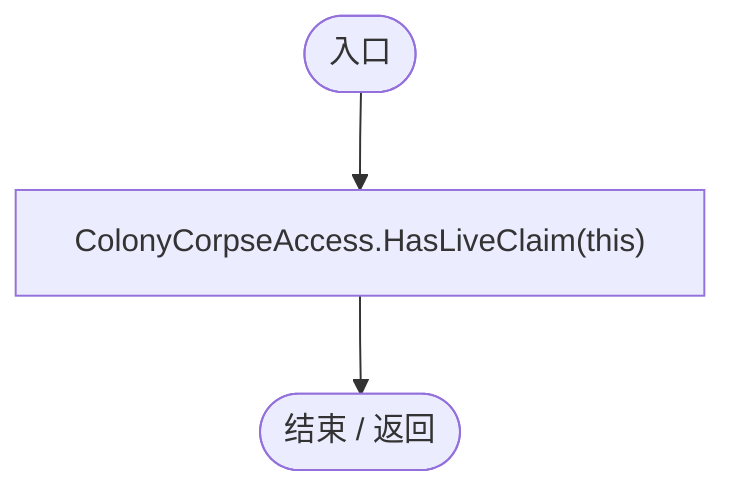

项目内调用/回调引用：

- [ColonyCorpseAccess.HasLiveClaim · L8](f6ef68cc68f39eea.md#me2731e09d1347ff7)（方法）

## All.get · L27

`public static IEnumerable<ColonyResource> All`

### Editor / Player · 语法控制结构 / 声明（非CFG）

项目内调用/回调引用：

- [ColonyResource.回调@27 · L27](293dbaecfff4b585.md#mae7c1d09b08138d1)（回调/委托）

## 回调@27 · L27

`r … => 回调`

### Editor / Player · 语法控制结构 / 声明（非CFG）

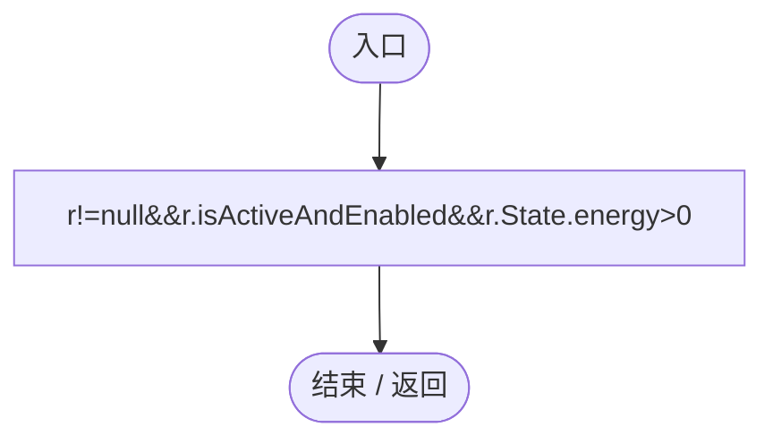

项目内调用/回调引用：

- [ColonyResource.State.get · L24](293dbaecfff4b585.md#m41824f1a0e160aa5)（访问器）

## Find · L28

`public static ColonyResource Find(string id)`

### Editor / Player · Roslyn编译器控制流

项目内调用/回调引用：

- [ColonyResource.State.get · L24](293dbaecfff4b585.md#m41824f1a0e160aa5)（访问器）

## OnEnable · L30

`private void OnEnable()`

★ 适配：出生、读档和启停同步维护能量块索引，资源尚未绑定State时由Create补登记。

### Editor / Player · Roslyn编译器控制流

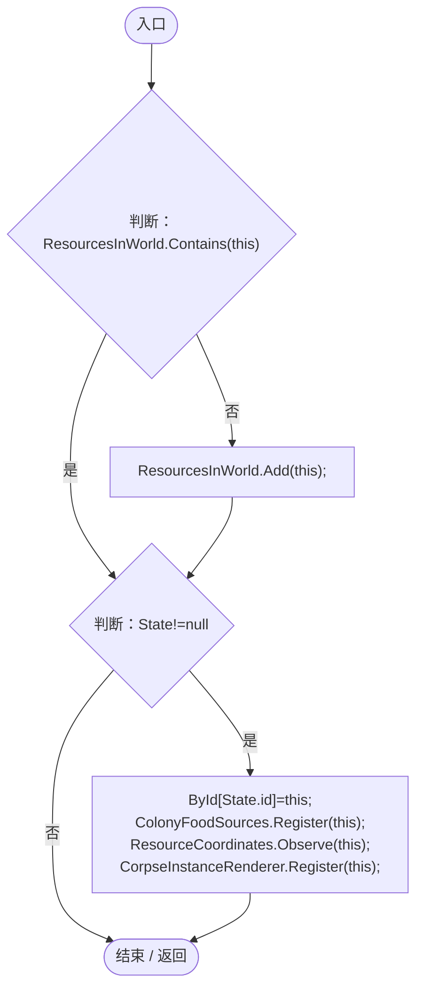

项目内调用/回调引用：

- [ColonyResource.State.get · L24](293dbaecfff4b585.md#m41824f1a0e160aa5)（访问器）
- [ColonyFoodSources.Register · L15](4c419a1a067d428c.md#mf32bc84088ad1316)（方法）
- [ResourceCoordinates.Observe · L55](93d731ac01e3af48.md#m78e074204b8da0a9)（方法）
- [CorpseInstanceRenderer.Register · L52](29964f1f6c300ac9.md#m04d922e92b0f3129)（方法）

## OnDisable · L31

`private void OnDisable()`

### Editor / Player · Roslyn编译器控制流

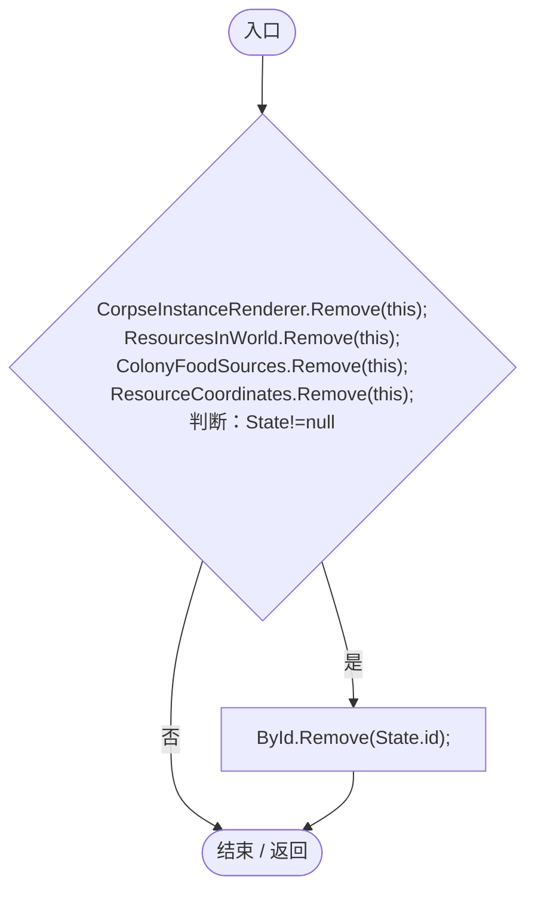

项目内调用/回调引用：

- [CorpseInstanceRenderer.Remove · L88](29964f1f6c300ac9.md#m422070be924a293f)（方法）
- [ColonyFoodSources.Remove · L17](4c419a1a067d428c.md#m650b2a625df8b634)（方法）
- [ResourceCoordinates.Remove · L61](93d731ac01e3af48.md#mf37d0cac8b27b09b)（方法）
- [ColonyResource.State.get · L24](293dbaecfff4b585.md#m41824f1a0e160aa5)（访问器）

## Reset · L32

`[RuntimeInitializeOnLoadMethod(RuntimeInitializeLoadType.SubsystemRegistration)] private static void Reset()`

### Editor / Player · Roslyn编译器控制流

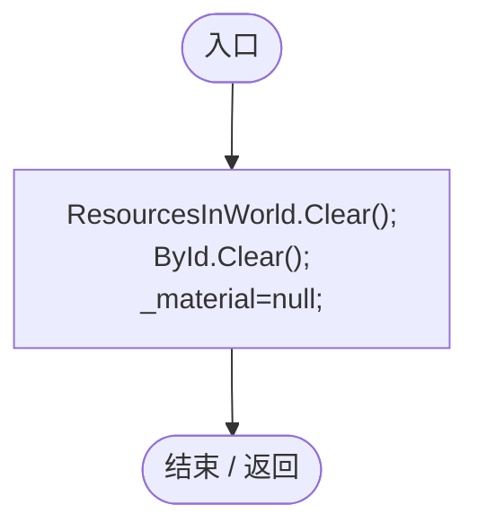

## Biomass · L33

`public static float Biomass(DarwinEntity entity)`

### Editor / Player · Roslyn编译器控制流

项目内调用/回调引用：

- [AntColonySettings.Current.get · L31](cb0a937e97c8fbb3.md#mcd121159f407ccdf)（访问器）
- [EntityStats.TryGet · L93](75aa86a368efdf24.md#m03cef847022eee28)（方法）

## LeaveCorpse · L38

`public static ColonyResource LeaveCorpse(DarwinEntity victim,string group)`

### Editor / Player · Roslyn编译器控制流

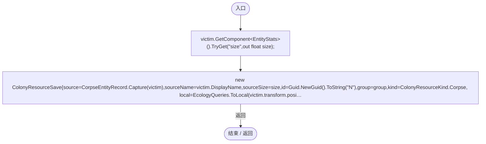

项目内调用/回调引用：

- [EntityStats.TryGet · L93](75aa86a368efdf24.md#m03cef847022eee28)（方法）
- [ColonyResource.Create · L45](293dbaecfff4b585.md#m6768b4f531fe91dd)（方法）
- [CorpseEntityRecord.Capture · L15](8a2345f1e54b1c75.md#m3785191a48d5dc8d)（方法）
- [EcologyQueries.ToLocal · L40](bdf7ccc2c9c0452f.md#mfa1ace432c73012a)（方法）
- [ColonyResource.Biomass · L33](293dbaecfff4b585.md#mac6f0b77996f44ab)（方法）

## Create · L45

`public static ColonyResource Create(ColonyResourceSave data)`

### Editor / Player · Roslyn编译器控制流

```mermaid
flowchart TD
  b0(["入口"])
  b1["data.source=CorpseEntityRecord.Normalize(data.source);"]
  b2{"判断：data.kind==ColonyResourceKind.Corpse"}
  b3["PrimitiveType.Sphere"]
  b4["PrimitiveType.Cube"]
  b5["obj=GameObject.CreatePrimitive(data.kind==ColonyResourceKind.Corpse?PrimitiveType.Sphere:PrimitiveType.Cube)"]
  b6{"obj.name<br/>判断：data.kind==ColonyResourceKind.Corpse"}
  b7["&quot;可搬运尸体&quot;"]
  b8{"判断：data.kind==ColonyResourceKind.Energy"}
  b9["&quot;能量块&quot;"]
  b10["&quot;种群能量块&quot;"]
  b11["obj.name=data.kind==ColonyResourceKind.Corpse?&quot;可搬运尸体&quot;:data.kind==ColonyResourceKind.Energy?&quot;能量块&quot;:&quot;种群能量块&quot;;"]
  b12{"collider=obj.GetComponent&lt;Collider&gt;()<br/>collider.enabled=false;<br/>Destroy(collider);<br/>判断：EcologyQueries.Planet!=null"}
  b13["obj.transform.SetParent(EcologyQueries.Planet.transform,false);"]
  b14["obj.transform.position=EcologyQueries.ToWorld(data.local);"]
  b15{"obj.transform.localScale<br/>判断：data.kind==ColonyResourceKind.Corpse"}
  b16["data.scale"]
  b17["Vector3.one*AntColonySettings.Current.energyBlockSize"]
  b18["obj.transform.localScale=data.kind==ColonyResourceKind.Corpse?data.scale:Vector3.one*AntColonySettings.Current.energyBlockSize;"]
  b19{"判断：_material==null"}
  b20{"Shader.Find(&quot;Universal Render Pipeline/Lit&quot;)<br/>判断：Shader.Find(&quot;Universal Render Pipeline/Lit&quot;)"}
  b21["Shader.Find(&quot;Universal Render Pipeline/Lit&quot;)"]
  b22["Shader.Find(&quot;Standard&quot;)"]
  b23["shader=Shader.Find(&quot;Universal Render Pipeline/Lit&quot;)??Shader.Find(&quot;Standard&quot;)"]
  b24{"判断：shader==null"}
  b25["结果：new InvalidOperationException(&quot;能量块缺少可用材质 Shader&quot;)"]
  x25(["抛出异常 / 离开方法"])
  b26["_material<br/>new Material(shader){name=&quot;Colony Resource&quot;,enableInstancing=DarwinPark.Core.SimulationOptimization.Current.resourceInstancing}<br/>name=&quot;Colony Resource&quot;<br/>enableInstancing=DarwinPark.Core.SimulationOptimization.Current.resourceInst…"]
  b27["_material.EnableKeyword(&quot;_EMISSION&quot;);"]
  b28["renderer=obj.GetComponent&lt;Renderer&gt;()<br/>renderer.sharedMaterial=_material;<br/>block=new MaterialPropertyBlock()<br/>ColorUtility.TryParseHtmlString(AntColonySettings.Current.energyColor,out var energy);"]
  b29{"判断：data.kind==ColonyResourceKind.Corpse"}
  b30["new Color(.28f,.25f,.2f)"]
  b31["energy"]
  b32["color=data.kind==ColonyResourceKind.Corpse?new Color(.28f,.25f,.2f):energy"]
  b33["block.SetColor(&quot;_BaseColor&quot;,color);<br/>block.SetColor(&quot;_Color&quot;,color);"]
  b34{"block<br/>&quot;_EmissionColor&quot;<br/>判断：data.kind==ColonyResourceKind.Corpse"}
  b35["Color.black"]
  b36["energy*AntColonySettings.Current.glowIntensity"]
  b37["block.SetColor(&quot;_EmissionColor&quot;,data.kind==ColonyResourceKind.Corpse?Color.black:energy*AntColonySettings.Current.glowIntensity);"]
  b38{"renderer.SetPropertyBlock(block);<br/>判断：data.kind!=ColonyResourceKind.Corpse"}
  b39["light=obj.AddComponent&lt;Light&gt;()<br/>light.type=LightType.Point;<br/>light.color=energy;<br/>light.intensity=AntColonySettings.Current.glowIntensity;<br/>light.range=AntColonySettings.Current.glowRange;<br/>light.shadows=LightShadows.None;"]
  b40{"resource=obj.AddComponent&lt;ColonyResource&gt;()<br/>resource.State=data;<br/>ById[data.id]=resource;<br/>ColonyFoodSources.Register(resource);<br/>ResourceCoordinates.Observe(resource);<br/>判断：data.kind==ColonyResourceKind.Corpse"}
  b41["resource._presentation=obj.AddComponent&lt;ColonyResourcePresentation&gt;();<br/>resource._presentation.Build();<br/>CorpseInstanceRenderer.Register(resource);"]
  b42["obj.AddComponent&lt;EnergyBlockGradeVisual&gt;().Refresh();"]
  b43["结果：resource"]
  b44(["结束 / 返回"])
  b0 --> b1
  b1 --> b2
  b2 -->|"是"| b3
  b2 -->|"否"| b4
  b3 --> b5
  b4 --> b5
  b5 --> b6
  b6 -->|"是"| b7
  b6 -->|"否"| b8
  b7 --> b11
  b8 -->|"是"| b9
  b8 -->|"否"| b10
  b9 --> b11
  b10 --> b11
  b11 --> b12
  b12 -->|"是"| b13
  b12 -->|"否"| b14
  b13 --> b14
  b14 --> b15
  b15 -->|"是"| b16
  b15 -->|"否"| b17
  b16 --> b18
  b17 --> b18
  b18 --> b19
  b19 -->|"是"| b20
  b19 -->|"否"| b28
  b20 -->|"否"| b21
  b20 -->|"是"| b22
  b21 --> b23
  b22 --> b23
  b23 --> b24
  b24 -->|"是"| b25
  b24 -->|"否"| b26
  b25 -->|"Throw"| x25
  b26 --> b27
  b27 --> b28
  b28 --> b29
  b29 -->|"是"| b30
  b29 -->|"否"| b31
  b30 --> b32
  b31 --> b32
  b32 --> b33
  b33 --> b34
  b34 -->|"是"| b35
  b34 -->|"否"| b36
  b35 --> b37
  b36 --> b37
  b37 --> b38
  b38 -->|"是"| b39
  b38 -->|"否"| b40
  b39 --> b40
  b40 -->|"是"| b41
  b40 -->|"否"| b42
  b41 --> b43
  b42 --> b43
  b43 -->|"返回"| b44

```

项目内调用/回调引用：

- [CorpseEntityRecord.Normalize · L23](8a2345f1e54b1c75.md#m649806250b80642a)（方法）
- [EcologyQueries.ToWorld · L41](bdf7ccc2c9c0452f.md#mc67423f4877c3534)（方法）
- [AntColonySettings.Current.get · L31](cb0a937e97c8fbb3.md#mcd121159f407ccdf)（访问器）
- [SimulationOptimization.Current.get · L30](11c9091e70893352.md#mcfa8eb2e650e57b1)（访问器）
- [ColonyResource.State.set · L24](293dbaecfff4b585.md#m07fea10388841ca3)（访问器）
- [ColonyFoodSources.Register · L15](4c419a1a067d428c.md#mf32bc84088ad1316)（方法）
- [ResourceCoordinates.Observe · L55](93d731ac01e3af48.md#m78e074204b8da0a9)（方法）
- [ColonyResourcePresentation.Build · L22](274e66c9a1d98a08.md#madeb13553cf40472)（方法）
- [CorpseInstanceRenderer.Register · L52](29964f1f6c300ac9.md#m04d922e92b0f3129)（方法）
- [EnergyBlockGradeVisual.Refresh · L15](dd689a3df9b53e75.md#m8d946724e45820f9)（方法）

## Claim · L73

`public bool Claim(AntColonyMember worker)`

### Editor / Player · Roslyn编译器控制流

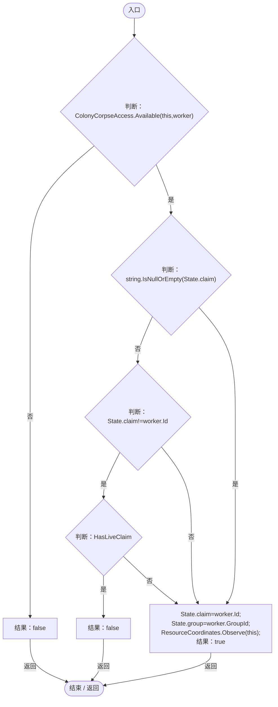

项目内调用/回调引用：

- [ColonyCorpseAccess.Available · L6](f6ef68cc68f39eea.md#m8ffa84bc06beaed6)（方法）
- [ColonyResource.State.get · L24](293dbaecfff4b585.md#m41824f1a0e160aa5)（访问器）
- [ResourceCoordinates.Observe · L55](93d731ac01e3af48.md#m78e074204b8da0a9)（方法）

## Release · L84

`public void Release(string owner)`

### Editor / Player · Roslyn编译器控制流

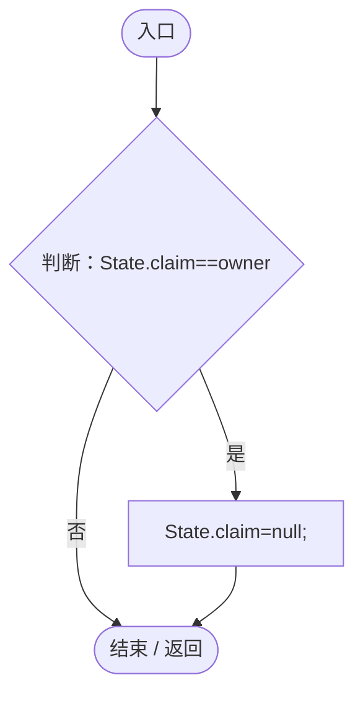

项目内调用/回调引用：

- [ColonyResource.State.get · L24](293dbaecfff4b585.md#m41824f1a0e160aa5)（访问器）

## CarryTo · L85

`public void CarryTo(Vector3 point)`

### Editor / Player · Roslyn编译器控制流

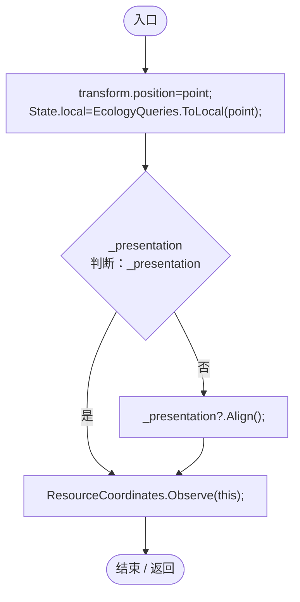

项目内调用/回调引用：

- [ColonyResource.State.get · L24](293dbaecfff4b585.md#m41824f1a0e160aa5)（访问器）
- [EcologyQueries.ToLocal · L40](bdf7ccc2c9c0452f.md#mfa1ace432c73012a)（方法）
- [ColonyResourcePresentation.Align · L40](274e66c9a1d98a08.md#mcccba155ee793429)（方法）
- [ResourceCoordinates.Observe · L55](93d731ac01e3af48.md#m78e074204b8da0a9)（方法）

## Convert · L86

`public static ColonyResource Convert(string group,Vector3 point,float energy,bool nursery)`

### Editor / Player · Roslyn编译器控制流

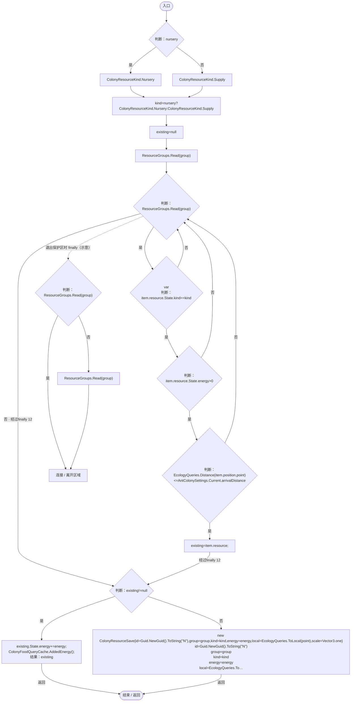

项目内调用/回调引用：

- [ResourceGroups.Read · L9](97a3c8522367343a.md#m155d5ab724041bf7)（方法）
- [ColonyResource.State.get · L24](293dbaecfff4b585.md#m41824f1a0e160aa5)（访问器）
- [EcologyQueries.Distance · L43](bdf7ccc2c9c0452f.md#m6e395dce655ebcac)（方法）
- [AntColonySettings.Current.get · L31](cb0a937e97c8fbb3.md#mcd121159f407ccdf)（访问器）
- [ColonyFoodQueryCache.AddedEnergy · L17](63cd90165719dbff.md#mbf6c1d71527a0c92)（方法）
- [ColonyResource.Create · L45](293dbaecfff4b585.md#m6768b4f531fe91dd)（方法）
- [EcologyQueries.ToLocal · L40](bdf7ccc2c9c0452f.md#mfa1ace432c73012a)（方法）

## Feed · L94

`public static void Feed(AntColonyMember member,float dt)`

### Editor / Player · Roslyn编译器控制流

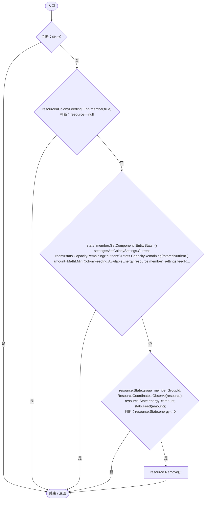

项目内调用/回调引用：

- [ColonyFeeding.Find · L11](2cb56c08d08ff8ec.md#mfea041f7d0713775)（方法）
- [AntColonySettings.Current.get · L31](cb0a937e97c8fbb3.md#mcd121159f407ccdf)（访问器）
- [EntityStats.CapacityRemaining · L95](75aa86a368efdf24.md#mf5014bafb4b29341)（方法）
- [ColonyFeeding.AvailableEnergy · L29](2cb56c08d08ff8ec.md#m39bf48fc3c592882)（方法）
- [GameplayTuning.Current.get · L46](db546e5713b32d53.md#m4fa691bd8a3b9618)（访问器）
- [ColonyResource.State.get · L24](293dbaecfff4b585.md#m41824f1a0e160aa5)（访问器）
- [ResourceCoordinates.Observe · L55](93d731ac01e3af48.md#m78e074204b8da0a9)（方法）
- [EntityStats.Feed · L98](75aa86a368efdf24.md#me8ee3fa22434267a)（方法）
- [ColonyResource.Remove · L108](293dbaecfff4b585.md#m42fd78441247c433)（方法）

## Remove · L108

`public void Remove()`

### Editor / Player · Roslyn编译器控制流

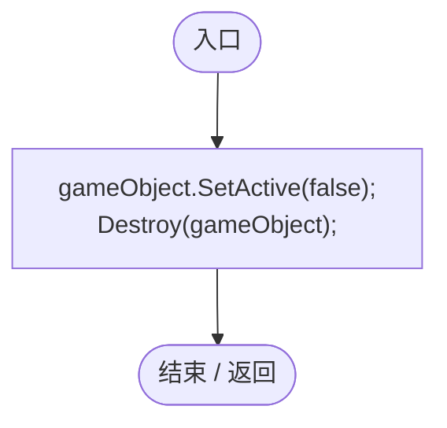

## ClearWorld · L109

`public static void ClearWorld()`

### Editor / Player · Roslyn编译器控制流

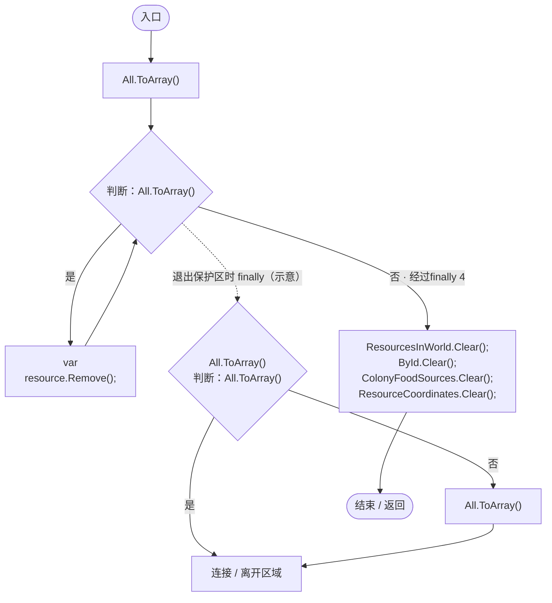

项目内调用/回调引用：

- [ColonyResource.Remove · L108](293dbaecfff4b585.md#m42fd78441247c433)（方法）
- [ColonyFoodSources.Clear · L18](4c419a1a067d428c.md#m1ded72e671d91ff7)（方法）
- [ResourceCoordinates.Clear · L92](93d731ac01e3af48.md#m1b44d83a47482abb)（方法）

## Capture · L110

`public ColonyResourceSave Capture()`

### Editor / Player · Roslyn编译器控制流

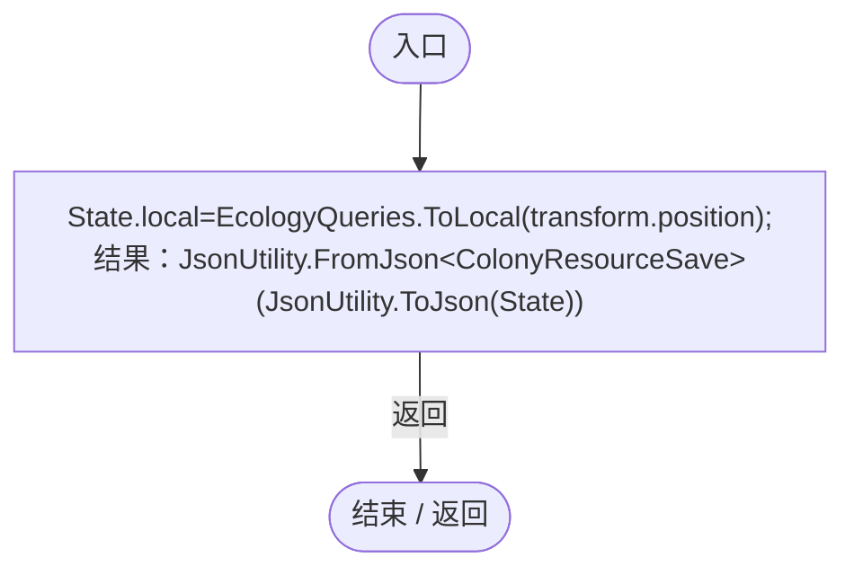

项目内调用/回调引用：

- [ColonyResource.State.get · L24](293dbaecfff4b585.md#m41824f1a0e160aa5)（访问器）
- [EcologyQueries.ToLocal · L40](bdf7ccc2c9c0452f.md#mfa1ace432c73012a)（方法）
