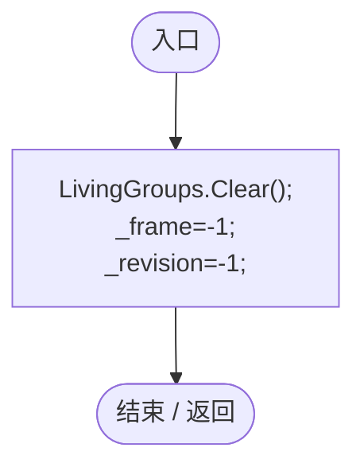
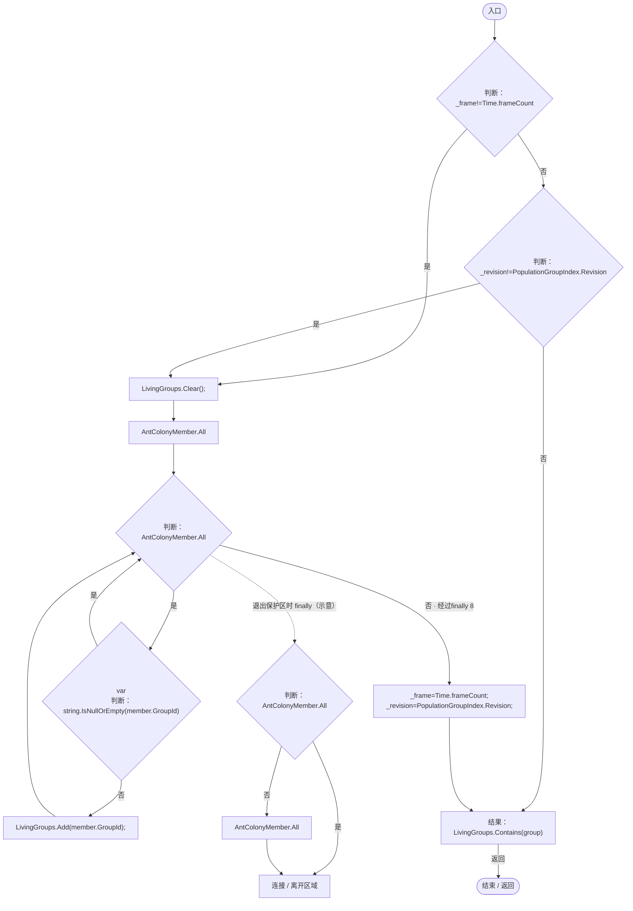
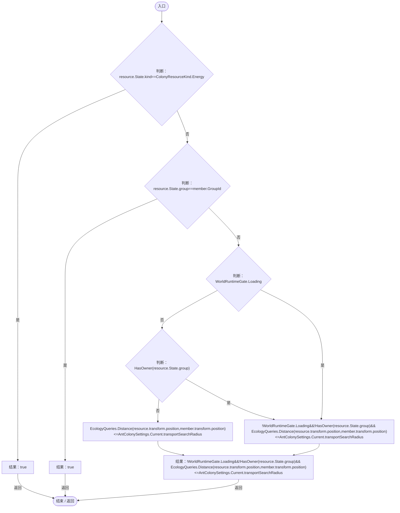

# ColonyResourceOwnership.cs

[返回总索引](../README.md) · `Runtime` · `Assets/DarwinPark/Entities/Ecology/ColonyResourceOwnership.cs`

[源文件](../../../Assets/DarwinPark/Entities/Ecology/ColonyResourceOwnership.cs) · 源码校验：`ad232595600b7ff9285df454450233441c35398893536ddd9f9d62650cb5a967`

方法按源文件位置排列。事件/回调引用不表示立即执行；分支与异常说明见总索引。完整源码与可点击关系图请打开离线手册。

## Reset · L12

`[RuntimeInitializeOnLoadMethod(RuntimeInitializeLoadType.SubsystemRegistration)] private static void Reset()`

### Editor / Player · Roslyn编译器控制流

## HasOwner · L14

`public static bool HasOwner(string group)`

### Editor / Player · Roslyn编译器控制流

项目内调用/回调引用：

- [PopulationGroupIndex.Revision.get · L19](6bb343d8be5beae5.md#m42c682636166d39b)（访问器）

## Available · L23

`public static bool Available(ColonyResource resource,AntColonyMember member)`

### Editor / Player · Roslyn编译器控制流

项目内调用/回调引用：

- [ColonyResource.State.get · L22](293dbaecfff4b585.md#m341a1355f4d657bf)（访问器）
- [ColonyResourceOwnership.HasOwner · L14](2988679fde59fc87.md#mc9fb9c75e5ef3aa5)（方法）
- [EcologyQueries.Distance · L42](bdf7ccc2c9c0452f.md#mba9c3e3c95d0f2dd)（方法）
- [AntColonySettings.Current.get · L31](cb0a937e97c8fbb3.md#mcd121159f407ccdf)（访问器）
