# CorpseInstanceRenderer.cs

[返回总索引](../README.md) · `Runtime` · `Assets/DarwinPark/Entities/Ecology/CorpseInstanceRenderer.cs`

[源文件](../../../Assets/DarwinPark/Entities/Ecology/CorpseInstanceRenderer.cs) · 源码校验：`37a38d370cfec1418f44154b46c2a5589992227625720370c69829c81d7f19ba`

方法按源文件位置排列。事件/回调引用不表示立即执行；分支与异常说明见总索引。完整源码与可点击关系图请打开离线手册。

<a id="m60f2a3cafb05d2d6"></a>

## Store · L25

`private void Store(Part part,int limit)`


### Editor / Player · Roslyn编译器控制流

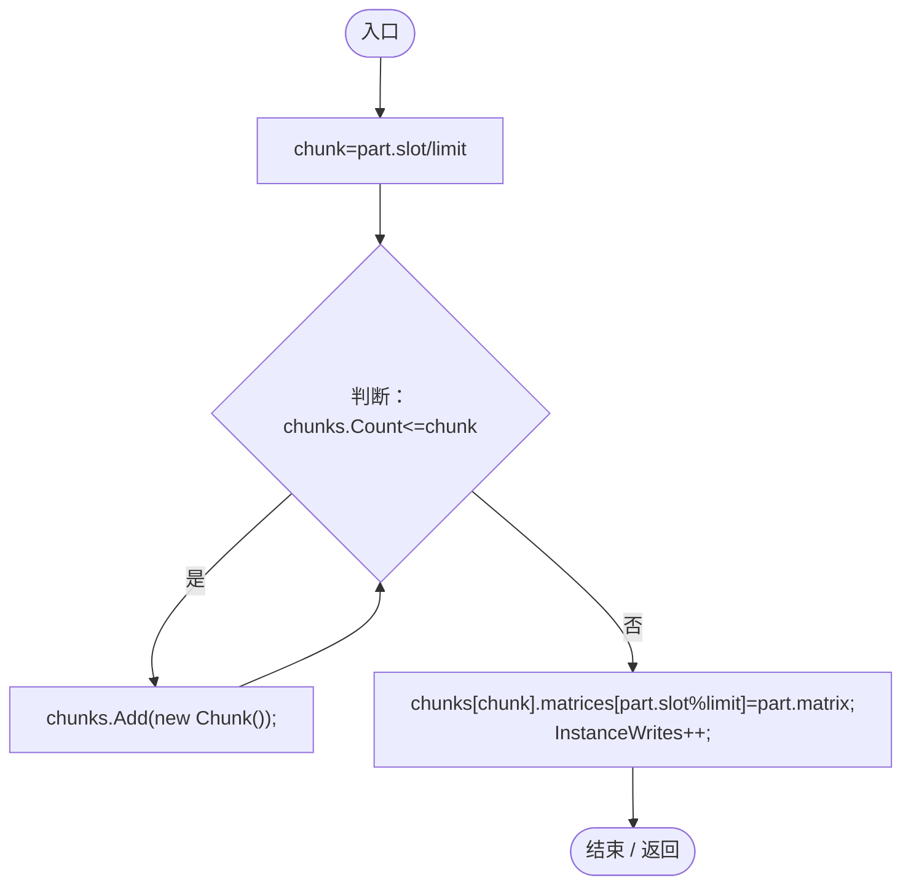

项目内调用/回调引用：

- [CorpseInstanceRenderer.InstanceWrites.set · L47](29964f1f6c300ac9.md#m96e035b640723879)（访问器）
- [CorpseInstanceRenderer.InstanceWrites.get · L47](29964f1f6c300ac9.md#m9330ca4e2a209288)（访问器）

<a id="m7e532315ca923b1b"></a>

## Attach · L27

`public void Attach(Part part,int limit)`


### Editor / Player · Roslyn编译器控制流

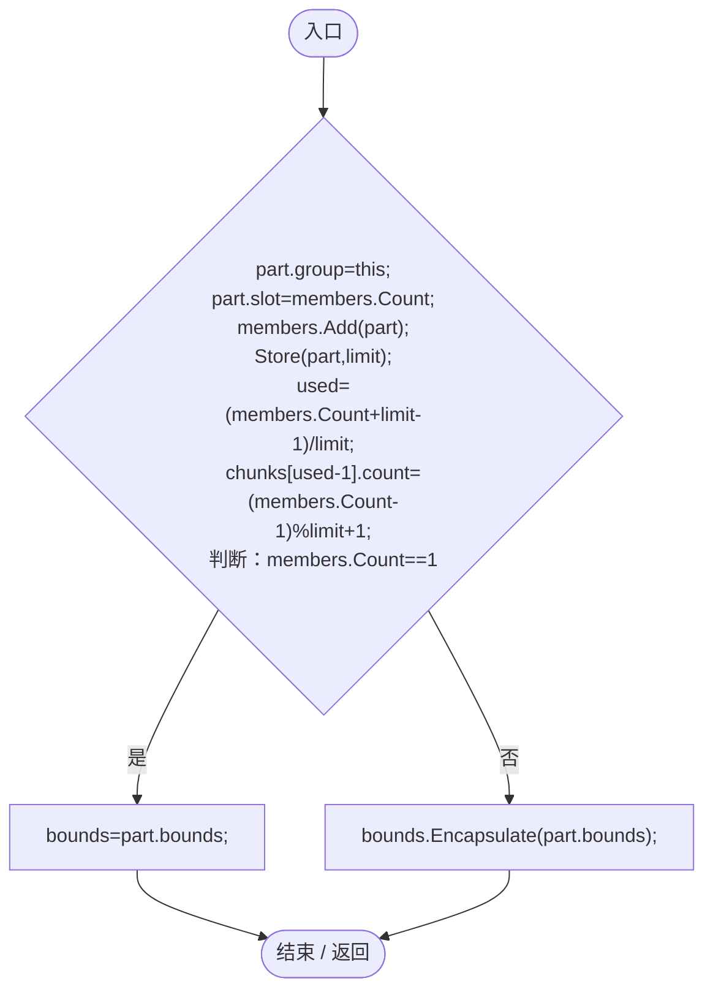

项目内调用/回调引用：

- [CorpseInstanceRenderer.Group.Store · L25](29964f1f6c300ac9.md#m60f2a3cafb05d2d6)（方法）

<a id="m60c9699e378fe05b"></a>

## Change · L29

`public void Change(Part part,int limit)`


### Editor / Player · Roslyn编译器控制流

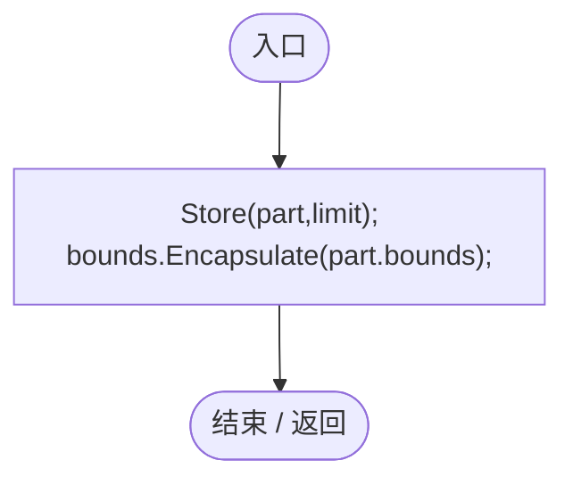

项目内调用/回调引用：

- [CorpseInstanceRenderer.Group.Store · L25](29964f1f6c300ac9.md#m60f2a3cafb05d2d6)（方法）

<a id="m5d1fc9b8f514e922"></a>

## Detach · L31

`public void Detach(Part part,int limit)`


### Editor / Player · Roslyn编译器控制流

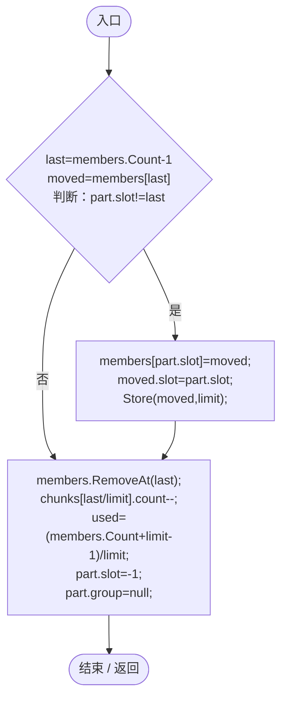

项目内调用/回调引用：

- [CorpseInstanceRenderer.Group.Store · L25](29964f1f6c300ac9.md#m60f2a3cafb05d2d6)（方法）

<a id="m9330ca4e2a209288"></a>

## InstanceWrites.get · L47

`get`


### Editor / Player · 语法控制结构 / 声明（非CFG）


<a id="m96e035b640723879"></a>

## InstanceWrites.set · L47

`private set`


### Editor / Player · 语法控制结构 / 声明（非CFG）


<a id="m936776ff97dcdb8e"></a>

## RegisteredParts.get · L48

`public static int RegisteredParts`


### Editor / Player · 语法控制结构 / 声明（非CFG）

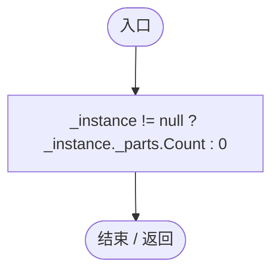

<a id="mb8773097c387985e"></a>

## LastBatches.get · L49

`get`


### Editor / Player · 语法控制结构 / 声明（非CFG）


<a id="m41a980b4574506ab"></a>

## LastBatches.set · L49

`private set`


### Editor / Player · 语法控制结构 / 声明（非CFG）


<a id="mc48fbcf8c606dd25"></a>

## LastInstances.get · L50

`get`


### Editor / Player · 语法控制结构 / 声明（非CFG）

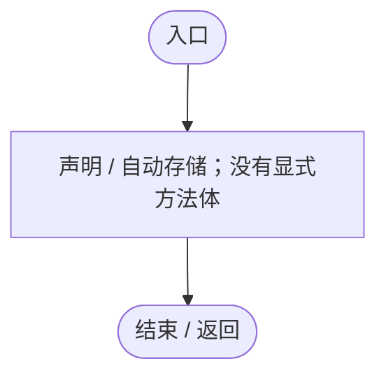

<a id="mac5497ebb9d3b29c"></a>

## LastInstances.set · L50

`private set`


### Editor / Player · 语法控制结构 / 声明（非CFG）


<a id="m04d922e92b0f3129"></a>

## Register · L52

`public static void Register(ColonyResource resource)`


### Editor / Player · Roslyn编译器控制流

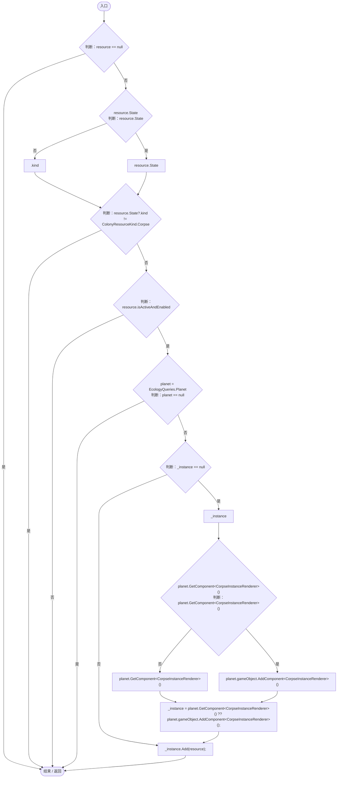

项目内调用/回调引用：

- [ColonyResource.State.get · L24](293dbaecfff4b585.md#m41824f1a0e160aa5)（访问器）
- [CorpseInstanceRenderer.Add · L61](29964f1f6c300ac9.md#mb86bf3b9b0666353)（方法）

<a id="m92524026fe515e89"></a>

## Awake · L60

`private void Awake()`


### Editor / Player · Roslyn编译器控制流

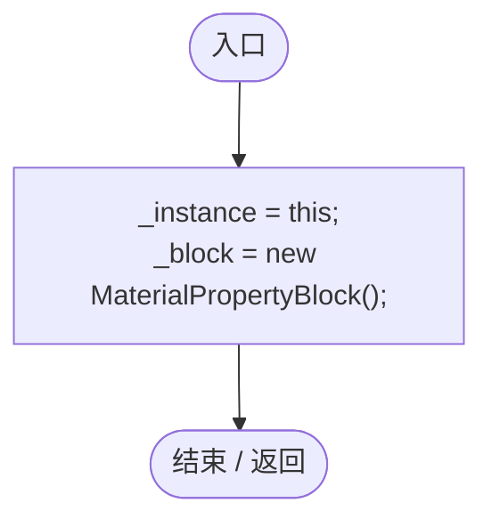

<a id="mb86bf3b9b0666353"></a>

## Add · L61

`private void Add(ColonyResource resource)`


### Editor / Player · Roslyn编译器控制流

```mermaid
flowchart TD
  b0(["入口"])
  b1{"判断：_owners.ContainsKey(resource)"}
  b2["parts = new List&lt;Part&gt;(2)<br/>_owners.Add(resource, parts);"]
  b3["resource.GetComponentsInChildren&lt;MeshRenderer&gt;()"]
  b4{"判断：resource.GetComponentsInChildren&lt;MeshRenderer&gt;()"}
  b5["var"]
  b6{"filter = renderer.GetComponent&lt;MeshFilter&gt;()<br/>material = renderer.sharedMaterial<br/>判断：filter == null"}
  b7{"判断：filter.sharedMesh == null"}
  b8{"判断：material == null"}
  b9{"判断：renderer.enabled"}
  b10["renderer.GetPropertyBlock(_block);"]
  b11{"判断：_block.HasColor(&quot;_BaseColor&quot;)"}
  b12["_block.GetColor(&quot;_BaseColor&quot;)"]
  b13{"判断：material.HasProperty(&quot;_BaseColor&quot;)"}
  b14["material.GetColor(&quot;_BaseColor&quot;)"]
  b15["Color.white"]
  b16["color = _block.HasColor(&quot;_BaseColor&quot;) ? _block.GetColor(&quot;_BaseColor&quot;) : material.HasProperty(&quot;_BaseColor&quot;) ? material.GetColor(&quot;_BaseColor&quot;) : Color.white"]
  b17{"判断：_block.HasColor(&quot;_EmissionColor&quot;)"}
  b18["_block.GetColor(&quot;_EmissionColor&quot;)"]
  b19{"判断：material.HasProperty(&quot;_EmissionColor&quot;)"}
  b20["material.GetColor(&quot;_EmissionColor&quot;)"]
  b21["Color.black"]
  b22["emission = _block.HasColor(&quot;_EmissionColor&quot;) ? _block.GetColor(&quot;_EmissionColor&quot;) : material.HasProperty(&quot;_EmissionColor&quot;) ? material.GetColor(&quot;_EmissionColor&quot;) : Color.black"]
  b23{"key = (filter.sharedMesh, material, color, emission, renderer.shadowCastingMode, renderer.receiveShadows, renderer.gameObject.layer)<br/>判断：_appearances.TryGetValue(key, out var appearance)"}
  b24["new Material(material) { name = &quot;Corpse instance palette&quot;, enableInstancing = true }<br/>name = &quot;Corpse instance palette&quot;<br/>enableInstancing = true<br/>palette = new Material(material) { name = &quot;Corpse instance palette&quot;, enableInstancing = true }"]
  b25{"判断：palette.HasProperty(&quot;_BaseColor&quot;)"}
  b26["palette.SetColor(&quot;_BaseColor&quot;, color);"]
  b27{"判断：palette.HasProperty(&quot;_Color&quot;)"}
  b28["palette.SetColor(&quot;_Color&quot;, color);"]
  b29{"判断：palette.HasProperty(&quot;_EmissionColor&quot;)"}
  b30["palette.SetColor(&quot;_EmissionColor&quot;, emission);"]
  b31["appearance<br/>new Appearance { mesh = filter.sharedMesh, material = palette, radius = filter.sharedMesh.bounds.extents.magnitude, parameters = new RenderParams(palette) { layer = renderer.gameObject.layer, shadowCastingMode = renderer.shado…"]
  b32["new RenderParams(palette) { layer = renderer.gameObject.layer, shadowCastingMode = renderer.shadowCastingMode, receiveShadows = renderer.receiveShadows, lightProbeUsage = LightProbeUsage.Off, motionVectorMode = MotionVectorGenerationMode…"]
  b33["appearance = new Appearance { mesh = filter.sharedMesh, material = palette, radius = filter.sharedMesh.bounds.extents.magnitude, parameters = new RenderParams(palette) { layer = renderer.gameObject.layer, shadowCastingMode = renderer.sha…"]
  b34["_appearances.Add(key, appearance);"]
  b35["new Part { owner = resource, source = renderer, transform = renderer.transform, appearance = appearance, original = renderer.enabled, index = _parts.Count }<br/>owner = resource<br/>source = renderer<br/>transform = renderer.transform<br/>appearance = a…"]
  b36["parts.Add(part);<br/>_parts.Add(part);"]
  b37{"resource.GetComponentsInChildren&lt;MeshRenderer&gt;()<br/>判断：resource.GetComponentsInChildren&lt;MeshRenderer&gt;()"}
  b38["resource.GetComponentsInChildren&lt;MeshRenderer&gt;()"]
  b39["连接 / 离开区域"]
  b40(["结束 / 返回"])
  b0 --> b1
  b1 -->|"是"| b40
  b1 -->|"否"| b2
  b2 --> b3
  b3 --> b4
  b4 -->|"是"| b5
  b4 -->|"否 · 经过finally 37"| b40
  b5 --> b6
  b6 -->|"否"| b7
  b6 -->|"是"| b4
  b7 -->|"否"| b8
  b7 -->|"是"| b4
  b8 -->|"否"| b9
  b8 -->|"是"| b4
  b9 -->|"否"| b4
  b9 -->|"是"| b10
  b10 --> b11
  b11 -->|"是"| b12
  b11 -->|"否"| b13
  b12 --> b16
  b13 -->|"是"| b14
  b13 -->|"否"| b15
  b14 --> b16
  b15 --> b16
  b16 --> b17
  b17 -->|"是"| b18
  b17 -->|"否"| b19
  b18 --> b22
  b19 -->|"是"| b20
  b19 -->|"否"| b21
  b20 --> b22
  b21 --> b22
  b22 --> b23
  b23 -->|"否"| b24
  b23 -->|"是"| b35
  b24 --> b25
  b25 -->|"是"| b26
  b25 -->|"否"| b27
  b26 --> b27
  b27 -->|"是"| b28
  b27 -->|"否"| b29
  b28 --> b29
  b29 -->|"是"| b30
  b29 -->|"否"| b31
  b30 --> b31
  b31 --> b32
  b32 --> b33
  b33 --> b34
  b34 --> b35
  b35 --> b36
  b36 --> b4
  b37 -->|"否"| b38
  b37 -->|"是"| b39
  b38 --> b39
  b4 -. "退出保护区时 finally（示意）" .-> b37

```

<a id="m422070be924a293f"></a>

## Remove · L88

`public static void Remove(ColonyResource resource)`


### Editor / Player · Roslyn编译器控制流

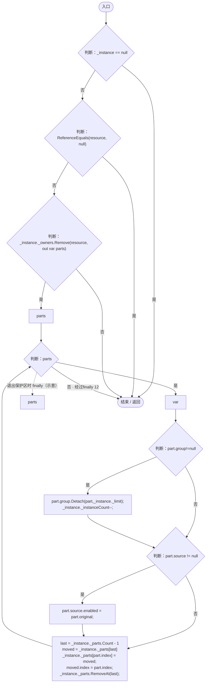

项目内调用/回调引用：

- [CorpseInstanceRenderer.Group.Detach · L31](29964f1f6c300ac9.md#m5d1fc9b8f514e922)（方法）

<a id="m3271b868626e9993"></a>

## Restore · L99

`private void Restore()`


### Editor / Player · Roslyn编译器控制流

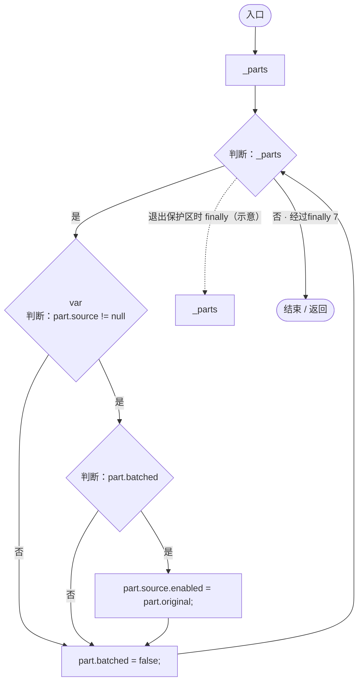

<a id="md4f83ba36ddc7a0a"></a>

## LateUpdate · L101

`private void LateUpdate()`


### Editor / Player · Roslyn编译器控制流

```mermaid
flowchart TD
  b0(["入口"])
  b1["timing=PerformanceTimings.Measure(PerformanceTimings.Area.CorpseBatches)"]
  b2{"LastBatches = LastInstances = 0;<br/>settings = SimulationOptimization.Current<br/>判断：_failed"}
  b3{"判断：settings.corpseBatchRendering"}
  b4{"判断：settings.resourceInstancing"}
  b5{"判断：SystemInfo.supportsInstancing"}
  b6["Restore();"]
  b7["size = settings.corpseRenderCellSize<br/>limit = settings.corpseBatchSize"]
  b8["world=transform.localToWorldMatrix"]
  b9{"判断：size!=_cellSize"}
  b10["limit!=_limit"]
  b11["size!=_cellSize"]
  b12["resize=size!=_cellSize&#124;&#124;limit!=_limit"]
  b13{"_world=world;<br/>_cellSize=size;<br/>_limit=limit;<br/>inverse=world.inverse<br/>判断：resize"}
  b14["_groups.Clear();<br/>_visible.Clear();<br/>_instanceCount=0;"]
  b15["_parts"]
  b16{"判断：_parts"}
  b17["var<br/>part.group=null;<br/>part.slot=-1;<br/>part.dirty=true;"]
  b18["_parts"]
  b19["_owners"]
  b20{"判断：_owners"}
  b21["var"]
  b22{"判断：owner.Key==null"}
  b23{"判断：owner.Key.isActiveAndEnabled"}
  b24["owner.Key.State.energy&gt;0"]
  b25["owner.Key.isActiveAndEnabled"]
  b26["active=owner.Key.isActiveAndEnabled&amp;&amp;owner.Key.State.energy&gt;0"]
  b27["root=owner.Key.transform<br/>rootSignal=root.hasChanged<br/>moved=false"]
  b28["owner.Value"]
  b29{"判断：owner.Value"}
  b30["var"]
  b31{"part.active<br/>判断：active"}
  b32["part.source!=null"]
  b33["active"]
  b34["part.active=active&amp;&amp;part.source!=null;"]
  b35{"判断：part.active"}
  b36{"判断：part.group!=null"}
  b37["part.group.Detach(part,limit);<br/>_instanceCount--;"]
  b38{"part.dirty=true;<br/>判断：part.source!=null"}
  b39{"判断：part.batched"}
  b40["part.source.enabled=part.original;<br/>part.batched=false;"]
  b41{"poseChanged=false<br/>判断：part.dirty"}
  b42{"判断：rootSignal"}
  b43{"判断：part.transform.hasChanged"}
  b44["position=part.transform.localPosition<br/>rotation=part.transform.localRotation<br/>scale=part.transform.localScale"]
  b45{"poseChanged<br/>判断：part.localPosition!=position"}
  b46{"判断：part.localRotation!=rotation"}
  b47["part.localScale!=scale"]
  b48["part.localPosition!=position&#124;&#124;part.localRotation!=rotation&#124;&#124;part.localScale!=scale"]
  b49["poseChanged=part.localPosition!=position&#124;&#124;part.localRotation!=rotation&#124;&#124;part.localScale!=scale;"]
  b50["part.localPosition=position;<br/>part.localRotation=rotation;<br/>part.localScale=scale;<br/>part.transform.hasChanged=false;"]
  b51{"判断：part.transform==root"}
  b52["moved=poseChanged;"]
  b53{"判断：part.dirty"}
  b54{"判断：resize"}
  b55{"判断：poseChanged"}
  b56{"判断：moved"}
  b57{"判断：part.transform!=root"}
  b58{"part.matrix=inverse*part.transform.localToWorldMatrix;<br/>point=part.matrix.GetColumn(3)<br/>cell=new Vector3Int(Mathf.FloorToInt(point.x/size),Mathf.FloorToInt(point.y/size),Mathf.FloorToInt(point.z/size))<br/>key=(part.appearance,cell)<br/>判断：_groups…"}
  b59["group<br/>new Group{appearance=part.appearance}<br/>appearance=part.appearance<br/>group=new Group{appearance=part.appearance};"]
  b60["_groups.Add(key,group);<br/>_visible.Add(group);"]
  b61{"scale=Mathf.Sqrt(Mathf.Max(part.matrix.GetColumn(0).sqrMagnitude,part.matrix.GetColumn(1).sqrMagnitude,part.matrix.GetColumn(2).sqrMagnitude))<br/>part.bounds=new Bounds(point,Vector3.one*(part.appearance.radius*scale*2));<br/>判断：part.group!=group"}
  b62{"判断：part.group!=null"}
  b63["part.group.Detach(part,limit);<br/>_instanceCount--;"]
  b64["group.Attach(part,limit);<br/>_instanceCount++;"]
  b65["group.Change(part,limit);"]
  b66["part.dirty=false;<br/>part.transform.hasChanged=false;"]
  b67{"判断：part.batched"}
  b68["part.source.enabled=false;<br/>part.batched=true;"]
  b69["owner.Value"]
  b70["root.hasChanged=false;"]
  b71["_owners"]
  b72["LastInstances=_instanceCount;"]
  b73["(System.InvalidOperationException ex)<br/>_failed = true;<br/>Restore();<br/>Debug.LogWarning(&quot;[尸体批次] 当前平台/材质不可实例化，恢复原显示：&quot; + ex.Message);"]
  b74["timing=PerformanceTimings.Measure(PerformanceTimings.Area.CorpseBatches)"]
  b75(["结束 / 返回"])
  b0 --> b1
  b1 --> b2
  b2 -->|"否"| b3
  b2 -->|"是"| b6
  b3 -->|"是"| b4
  b3 -->|"否"| b6
  b4 -->|"是"| b5
  b4 -->|"否"| b6
  b5 -->|"否"| b6
  b5 -->|"是"| b7
  b6 -->|"经过finally 74"| b75
  b7 --> b8
  b8 --> b9
  b9 -->|"否"| b10
  b9 -->|"是"| b11
  b10 --> b12
  b11 --> b12
  b12 --> b13
  b13 -->|"是"| b14
  b13 -->|"否"| b19
  b14 --> b15
  b15 --> b16
  b16 -->|"是"| b17
  b16 -->|"否 · 经过finally 18"| b19
  b17 --> b16
  b19 --> b20
  b20 -->|"是"| b21
  b20 -->|"否 · 经过finally 71"| b72
  b21 --> b22
  b22 -->|"是"| b20
  b22 -->|"否"| b23
  b23 -->|"是"| b24
  b23 -->|"否"| b25
  b24 --> b26
  b25 --> b26
  b26 --> b27
  b27 --> b28
  b28 --> b29
  b29 -->|"是"| b30
  b29 -->|"否 · 经过finally 69"| b70
  b30 --> b31
  b31 -->|"是"| b32
  b31 -->|"否"| b33
  b32 --> b34
  b33 --> b34
  b34 --> b35
  b35 -->|"否"| b36
  b35 -->|"是"| b41
  b36 -->|"是"| b37
  b36 -->|"否"| b38
  b37 --> b38
  b38 -->|"是"| b39
  b38 -->|"否"| b29
  b39 -->|"是"| b40
  b39 -->|"否"| b29
  b40 --> b29
  b41 -->|"否"| b42
  b41 -->|"是"| b44
  b42 -->|"否"| b43
  b42 -->|"是"| b44
  b43 -->|"是"| b44
  b43 -->|"否"| b51
  b44 --> b45
  b45 -->|"否"| b46
  b45 -->|"是"| b48
  b46 -->|"否"| b47
  b46 -->|"是"| b48
  b47 --> b49
  b48 --> b49
  b49 --> b50
  b50 --> b51
  b51 -->|"是"| b52
  b51 -->|"否"| b53
  b52 --> b53
  b53 -->|"否"| b54
  b53 -->|"是"| b58
  b54 -->|"否"| b55
  b54 -->|"是"| b58
  b55 -->|"否"| b56
  b55 -->|"是"| b58
  b56 -->|"是"| b57
  b56 -->|"否"| b67
  b57 -->|"是"| b58
  b57 -->|"否"| b67
  b58 -->|"否"| b59
  b58 -->|"是"| b61
  b59 --> b60
  b60 --> b61
  b61 -->|"是"| b62
  b61 -->|"否"| b65
  b62 -->|"是"| b63
  b62 -->|"否"| b64
  b63 --> b64
  b64 --> b66
  b65 --> b66
  b66 --> b67
  b67 -->|"否"| b68
  b67 -->|"是"| b29
  b68 --> b29
  b70 --> b20
  b72 -->|"经过finally 74"| b75
  b73 -->|"经过finally 74"| b75
  b16 -. "退出保护区时 finally（示意）" .-> b18
  b29 -. "退出保护区时 finally（示意）" .-> b69
  b20 -. "退出保护区时 finally（示意）" .-> b71
  b8 -. "保护区可能异常（示意）" .-> b73
  b2 -. "退出保护区时 finally（示意）" .-> b74

```

项目内调用/回调引用：

- [PerformanceTimings.Measure · L24](a8403a4c7503726d.md#m592e16f2b6513efd)（方法）
- [CorpseInstanceRenderer.LastBatches.set · L49](29964f1f6c300ac9.md#m41a980b4574506ab)（访问器）
- [CorpseInstanceRenderer.LastInstances.set · L50](29964f1f6c300ac9.md#mac5497ebb9d3b29c)（访问器）
- [SimulationOptimization.Current.get · L30](11c9091e70893352.md#mcfa8eb2e650e57b1)（访问器）
- [CorpseInstanceRenderer.Restore · L99](29964f1f6c300ac9.md#m3271b868626e9993)（方法）
- [ColonyResource.State.get · L24](293dbaecfff4b585.md#m41824f1a0e160aa5)（访问器）
- [CorpseInstanceRenderer.Group.Detach · L31](29964f1f6c300ac9.md#m5d1fc9b8f514e922)（方法）
- [CorpseInstanceRenderer.Group.Attach · L27](29964f1f6c300ac9.md#m7e532315ca923b1b)（方法）
- [CorpseInstanceRenderer.Group.Change · L29](29964f1f6c300ac9.md#m60c9699e378fe05b)（方法）

<a id="m2782b3240389a7d8"></a>

## OnEnable · L153

`private void OnEnable()`

★ 修复（防Bug回归）：每台镜头仅提交可见空间格；原先把地球背面和镜头外批次也逐个提交，CPU绘制仍过高。

### Editor / Player · Roslyn编译器控制流

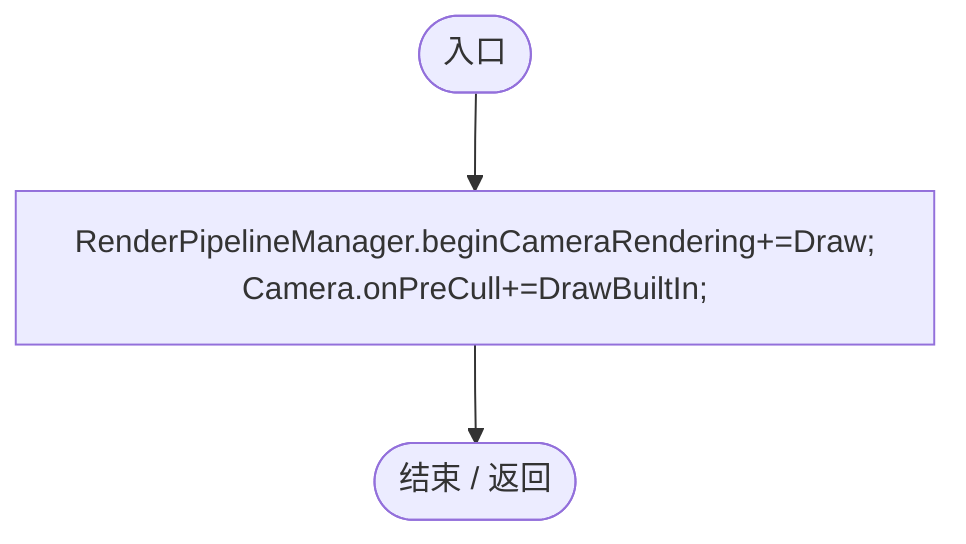

项目内调用/回调引用：

- [CorpseInstanceRenderer.Draw · L155](29964f1f6c300ac9.md#m6d05d71a1b9d944c)（方法）
- [CorpseInstanceRenderer.DrawBuiltIn · L154](29964f1f6c300ac9.md#mbf4f4171ade37668)（方法）

<a id="mbf4f4171ade37668"></a>

## DrawBuiltIn · L154

`private void DrawBuiltIn(Camera camera)`


### Editor / Player · Roslyn编译器控制流

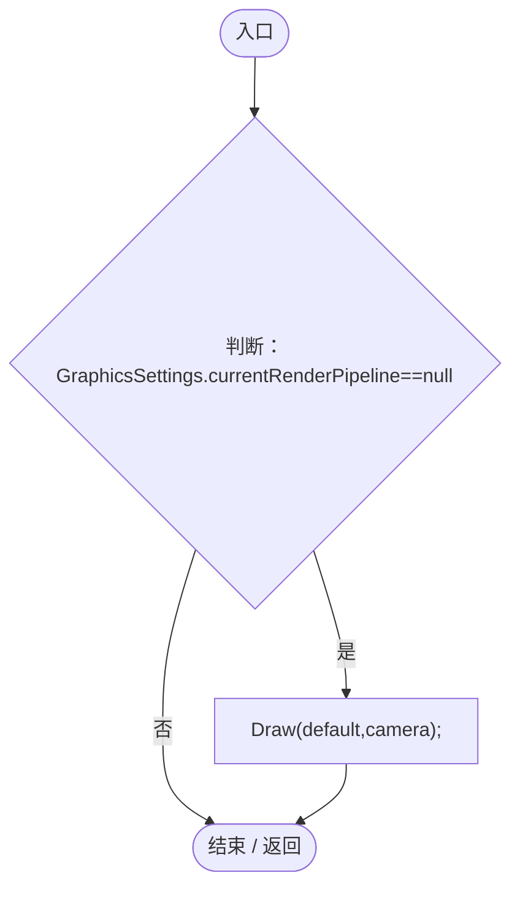

项目内调用/回调引用：

- [CorpseInstanceRenderer.Draw · L155](29964f1f6c300ac9.md#m6d05d71a1b9d944c)（方法）

<a id="m6d05d71a1b9d944c"></a>

## Draw · L155

`private void Draw(ScriptableRenderContext context,Camera camera)`


### Editor / Player · Roslyn编译器控制流

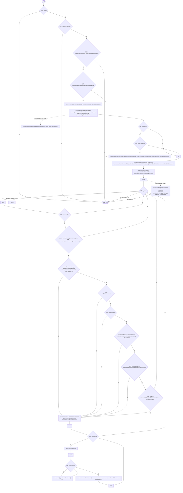

项目内调用/回调引用：

- [SimulationOptimization.Current.get · L30](11c9091e70893352.md#mcfa8eb2e650e57b1)（访问器）
- [PerformanceTimings.Measure · L24](a8403a4c7503726d.md#m592e16f2b6513efd)（方法）
- [PlanetTerrainMeshBuilder.Data.get · L81](415285cf043354a9.md#m1a65abfe0f34c5d8)（访问器）
- [CorpseInstanceRenderer.WorldBounds · L182](29964f1f6c300ac9.md#m32003e1f37ebf9e5)（方法）
- [CorpseInstanceRenderer.LastBatches.set · L49](29964f1f6c300ac9.md#m41a980b4574506ab)（访问器）
- [CorpseInstanceRenderer.LastBatches.get · L49](29964f1f6c300ac9.md#mb8773097c387985e)（访问器）
- [CorpseInstanceRenderer.Restore · L99](29964f1f6c300ac9.md#m3271b868626e9993)（方法）

<a id="m32003e1f37ebf9e5"></a>

## WorldBounds · L182

`private static Bounds WorldBounds(Bounds local,Matrix4x4 world)`


### Editor / Player · Roslyn编译器控制流

```mermaid
flowchart TD
  b0(["入口"])
  b1["e=local.extents<br/>x=world.MultiplyVector(new Vector3(e.x,0,0))<br/>y=world.MultiplyVector(new Vector3(0,e.y,0))<br/>z=world.MultiplyVector(new Vector3(0,0,e.z))<br/>结果：new Bounds(world.MultiplyPoint3x4(local.center),new Vector3(Mathf.Abs(x.x)+Mathf.Ab…"]
  b2(["结束 / 返回"])
  b0 --> b1
  b1 -->|"返回"| b2

```

<a id="m3430474d2d3e7eba"></a>

## OnDisable · L187

`private void OnDisable()`


### Editor / Player · Roslyn编译器控制流

```mermaid
flowchart TD
  b0(["入口"])
  b1["RenderPipelineManager.beginCameraRendering-=Draw;<br/>Camera.onPreCull-=DrawBuiltIn;<br/>Restore();"]
  b2(["结束 / 返回"])
  b0 --> b1
  b1 --> b2

```

项目内调用/回调引用：

- [CorpseInstanceRenderer.Restore · L99](29964f1f6c300ac9.md#m3271b868626e9993)（方法）
- [CorpseInstanceRenderer.Draw · L155](29964f1f6c300ac9.md#m6d05d71a1b9d944c)（方法）
- [CorpseInstanceRenderer.DrawBuiltIn · L154](29964f1f6c300ac9.md#mbf4f4171ade37668)（方法）

<a id="m84c6925628ec2feb"></a>

## OnDestroy · L188

`private void OnDestroy()`


### Editor / Player · Roslyn编译器控制流

```mermaid
flowchart TD
  b0(["入口"])
  b1["Restore();"]
  b2["_appearances.Values"]
  b3{"判断：_appearances.Values"}
  b4{"var<br/>判断：item.material != null"}
  b5["Destroy(item.material);"]
  b6["_appearances.Values"]
  b7{"判断：_instance == this"}
  b8["_instance = null;"]
  b9(["结束 / 返回"])
  b0 --> b1
  b1 --> b2
  b2 --> b3
  b3 -->|"是"| b4
  b3 -->|"否 · 经过finally 6"| b7
  b4 -->|"是"| b5
  b4 -->|"否"| b3
  b5 --> b3
  b7 -->|"是"| b8
  b7 -->|"否"| b9
  b8 --> b9
  b3 -. "退出保护区时 finally（示意）" .-> b6

```

项目内调用/回调引用：

- [CorpseInstanceRenderer.Restore · L99](29964f1f6c300ac9.md#m3271b868626e9993)（方法）

<a id="m396d8d9571ff1210"></a>

## Reset · L190

`[RuntimeInitializeOnLoadMethod(RuntimeInitializeLoadType.SubsystemRegistration)] private static void Reset()`


### Editor / Player · Roslyn编译器控制流

```mermaid
flowchart TD
  b0(["入口"])
  b1["_instance = null;<br/>LastBatches = LastInstances = 0;<br/>InstanceWrites=0;"]
  b2(["结束 / 返回"])
  b0 --> b1
  b1 --> b2

```

项目内调用/回调引用：

- [CorpseInstanceRenderer.LastBatches.set · L49](29964f1f6c300ac9.md#m41a980b4574506ab)（访问器）
- [CorpseInstanceRenderer.LastInstances.set · L50](29964f1f6c300ac9.md#mac5497ebb9d3b29c)（访问器）
- [CorpseInstanceRenderer.InstanceWrites.set · L47](29964f1f6c300ac9.md#m96e035b640723879)（访问器）
