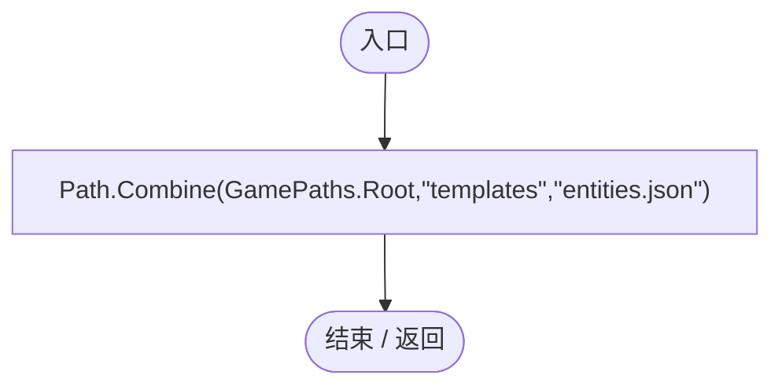
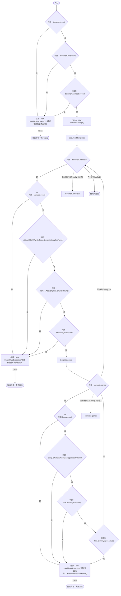
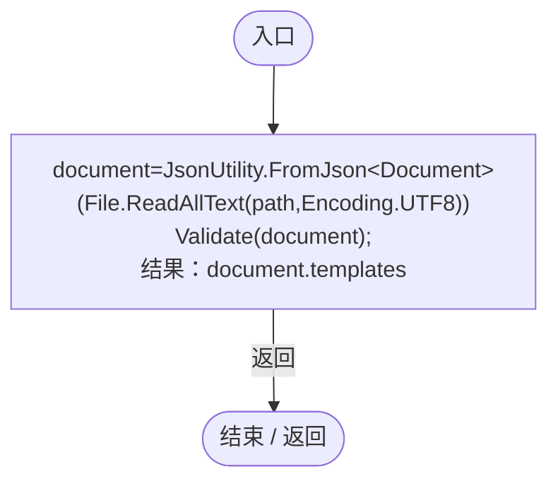
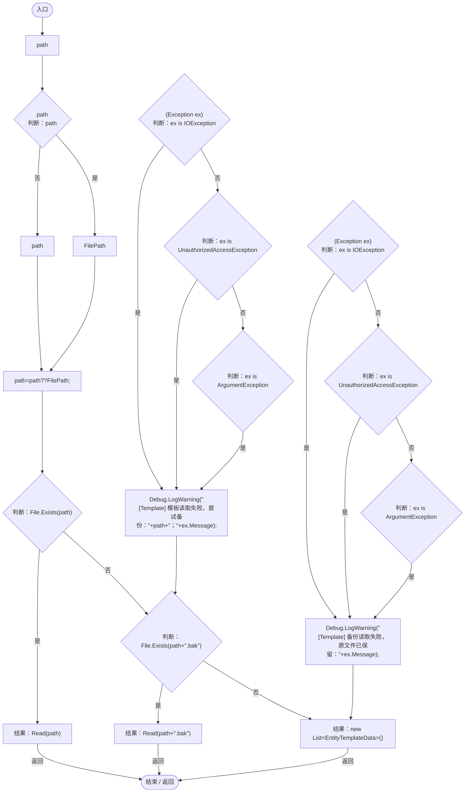
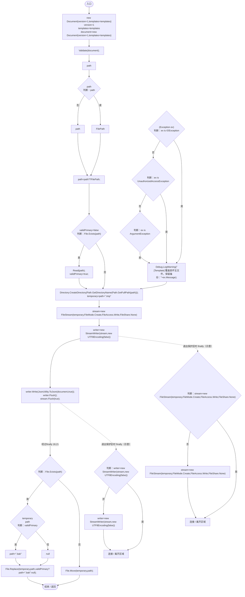

# EntityTemplateStore.cs

[返回总索引](../README.md) · `Runtime` · `Assets/DarwinPark/UI/EntityTemplateStore.cs`

[源文件](../../../Assets/DarwinPark/UI/EntityTemplateStore.cs) · 源码校验：`abd4b4eb43cf24646e2347c20504969852bf00360f8b8a354fd664ed0e49329a`

方法按源文件位置排列。事件/回调引用不表示立即执行；分支与异常说明见总索引。完整源码与可点击关系图请打开离线手册。

## FilePath.get · L18

`public static string FilePath`

### Editor / Player · 语法控制结构 / 声明（非CFG）

## Validate · L19

`private static void Validate(Document document)`

### Editor / Player · Roslyn编译器控制流

## Read · L30

`private static List<EntityTemplateData> Read(string path)`

### Editor / Player · Roslyn编译器控制流

项目内调用/回调引用：

- [EntityTemplateStore.Validate · L19](2a560a9e3c003e7b.md#m80c47bf0f7b6b9e5)（方法）

## Load · L34

`public static List<EntityTemplateData> Load(string path=null)`

### Editor / Player · Roslyn编译器控制流

项目内调用/回调引用：

- [EntityTemplateStore.Read · L30](2a560a9e3c003e7b.md#m180ba0abb7757ac9)（方法）

## Save · L51

`public static void Save(List<EntityTemplateData> templates,string path=null)`

### Editor / Player · Roslyn编译器控制流

项目内调用/回调引用：

- [EntityTemplateStore.Validate · L19](2a560a9e3c003e7b.md#m80c47bf0f7b6b9e5)（方法）
- [EntityTemplateStore.Read · L30](2a560a9e3c003e7b.md#m180ba0abb7757ac9)（方法）
