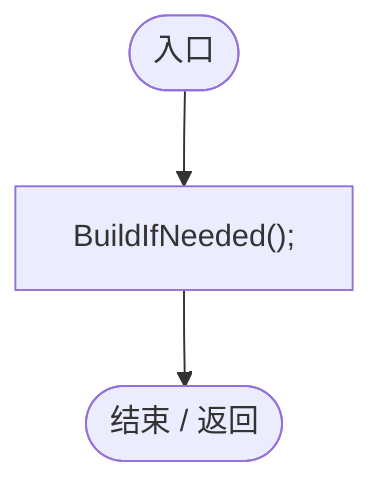
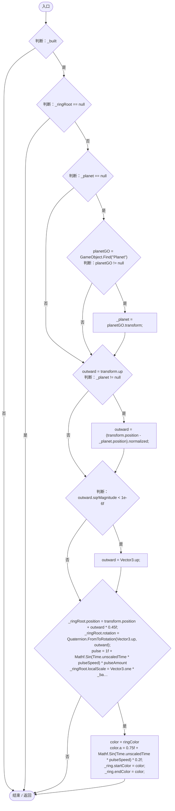
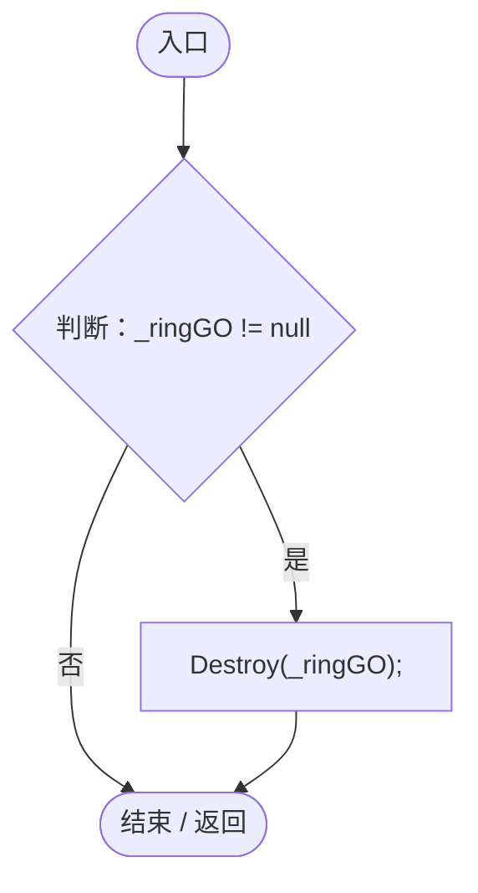
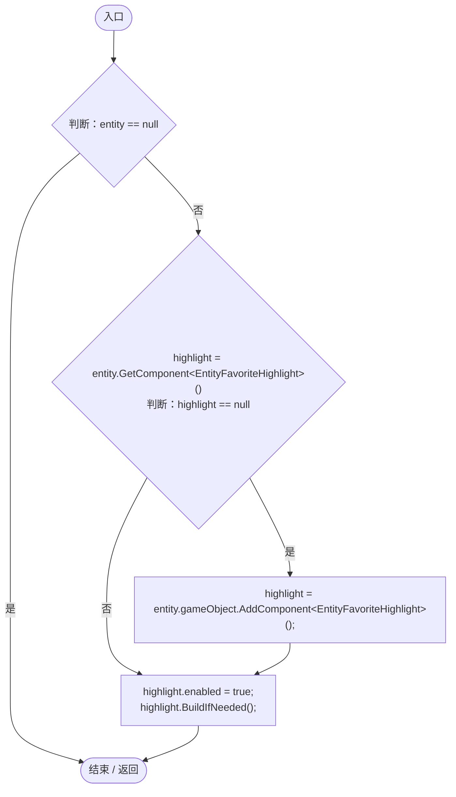
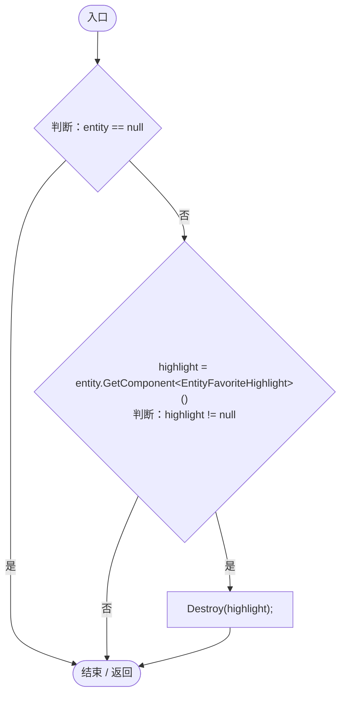

# EntityFavoriteHighlight.cs

[返回总索引](../README.md) · `Runtime` · `Assets/DarwinPark/UI/EntityFavoriteHighlight.cs`

[源文件](../../../Assets/DarwinPark/UI/EntityFavoriteHighlight.cs) · 源码校验：`452ed27685d0df70b7d953194fd7c4164f24cf8fc6e63f30e4545480265d3f65`

方法按源文件位置排列。事件/回调引用不表示立即执行；分支与异常说明见总索引。完整源码与可点击关系图请打开离线手册。

## Awake · L29

`private void Awake()`

### Editor / Player · Roslyn编译器控制流

项目内调用/回调引用：

- [EntityFavoriteHighlight.BuildIfNeeded · L69](2af216812259d790.md#mea59e80a2261c8a0)（方法）

## OnEnable · L34

`private void OnEnable()`

### Editor / Player · Roslyn编译器控制流

项目内调用/回调引用：

- [EntityFavoriteHighlight.BuildIfNeeded · L69](2af216812259d790.md#mea59e80a2261c8a0)（方法）

## LateUpdate · L39

`private void LateUpdate()`

### Editor / Player · Roslyn编译器控制流

## BuildIfNeeded · L69

`private void BuildIfNeeded()`

### Editor / Player · Roslyn编译器控制流

```mermaid
flowchart TD
  b0(["入口"])
  b1{"判断：_built"}
  b2{"_built = true;<br/>_ringGO = new GameObject(&quot;FavHighlightRing&quot;);<br/>_ringGO.transform.SetParent(transform, false);<br/>_ringRoot = _ringGO.transform;<br/>_ring = _ringGO.AddComponent&lt;LineRenderer&gt;();<br/>_ring.useWorldSpace = false;<br/>_ring.loop = true;<br/>_rin…"}
  b3["shader = Shader.Find(&quot;Universal Render Pipeline/Unlit&quot;);"]
  b4{"判断：shader == null"}
  b5["shader = Shader.Find(&quot;Unlit/Color&quot;);"]
  b6{"判断：shader != null"}
  b7["new Material(shader) { name = &quot;FavHighlightMat&quot; }<br/>name = &quot;FavHighlightMat&quot;<br/>mat = new Material(shader) { name = &quot;FavHighlightMat&quot; }"]
  b8{"判断：mat.HasProperty(&quot;_Color&quot;)"}
  b9["mat.SetColor(&quot;_Color&quot;, ringColor);"]
  b10{"判断：mat.HasProperty(&quot;_BaseColor&quot;)"}
  b11["mat.SetColor(&quot;_BaseColor&quot;, ringColor);"]
  b12["_ring.material = mat;"]
  b13{"_baseRadius = Mathf.Max(1f, ringRadius);<br/>col = GetComponent&lt;Collider&gt;()<br/>判断：col != null"}
  b14["extent = Mathf.Max(col.bounds.extents.x, col.bounds.extents.z)<br/>_baseRadius = Mathf.Max(_baseRadius, extent * 2.2f);"]
  b15["positions = new Vector3[_ring.positionCount]"]
  b16["i = 0"]
  b17{"判断：i &lt; positions.Length"}
  b18["angle = (float)i / positions.Length * Mathf.PI * 2f<br/>positions[i] = new Vector3(Mathf.Cos(angle), 0f, Mathf.Sin(angle));"]
  b19["i++"]
  b20["_ring.SetPositions(positions);"]
  b21(["结束 / 返回"])
  b0 --> b1
  b1 -->|"是"| b21
  b1 -->|"否"| b2
  b2 -->|"是"| b3
  b2 -->|"否"| b4
  b3 --> b4
  b4 -->|"是"| b5
  b4 -->|"否"| b6
  b5 --> b6
  b6 -->|"是"| b7
  b6 -->|"否"| b13
  b7 --> b8
  b8 -->|"是"| b9
  b8 -->|"否"| b10
  b9 --> b10
  b10 -->|"是"| b11
  b10 -->|"否"| b12
  b11 --> b12
  b12 --> b13
  b13 -->|"是"| b14
  b13 -->|"否"| b15
  b14 --> b15
  b15 --> b16
  b16 --> b17
  b17 -->|"是"| b18
  b17 -->|"否"| b20
  b18 --> b19
  b19 --> b17
  b20 --> b21

```

## OnDestroy · L118

`private void OnDestroy()`

### Editor / Player · Roslyn编译器控制流

## Attach · L124

`public static void Attach(DarwinEntity entity)`

### Editor / Player · Roslyn编译器控制流

项目内调用/回调引用：

- [EntityFavoriteHighlight.BuildIfNeeded · L69](2af216812259d790.md#mea59e80a2261c8a0)（方法）

## Detach · L133

`public static void Detach(DarwinEntity entity)`

### Editor / Player · Roslyn编译器控制流

