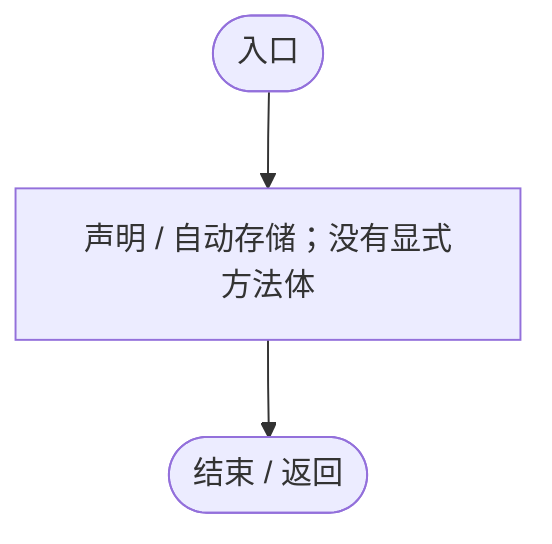
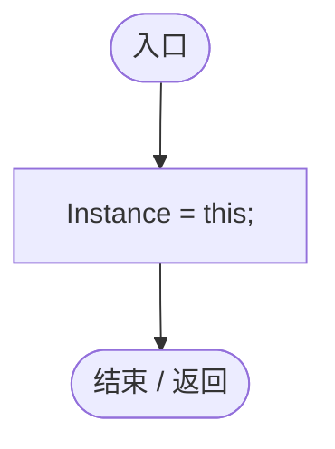
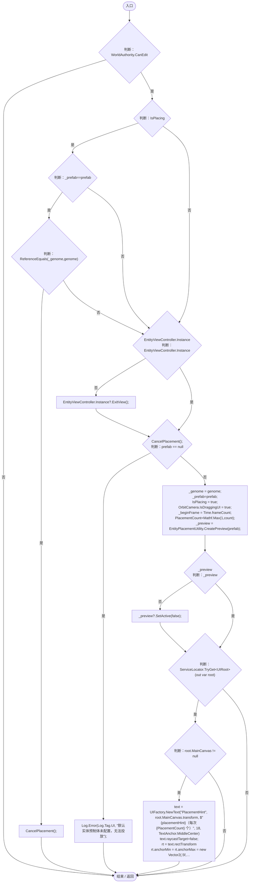
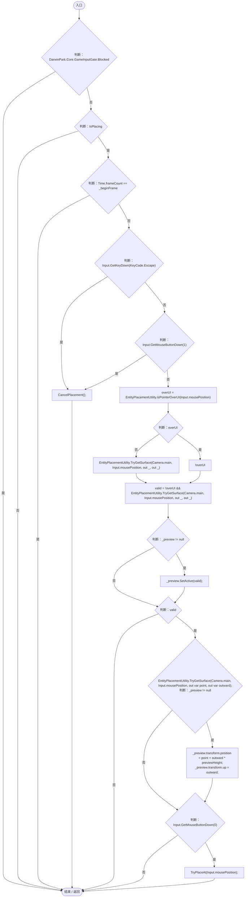
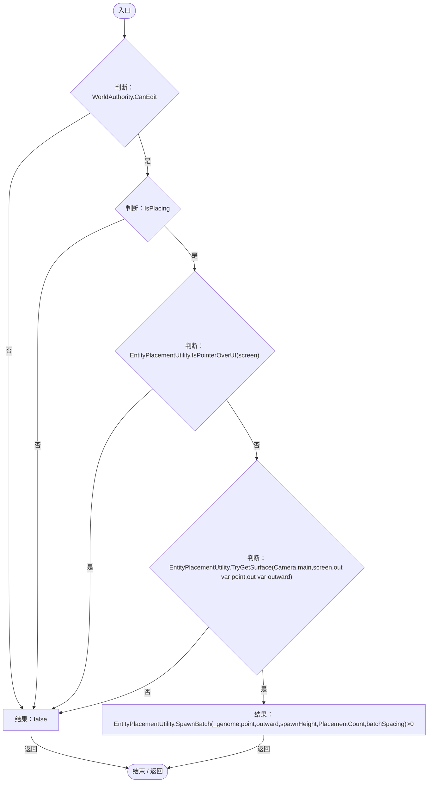
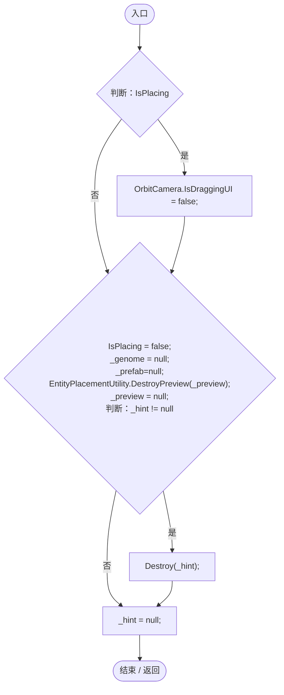
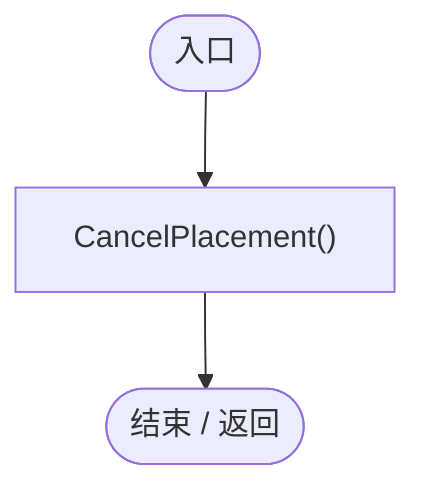
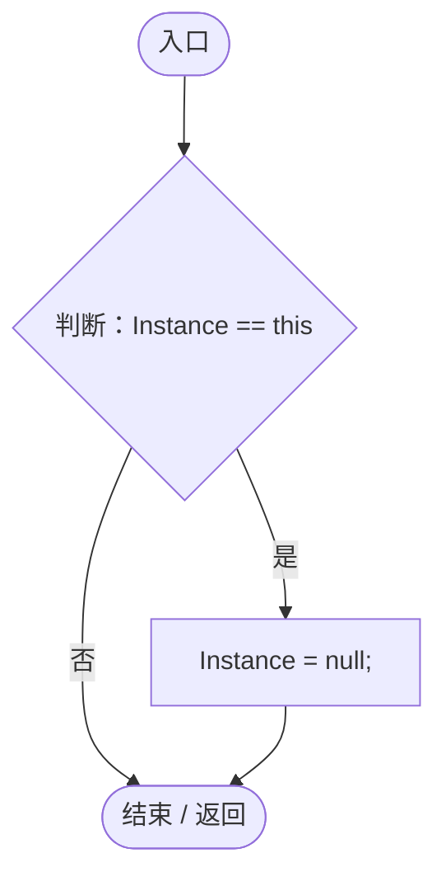

# EntityPlacementTool.cs

[返回总索引](../README.md) · `Runtime` · `Assets/DarwinPark/UI/EntityPlacementTool.cs`

[源文件](../../../Assets/DarwinPark/UI/EntityPlacementTool.cs) · 源码校验：`01f14bcdf318badc74e6c1d2f79f03b040171904cf7c4daa74e582c4e1ad7c5a`

方法按源文件位置排列。事件/回调引用不表示立即执行；分支与异常说明见总索引。完整源码与可点击关系图请打开离线手册。

## Instance.get · L13

`get`

### Editor / Player · 语法控制结构 / 声明（非CFG）

## Instance.set · L13

`private set`

### Editor / Player · 语法控制结构 / 声明（非CFG）

## IsPlacing.get · L14

`get`

### Editor / Player · 语法控制结构 / 声明（非CFG）

## IsPlacing.set · L14

`private set`

### Editor / Player · 语法控制结构 / 声明（非CFG）

## PlacementCount.get · L19

`get`

### Editor / Player · 语法控制结构 / 声明（非CFG）

## PlacementCount.set · L19

`private set`

### Editor / Player · 语法控制结构 / 声明（非CFG）

## Awake · L25

`private void Awake()`

### Editor / Player · Roslyn编译器控制流

项目内调用/回调引用：

- [EntityPlacementTool.Instance.set · L13](2ca993947b0a7e7a.md#m6f99b165fbf7a5e3)（访问器）

## BeginPlacement · L27

`public void BeginPlacement(GameObject prefab, Genome genome, int count=1)`

### Editor / Player · Roslyn编译器控制流

项目内调用/回调引用：

- [EntityPlacementTool.IsPlacing.get · L14](2ca993947b0a7e7a.md#ma73d17b3db4aa719)（访问器）
- [EntityPlacementTool.CancelPlacement · L81](2ca993947b0a7e7a.md#m5a9374d2c71f0a2d)（方法）
- [EntityViewController.Instance.get · L15](0ad0345f83229ef0.md#mb3b8144b56e80842)（访问器）
- [EntityViewController.ExitView · L105](0ad0345f83229ef0.md#mca8619c7f27942c9)（方法）
- [Log.Error · L43](735e5abf0df2bddc.md#m2addd5e1d74b000d)（方法）
- [EntityPlacementTool.IsPlacing.set · L14](2ca993947b0a7e7a.md#mde2fe18a16f3901f)（访问器）
- [EntityPlacementTool.PlacementCount.set · L19](2ca993947b0a7e7a.md#ma2978337e869768b)（访问器）
- [EntityPlacementUtility.CreatePreview · L89](6d2c32e632b9c147.md#m1f174d9daef88414)（方法）
- [ServiceLocator.TryGet · L26](f2fdbe9f9ccd93cb.md#m143b24e6d58471b0)（方法）
- [UIRoot.MainCanvas.get · L14](9c1421378791f0e0.md#maa2cc9baf1248477)（访问器）
- [UIFactory.NewText · L57](dd1096a6995423db.md#m9dbccb5f0c38189e)（方法）
- [EntityPlacementTool.PlacementCount.get · L19](2ca993947b0a7e7a.md#m7c137204abc02672)（访问器）

## Update · L51

`private void Update()`

### Editor / Player · Roslyn编译器控制流

项目内调用/回调引用：

- [GameInputGate.Blocked.get · L8](52955daae7e592ab.md#m765763b665829633)（访问器）
- [EntityPlacementTool.IsPlacing.get · L14](2ca993947b0a7e7a.md#ma73d17b3db4aa719)（访问器）
- [EntityPlacementTool.CancelPlacement · L81](2ca993947b0a7e7a.md#m5a9374d2c71f0a2d)（方法）
- [EntityPlacementUtility.IsPointerOverUI · L16](6d2c32e632b9c147.md#m126e7f8ff0d0a893)（方法）
- [EntityPlacementUtility.TryGetSurface · L23](6d2c32e632b9c147.md#mcaf74a1c76576237)（方法）
- [EntityPlacementTool.TryPlaceAt · L73](2ca993947b0a7e7a.md#m3ad1295309fe99b0)（方法）

## TryPlaceAt · L73

`public bool TryPlaceAt(Vector2 screen)`

★ 修复（防Bug回归）：确认投放共用实时 UI/正面射线判定，失败可重新选位置，成功保持连续模式。

### Editor / Player · Roslyn编译器控制流

项目内调用/回调引用：

- [EntityPlacementTool.IsPlacing.get · L14](2ca993947b0a7e7a.md#ma73d17b3db4aa719)（访问器）
- [EntityPlacementUtility.IsPointerOverUI · L16](6d2c32e632b9c147.md#m126e7f8ff0d0a893)（方法）
- [EntityPlacementUtility.TryGetSurface · L23](6d2c32e632b9c147.md#mcaf74a1c76576237)（方法）
- [EntityPlacementUtility.SpawnBatch · L41](6d2c32e632b9c147.md#m19dfca56b6218af1)（方法）
- [EntityPlacementTool.PlacementCount.get · L19](2ca993947b0a7e7a.md#m7c137204abc02672)（访问器）

## CancelPlacement · L81

`public void CancelPlacement()`

### Editor / Player · Roslyn编译器控制流

项目内调用/回调引用：

- [EntityPlacementTool.IsPlacing.get · L14](2ca993947b0a7e7a.md#ma73d17b3db4aa719)（访问器）
- [EntityPlacementTool.IsPlacing.set · L14](2ca993947b0a7e7a.md#mde2fe18a16f3901f)（访问器）
- [EntityPlacementUtility.DestroyPreview · L134](6d2c32e632b9c147.md#m1ae2ba4853de4560)（方法）

## OnDisable · L88

`private void OnDisable()`

### Editor / Player · Roslyn编译器控制流

项目内调用/回调引用：

- [EntityPlacementTool.CancelPlacement · L81](2ca993947b0a7e7a.md#m5a9374d2c71f0a2d)（方法）

## OnDestroy · L89

`private void OnDestroy()`

### Editor / Player · Roslyn编译器控制流

项目内调用/回调引用：

- [EntityPlacementTool.Instance.get · L13](2ca993947b0a7e7a.md#mafb26991c0dfcb86)（访问器）
- [EntityPlacementTool.Instance.set · L13](2ca993947b0a7e7a.md#m6f99b165fbf7a5e3)（访问器）
