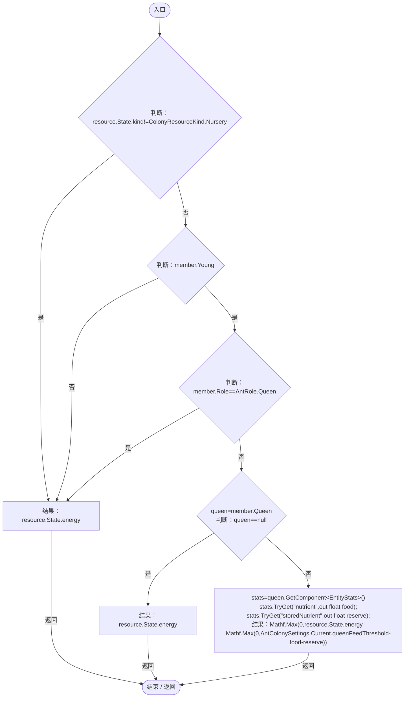
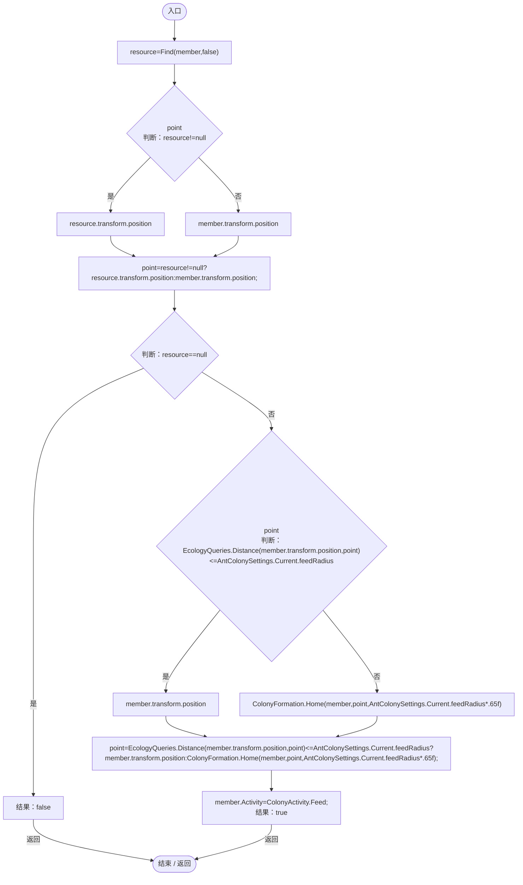

```mermaid
flowchart TD
  b0(["入口"])
  b1{"判断：member==null"}
  b2{"判断：member.Active"}
  b3{"member.GetComponent&lt;EggIncubation&gt;()<br/>判断：member.GetComponent&lt;EggIncubation&gt;()"}
  b4[".Incubating"]
  b5["member.GetComponent&lt;EggIncubation&gt;()"]
  b6{"判断：member.GetComponent&lt;EggIncubation&gt;()?.Incubating==true"}
  b7["结果：false"]
  b8{"stats=member.GetComponent&lt;EntityStats&gt;()<br/>settings=AntColonySettings.Current<br/>判断：stats==null"}
  b9{"判断：stats.TryGet(&quot;nutrient&quot;,out float food)"}
  b10["结果：false"]
  b11{"判断：member.Role!=AntRole.Queen"}
  b12["结果：food&lt;settings.memberFeedThreshold"]
  b13["stats.TryGet(&quot;storedNutrient&quot;,out float reserve);"]
  b14{"判断：food&lt;settings.queenFeedThreshold"}
  b15["reserve&lt;settings.queenReserveTarget"]
  b16["food&lt;settings.queenFeedThreshold"]
  b17["结果：food&lt;settings.queenFeedThreshold&#124;&#124;reserve&lt;settings.queenReserveTarget"]
  b18(["结束 / 返回"])
  b0 --> b1
  b1 -->|"否"| b2
  b1 -->|"是"| b7
  b2 -->|"是"| b3
  b2 -->|"否"| b7
  b3 -->|"否"| b4
  b3 -->|"是"| b5
  b4 --> b6
  b5 --> b6
  b6 -->|"是"| b7
  b6 -->|"否"| b8
  b7 -->|"返回"| b18
  b8 -->|"否"| b9
  b8 -->|"是"| b10
  b9 -->|"否"| b10
  b9 -->|"是"| b11
  b10 -->|"返回"| b18
  b11 -->|"是"| b12
  b11 -->|"否"| b13
  b12 -->|"返回"| b18
  b13 --> b14
  b14 -->|"否"| b15
  b14 -->|"是"| b16
  b15 --> b17
  b16 --> b17
  b17 -->|"返回"| b18

```

```mermaid
flowchart TD
  b0(["入口"])
  b1{"判断：WantsFood(member)"}
  b2["结果：null"]
  b3{"判断：member.Role==AntRole.Queen"}
  b4{"判断：member.Young"}
  b5["ColonyResourceKind.Nursery"]
  b6["ColonyResourceKind.Supply"]
  b7["kind=member.Role==AntRole.Queen&#124;&#124;member.Young?ColonyResourceKind.Nursery:ColonyResourceKind.Supply"]
  b8["nearest=null<br/>best=float.PositiveInfinity<br/>point=member.transform.position"]
  b9["ColonyResource.All"]
  b10{"判断：ColonyResource.All"}
  b11["var"]
  b12{"判断：resource.State.kind!=kind"}
  b13{"判断：resource.State.kind!=ColonyResourceKind.Energy"}
  b14{"判断：ColonyResourceOwnership.Available(resource,member)"}
  b15{"判断：AvailableEnergy(resource,member)&lt;=0"}
  b16{"distance=(resource.transform.position-point).sqrMagnitude<br/>判断：distance&gt;=best"}
  b17{"判断：nearbyOnly"}
  b18{"判断：EcologyQueries.Distance(resource.transform.position,point)&gt;AntColonySettings.Current.feedRadius"}
  b19["best=distance;<br/>nearest=resource;"]
  b20{"判断：ColonyResource.All"}
  b21["ColonyResource.All"]
  b22["连接 / 离开区域"]
  b23["结果：nearest"]
  b24(["结束 / 返回"])
  b0 --> b1
  b1 -->|"否"| b2
  b1 -->|"是"| b3
  b2 -->|"返回"| b24
  b3 -->|"否"| b4
  b3 -->|"是"| b5
  b4 -->|"是"| b5
  b4 -->|"否"| b6
  b5 --> b7
  b6 --> b7
  b7 --> b8
  b8 --> b9
  b9 --> b10
  b10 -->|"是"| b11
  b10 -->|"否 · 经过finally 20"| b23
  b11 --> b12
  b12 -->|"是"| b13
  b12 -->|"否"| b14
  b13 -->|"否"| b14
  b13 -->|"是"| b10
  b14 -->|"是"| b15
  b14 -->|"否"| b10
  b15 -->|"是"| b10
  b15 -->|"否"| b16
  b16 -->|"否"| b17
  b16 -->|"是"| b10
  b17 -->|"是"| b18
  b17 -->|"否"| b19
  b18 -->|"是"| b10
  b18 -->|"否"| b19
  b19 --> b10
  b20 -->|"否"| b21
  b20 -->|"是"| b22
  b21 --> b22
  b23 -->|"返回"| b24
  b10 -. "退出保护区时 finally（示意）" .-> b20

```

# ColonyFeeding.cs

[返回总索引](../README.md) · `Runtime` · `Assets/DarwinPark/Entities/Ecology/ColonyFeeding.cs`

[源文件](../../../Assets/DarwinPark/Entities/Ecology/ColonyFeeding.cs) · 源码校验：`69b8bbd02b470e84cd8295137940c7861d896aaf7b15f84259f7f81fd0621c7c`

方法按源文件位置排列。事件/回调引用不表示立即执行；分支与异常说明见总索引。完整源码与可点击关系图请打开离线手册。

## WantsFood · L9

`public static bool WantsFood(AntColonyMember member)`

### Editor / Player · Roslyn编译器控制流

项目内调用/回调引用：

- [AntColonySettings.Current.get · L31](cb0a937e97c8fbb3.md#mcd121159f407ccdf)（访问器）
- [EntityStats.TryGet · L90](75aa86a368efdf24.md#m24ee1433e4a70d94)（方法）
- [AntColonyMember.Role.get · L33](baebd85c05598377.md#mdf6df89f7116c7a3)（访问器）

## Find · L18

`public static ColonyResource Find(AntColonyMember member,bool nearbyOnly)`

### Editor / Player · Roslyn编译器控制流

项目内调用/回调引用：

- [ColonyFeeding.WantsFood · L9](2cb56c08d08ff8ec.md#m362cbc1ec7a07c9a)（方法）
- [AntColonyMember.Role.get · L33](baebd85c05598377.md#mdf6df89f7116c7a3)（访问器）
- [ColonyResource.State.get · L22](293dbaecfff4b585.md#m341a1355f4d657bf)（访问器）
- [ColonyResourceOwnership.Available · L23](2988679fde59fc87.md#ma3b7caf13a1f8423)（方法）
- [ColonyFeeding.AvailableEnergy · L33](2cb56c08d08ff8ec.md#m0406d84fec349ad9)（方法）
- [EcologyQueries.Distance · L42](bdf7ccc2c9c0452f.md#mba9c3e3c95d0f2dd)（方法）
- [AntColonySettings.Current.get · L31](cb0a937e97c8fbb3.md#mcd121159f407ccdf)（访问器）

## AvailableEnergy · L33

`public static float AvailableEnergy(ColonyResource resource,AntColonyMember member)`

### Editor / Player · Roslyn编译器控制流

项目内调用/回调引用：

- [ColonyResource.State.get · L22](293dbaecfff4b585.md#m341a1355f4d657bf)（访问器）
- [AntColonyMember.Role.get · L33](baebd85c05598377.md#mdf6df89f7116c7a3)（访问器）
- [EntityStats.TryGet · L90](75aa86a368efdf24.md#m24ee1433e4a70d94)（方法）
- [AntColonySettings.Current.get · L31](cb0a937e97c8fbb3.md#mcd121159f407ccdf)（访问器）

## Destination · L41

`public static bool Destination(AntColonyMember member,out Vector3 point)`

### Editor / Player · Roslyn编译器控制流

项目内调用/回调引用：

- [ColonyFeeding.Find · L18](2cb56c08d08ff8ec.md#me471fba86317bbb2)（方法）
- [EcologyQueries.Distance · L42](bdf7ccc2c9c0452f.md#mba9c3e3c95d0f2dd)（方法）
- [AntColonySettings.Current.get · L31](cb0a937e97c8fbb3.md#mcd121159f407ccdf)（访问器）
- [ColonyFormation.Home · L36](c65dce2d54e43480.md#m79ad3420baeaf49d)（方法）
- [AntColonyMember.Activity.set · L43](baebd85c05598377.md#m8a34eff66ccac9e4)（访问器）
