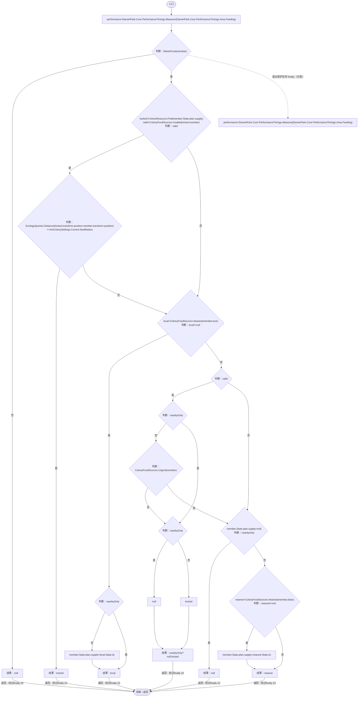
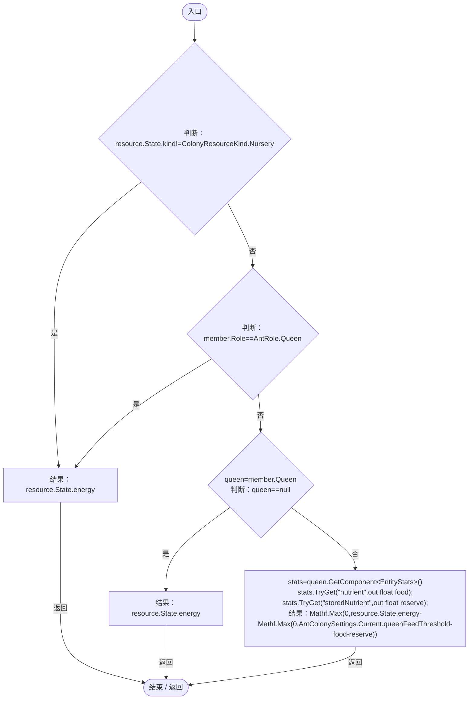
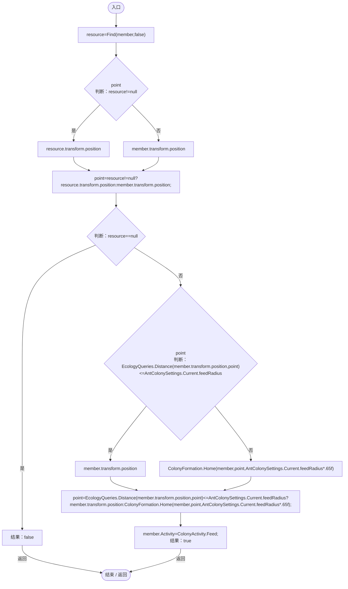

# ColonyFeeding.cs

[返回总索引](../README.md) · `Runtime` · `Assets/DarwinPark/Entities/Ecology/ColonyFeeding.cs`

[源文件](../../../Assets/DarwinPark/Entities/Ecology/ColonyFeeding.cs) · 源码校验：`644ab1fbce0edc3b208ccafd75e40d7d1bedaf2eefe5919f9183d1719a41d521`

方法按源文件位置排列。事件/回调引用不表示立即执行；分支与异常说明见总索引。完整源码与可点击关系图请打开离线手册。

## WantsFood · L10

`public static bool WantsFood(AntColonyMember member)`

★ 适配：所有消费和寻路入口读取同一份持久化计划。

### Editor / Player · Roslyn编译器控制流

项目内调用/回调引用：

- [EntityTaskPlan.Feeding · L20](da041665b1125ffc.md#m0546cdf948a33533)（方法）

## Find · L11

`public static ColonyResource Find(AntColonyMember member,bool nearbyOnly)`

### Editor / Player · Roslyn编译器控制流

项目内调用/回调引用：

- [PerformanceTimings.Measure · L24](a8403a4c7503726d.md#m5b1de577e94d50e9)（方法）
- [ColonyFeeding.WantsFood · L10](2cb56c08d08ff8ec.md#m56d2edeb3860f143)（方法）
- [ColonyResource.Find · L28](293dbaecfff4b585.md#m1324285ab40ac6f4)（方法）
- [AntColonyMember.State.get · L32](baebd85c05598377.md#m426db6a7c12dd7aa)（访问器）
- [ColonyFoodSources.Usable · L26](4c419a1a067d428c.md#m130e4fc5e6874ffc)（方法）
- [EcologyQueries.Distance · L42](bdf7ccc2c9c0452f.md#mba9c3e3c95d0f2dd)（方法）
- [AntColonySettings.Current.get · L31](cb0a937e97c8fbb3.md#mcd121159f407ccdf)（访问器）
- [ColonyFoodSources.Nearest · L29](4c419a1a067d428c.md#m7940fec03630abeb)（方法）
- [ColonyResource.State.get · L24](293dbaecfff4b585.md#m41824f1a0e160aa5)（访问器）
- [ColonyFoodSources.Urgent · L28](4c419a1a067d428c.md#m724338338b658ae8)（方法）

## AvailableEnergy · L29

`public static float AvailableEnergy(ColonyResource resource,AntColonyMember member)`

### Editor / Player · Roslyn编译器控制流

项目内调用/回调引用：

- [ColonyResource.State.get · L24](293dbaecfff4b585.md#m41824f1a0e160aa5)（访问器）
- [AntColonyMember.Role.get · L38](baebd85c05598377.md#mab30d459d599e4df)（访问器）
- [EntityStats.TryGet · L90](75aa86a368efdf24.md#m24ee1433e4a70d94)（方法）
- [AntColonySettings.Current.get · L31](cb0a937e97c8fbb3.md#mcd121159f407ccdf)（访问器）

## Destination · L37

`public static bool Destination(AntColonyMember member,out Vector3 point)`

### Editor / Player · Roslyn编译器控制流

项目内调用/回调引用：

- [ColonyFeeding.Find · L11](2cb56c08d08ff8ec.md#mfea041f7d0713775)（方法）
- [EcologyQueries.Distance · L42](bdf7ccc2c9c0452f.md#mba9c3e3c95d0f2dd)（方法）
- [AntColonySettings.Current.get · L31](cb0a937e97c8fbb3.md#mcd121159f407ccdf)（访问器）
- [ColonyFormation.Home · L36](c65dce2d54e43480.md#m79ad3420baeaf49d)（方法）
- [AntColonyMember.Activity.set · L50](baebd85c05598377.md#mde27369ea48da368)（访问器）
