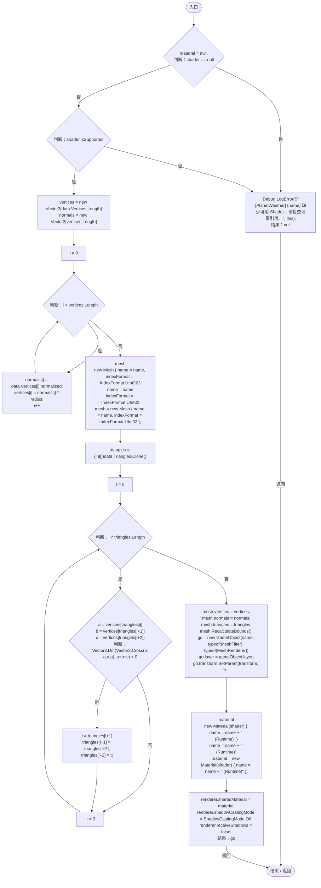
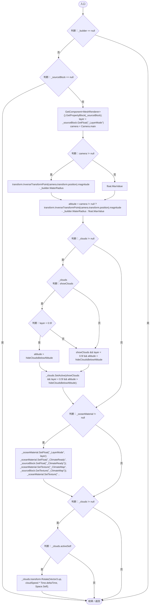
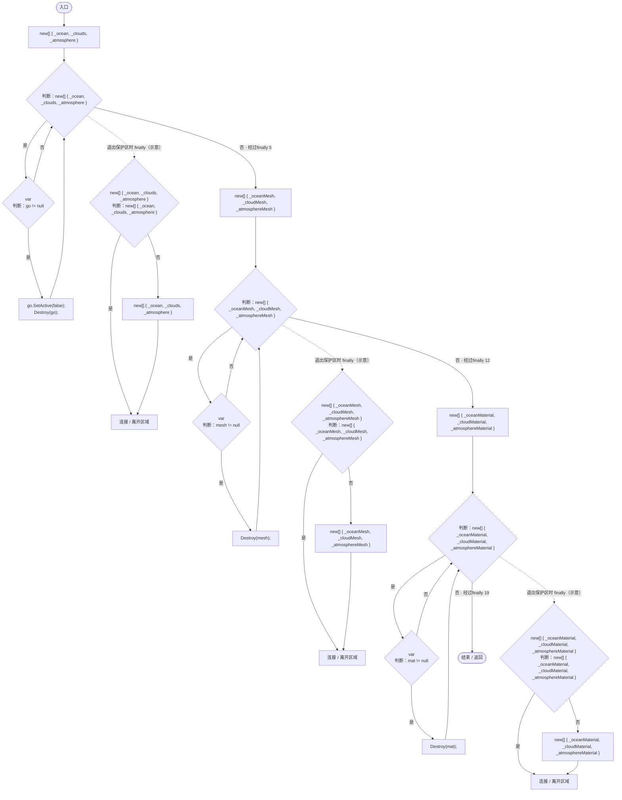
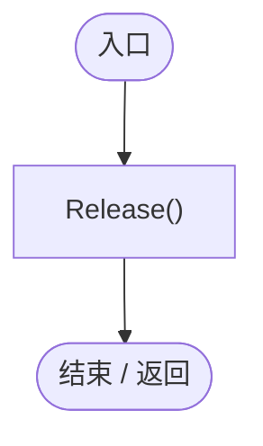

```mermaid
flowchart TD
  b0(["入口"])
  b1{"_builder = GetComponent&lt;PlanetTerrainMeshBuilder&gt;();<br/>data = _builder.Data<br/>判断：data == null"}
  b2["Release();<br/>sea = _builder.WaterRadius"]
  b3{"判断：Camera.main != null"}
  b4["Camera.main.GetComponent&lt;OrbitCamera&gt;()"]
  b5["null"]
  b6["orbit=Camera.main != null ? Camera.main.GetComponent&lt;OrbitCamera&gt;() : null"]
  b7{"判断：orbit != null"}
  b8["orbit.minimumSurfaceRadius=sea;"]
  b9{"cloudBottom = sea + cloudClearance<br/>cloudTop = cloudBottom + cloudThickness<br/>atmosphereTop = cloudTop + atmosphereThickness<br/>_ocean = CreateShell(&quot;OceanSurface&quot;, data, sea, oceanShader, ref _oceanMesh, out _oceanMaterial);<br/>判断：_oceanMaterial…"}
  b10["depth = new Color[data.Vertices.Length]"]
  b11["i = 0"]
  b12{"判断：i &lt; depth.Length"}
  b13["h = PlanetTerrainSampler.SampleHeight(data, data.Vertices[i].normalized)<br/>depth[i] = new Color(Mathf.Clamp01((data.SeaLevel - h) * data.HeightScale / Mathf.Max(0.1f, shelfDepth)), 0, 0, 1);"]
  b14["i++"]
  b15["_oceanMesh.colors = depth;<br/>_oceanMaterial.SetColor(&quot;_ShallowColor&quot;, shallowWater);<br/>_oceanMaterial.SetColor(&quot;_DeepColor&quot;, deepWater);"]
  b16{"_clouds = CreateShell(&quot;CloudVolume&quot;, data, cloudTop, cloudShader, ref _cloudMesh, out _cloudMaterial);<br/>判断：_cloudMaterial != null"}
  b17["_cloudMaterial.SetFloat(&quot;_BottomRadius&quot;, cloudBottom);<br/>_cloudMaterial.SetFloat(&quot;_TopRadius&quot;, cloudTop);<br/>_cloudMaterial.SetFloat(&quot;_Coverage&quot;, cloudCoverage);<br/>_cloudMaterial.SetFloat(&quot;_Frequency&quot;, cloudFrequency);<br/>_cloudMaterial.SetFloat(&quot;…"]
  b18{"_atmosphere = CreateShell(&quot;AtmosphericScattering&quot;, data, atmosphereTop, atmosphereShader, ref _atmosphereMesh, out _atmosphereMaterial);<br/>判断：_atmosphereMaterial != null"}
  b19["_atmosphereMaterial.SetFloat(&quot;_SurfaceRadius&quot;, sea);<br/>_atmosphereMaterial.SetFloat(&quot;_OuterRadius&quot;, atmosphereTop);<br/>_atmosphereMaterial.SetFloat(&quot;_Density&quot;, atmosphereDensity);<br/>_atmosphereMaterial.SetColor(&quot;_ScatterColor&quot;, atmosphereColor);"]
  b20["_sourceBlock = new MaterialPropertyBlock();"]
  b21(["结束 / 返回"])
  b0 --> b1
  b1 -->|"是"| b21
  b1 -->|"否"| b2
  b2 --> b3
  b3 -->|"是"| b4
  b3 -->|"否"| b5
  b4 --> b6
  b5 --> b6
  b6 --> b7
  b7 -->|"是"| b8
  b7 -->|"否"| b9
  b8 --> b9
  b9 -->|"是"| b10
  b9 -->|"否"| b16
  b10 --> b11
  b11 --> b12
  b12 -->|"是"| b13
  b12 -->|"否"| b15
  b13 --> b14
  b14 --> b12
  b15 --> b16
  b16 -->|"是"| b17
  b16 -->|"否"| b18
  b17 --> b18
  b18 -->|"是"| b19
  b18 -->|"否"| b20
  b19 --> b20
  b20 --> b21

```

# PlanetWeatherVisuals.cs

[返回总索引](../README.md) · `Runtime` · `Assets/DarwinPark/Planet/PlanetWeatherVisuals.cs`

[源文件](../../../Assets/DarwinPark/Planet/PlanetWeatherVisuals.cs) · 源码校验：`10361121435804319717dad6179cf15136592be597754316e6f1d36e1e5f629b`

方法按源文件位置排列。事件/回调引用不表示立即执行；分支与异常说明见总索引。完整源码与可点击关系图请打开离线手册。

## Rebuild · L38

`public void Rebuild()`

### Editor / Player · Roslyn编译器控制流

项目内调用/回调引用：

- [PlanetTerrainMeshBuilder.Data.get · L78](415285cf043354a9.md#m8382f579717fbc6d)（访问器）
- [PlanetWeatherVisuals.Release · L148](2d18e9bc2efd11b8.md#m9874456e4f77ef73)（方法）
- [PlanetTerrainMeshBuilder.WaterRadius.get · L94](415285cf043354a9.md#m28d8809083881ec1)（访问器）
- [PlanetWeatherVisuals.CreateShell · L88](2d18e9bc2efd11b8.md#m40973fae749807c8)（方法）
- [PlanetTerrainSampler.SampleHeight · L32](fd5c1d83b88a7c8b.md#m759508f0c5a04b21)（方法）

## CreateShell · L88

`private GameObject CreateShell(string name, PlanetTerrainData data, float radius, Shader shader, ref Mesh mesh, out Material material)`

### Editor / Player · Roslyn编译器控制流

## LateUpdate · L127

`private void LateUpdate()`

### Editor / Player · Roslyn编译器控制流

项目内调用/回调引用：

- [PlanetTerrainMeshBuilder.WaterRadius.get · L94](415285cf043354a9.md#m28d8809083881ec1)（访问器）

## Release · L148

`private void Release()`

### Editor / Player · Roslyn编译器控制流

## OnDestroy · L158

`private void OnDestroy()`

### Editor / Player · Roslyn编译器控制流

项目内调用/回调引用：

- [PlanetWeatherVisuals.Release · L148](2d18e9bc2efd11b8.md#m9874456e4f77ef73)（方法）
