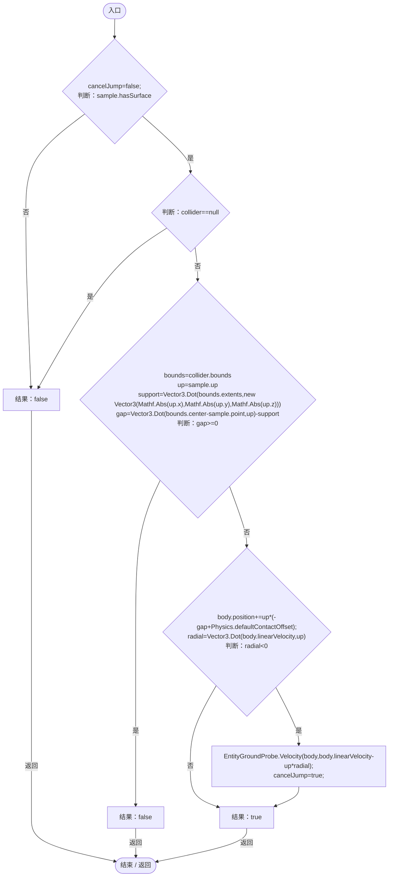

# ManualGroundPhysics.cs

[返回总索引](../README.md) · `Runtime` · `Assets/DarwinPark/Entities/ManualGroundPhysics.cs`

[源文件](../../../Assets/DarwinPark/Entities/ManualGroundPhysics.cs) · 源码校验：`b153e1e3d1033276c8264259fb1c82abb3bce7296655263d133fcc122e702c7f`

方法按源文件位置排列。事件/回调引用不表示立即执行；分支与异常说明见总索引。完整源码与可点击关系图请打开离线手册。

## Resolve · L7

`public static bool Resolve(Rigidbody body,Collider collider,EntityGroundSample sample,out bool cancelJump)`

### Editor / Player · Roslyn编译器控制流

项目内调用/回调引用：

- [EntityGroundProbe.Velocity · L35](6cefee808441951d.md#mdc5d4538aa1ee338)（方法）
