# EntityAttackAim.cs

[返回总索引](../README.md) · `Runtime` · `Assets/DarwinPark/Entities/EntityAttackAim.cs`

[源文件](../../../Assets/DarwinPark/Entities/EntityAttackAim.cs) · 源码校验：`87e8cc6c2955333fee462fdf9d8465bcc385e91ff7e308d787844d2a935421eb`

方法按源文件位置排列。事件/回调引用不表示立即执行；分支与异常说明见总索引。完整源码与可点击关系图请打开离线手册。

## Pick · L10

`public static DarwinEntity Pick(GameObject self,Ray ray,float distance,float radius=0)`

### Editor / Player · Roslyn编译器控制流

```mermaid
flowchart TD
  b0(["入口"])
  b1["best=null<br/>nearest=distance"]
  b2["EntityRegistry.All"]
  b3{"判断：EntityRegistry.All"}
  b4{"var<br/>判断：entity==null"}
  b5{"判断：entity.gameObject==self"}
  b6{"判断：EcologyQueries.Alive(entity)"}
  b7["entity.GetComponentsInChildren&lt;Collider&gt;()"]
  b8{"判断：entity.GetComponentsInChildren&lt;Collider&gt;()"}
  b9["var"]
  b10{"判断：collider.enabled"}
  b11{"判断：collider.isTrigger"}
  b12{"判断：collider.gameObject.activeInHierarchy"}
  b13{"判断：Vector3.Dot(collider.bounds.center-ray.origin,ray.direction)&lt;=0"}
  b14{"bounds=collider.bounds<br/>bounds.extents=bounds.extents*GameplayTuning.Current.manualHitboxScale+Vector3.one*Mathf.Max(0,radius);<br/>判断：bounds.IntersectRay(ray,out float along)"}
  b15{"判断：along&gt;nearest"}
  b16{"point=collider.ClosestPoint(ray.GetPoint(Mathf.Max(0,along)))<br/>toward=point-ray.origin<br/>blocked=false<br/>判断：toward.sqrMagnitude&gt;.0001f"}
  b17["Physics.RaycastAll(ray.origin,toward.normalized,toward.magnitude,~0,QueryTriggerInteraction.Ignore)"]
  b18{"判断：Physics.RaycastAll(ray.origin,toward.normalized,toward.magnitude,~0,QueryTriggerInteraction.Ignore)"}
  b19["var"]
  b20{"owner=hit.collider.GetComponentInParent&lt;DarwinEntity&gt;()<br/>判断：owner==entity"}
  b21{"判断：owner!=null"}
  b22{"判断：owner.gameObject==self"}
  b23["blocked=true;"]
  b24{"Physics.RaycastAll(ray.origin,toward.normalized,toward.magnitude,~0,QueryTriggerInteraction.Ignore)<br/>判断：Physics.RaycastAll(ray.origin,toward.normalized,toward.magnitude,~0,QueryTriggerInteraction.Ignore)"}
  b25["Physics.RaycastAll(ray.origin,toward.normalized,toward.magnitude,~0,QueryTriggerInteraction.Ignore)"]
  b26["连接 / 离开区域"]
  b27{"判断：blocked"}
  b28["nearest=along;<br/>best=entity;"]
  b29{"entity.GetComponentsInChildren&lt;Collider&gt;()<br/>判断：entity.GetComponentsInChildren&lt;Collider&gt;()"}
  b30["entity.GetComponentsInChildren&lt;Collider&gt;()"]
  b31["连接 / 离开区域"]
  b32{"判断：EntityRegistry.All"}
  b33["EntityRegistry.All"]
  b34["连接 / 离开区域"]
  b35["结果：best"]
  b36(["结束 / 返回"])
  b0 --> b1
  b1 --> b2
  b2 --> b3
  b3 -->|"是"| b4
  b3 -->|"否 · 经过finally 32"| b35
  b4 -->|"否"| b5
  b4 -->|"是"| b3
  b5 -->|"否"| b6
  b5 -->|"是"| b3
  b6 -->|"否"| b3
  b6 -->|"是"| b7
  b7 --> b8
  b8 -->|"是"| b9
  b8 -->|"否 · 经过finally 29"| b3
  b9 --> b10
  b10 -->|"是"| b11
  b10 -->|"否"| b8
  b11 -->|"否"| b12
  b11 -->|"是"| b8
  b12 -->|"否"| b8
  b12 -->|"是"| b13
  b13 -->|"是"| b8
  b13 -->|"否"| b14
  b14 -->|"是"| b15
  b14 -->|"否"| b8
  b15 -->|"是"| b8
  b15 -->|"否"| b16
  b16 -->|"是"| b17
  b16 -->|"否"| b27
  b17 --> b18
  b18 -->|"是"| b19
  b18 -->|"否 · 经过finally 24"| b27
  b19 --> b20
  b20 -->|"否"| b21
  b20 -->|"是"| b18
  b21 -->|"是"| b22
  b21 -->|"否"| b23
  b22 -->|"是"| b18
  b22 -->|"否"| b23
  b23 -->|"经过finally 24"| b27
  b24 -->|"否"| b25
  b24 -->|"是"| b26
  b25 --> b26
  b27 -->|"是"| b8
  b27 -->|"否"| b28
  b28 --> b8
  b29 -->|"否"| b30
  b29 -->|"是"| b31
  b30 --> b31
  b32 -->|"否"| b33
  b32 -->|"是"| b34
  b33 --> b34
  b35 -->|"返回"| b36
  b18 -. "退出保护区时 finally（示意）" .-> b24
  b8 -. "退出保护区时 finally（示意）" .-> b29
  b3 -. "退出保护区时 finally（示意）" .-> b32

```

项目内调用/回调引用：

- [EcologyQueries.Alive · L38](bdf7ccc2c9c0452f.md#mb2877c487f449970)（方法）
- [GameplayTuning.Current.get · L21](db546e5713b32d53.md#m1caba89e7704d239)（访问器）
