# ActiveControlsRegression.cs

[返回总索引](../README.md) · `Editor` · `Assets/DarwinPark/Editor/ActiveControlsRegression.cs`

[源文件](../../../Assets/DarwinPark/Editor/ActiveControlsRegression.cs) · 源码校验：`834fcbc0d53d576b85ea802a55521ebe0b2cf87374ef07c84280028e43384eef`

方法按源文件位置排列。事件/回调引用不表示立即执行；分支与异常说明见总索引。完整源码与可点击关系图请打开离线手册。

<a id="m9c9ee318734887a7"></a>

## Folder.get · L27

`private static string Folder`


### Editor · 语法控制结构 / 声明（非CFG）

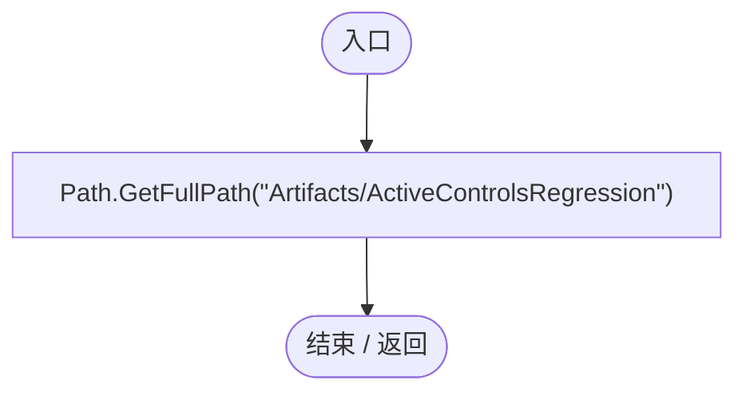

<a id="m82b111dfdc9fcc4e"></a>

## ActiveControlsRegression.ctor · L28

`static ActiveControlsRegression()`


### Editor · Roslyn编译器控制流

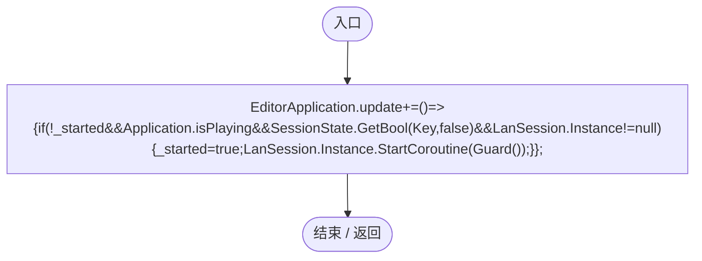

项目内调用/回调引用：

- [ActiveControlsRegression.回调@28 · L28](2eab88692e68527d.md#m2ca3096a06f238a5)（回调/委托）

<a id="m2ca3096a06f238a5"></a>

## 回调@28 · L28

`( … => 回调`


### Editor · Roslyn编译器控制流

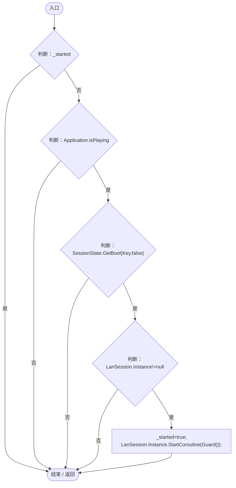

项目内调用/回调引用：

- [LanSession.Instance.get · L23](9fb633eebffe669c.md#mbf83306994878383)（访问器）
- [ActiveControlsRegression.Guard · L31](2eab88692e68527d.md#m0537b1bd3dff52b6)（方法）

<a id="mc4cd482bd2296126"></a>

## RunBatch · L29

`public static void RunBatch()`


### Editor · Roslyn编译器控制流

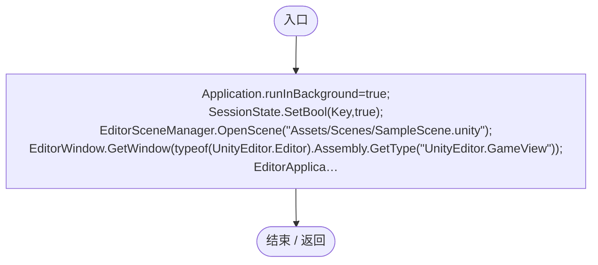

<a id="mfab68ce2a6caed55"></a>

## Check · L30

`private static void Check(bool pass,string message)`


### Editor · Roslyn编译器控制流

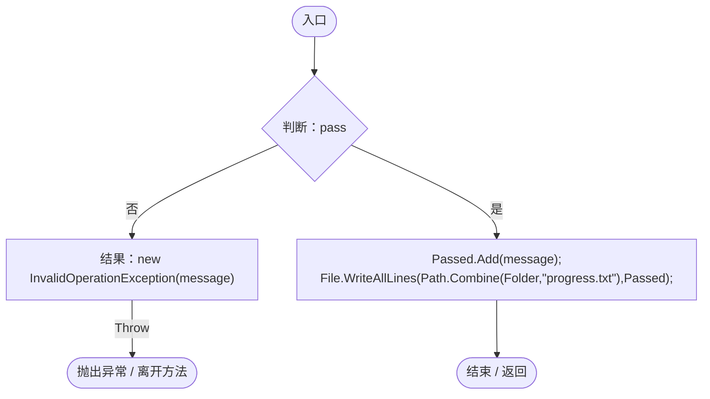

<a id="m0537b1bd3dff52b6"></a>

## Guard · L31

`private static IEnumerator Guard()`


### Editor · Roslyn编译器控制流

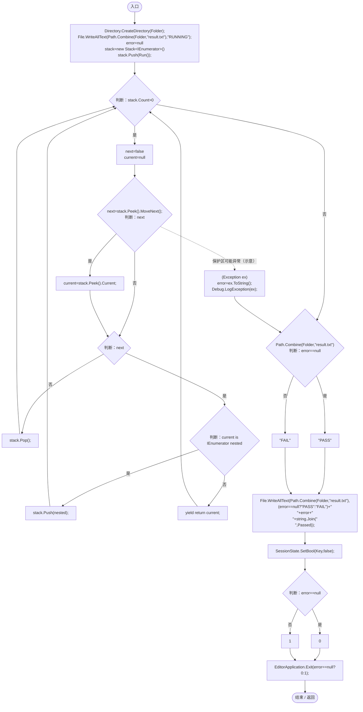

项目内调用/回调引用：

- [ActiveControlsRegression.Run · L45](2eab88692e68527d.md#m417f550541519bb1)（方法）

<a id="m7f3b7f45f16e73c7"></a>

## Spawn · L37

`private static DarwinEntity Spawn(params (string,float)[] values)`


### Editor · Roslyn编译器控制流

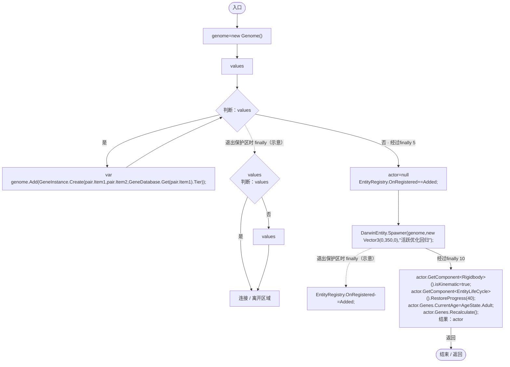

项目内调用/回调引用：

- [Genome.Add · L19](a2ef23f865bc7ee8.md#md9cfdc94b8b8d40f)（方法）
- [GeneInstance.Create · L20](f82e1498d67f5afd.md#m72e94c278de3cf8b)（方法）
- [GeneDatabase.Get · L136](ec0a03483435a863.md#me6a5fefe6c3492f9)（方法）
- [EntityLifeCycle.RestoreProgress · L51](9f4138bfbae654b7.md#mec34c953ece464ab)（方法）
- [EntityGeneController.CurrentAge.set · L37](7494d53178552f0e.md#md8993fc83a0c41da)（访问器）
- [DarwinEntity.Genes.get · L14](70798dde169f2e8b.md#m622eb1adf401d431)（访问器）
- [EntityGeneController.Recalculate · L118](7494d53178552f0e.md#m707d9a56b0c7c609)（方法）
- [ActiveControlsRegression.Added · L39](2eab88692e68527d.md#m8ed7ae9cd73438cd)（局部函数）

<a id="m8ed7ae9cd73438cd"></a>

## Added · L39

`void Added(DarwinEntity value)`


### Editor · Roslyn编译器控制流

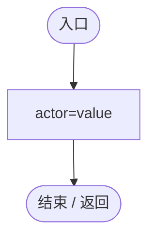

<a id="mdfa6f2de9d1b813d"></a>

## Initialize · L42

`public void Initialize(EntityGeneController owner,GeneInstance gene)`


### Editor · Roslyn编译器控制流

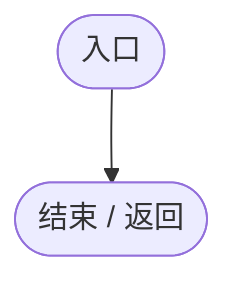

<a id="m28bae2bb8dab3975"></a>

## OnUpdate · L42

`public void OnUpdate(float dt)`


### Editor · Roslyn编译器控制流

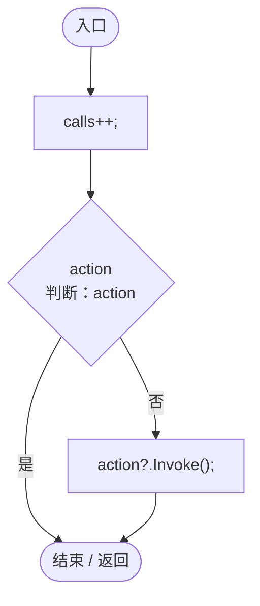

<a id="m050954591e6cc028"></a>

## GetTooltipInfo · L42

`public string GetTooltipInfo()`


### Editor · Roslyn编译器控制流

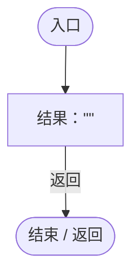

<a id="m38bdf7c672a1b7ca"></a>

## Logics · L43

`private static List<IGeneLogic> Logics(EntityGeneController owner)`


### Editor · Roslyn编译器控制流

```mermaid
flowchart TD
  b0(["入口"])
  b1["结果：((Dictionary&lt;GeneInstance,IGeneLogic&gt;)typeof(EntityGeneController).GetField(&quot;_activeLogics&quot;,BindingFlags.NonPublic&#124;BindingFlags.Instance).GetValue(owner)).Values.ToList()"]
  b2(["结束 / 返回"])
  b0 --> b1
  b1 -->|"返回"| b2

```

<a id="m09c132699f0c061e"></a>

## Field · L44

`private static T Field<T>(object instance,string name)`


### Editor · Roslyn编译器控制流

```mermaid
flowchart TD
  b0(["入口"])
  b1["结果：(T)instance.GetType().GetField(name,BindingFlags.NonPublic&#124;BindingFlags.Instance).GetValue(instance)"]
  b2(["结束 / 返回"])
  b0 --> b1
  b1 -->|"返回"| b2

```

<a id="m417f550541519bb1"></a>

## Run · L45

`private static IEnumerator Run()`


### Editor · Roslyn编译器控制流

```mermaid
flowchart TD
  b0(["入口"])
  b1["session=Object.FindFirstObjectByType&lt;WorldSessionManager&gt;()<br/>session.autoSaveInterval=36000;<br/>planet=Object.FindFirstObjectByType&lt;PlanetTerrainMeshBuilder&gt;()<br/>planet.subdivisions=16;<br/>typeof(WorldSessionManager).GetField(&quot;_initialTerrain&quot;,Bi…"]
  b2{"判断：session.Busy"}
  b3["yield return null;"]
  b4["clock=ServiceLocator.Get&lt;SimulationClock&gt;()<br/>clock.Pause();<br/>Object.FindFirstObjectByType&lt;RandomPlanetSpawner&gt;().enabled=false;<br/>PopulationMaintenance.Restore(null);<br/>GameplayTuning.Current.mutationRoundsEnabled=false;"]
  b5["EntityRegistry.All.ToArray()"]
  b6{"判断：EntityRegistry.All.ToArray()"}
  b7["var<br/>Object.DestroyImmediate(actor.gameObject);"]
  b8{"EntityRegistry.All.ToArray()<br/>判断：EntityRegistry.All.ToArray()"}
  b9["EntityRegistry.All.ToArray()"]
  b10["连接 / 离开区域"]
  b11["ColonyResource.ClearWorld();<br/>entity=Spawn((&quot;gene_growth&quot;,50),(&quot;gene_repair&quot;,50),(&quot;gene_storage&quot;,50),(&quot;gene_nutrition&quot;,50),(&quot;gene_nutrition&quot;,45),(&quot;gene_reproduction&quot;,45))<br/>yield return null;<br/>genes=entity.Genes<br/>optimization=SimulationOptimi…"]
  b12["i=0"]
  b13{"判断：i&lt;5"}
  b14["genes.AdvanceSimulation(.5f);<br/>i++"]
  b15["expected=stats.CaptureValues()"]
  b16["new ReproductionList{values=EntitySaveState.Capture(entity).reproduction}<br/>values=EntitySaveState.Capture(entity).reproduction<br/>expectedReproduction=JsonUtility.ToJson(new ReproductionList{values=EntitySaveState.Capture(entity).reproduction})"]
  b17["progress=entity.GetComponent&lt;EntityLifeCycle&gt;().Progress<br/>initial.Restore(entity);<br/>stats.RestoreValues(depleted);<br/>genes.CurrentAge=oldStage;<br/>optimization.activeExecutionPlan=true;<br/>optimization.activeComponentReuse=true;<br/>skipped=ActiveSimu…"]
  b18["i=0"]
  b19{"判断：i&lt;5"}
  b20["genes.AdvanceSimulation(.5f);<br/>i++"]
  b21["new StatList{values=stats.CaptureValues()}<br/>values=stats.CaptureValues()<br/>JsonUtility.ToJson(new StatList{values=stats.CaptureValues()})"]
  b22["new StatList{values=expected}<br/>values=expected<br/>Check(JsonUtility.ToJson(new StatList{values=stats.CaptureValues()})==JsonUtility.ToJson(new StatList{values=expected}),&quot;优化开关前后生命、营养、储存及所有属性逐值一致&quot;);"]
  b23["new ReproductionList{values=EntitySaveState.Capture(entity).reproduction}<br/>values=EntitySaveState.Capture(entity).reproduction<br/>Check(JsonUtility.ToJson(new ReproductionList{values=EntitySaveState.Capture(entity).reproduction})==expectedRe…"]
  b24["Check(expected.First(v=&gt;v.id==&quot;nutrient&quot;).value&gt;depleted.First(v=&gt;v.id==&quot;nutrient&quot;).value,&quot;等价样本确实产生了营养收入&quot;);<br/>Check(Mathf.Abs(entity.GetComponent&lt;EntityLifeCycle&gt;().Progress-progress)&lt;.00001f,&quot;成长时间逐小步等价&quot;);<br/>Check(ActiveSimulationPlan.Skippe…"]
  b25{"判断：ActiveSimulationBatch.Read&lt;EntityStats&gt;(genes)==stats"}
  b26["ActiveSimulationPlan.ComponentReads==reads"]
  b27["ActiveSimulationBatch.Read&lt;EntityStats&gt;(genes)==stats"]
  b28["Check(ActiveSimulationBatch.Read&lt;EntityStats&gt;(genes)==stats&amp;&amp;ActiveSimulationPlan.ComponentReads==reads,&quot;批次外原生查询不增加优化计数&quot;);"]
  b29["optimization.activeExecutionPlan=true;<br/>optimization.activeComponentReuse=true;"]
  b30["new[]{new[]{(&quot;gene_nutrition&quot;,50f)},new[]{(&quot;gene_nutrition&quot;,20f)},new[]{(&quot;gene_nutrition&quot;,80f)},new[]{(&quot;gene_nutrition&quot;,50f),(&quot;gene_locomotion&quot;,70f)},new[]{(&quot;gene_nutrition&quot;,50f),(&quot;gene_heterotrophy&quot;,75f)},new[]{(&quot;gene_nutrition&quot;,50f),(&quot;…"]
  b31{"判断：new[]{new[]{(&quot;gene_nutrition&quot;,50f)},new[]{(&quot;gene_nutrition&quot;,20f)},new[]{(&quot;gene_nutrition&quot;,80f)},new[]{(&quot;gene_nutrition&quot;,50f),(&quot;gene_locomotion&quot;,70f)},new[]{(&quot;gene_nutrition&quot;,50f),(&quot;gene_heterotrophy&quot;,75f)},new[]{(&quot;gene_nutrition&quot;,50f)…"}
  b32["var"]
  b33["classified=Spawn(recipe)<br/>Check(EcologyEnergyBudget.IsProducer(classified.Genes)==OriginalProducer(classified.Genes),&quot;生产资格与完整规则等价：&quot;+string.Join(&quot;/&quot;,recipe.Select(x=&gt;x.Item1+&quot;:&quot;+x.Item2)));<br/>Check(EcologyMobility.CanMove(classified.Genes)==…"]
  b34["classified.GetComponent&lt;EntityStats&gt;().Modify(&quot;health&quot;,-1);"]
  b35["Application.logMessageReceived-=Error;"]
  b36["Check(!flashError,&quot;同帧停用实体扣血不启动闪烁协程&quot;);<br/>Object.DestroyImmediate(classified.gameObject);"]
  b37{"new[]{new[]{(&quot;gene_nutrition&quot;,50f)},new[]{(&quot;gene_nutrition&quot;,20f)},new[]{(&quot;gene_nutrition&quot;,80f)},new[]{(&quot;gene_nutrition&quot;,50f),(&quot;gene_locomotion&quot;,70f)},new[]{(&quot;gene_nutrition&quot;,50f),(&quot;gene_heterotrophy&quot;,75f)},new[]{(&quot;gene_nutrition&quot;,50f),(&quot;…"}
  b38["new[]{new[]{(&quot;gene_nutrition&quot;,50f)},new[]{(&quot;gene_nutrition&quot;,20f)},new[]{(&quot;gene_nutrition&quot;,80f)},new[]{(&quot;gene_nutrition&quot;,50f),(&quot;gene_locomotion&quot;,70f)},new[]{(&quot;gene_nutrition&quot;,50f),(&quot;gene_heterotrophy&quot;,75f)},new[]{(&quot;gene_nutrition&quot;,50f),(&quot;…"]
  b39["连接 / 离开区域"]
  b40["plan=new ActiveSimulationPlan()<br/>plan.Prepare(genes,Logics(genes));<br/>Check(plan.KnownOnly,&quot;内置行为计划允许批内复用&quot;);<br/>ActiveSimulationBatch.Begin(genes,plan);"]
  b41["count=ActiveSimulationPlan.ComponentHits"]
  b42{"判断：ActiveSimulationBatch.Read&lt;EntityStats&gt;(genes)==stats"}
  b43{"判断：ActiveSimulationBatch.Read&lt;EntityStats&gt;(genes)==stats"}
  b44["ActiveSimulationPlan.ComponentHits==count+1"]
  b45["ActiveSimulationBatch.Read&lt;EntityStats&gt;(genes)==stats&amp;&amp;ActiveSimulationBatch.Read&lt;EntityStats&gt;(genes)==stats&amp;&amp;ActiveSimulationPlan.ComponentHits==count+1"]
  b46["Check(ActiveSimulationBatch.Read&lt;EntityStats&gt;(genes)==stats&amp;&amp;ActiveSimulationBatch.Read&lt;EntityStats&gt;(genes)==stats&amp;&amp;ActiveSimulationPlan.ComponentHits==count+1,&quot;同批组件仅首次真实查询&quot;);"]
  b47["Check(ActiveSimulationBatch.Read&lt;EntityManualControl&gt;(genes)==null,&quot;不存在的可选组件可查询&quot;);<br/>manual=entity.gameObject.AddComponent&lt;EntityManualControl&gt;()<br/>ActiveSimulationBatch.Invalidate(genes);<br/>Check(ActiveSimulationBatch.Read&lt;EntityManualControl…"]
  b48["ActiveSimulationBatch.End(genes);"]
  b49["other=Spawn((&quot;gene_storage&quot;,50))<br/>otherPlan=new ActiveSimulationPlan()<br/>otherPlan.Prepare(other.Genes,Logics(other.Genes));<br/>ActiveSimulationBatch.Begin(genes,plan);"]
  b50["ActiveSimulationBatch.Read&lt;EntityStats&gt;(genes);<br/>ActiveSimulationBatch.Begin(other.Genes,otherPlan);"]
  b51["Check(ActiveSimulationBatch.Read&lt;EntityStats&gt;(other.Genes)==other.GetComponent&lt;EntityStats&gt;(),&quot;嵌套其他实体读取自身组件&quot;);"]
  b52["ActiveSimulationBatch.End(other.Genes);"]
  b53["count=ActiveSimulationPlan.ComponentHits<br/>ActiveSimulationBatch.Read&lt;EntityStats&gt;(genes);<br/>Check(ActiveSimulationPlan.ComponentHits==count+1,&quot;嵌套批次结束恢复父缓存&quot;);"]
  b54["ActiveSimulationBatch.End(genes);"]
  b55["callback=new Callback()<br/>unknownPlan=new ActiveSimulationPlan()"]
  b56["new List&lt;IGeneLogic&gt;{callback}<br/>callback<br/>unknown=new List&lt;IGeneLogic&gt;{callback}"]
  b57["unknownPlan.Run(genes,unknown,.1f);"]
  b58{"判断：callback.calls==1"}
  b59["!unknownPlan.KnownOnly"]
  b60["callback.calls==1"]
  b61["Check(callback.calls==1&amp;&amp;!unknownPlan.KnownOnly,&quot;未知扩展始终执行并回退原组件查询&quot;);"]
  b62["passive=new GrowthGeneLogic()<br/>passive.Initialize(genes,genes.Genome.Genes.First(g=&gt;g.DefinitionId==&quot;gene_growth&quot;));<br/>tail=new Callback()<br/>callback.action=()=&gt;genes.Recalculate();"]
  b63["new List&lt;IGeneLogic&gt;{callback,passive,tail}<br/>callback<br/>passive<br/>tail<br/>changed=new List&lt;IGeneLogic&gt;{callback,passive,tail}"]
  b64["unknownPlan.Invalidate();<br/>unknownPlan.Run(genes,changed,.1f);<br/>Check(tail.calls==1,&quot;回调重算后继续原快照剩余行为，下一步重建计划&quot;);<br/>blocked=ActiveNutritionContext.Blocked(genes)<br/>optimization.activeComponentReuse=false;<br/>Check(blocked==ActiveNutritionContext.Blo…"]
  b65{"ActiveNutritionContext.Blocked(genes)<br/>判断：EcologyQueries.Active(genes,NutritionEcologySettings.Current.heterotrophyGene)!=null"}
  b66["EcologyQueries.Active(genes,NutritionEcologySettings.Current.scavengerGene)!=null"]
  b67["EcologyQueries.Active(genes,NutritionEcologySettings.Current.heterotrophyGene)!=null"]
  b68["Check(ActiveNutritionContext.Blocked(genes)==(EcologyQueries.Active(genes,NutritionEcologySettings.Current.heterotrophyGene)!=null&#124;&#124;EcologyQueries.Active(genes,NutritionEcologySettings.Current.scavengerGene)!=null),&quot;表达重算后生产资格重新解析&quot;);"]
  b69["panel=Object.FindFirstObjectByType&lt;SimulationRulesPanel&gt;()"]
  b70{"panel<br/>判断：panel"}
  b71[".Card"]
  b72["panel"]
  b73{"判断：panel?.Card==null"}
  b74["yield return null;<br/>panel=Object.FindFirstObjectByType&lt;SimulationRulesPanel&gt;();"]
  b75{"extension=panel.GetComponent&lt;RuleCardExtensions&gt;()<br/>判断：extension==null"}
  b76["extension=panel.Card.GetComponent&lt;RuleCardExtensions&gt;();"]
  b77["dropdown=panel.Card.Find(&quot;RuleList&quot;).GetComponent&lt;Dropdown&gt;()"]
  b78{"判断：panel.Card.Find(&quot;CleanupTab&quot;)==null"}
  b79{"判断：dropdown.options.Count==3"}
  b80["panel.Card.sizeDelta==new Vector2(260,164)"]
  b81["panel.Card.Find(&quot;CleanupTab&quot;)==null&amp;&amp;dropdown.options.Count==3&amp;&amp;panel.Card.sizeDelta==new Vector2(260,164)"]
  b82["Check(panel.Card.Find(&quot;CleanupTab&quot;)==null&amp;&amp;dropdown.options.Count==3&amp;&amp;panel.Card.sizeDelta==new Vector2(260,164),&quot;同尺寸规则卡使用列表，不保留旧页签按钮&quot;);"]
  b83{"panel.Card.Find(&quot;Fraction&quot;).GetComponent&lt;InputField&gt;().text=&quot;23&quot;;<br/>dropdown.value=1;<br/>panel.Card.Find(&quot;Fraction&quot;).GetComponent&lt;InputField&gt;().text=&quot;67&quot;;<br/>dropdown.value=0;<br/>Check(panel.Card.Find(&quot;Fraction&quot;).GetComponent&lt;InputField&gt;().text==&quot;2…"}
  b84["panel.GetComponentsInChildren&lt;Button&gt;(true).Single(b=&gt;b.name==&quot;OpenRules&quot;).onClick.Invoke();"]
  b85["yield return null;"]
  b86{"判断：dropdown.captionText.text.Length&gt;0"}
  b87["dropdown.captionText.rectTransform.rect.height&gt;=dropdown.captionText.preferredHeight"]
  b88["dropdown.captionText.text.Length&gt;0"]
  b89["Check(dropdown.captionText.text.Length&gt;0&amp;&amp;dropdown.captionText.rectTransform.rect.height&gt;=dropdown.captionText.preferredHeight,&quot;紧凑列表标题文字有足够空间，不被默认内边距裁空&quot;);"]
  b90["dropdown.Show();<br/>yield return null;<br/>Check(dropdown.transform.Find(&quot;Dropdown List&quot;)!=null,&quot;规则列表真实展开&quot;);<br/>dropdown.Hide();<br/>yield return new WaitForSecondsRealtime(.3f);<br/>Check(dropdown.transform.Find(&quot;Dropdown List&quot;)==null,&quot;规则列表关闭不残留遮罩&quot;);<br/>thi…"]
  b91{"判断：extension.Rules.Select(&quot;audit&quot;)"}
  b92{"判断：third"}
  b93["dropdown.options.Count==4"]
  b94["extension.Rules.Select(&quot;audit&quot;)&amp;&amp;third&amp;&amp;dropdown.options.Count==4"]
  b95["Check(extension.Rules.Select(&quot;audit&quot;)&amp;&amp;third&amp;&amp;dropdown.options.Count==4,&quot;追加规则可登记并选择，无需扩展标题按钮&quot;);"]
  b96["extension.Rules.Select(&quot;mutation&quot;);<br/>inspector=Object.FindFirstObjectByType&lt;GeneInspectorUI&gt;()<br/>inspector.ShowEntityInfo(entity);<br/>yield return null;<br/>inspectorPanel=Field&lt;GameObject&gt;(inspector,&quot;_panel&quot;)<br/>size=inspectorPanel.GetComponent&lt;Rect…"]
  b97{"判断：entry!=null"}
  b98["entry.GetComponentInChildren&lt;Text&gt;().text==&quot;编辑&quot;"]
  b99["entry!=null"]
  b100["Check(entry!=null&amp;&amp;entry.GetComponentInChildren&lt;Text&gt;().text==&quot;编辑&quot;,&quot;原位置入口仅显示编辑&quot;);"]
  b101["hover=inspectorPanel.GetComponentsInChildren&lt;GeneHoverSurface&gt;().First(s=&gt;s.name.StartsWith(&quot;Block_gene_nutrition_&quot;))<br/>pointer=new PointerEventData(EventSystem.current)<br/>ExecuteEvents.Execute(hover.gameObject,pointer,ExecuteEvents.pointerE…"]
  b102{"判断：tooltip.activeSelf"}
  b103["Field&lt;Text&gt;(inspector,&quot;_tooltipText&quot;).text.Contains(&quot;禁用&quot;)"]
  b104["tooltip.activeSelf"]
  b105["Check(tooltip.activeSelf&amp;&amp;Field&lt;Text&gt;(inspector,&quot;_tooltipText&quot;).text.Contains(&quot;禁用&quot;),&quot;整张基因卡悬浮显示实际失效原因&quot;);"]
  b106["Check(tooltip.GetComponentsInChildren&lt;Graphic&gt;().All(g=&gt;!g.raycastTarget),&quot;提示不拦截下方数值框或按钮&quot;);<br/>ExecuteEvents.Execute(hover.gameObject,pointer,ExecuteEvents.pointerExitHandler);<br/>Check(!tooltip.activeSelf,&quot;离开基因卡关闭原因提示&quot;);<br/>entry.GetComponent&lt;Bu…"]
  b107{"判断：EntityEditPopup.Instance.Visible"}
  b108["inspectorPanel.GetComponent&lt;RectTransform&gt;().sizeDelta==size"]
  b109["EntityEditPopup.Instance.Visible"]
  b110["Check(EntityEditPopup.Instance.Visible&amp;&amp;inspectorPanel.GetComponent&lt;RectTransform&gt;().sizeDelta==size,&quot;编辑入口有效且原检查面板大小不变&quot;);"]
  b111["EntityEditPopup.Instance.Close();<br/>Check(!GameInputGate.Blocked,&quot;关闭编辑恢复游戏输入&quot;);<br/>Check(AtmosphereViewPolicy.OuterRadius(planet.Data,1,20)&gt;=planet.Data.Vertices.Max(v=&gt;v.magnitude)+19.99f,&quot;大气外壳覆盖最高地形并保留厚度&quot;);<br/>atmosphere=planet.transform.Find(…"]
  b112(["结束 / 返回"])
  b0 --> b1
  b1 --> b2
  b2 -->|"是"| b3
  b2 -->|"否"| b4
  b3 --> b2
  b4 --> b5
  b5 --> b6
  b6 -->|"是"| b7
  b6 -->|"否 · 经过finally 8"| b11
  b7 --> b6
  b8 -->|"否"| b9
  b8 -->|"是"| b10
  b9 --> b10
  b11 --> b12
  b12 --> b13
  b13 -->|"是"| b14
  b13 -->|"否"| b15
  b14 --> b13
  b15 --> b16
  b16 --> b17
  b17 --> b18
  b18 --> b19
  b19 -->|"是"| b20
  b19 -->|"否"| b21
  b20 --> b19
  b21 --> b22
  b22 --> b23
  b23 --> b24
  b24 --> b25
  b25 -->|"是"| b26
  b25 -->|"否"| b27
  b26 --> b28
  b27 --> b28
  b28 --> b29
  b29 --> b30
  b30 --> b31
  b31 -->|"是"| b32
  b31 -->|"否 · 经过finally 37"| b40
  b32 --> b33
  b33 --> b34
  b34 -->|"经过finally 35"| b36
  b36 --> b31
  b37 -->|"否"| b38
  b37 -->|"是"| b39
  b38 --> b39
  b40 --> b41
  b41 --> b42
  b42 -->|"是"| b43
  b42 -->|"否"| b45
  b43 -->|"是"| b44
  b43 -->|"否"| b45
  b44 --> b46
  b45 --> b46
  b46 --> b47
  b47 -->|"经过finally 48"| b49
  b49 --> b50
  b50 --> b51
  b51 -->|"经过finally 52"| b53
  b53 -->|"经过finally 54"| b55
  b55 --> b56
  b56 --> b57
  b57 --> b58
  b58 -->|"是"| b59
  b58 -->|"否"| b60
  b59 --> b61
  b60 --> b61
  b61 --> b62
  b62 --> b63
  b63 --> b64
  b64 --> b65
  b65 -->|"否"| b66
  b65 -->|"是"| b67
  b66 --> b68
  b67 --> b68
  b68 --> b69
  b69 --> b70
  b70 -->|"否"| b71
  b70 -->|"是"| b72
  b71 --> b73
  b72 --> b73
  b73 -->|"是"| b74
  b73 -->|"否"| b75
  b74 --> b70
  b75 -->|"是"| b76
  b75 -->|"否"| b77
  b76 --> b77
  b77 --> b78
  b78 -->|"是"| b79
  b78 -->|"否"| b81
  b79 -->|"是"| b80
  b79 -->|"否"| b81
  b80 --> b82
  b81 --> b82
  b82 --> b83
  b83 -->|"否"| b84
  b83 -->|"是"| b85
  b84 --> b85
  b85 --> b86
  b86 -->|"是"| b87
  b86 -->|"否"| b88
  b87 --> b89
  b88 --> b89
  b89 --> b90
  b90 --> b91
  b91 -->|"是"| b92
  b91 -->|"否"| b94
  b92 -->|"是"| b93
  b92 -->|"否"| b94
  b93 --> b95
  b94 --> b95
  b95 --> b96
  b96 --> b97
  b97 -->|"是"| b98
  b97 -->|"否"| b99
  b98 --> b100
  b99 --> b100
  b100 --> b101
  b101 --> b102
  b102 -->|"是"| b103
  b102 -->|"否"| b104
  b103 --> b105
  b104 --> b105
  b105 --> b106
  b106 --> b107
  b107 -->|"是"| b108
  b107 -->|"否"| b109
  b108 --> b110
  b109 --> b110
  b110 --> b111
  b111 --> b112
  b6 -. "退出保护区时 finally（示意）" .-> b8
  b34 -. "退出保护区时 finally（示意）" .-> b35
  b31 -. "退出保护区时 finally（示意）" .-> b37
  b41 -. "退出保护区时 finally（示意）" .-> b48
  b51 -. "退出保护区时 finally（示意）" .-> b52
  b50 -. "退出保护区时 finally（示意）" .-> b54

```

项目内调用/回调引用：

- [PlanetClimateMap.Instance.get · L16](b4e9726c1bcf4c37.md#m3add54a419aeef9f)（访问器）
- [PlanetOreSystem.Instance.get · L8](86b3fbb4d9436121.md#m53f6a6af4b6dc252)（访问器）
- [WorldSessionManager.Create · L41](08741c7b7b9d9344.md#m6aadfeee8b90aacd)（方法）
- [WorldSessionManager.Busy.get · L24](08741c7b7b9d9344.md#m4483e2e4f28f7c85)（访问器）
- [ServiceLocator.Get · L33](f2fdbe9f9ccd93cb.md#m2ae625299520c56d)（方法）
- [SimulationClock.Pause · L79](a8f444aec9614b0a.md#m30929d45a885d0f1)（方法）
- [PopulationMaintenance.Restore · L162](923ccc4e86c4786c.md#m23ae054ef57d2624)（方法）
- [GameplayTuning.Current.get · L46](db546e5713b32d53.md#m4fa691bd8a3b9618)（访问器）
- [ColonyResource.ClearWorld · L109](293dbaecfff4b585.md#mc969798f9562c061)（方法）
- [ActiveControlsRegression.Spawn · L37](2eab88692e68527d.md#m7f3b7f45f16e73c7)（方法）
- [DarwinEntity.Genes.get · L14](70798dde169f2e8b.md#m622eb1adf401d431)（访问器）
- [SimulationOptimization.Current.get · L25](11c9091e70893352.md#mde7abfdc18429e4a)（访问器）
- [EntitySaveState.Capture · L22](a1ec8fcd9d7d3ddb.md#md994065ded6697b7)（方法）
- [EntityStats.Modify · L111](75aa86a368efdf24.md#m9c837be197158240)（方法）
- [EntityStats.CaptureValues · L86](75aa86a368efdf24.md#mbf54fc67f0d07a99)（方法）
- [EntityGeneController.CurrentAge.get · L37](7494d53178552f0e.md#md08823d8f9a2fa16)（访问器）
- [EntityGeneController.AdvanceSimulation · L73](7494d53178552f0e.md#m0056817ce3208fda)（方法）
- [EntityLifeCycle.Progress.get · L10](9f4138bfbae654b7.md#m178185fd5f5a0d74)（访问器）
- [EntitySaveState.Restore · L32](a1ec8fcd9d7d3ddb.md#md1cca8b8dd3628a4)（方法）
- [EntityStats.RestoreValues · L88](75aa86a368efdf24.md#m774f994eaa3183ca)（方法）
- [EntityGeneController.CurrentAge.set · L37](7494d53178552f0e.md#md8993fc83a0c41da)（访问器）
- [ActiveControlsRegression.Check · L30](2eab88692e68527d.md#mfab68ce2a6caed55)（方法）
- [EntityGeneController.Recalculate · L118](7494d53178552f0e.md#m707d9a56b0c7c609)（方法）
- [ActiveSimulationBatch.Read · L57](ac63422a085684a6.md#mc77e063d3598b3fd)（方法）
- [EcologyEnergyBudget.IsProducer · L27](06a91c8201f26593.md#mdf11c493dfe1c754)（方法）
- [ActiveControlsRegression.OriginalProducer · L78](2eab88692e68527d.md#m7ea3afc5a451fae4)（方法）
- [EcologyMobility.CanMove · L6](5cf9761659037d31.md#m9806988ade82d499)（方法）
- [EntityGeneController.GetAttribute · L286](7494d53178552f0e.md#m18bff2b38f95b556)（方法）
- [EcologyBalanceSettings.Current.get · L29](5a37bc79f15f6238.md#md33d4c4b8f82540b)（访问器）
- [EntityStats.Modify · L104](75aa86a368efdf24.md#m858c2a75d852ecc1)（方法）
- [ActiveSimulationPlan.Prepare · L18](ac63422a085684a6.md#m5803c8392b641c09)（方法）
- [ActiveControlsRegression.Logics · L43](2eab88692e68527d.md#m38bdf7c672a1b7ca)（方法）
- [ActiveSimulationPlan.KnownOnly.get · L13](ac63422a085684a6.md#m1ed86b674f03aacf)（访问器）
- [ActiveSimulationBatch.Begin · L54](ac63422a085684a6.md#m7a86232ecedfc1dd)（方法）
- [ActiveSimulationBatch.Invalidate · L56](ac63422a085684a6.md#m93e82d58ab35f4b5)（方法）
- [ActiveSimulationBatch.End · L55](ac63422a085684a6.md#m4f433d617af31f34)（方法）
- [ActiveSimulationPlan.Run · L35](ac63422a085684a6.md#m07e7dcf97d5c36f2)（方法）
- [GrowthGeneLogic.Initialize · L10](136851db51415ac3.md#mc66cf44d40afbe23)（方法）
- [ActiveSimulationPlan.Invalidate · L15](ac63422a085684a6.md#m2a303a152f180f6a)（方法）
- [ActiveNutritionContext.Blocked · L15](e8a4c7e1945f6f55.md#m41c43e35cb837ab8)（方法）
- [EcologyQueries.Active · L29](bdf7ccc2c9c0452f.md#m200839bb9db5ec55)（方法）
- [NutritionEcologySettings.Current.get · L19](846a17351dbd6aa4.md#mb3eb930022e314f3)（访问器）
- [SimulationRuleList.Register · L23](8e0c9b70cd52abbf.md#m3753c727dbdbe6be)（方法）
- [RuleCardExtensions.Rules.get · L15](92d59cd12a5696c3.md#m82cd86458c20264f)（访问器）
- [SimulationRuleList.Select · L25](8e0c9b70cd52abbf.md#m93e0ddaa26b331e3)（方法）
- [GeneInspectorUI.ShowEntityInfo · L387](924e27c34e7b1f0a.md#mfbae827fa8eb1ff1)（方法）
- [ActiveControlsRegression.Field · L44](2eab88692e68527d.md#m09c132699f0c061e)（方法）
- [EntityEditPopup.Instance.get · L13](79ed73ecd9855f79.md#md1e4e9556a61fb18)（访问器）
- [EntityEditPopup.Close · L34](79ed73ecd9855f79.md#m07792a3835d81df8)（方法）
- [GameInputGate.Blocked.get · L8](52955daae7e592ab.md#m765763b665829633)（访问器）
- [AtmosphereViewPolicy.OuterRadius · L8](77ad1469df9525fa.md#m40521f3c999c1a8b)（方法）
- [PlanetTerrainMeshBuilder.Data.get · L81](415285cf043354a9.md#m1a65abfe0f34c5d8)（访问器）
- [AtmosphereViewPolicy.Apply · L10](77ad1469df9525fa.md#m214bc119bec45f2d)（方法）
- [PopulationRatioRuleChecks.Capture · L45](8a1ed94562678893.md#m466400a34da14018)（方法）
- [ActiveControlsRegression.回调@53 · L53](2eab88692e68527d.md#mbdd1c32f1a91e4c9)（回调/委托）
- [ActiveControlsRegression.回调@53 · L53](2eab88692e68527d.md#m721917d0bd0155c8)（回调/委托）
- [ActiveControlsRegression.回调@57 · L57](2eab88692e68527d.md#mf58d49c68ecd4542)（回调/委托）
- [ActiveControlsRegression.回调@57 · L57](2eab88692e68527d.md#maf00cfdf2562a5f3)（回调/委托）
- [ActiveControlsRegression.回调@58 · L58](2eab88692e68527d.md#m38b0c37385d86f6a)（回调/委托）
- [ActiveControlsRegression.Error · L59](2eab88692e68527d.md#md83a034f7d3194e5)（局部函数）
- [ActiveControlsRegression.回调@64 · L64](2eab88692e68527d.md#m505837fd15deb841)（回调/委托）
- [ActiveControlsRegression.回调@64 · L64](2eab88692e68527d.md#m873fbc1282466bd1)（回调/委托）
- [ActiveControlsRegression.回调@65 · L65](2eab88692e68527d.md#me9ca645fdf2950b4)（回调/委托）
- [ActiveControlsRegression.回调@69 · L69](2eab88692e68527d.md#mafc5ab6d619f4d27)（回调/委托）
- [ActiveControlsRegression.回调@71 · L71](2eab88692e68527d.md#m844e43c57ba88e50)（回调/委托）
- [ActiveControlsRegression.回调@72 · L72](2eab88692e68527d.md#me74505b7332ec33d)（回调/委托）
- [ActiveControlsRegression.回调@72 · L72](2eab88692e68527d.md#m918b2dbcf3de3e93)（回调/委托）
- [ActiveControlsRegression.回调@74 · L74](2eab88692e68527d.md#mb0882150ce45ab67)（回调/委托）

<a id="mbdd1c32f1a91e4c9"></a>

## 回调@53 · L53

`v … => 回调`


### Editor · Roslyn编译器控制流

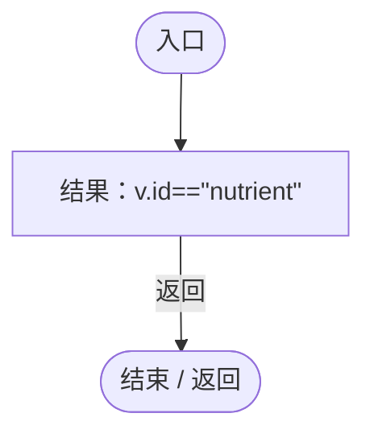

<a id="m721917d0bd0155c8"></a>

## 回调@53 · L53

`v … => 回调`


### Editor · Roslyn编译器控制流


<a id="mf58d49c68ecd4542"></a>

## 回调@57 · L57

`x … => 回调`


### Editor · Roslyn编译器控制流

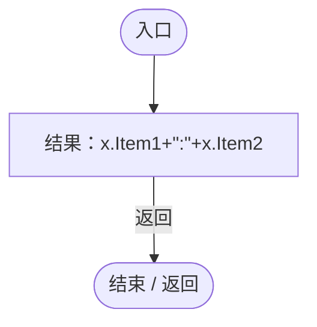

<a id="maf00cfdf2562a5f3"></a>

## 回调@57 · L57

`x … => 回调`


### Editor · Roslyn编译器控制流

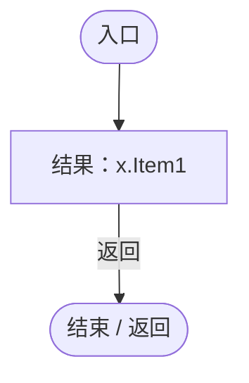

<a id="m38b0c37385d86f6a"></a>

## 回调@58 · L58

`_ … => 回调`


### Editor · Roslyn编译器控制流

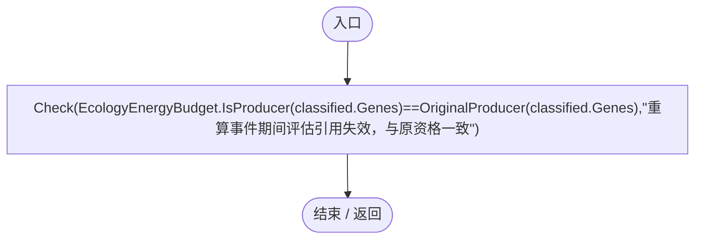

项目内调用/回调引用：

- [ActiveControlsRegression.Check · L30](2eab88692e68527d.md#mfab68ce2a6caed55)（方法）
- [EcologyEnergyBudget.IsProducer · L27](06a91c8201f26593.md#mdf11c493dfe1c754)（方法）
- [DarwinEntity.Genes.get · L14](70798dde169f2e8b.md#m622eb1adf401d431)（访问器）
- [ActiveControlsRegression.OriginalProducer · L78](2eab88692e68527d.md#m7ea3afc5a451fae4)（方法）

<a id="md83a034f7d3194e5"></a>

## Error · L59

`void Error(string text,string stack,LogType type)`


### Editor · Roslyn编译器控制流

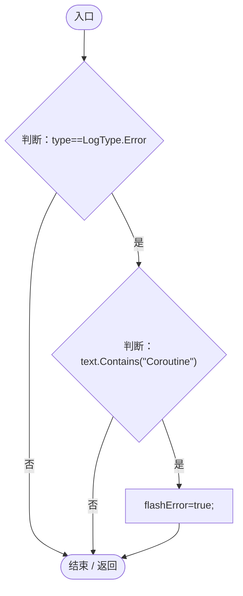

<a id="m505837fd15deb841"></a>

## 回调@64 · L64

`g … => 回调`


### Editor · Roslyn编译器控制流

```mermaid
flowchart TD
  b0(["入口"])
  b1["结果：g.DefinitionId==&quot;gene_growth&quot;"]
  b2(["结束 / 返回"])
  b0 --> b1
  b1 -->|"返回"| b2

```

<a id="m873fbc1282466bd1"></a>

## 回调@64 · L64

`( … => 回调`


### Editor · Roslyn编译器控制流

```mermaid
flowchart TD
  b0(["入口"])
  b1["genes.Recalculate()"]
  b2(["结束 / 返回"])
  b0 --> b1
  b1 --> b2

```

项目内调用/回调引用：

- [EntityGeneController.Recalculate · L118](7494d53178552f0e.md#m707d9a56b0c7c609)（方法）

<a id="me9ca645fdf2950b4"></a>

## 回调@65 · L65

`g … => 回调`


### Editor · Roslyn编译器控制流

```mermaid
flowchart TD
  b0(["入口"])
  b1["结果：g.DefinitionId==&quot;gene_nutrition&quot;"]
  b2(["结束 / 返回"])
  b0 --> b1
  b1 -->|"返回"| b2

```

<a id="mafc5ab6d619f4d27"></a>

## 回调@69 · L69

`b … => 回调`


### Editor · Roslyn编译器控制流

```mermaid
flowchart TD
  b0(["入口"])
  b1["结果：b.name==&quot;OpenRules&quot;"]
  b2(["结束 / 返回"])
  b0 --> b1
  b1 -->|"返回"| b2

```

<a id="m844e43c57ba88e50"></a>

## 回调@71 · L71

`( … => 回调`


### Editor · Roslyn编译器控制流

```mermaid
flowchart TD
  b0(["入口"])
  b1["third=true"]
  b2(["结束 / 返回"])
  b0 --> b1
  b1 --> b2

```

<a id="me74505b7332ec33d"></a>

## 回调@72 · L72

`s … => 回调`


### Editor · Roslyn编译器控制流

```mermaid
flowchart TD
  b0(["入口"])
  b1["结果：s.name.StartsWith(&quot;Block_gene_nutrition_&quot;)"]
  b2(["结束 / 返回"])
  b0 --> b1
  b1 -->|"返回"| b2

```

<a id="m918b2dbcf3de3e93"></a>

## 回调@72 · L72

`g … => 回调`


### Editor · Roslyn编译器控制流

```mermaid
flowchart TD
  b0(["入口"])
  b1["结果：!g.raycastTarget"]
  b2(["结束 / 返回"])
  b0 --> b1
  b1 -->|"返回"| b2

```

<a id="mb0882150ce45ab67"></a>

## 回调@74 · L74

`v … => 回调`


### Editor · Roslyn编译器控制流

```mermaid
flowchart TD
  b0(["入口"])
  b1["结果：v.magnitude"]
  b2(["结束 / 返回"])
  b0 --> b1
  b1 -->|"返回"| b2

```

<a id="m7ea3afc5a451fae4"></a>

## OriginalProducer · L78

`private static bool OriginalProducer(EntityGeneController genes)`


### Editor · Roslyn编译器控制流

```mermaid
flowchart TD
  b0(["入口"])
  b1{"settings=EcologyBalanceSettings.Current<br/>判断：genes==null"}
  b2{"genes.GetComponent&lt;EggIncubation&gt;()<br/>判断：genes.GetComponent&lt;EggIncubation&gt;()"}
  b3[".Incubating"]
  b4["genes.GetComponent&lt;EggIncubation&gt;()"]
  b5{"判断：genes.GetComponent&lt;EggIncubation&gt;()?.Incubating==true"}
  b6["结果：false"]
  b7{"判断：EcologyQueries.Active(genes,NutritionEcologySettings.Current.heterotrophyGene)!=null"}
  b8{"判断：EcologyQueries.Active(genes,NutritionEcologySettings.Current.scavengerGene)!=null"}
  b9["结果：false"]
  b10["selected=null"]
  b11["genes.Evaluation.Genes"]
  b12{"判断：genes.Evaluation.Genes"}
  b13{"var<br/>判断：gene.IsActive"}
  b14{"判断：gene.Definition.Id==settings.nutritionGene"}
  b15{"判断：selected==null"}
  b16{"判断：gene.EffectiveStrength&gt;selected.EffectiveStrength"}
  b17["selected=gene;"]
  b18["genes.Evaluation.Genes"]
  b19{"selected<br/>判断：selected"}
  b20[".State"]
  b21["selected"]
  b22{"判断：selected?.State!=null"}
  b23{"判断：Array.IndexOf(settings.producerStates,selected.State.StateId)&gt;=0"}
  b24["genes.GetAttribute(settings.movementAttribute)&lt;=0"]
  b25["selected?.State!=null&amp;&amp;Array.IndexOf(settings.producerStates,selected.State.StateId)&gt;=0&amp;&amp;genes.GetAttribute(settings.movementAttribute)&lt;=0"]
  b26["结果：selected?.State!=null&amp;&amp;Array.IndexOf(settings.producerStates,selected.State.StateId)&gt;=0&amp;&amp;genes.GetAttribute(settings.movementAttribute)&lt;=0"]
  b27(["结束 / 返回"])
  b0 --> b1
  b1 -->|"否"| b2
  b1 -->|"是"| b6
  b2 -->|"否"| b3
  b2 -->|"是"| b4
  b3 --> b5
  b4 --> b5
  b5 -->|"是"| b6
  b5 -->|"否"| b7
  b6 -->|"返回"| b27
  b7 -->|"否"| b8
  b7 -->|"是"| b9
  b8 -->|"是"| b9
  b8 -->|"否"| b10
  b9 -->|"返回"| b27
  b10 --> b11
  b11 --> b12
  b12 -->|"是"| b13
  b12 -->|"否 · 经过finally 18"| b19
  b13 -->|"是"| b14
  b13 -->|"否"| b12
  b14 -->|"是"| b15
  b14 -->|"否"| b12
  b15 -->|"否"| b16
  b15 -->|"是"| b17
  b16 -->|"是"| b17
  b16 -->|"否"| b12
  b17 --> b12
  b19 -->|"否"| b20
  b19 -->|"是"| b21
  b20 --> b22
  b21 --> b22
  b22 -->|"是"| b23
  b22 -->|"否"| b25
  b23 -->|"是"| b24
  b23 -->|"否"| b25
  b24 --> b26
  b25 --> b26
  b26 -->|"返回"| b27
  b12 -. "退出保护区时 finally（示意）" .-> b18

```

项目内调用/回调引用：

- [EcologyBalanceSettings.Current.get · L29](5a37bc79f15f6238.md#md33d4c4b8f82540b)（访问器）
- [EcologyQueries.Active · L29](bdf7ccc2c9c0452f.md#m200839bb9db5ec55)（方法）
- [NutritionEcologySettings.Current.get · L19](846a17351dbd6aa4.md#mb3eb930022e314f3)（访问器）
- [EntityGeneController.Evaluation.get · L18](7494d53178552f0e.md#mc0039c100a31b455)（访问器）
- [EntityGeneController.GetAttribute · L286](7494d53178552f0e.md#m18bff2b38f95b556)（方法）
