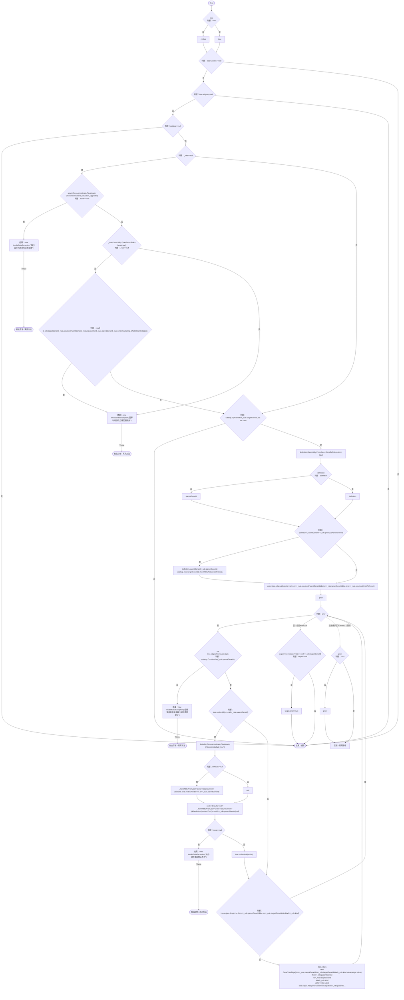
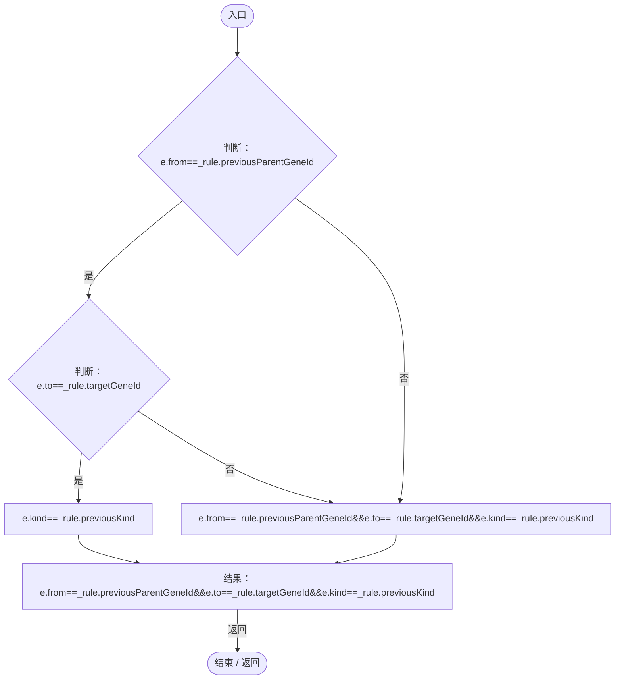
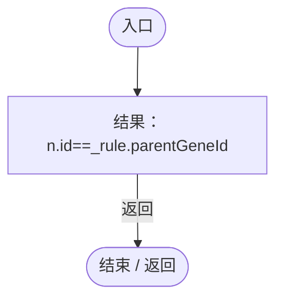
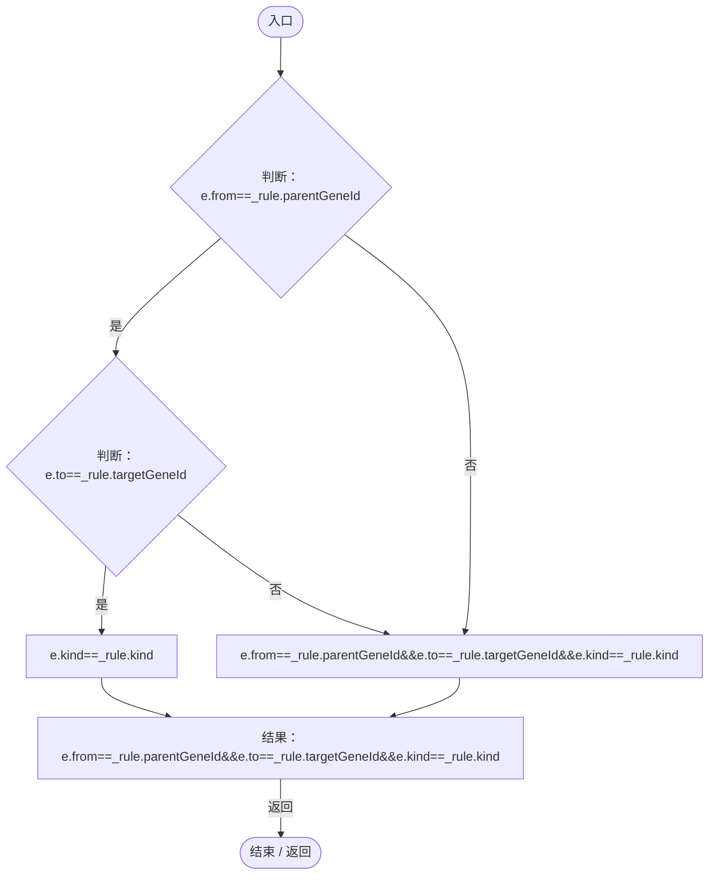
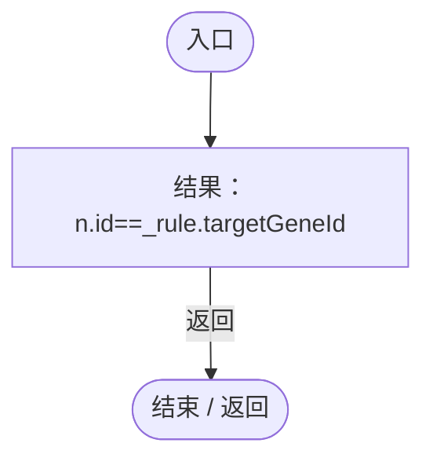

# NutrientUtilizationEvolutionUpgrade.cs

[返回总索引](../README.md) · `Runtime` · `Assets/DarwinPark/Genetics/NutrientUtilizationEvolutionUpgrade.cs`

[源文件](../../../Assets/DarwinPark/Genetics/NutrientUtilizationEvolutionUpgrade.cs) · 源码校验：`f009c37a9d2ea9f0131b392778d7b63bfc41c1dd85e9b746a629833f69fd35e9`

方法按源文件位置排列。事件/回调引用不表示立即执行；分支与异常说明见总索引。完整源码与可点击关系图请打开离线手册。

## Apply · L15

`public static void Apply(GeneTreeDocument tree,Dictionary<string,string> catalog)`

### Editor / Player · Roslyn编译器控制流

项目内调用/回调引用：

- [NutrientUtilizationEvolutionUpgrade.回调@27 · L27](31507b5a0e171a28.md#macdc33d489483e67)（回调/委托）
- [NutrientUtilizationEvolutionUpgrade.回调@33 · L33](31507b5a0e171a28.md#m57016a6cb8e24d44)（回调/委托）
- [NutrientUtilizationEvolutionUpgrade.回调@36 · L36](31507b5a0e171a28.md#mf2f433038fa079b0)（回调/委托）
- [NutrientUtilizationEvolutionUpgrade.回调@39 · L39](31507b5a0e171a28.md#mffc26055ed8e4a55)（回调/委托）
- [NutrientUtilizationEvolutionUpgrade.回调@41 · L41](31507b5a0e171a28.md#ma175cf5e4a52b6b0)（回调/委托）

## 回调@27 · L27

`e … => 回调`

### Editor / Player · Roslyn编译器控制流

## 回调@33 · L33

`n … => 回调`

### Editor / Player · Roslyn编译器控制流

## 回调@36 · L36

`n … => 回调`

### Editor / Player · Roslyn编译器控制流

## 回调@39 · L39

`e … => 回调`

### Editor / Player · Roslyn编译器控制流

## 回调@41 · L41

`n … => 回调`

### Editor / Player · Roslyn编译器控制流

