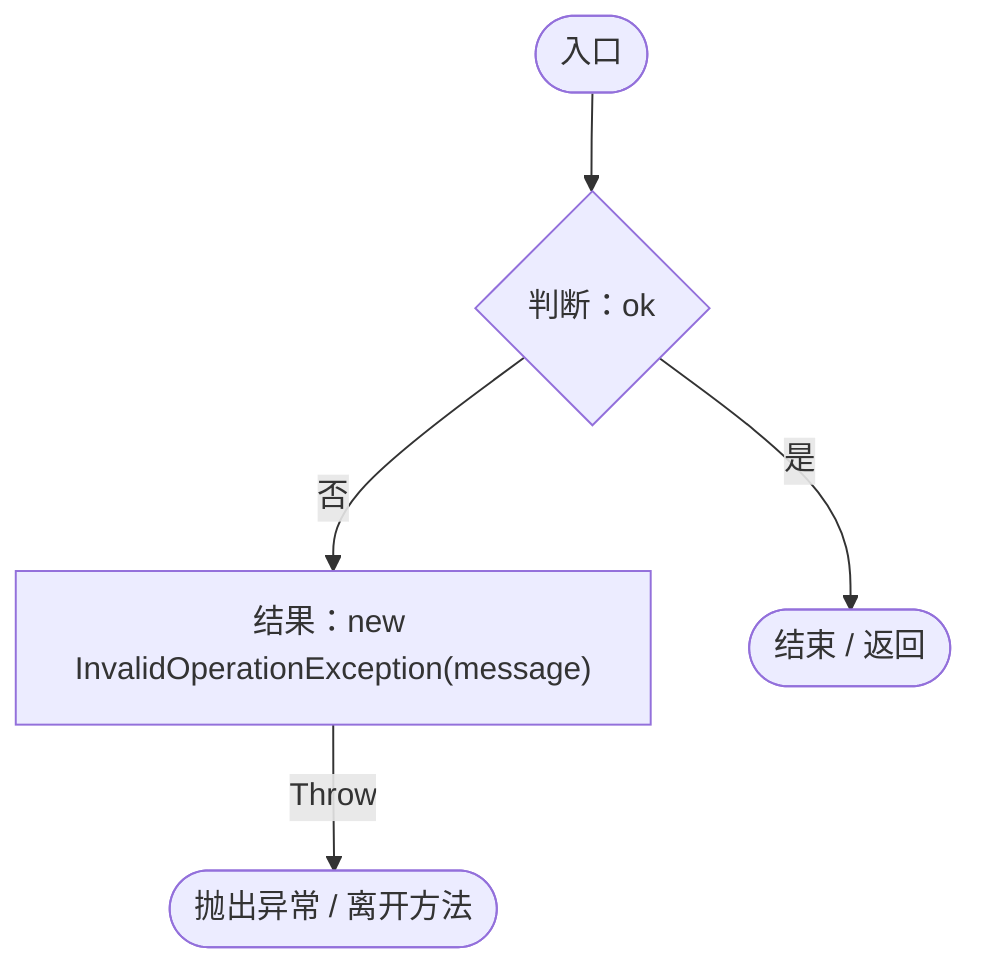
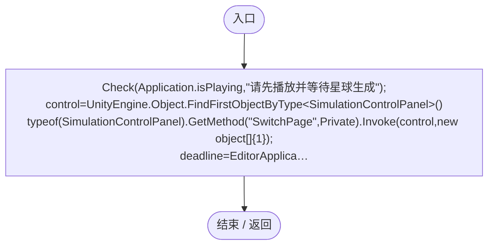
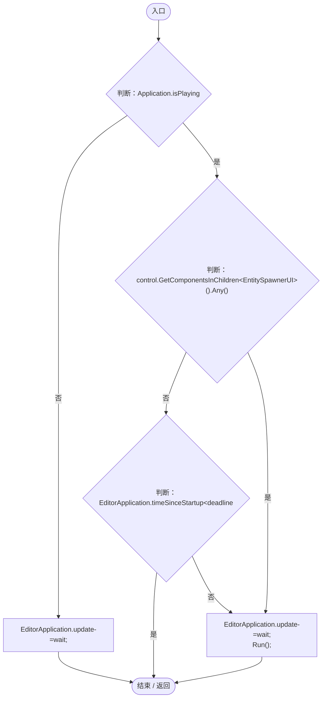
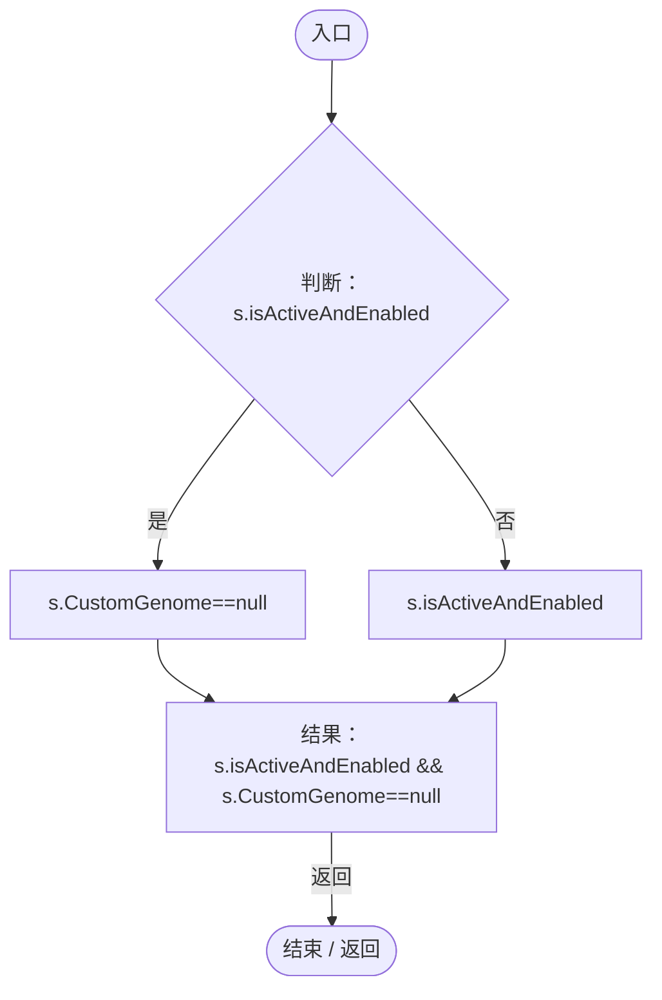

```mermaid
flowchart TD
  b0(["入口"])
  b1["report=new StringBuilder()<br/>b=UnityEngine.Object.FindFirstObjectByType&lt;PlanetTerrainMeshBuilder&gt;()<br/>c=Camera.main<br/>orbit=c.GetComponent&lt;OrbitCamera&gt;()<br/>oldPos=c.transform.position<br/>oldRot=c.transform.rotation<br/>clock=ServiceLocator.Get&lt;Simulati…"]
  b2["new[]{&quot;x&quot;,&quot;y&quot;,&quot;targetDistance&quot;,&quot;_isFocusing&quot;,&quot;targetPosition&quot;,&quot;targetRotation&quot;}"]
  b3{"判断：new[]{&quot;x&quot;,&quot;y&quot;,&quot;targetDistance&quot;,&quot;_isFocusing&quot;,&quot;targetPosition&quot;,&quot;targetRotation&quot;}"}
  b4["string<br/>saved[field]=typeof(OrbitCamera).GetField(field,Private).GetValue(orbit);"]
  b5{"new[]{&quot;x&quot;,&quot;y&quot;,&quot;targetDistance&quot;,&quot;_isFocusing&quot;,&quot;targetPosition&quot;,&quot;targetRotation&quot;}<br/>判断：new[]{&quot;x&quot;,&quot;y&quot;,&quot;targetDistance&quot;,&quot;_isFocusing&quot;,&quot;targetPosition&quot;,&quot;targetRotation&quot;}"}
  b6["new[]{&quot;x&quot;,&quot;y&quot;,&quot;targetDistance&quot;,&quot;_isFocusing&quot;,&quot;targetPosition&quot;,&quot;targetRotation&quot;}"]
  b7["连接 / 离开区域"]
  b8["oldDistance=orbit.distance<br/>initial=EntityRegistry.All.ToArray()<br/>module=EventSystem.current.currentInputModule as PointerInputModule<br/>cached=null<br/>previousEnter=null"]
  b9["clock.Pause();<br/>Check(Mathf.Abs(orbit.minimumSurfaceRadius-b.WaterRadius)&lt;.01f,&quot;海面半径未绑定相机&quot;);"]
  b10["i=0"]
  b11{"判断：i&lt;b.Data.Triangles.Length"}
  b12["a=b.Data.Vertices[b.Data.Triangles[i]]<br/>v=b.Data.Vertices[b.Data.Triangles[i+1]]<br/>w=b.Data.Vertices[b.Data.Triangles[i+2]]<br/>Check(Vector3.Dot(Vector3.Cross(v-a,w-a),a+v+w)&gt;0,&quot;地形三角形朝向反转&quot;);"]
  b13["i+=3"]
  b14["report.AppendLine(&quot;PASS: every high-resolution terrain triangle faces outward&quot;);<br/>keep=typeof(OrbitCamera).GetMethod(&quot;KeepAboveSurface&quot;,Private)"]
  b15["i=0"]
  b16{"判断：i&lt;96"}
  b17["y=1-2f*(i+.5f)/96f<br/>phi=i*2.39996323f<br/>d=new Vector3(Mathf.Sqrt(1-y*y)*Mathf.Cos(phi),y,Mathf.Sqrt(1-y*y)*Mathf.Sin(phi))<br/>c.transform.SetPositionAndRotation(b.transform.position+d*(b.WaterRadius-8),Quaternion.LookRotation(-d));<br/>orbit.dista…"]
  b18["i++"]
  b19["report.AppendLine(&quot;PASS: 96 close-up directions stay above sea/terrain; no hemisphere flip; centre picks visible front surface&quot;);<br/>c.transform.SetPositionAndRotation(oldPos,oldRot);<br/>orbit.distance=oldDistance;<br/>from=(oldPos-b.transform.pos…"]
  b20["i=0"]
  b21{"判断：i&lt;240"}
  b22["typeof(OrbitCamera).GetMethod(&quot;LateUpdate&quot;,Private).Invoke(orbit,null);<br/>Check(Vector3.Distance(c.transform.position,b.transform.position)&gt;=b.WaterRadius+orbit.surfaceClearance-.01f,&quot;跨星球聚焦穿入海面&quot;);<br/>i++"]
  b23["Check(Vector3.Dot((c.transform.position-b.transform.position).normalized,from)&lt;-.9f,&quot;对侧圆弧聚焦未完成&quot;);<br/>report.AppendLine(&quot;PASS: opposite-side focus follows an exterior arc without crossing the planet&quot;);<br/>c.transform.SetPositionAndRotation(oldP…"]
  b24["saved"]
  b25{"判断：saved"}
  b26["var<br/>typeof(OrbitCamera).GetField(field.Key,Private).SetValue(orbit,field.Value);"]
  b27["saved"]
  b28{"orbit.distance=oldDistance;<br/>Canvas.ForceUpdateCanvases();<br/>slot=UnityEngine.Object.FindObjectsByType&lt;EntitySpawnerUI&gt;(FindObjectsSortMode.None).First(s=&gt;s.isActiveAndEnabled &amp;&amp; s.CustomGenome==null)<br/>screen=new Vector2(c.pixelWidth*.5f,c.p…"}
  b29["args={-1,null,true}<br/>typeof(PointerInputModule).GetMethod(&quot;GetPointerData&quot;,Private).Invoke(module,args);<br/>cached=(PointerEventData)args[1];<br/>previousEnter=cached.pointerEnter;<br/>cached.pointerEnter=slot.gameObject;<br/>Check(EventSystem.current.I…"]
  b30["count=EntityRegistry.All.Count"]
  b31["new PointerEventData(EventSystem.current){position=screen,button=PointerEventData.InputButton.Left,pointerId=-1,pointerEnter=slot.gameObject}<br/>position=screen<br/>button=PointerEventData.InputButton.Left<br/>pointerId=-1<br/>pointerEnter=slot.gameObj…"]
  b32["slot.OnBeginDrag(drag);<br/>slot.OnDrag(drag);<br/>slot.OnEndDrag(drag);"]
  b33{"判断：EntityRegistry.All.Count==count+1"}
  b34["!OrbitCamera.IsDraggingUI"]
  b35["EntityRegistry.All.Count==count+1"]
  b36["Check(EntityRegistry.All.Count==count+1 &amp;&amp; !OrbitCamera.IsDraggingUI,&quot;真实鼠标缓存 UI 导致地面松手丢失&quot;);"]
  b37["count=EntityRegistry.All.Count;"]
  b38["slot<br/>new PointerEventData(EventSystem.current){button=PointerEventData.InputButton.Left}<br/>button=PointerEventData.InputButton.Left<br/>slot.OnPointerClick(new PointerEventData(EventSystem.current){button=PointerEventData.InputButton.Left});"]
  b39{"判断：EntityPlacementTool.Instance.TryPlaceAt(screen)"}
  b40{"判断：EntityRegistry.All.Count==count+1"}
  b41["EntityPlacementTool.Instance.IsPlacing"]
  b42["EntityPlacementTool.Instance.TryPlaceAt(screen) &amp;&amp; EntityRegistry.All.Count==count+1 &amp;&amp; EntityPlacementTool.Instance.IsPlacing"]
  b43["Check(EntityPlacementTool.Instance.TryPlaceAt(screen) &amp;&amp; EntityRegistry.All.Count==count+1 &amp;&amp; EntityPlacementTool.Instance.IsPlacing,&quot;连续投放失败或意外退出&quot;);"]
  b44["EntityPlacementTool.Instance.CancelPlacement();<br/>uiScreen=RectTransformUtility.WorldToScreenPoint(null,slot.transform.position)<br/>Check(EntityPlacementUtility.IsPointerOverUI(uiScreen),&quot;槽位 UI 边界检测失败&quot;);<br/>count=EntityRegistry.All.Count;<br/>drag.p…"]
  b45["new PlanetTerrainData{Subdivisions=32,FaceHeights=new float[6][]}<br/>Subdivisions=32<br/>FaceHeights=new float[6][]<br/>synthetic=new PlanetTerrainData{Subdivisions=32,FaceHeights=new float[6][]}"]
  b46["face=0"]
  b47{"判断：face&lt;6"}
  b48["synthetic.FaceHeights[face]=new float[33*33];"]
  b49["y=0"]
  b50{"判断：y&lt;=32"}
  b51["x=0"]
  b52{"判断：x&lt;=32"}
  b53{"synthetic.FaceHeights[face][y*33+x]<br/>.55f+.01f*PlanetSeamContinuity.Direction(face,x,y,32).y<br/>判断：x==0"}
  b54{"判断：x==32"}
  b55{"判断：y==0"}
  b56{"判断：y==32"}
  b57[".02f"]
  b58["0"]
  b59["synthetic.FaceHeights[face][y*33+x]=.55f+.01f*PlanetSeamContinuity.Direction(face,x,y,32).y+(x==0&#124;&#124;x==32&#124;&#124;y==0&#124;&#124;y==32?.02f:0);"]
  b60["x++"]
  b61["y++"]
  b62["face++"]
  b63["before=PlanetSeamContinuity.MeanCurvature(synthetic)<br/>PlanetSeamContinuity.Smooth(synthetic,b.erosion);<br/>after=PlanetSeamContinuity.MeanCurvature(synthetic)<br/>Check(after&lt;before*.5f,&quot;跨面折痕未减弱&quot;);<br/>report.AppendLine($&quot;PASS: seam crease curvature…"]
  b64{"判断：cached!=null"}
  b65["cached.pointerEnter=previousEnter;"]
  b66{"EntityPlacementTool.Instance<br/>判断：EntityPlacementTool.Instance"}
  b67["EntityPlacementTool.Instance?.CancelPlacement();"]
  b68["c.transform.SetPositionAndRotation(oldPos,oldRot);<br/>orbit.distance=oldDistance;"]
  b69["saved"]
  b70{"判断：saved"}
  b71["var<br/>typeof(OrbitCamera).GetField(field.Key,Private).SetValue(orbit,field.Value);"]
  b72["saved"]
  b73["EntityRegistry.All.ToArray()"]
  b74{"判断：EntityRegistry.All.ToArray()"}
  b75{"var<br/>判断：initial.Contains(entity)"}
  b76["entity.gameObject.SetActive(false);<br/>UnityEngine.Object.Destroy(entity.gameObject);"]
  b77{"EntityRegistry.All.ToArray()<br/>判断：EntityRegistry.All.ToArray()"}
  b78["EntityRegistry.All.ToArray()"]
  b79["连接 / 离开区域"]
  b80{"clock.SetTimeScale(scale);<br/>判断：running"}
  b81["clock.Play();"]
  b82["clock.Pause();"]
  b83["连接 / 离开区域"]
  b84["Directory.CreateDirectory(&quot;Artifacts/SurfaceInteractionReview&quot;);<br/>File.WriteAllText(&quot;Artifacts/SurfaceInteractionReview/runtime-checks.txt&quot;,report.ToString());<br/>ScreenCapture.CaptureScreenshot(Path.GetFullPath(&quot;Artifacts/SurfaceInteraction…"]
  b85(["结束 / 返回"])
  b0 --> b1
  b1 --> b2
  b2 --> b3
  b3 -->|"是"| b4
  b3 -->|"否 · 经过finally 5"| b8
  b4 --> b3
  b5 -->|"否"| b6
  b5 -->|"是"| b7
  b6 --> b7
  b8 --> b9
  b9 --> b10
  b10 --> b11
  b11 -->|"是"| b12
  b11 -->|"否"| b14
  b12 --> b13
  b13 --> b11
  b14 --> b15
  b15 --> b16
  b16 -->|"是"| b17
  b16 -->|"否"| b19
  b17 --> b18
  b18 --> b16
  b19 --> b20
  b20 --> b21
  b21 -->|"是"| b22
  b21 -->|"否"| b23
  b22 --> b21
  b23 --> b24
  b24 --> b25
  b25 -->|"是"| b26
  b25 -->|"否 · 经过finally 27"| b28
  b26 --> b25
  b28 -->|"是"| b29
  b28 -->|"否"| b30
  b29 --> b30
  b30 --> b31
  b31 --> b32
  b32 --> b33
  b33 -->|"是"| b34
  b33 -->|"否"| b35
  b34 --> b36
  b35 --> b36
  b36 --> b37
  b37 --> b38
  b38 --> b39
  b39 -->|"是"| b40
  b39 -->|"否"| b42
  b40 -->|"是"| b41
  b40 -->|"否"| b42
  b41 --> b43
  b42 --> b43
  b43 --> b44
  b44 --> b45
  b45 --> b46
  b46 --> b47
  b47 -->|"是"| b48
  b47 -->|"否"| b63
  b48 --> b49
  b49 --> b50
  b50 -->|"是"| b51
  b50 -->|"否"| b62
  b51 --> b52
  b52 -->|"是"| b53
  b52 -->|"否"| b61
  b53 -->|"否"| b54
  b53 -->|"是"| b57
  b54 -->|"否"| b55
  b54 -->|"是"| b57
  b55 -->|"否"| b56
  b55 -->|"是"| b57
  b56 -->|"是"| b57
  b56 -->|"否"| b58
  b57 --> b59
  b58 --> b59
  b59 --> b60
  b60 --> b52
  b61 --> b50
  b62 --> b47
  b63 -->|"经过finally 64"| b84
  b64 -->|"是"| b65
  b64 -->|"否"| b66
  b65 --> b66
  b66 -->|"否"| b67
  b66 -->|"是"| b68
  b67 --> b68
  b68 --> b69
  b69 --> b70
  b70 -->|"是"| b71
  b70 -->|"否 · 经过finally 72"| b73
  b71 --> b70
  b73 --> b74
  b74 -->|"是"| b75
  b74 -->|"否 · 经过finally 77"| b80
  b75 -->|"否"| b76
  b75 -->|"是"| b74
  b76 --> b74
  b77 -->|"否"| b78
  b77 -->|"是"| b79
  b78 --> b79
  b80 -->|"是"| b81
  b80 -->|"否"| b82
  b81 --> b83
  b82 --> b83
  b84 --> b85
  b3 -. "退出保护区时 finally（示意）" .-> b5
  b25 -. "退出保护区时 finally（示意）" .-> b27
  b9 -. "退出保护区时 finally（示意）" .-> b64
  b70 -. "退出保护区时 finally（示意）" .-> b72
  b74 -. "退出保护区时 finally（示意）" .-> b77

```

# SurfaceInteractionRegression.cs

[返回总索引](../README.md) · `Editor` · `Assets/DarwinPark/Editor/SurfaceInteractionRegression.cs`

[源文件](../../../Assets/DarwinPark/Editor/SurfaceInteractionRegression.cs) · 源码校验：`1f26e9eeb6f7d799c501a7f1a66348868530834c67a64df838a7644ae1c0ebc7`

方法按源文件位置排列。事件/回调引用不表示立即执行；分支与异常说明见总索引。完整源码与可点击关系图请打开离线手册。

## Check · L20

`private static void Check(bool ok,string message)`

### Editor · Roslyn编译器控制流

## Validate · L21

`[MenuItem("Tools/Darwin Park/Validate Surface Interactions")] public static void Validate()`

### Editor · Roslyn编译器控制流

项目内调用/回调引用：

- [SurfaceInteractionRegression.Check · L20](3229e96fb60a3e5b.md#mb55389b043e518bf)（方法）
- [SurfaceInteractionRegression.回调@29 · L29](3229e96fb60a3e5b.md#me6e1fbbd1d925028)（回调/委托）

## 回调@29 · L29

`( … => 回调`

### Editor · Roslyn编译器控制流

项目内调用/回调引用：

- [SurfaceInteractionRegression.Run · L36](3229e96fb60a3e5b.md#m0106697c24d18636)（方法）

## Run · L36

`private static void Run()`

### Editor · Roslyn编译器控制流

项目内调用/回调引用：

- [ServiceLocator.Get · L33](f2fdbe9f9ccd93cb.md#m2ae625299520c56d)（方法）
- [SimulationClock.IsRunning.get · L22](a8f444aec9614b0a.md#m10f4fe307faca0f0)（访问器）
- [SimulationClock.Pause · L79](a8f444aec9614b0a.md#m30929d45a885d0f1)（方法）
- [SurfaceInteractionRegression.Check · L20](3229e96fb60a3e5b.md#mb55389b043e518bf)（方法）
- [PlanetTerrainMeshBuilder.WaterRadius.get · L94](415285cf043354a9.md#m28d8809083881ec1)（访问器）
- [PlanetTerrainMeshBuilder.Data.get · L78](415285cf043354a9.md#m8382f579717fbc6d)（访问器）
- [EntityPlacementUtility.TryGetSurface · L23](6d2c32e632b9c147.md#mcaf74a1c76576237)（方法）
- [OrbitCamera.FocusOn · L170](42eb429559b42bcb.md#m90f6d4818e064f1d)（方法）
- [EntityPlacementUtility.IsPointerOverUI · L16](6d2c32e632b9c147.md#m126e7f8ff0d0a893)（方法）
- [EntitySpawnerUI.OnBeginDrag · L30](35e73bec7584e677.md#m588613461813385f)（方法）
- [EntitySpawnerUI.OnDrag · L42](35e73bec7584e677.md#m78a0c360c9a3261a)（方法）
- [EntitySpawnerUI.OnEndDrag · L50](35e73bec7584e677.md#m88135fa43ee7a29e)（方法）
- [EntitySpawnerUI.OnPointerClick · L20](35e73bec7584e677.md#m5f4fec17861ede2a)（方法）
- [EntityPlacementTool.TryPlaceAt · L73](2ca993947b0a7e7a.md#m3ad1295309fe99b0)（方法）
- [EntityPlacementTool.Instance.get · L13](2ca993947b0a7e7a.md#mafb26991c0dfcb86)（访问器）
- [EntityPlacementTool.IsPlacing.get · L14](2ca993947b0a7e7a.md#ma73d17b3db4aa719)（访问器）
- [EntityPlacementTool.CancelPlacement · L81](2ca993947b0a7e7a.md#m5a9374d2c71f0a2d)（方法）
- [PlanetSeamContinuity.Direction · L40](b45fffad7e3300e3.md#mb2cb3d81d0d467ec)（方法）
- [PlanetSeamContinuity.MeanCurvature · L46](b45fffad7e3300e3.md#mcacd4832135628d3)（方法）
- [PlanetSeamContinuity.Smooth · L9](b45fffad7e3300e3.md#m8e8308fbbdc4322e)（方法）
- [SimulationClock.SetTimeScale · L81](a8f444aec9614b0a.md#mecaa463a0561aca3)（方法）
- [SimulationClock.Play · L78](a8f444aec9614b0a.md#m7aa9e64b7de60ed0)（方法）
- [SurfaceInteractionRegression.回调@91 · L91](3229e96fb60a3e5b.md#mb57cec3f6ea7d0f6)（回调/委托）

## 回调@91 · L91

`s … => 回调`

### Editor · Roslyn编译器控制流

