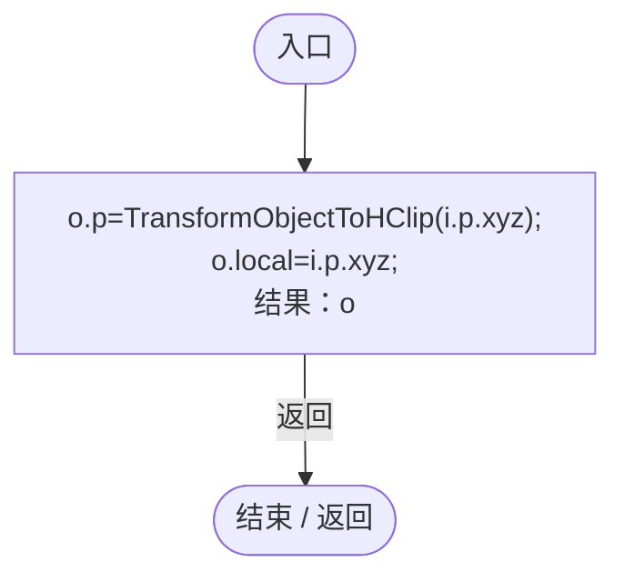
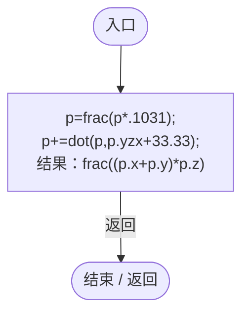
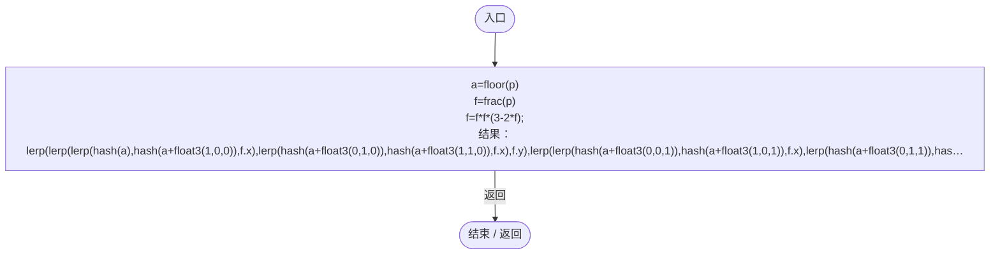
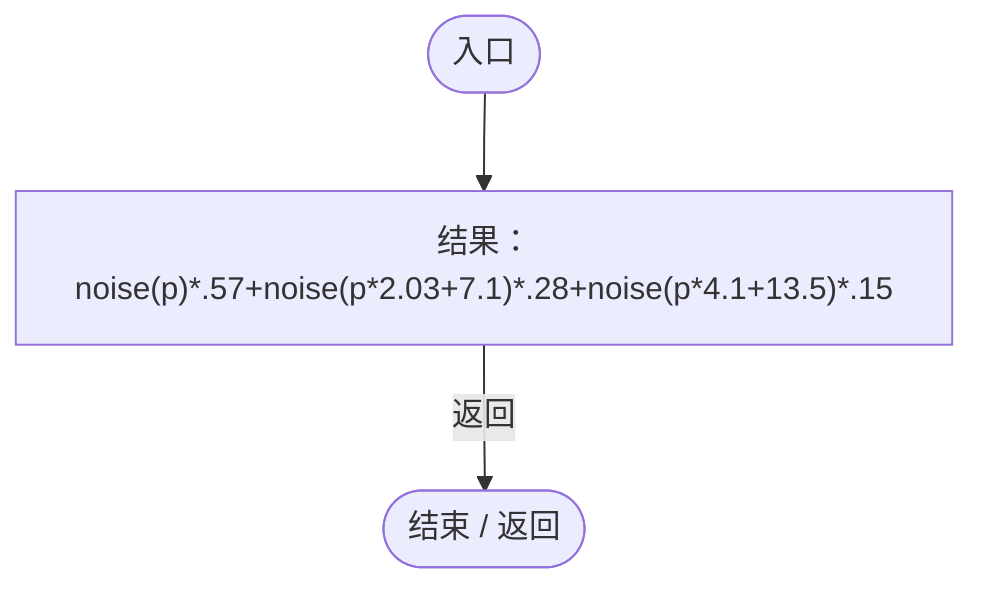
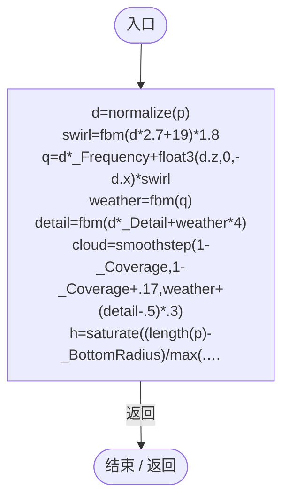
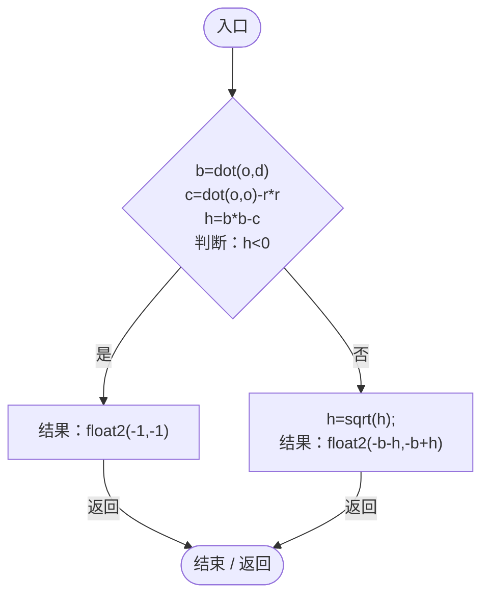
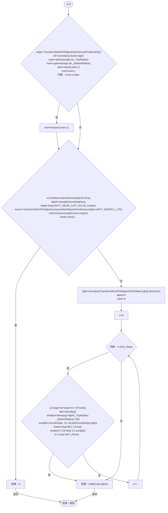

# PlanetCloudVolume.shader

[返回总索引](../README.md) · `GPU` · `Assets/DarwinPark/Planet/PlanetCloudVolume.shader`

[源文件](../../../Assets/DarwinPark/Planet/PlanetCloudVolume.shader) · 源码校验：`88814a6c4ee8ac38ddd8bb2b575eecb5aed7cedcf89cfa3a473df41c965d8c18`

方法按源文件位置排列。事件/回调引用不表示立即执行；分支与异常说明见总索引。完整源码与可点击关系图请打开离线手册。

## vert · L29

`V vert(A i)`

### GPU · GPU控制结构（名称链接，不作C#类型推断）

## hash · L30

`float hash(float3 p)`

### GPU · GPU控制结构（名称链接，不作C#类型推断）

## noise · L31

`float noise(float3 p)`

### GPU · GPU控制结构（名称链接，不作C#类型推断）

项目内调用/回调引用：

- [PlanetCloudVolume.hash · L30](331b4344b269939a.md#m20e63114ebf4ee8c)（GPU函数）

## fbm · L32

`float fbm(float3 p)`

### GPU · GPU控制结构（名称链接，不作C#类型推断）

项目内调用/回调引用：

- [PlanetCloudVolume.noise · L31](331b4344b269939a.md#m1bd7fc713ad3f68e)（GPU函数）

## density · L33

`float density(float3 p)`

### GPU · GPU控制结构（名称链接，不作C#类型推断）

项目内调用/回调引用：

- [PlanetCloudVolume.fbm · L32](331b4344b269939a.md#m249c7a69b1d56d43)（GPU函数）

## sphere · L44

`float2 sphere(float3 o,float3 d,float r)`

### GPU · GPU控制结构（名称链接，不作C#类型推断）

## frag · L45

`half4 frag(V i):SV_Target`

### GPU · GPU控制结构（名称链接，不作C#类型推断）

项目内调用/回调引用：

- [PlanetCloudVolume.sphere · L44](331b4344b269939a.md#m81c36989d2b2ed18)（GPU函数）
- [PlanetCloudVolume.density · L33](331b4344b269939a.md#mbaaae30b4afc2e21)（GPU函数）
