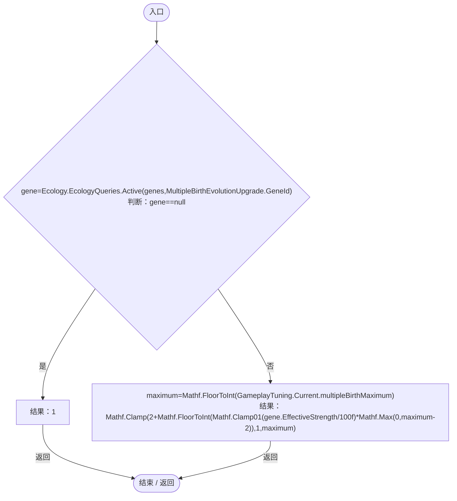
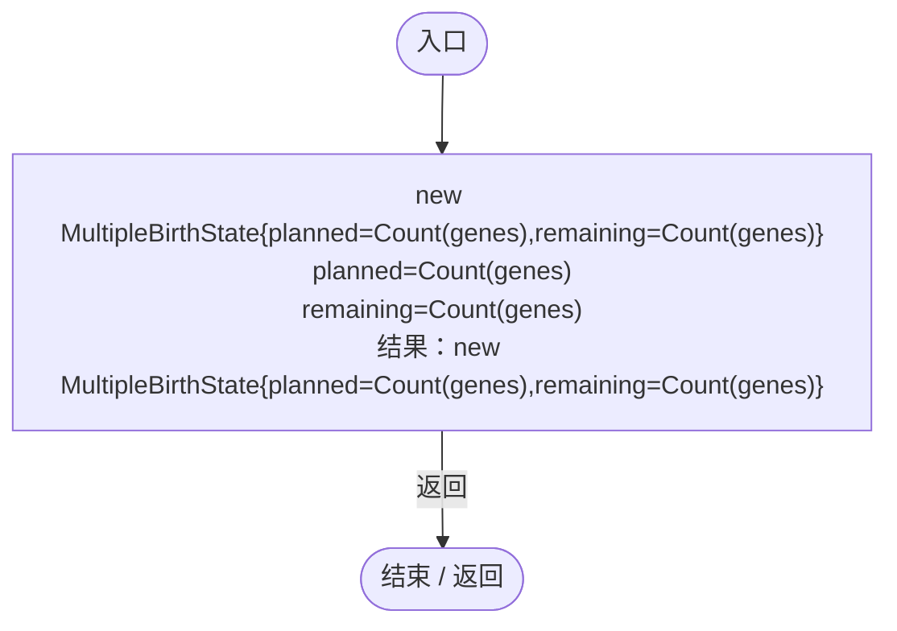
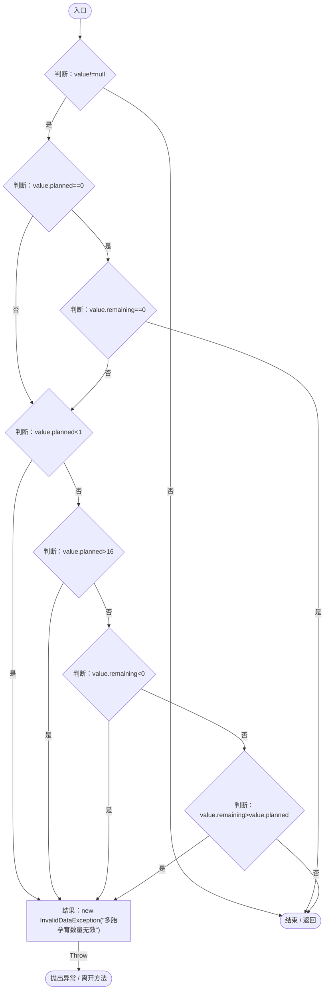
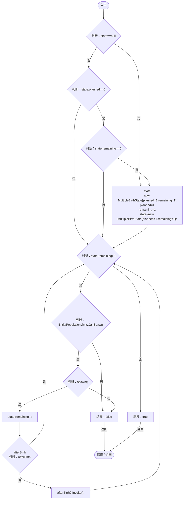

# MultipleBirthPolicy.cs

[返回总索引](../README.md) · `Runtime` · `Assets/DarwinPark/Entities/Logic/MultipleBirthPolicy.cs`

[源文件](../../../Assets/DarwinPark/Entities/Logic/MultipleBirthPolicy.cs) · 源码校验：`7ca7795edb5bdac706986dceb574c29a6dd99dd7cb3ed8c4bb2650612e0a7f20`

方法按源文件位置排列。事件/回调引用不表示立即执行；分支与异常说明见总索引。完整源码与可点击关系图请打开离线手册。

## Count · L13

`public static int Count(EntityGeneController genes)`

### Editor / Player · Roslyn编译器控制流

项目内调用/回调引用：

- [EcologyQueries.Active · L29](bdf7ccc2c9c0452f.md#m200839bb9db5ec55)（方法）
- [GameplayTuning.Current.get · L46](db546e5713b32d53.md#m4fa691bd8a3b9618)（访问器）

## Begin · L20

`public static MultipleBirthState Begin(EntityGeneController genes)`

### Editor / Player · Roslyn编译器控制流

项目内调用/回调引用：

- [MultipleBirthPolicy.Count · L13](337309de03d51a54.md#m0fef88a7307367ee)（方法）

## Copy · L21

`public static MultipleBirthState Copy(MultipleBirthState value)`

### Editor / Player · Roslyn编译器控制流

```mermaid
flowchart TD
  b0(["入口"])
  b1{"判断：value==null"}
  b2{"判断：value.planned==0"}
  b3{"判断：value.remaining==0"}
  b4["null"]
  b5["new MultipleBirthState{planned=value.planned,remaining=value.remaining}<br/>planned=value.planned<br/>remaining=value.remaining"]
  b6["结果：value==null&#124;&#124;value.planned==0&amp;&amp;value.remaining==0?null:new MultipleBirthState{planned=value.planned,remaining=value.remaining}"]
  b7(["结束 / 返回"])
  b0 --> b1
  b1 -->|"否"| b2
  b1 -->|"是"| b4
  b2 -->|"是"| b3
  b2 -->|"否"| b5
  b3 -->|"是"| b4
  b3 -->|"否"| b5
  b4 --> b6
  b5 --> b6
  b6 -->|"返回"| b7

```

## Validate · L22

`public static void Validate(MultipleBirthState value)`

### Editor / Player · Roslyn编译器控制流

## Deliver · L28

`public static bool Deliver(ref MultipleBirthState state,Func<bool> spawn,Action afterBirth=null)`

### Editor / Player · Roslyn编译器控制流

