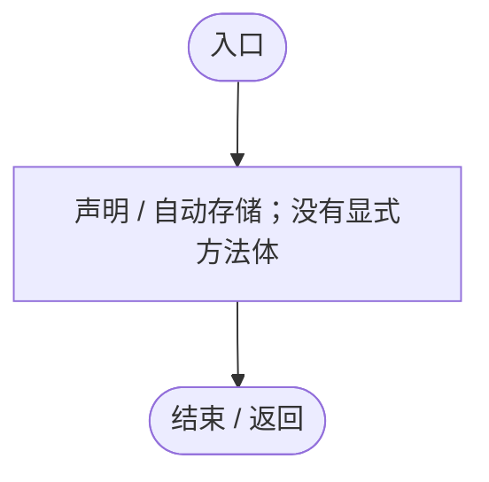
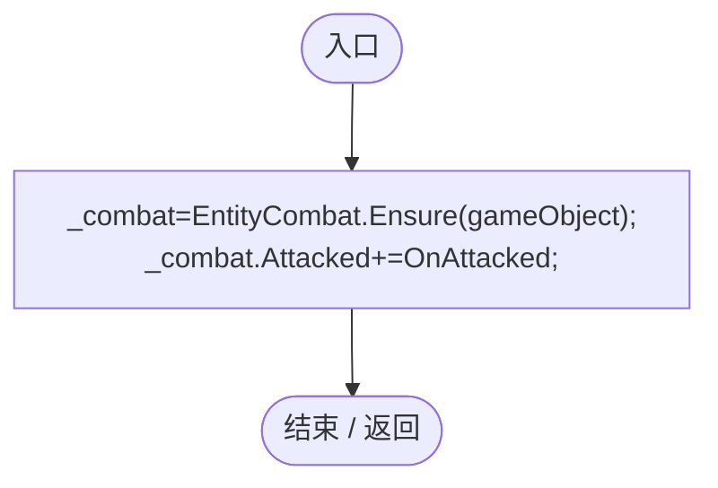
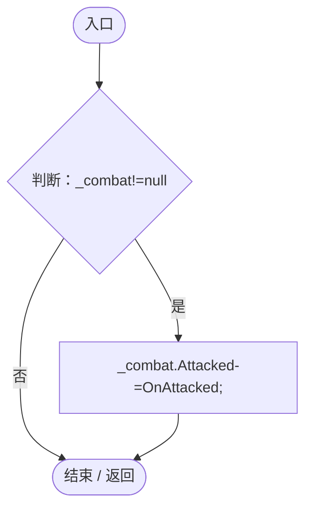
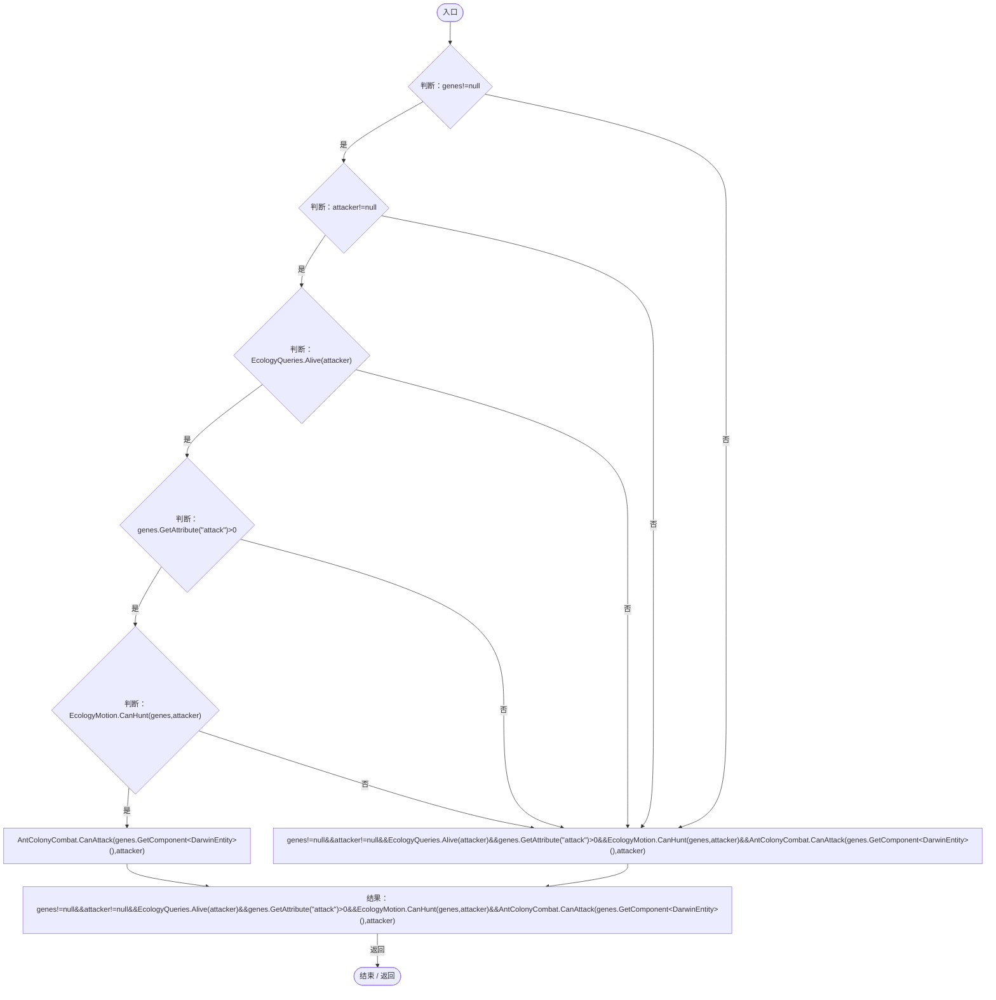
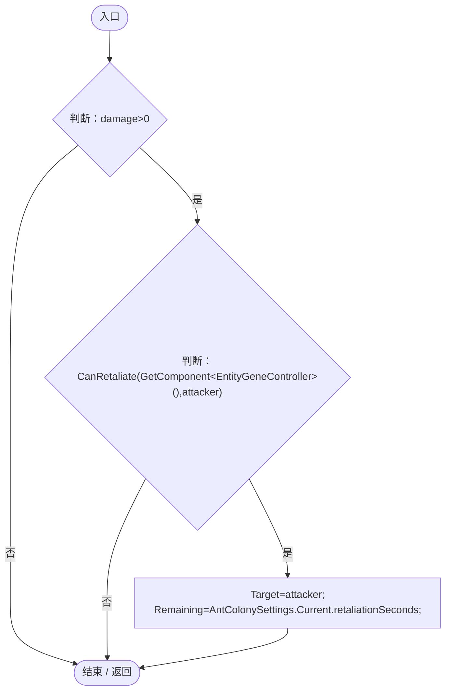
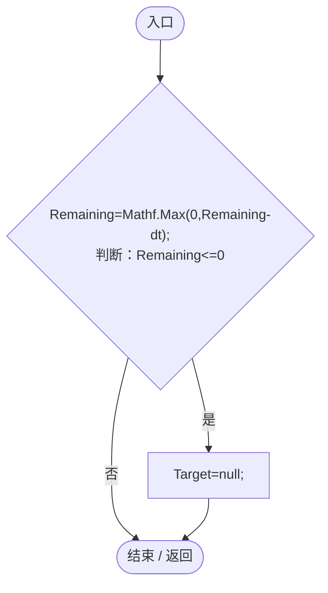
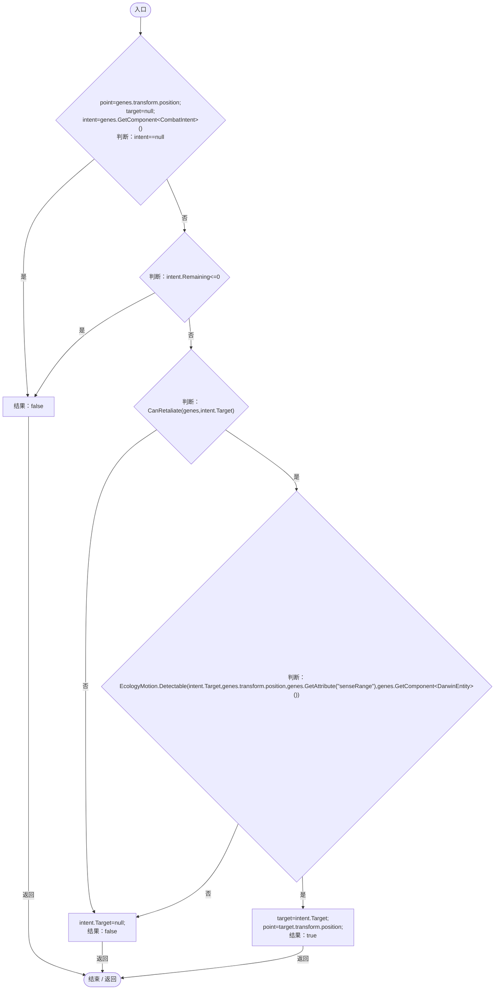
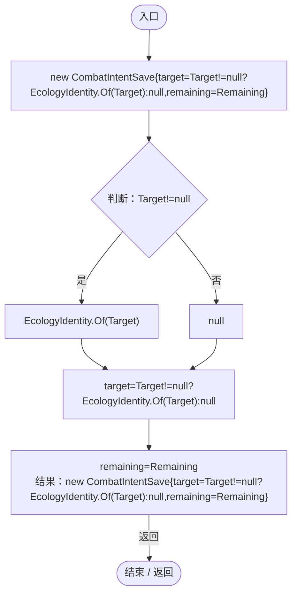
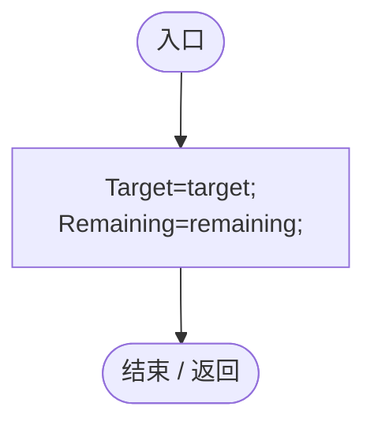
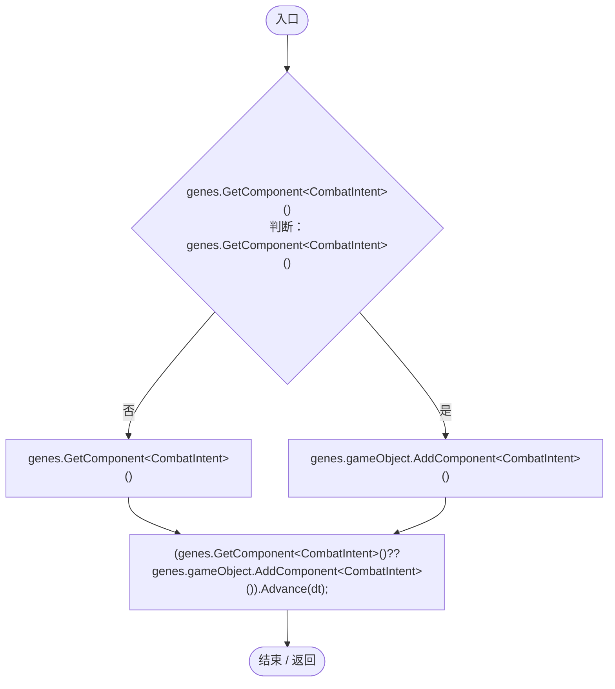

# CombatIntent.cs

[返回总索引](../README.md) · `Runtime` · `Assets/DarwinPark/Entities/Ecology/CombatIntent.cs`

[源文件](../../../Assets/DarwinPark/Entities/Ecology/CombatIntent.cs) · 源码校验：`9005465225914d1069e0665000c251aca3d9bdab7d0d9f4715f1dc70ec0bfef4`

方法按源文件位置排列。事件/回调引用不表示立即执行；分支与异常说明见总索引。完整源码与可点击关系图请打开离线手册。

## Target.get · L11

`get`

### Editor / Player · 语法控制结构 / 声明（非CFG）

## Target.set · L11

`private set`

### Editor / Player · 语法控制结构 / 声明（非CFG）

## Remaining.get · L12

`get`

### Editor / Player · 语法控制结构 / 声明（非CFG）

## Remaining.set · L12

`private set`

### Editor / Player · 语法控制结构 / 声明（非CFG）

## OnEnable · L14

`private void OnEnable()`

### Editor / Player · Roslyn编译器控制流

项目内调用/回调引用：

- [EntityCombat.Ensure · L11](a5b5b46ac6c197ae.md#m1b9e5f59cedd143e)（方法）
- [CombatIntent.OnAttacked · L17](34193b994b2c0894.md#mcdc0f5f47ddda568)（方法）

## OnDisable · L15

`private void OnDisable()`

### Editor / Player · Roslyn编译器控制流

项目内调用/回调引用：

- [CombatIntent.OnAttacked · L17](34193b994b2c0894.md#mcdc0f5f47ddda568)（方法）

## CanRetaliate · L16

`public static bool CanRetaliate(EntityGeneController genes,DarwinEntity attacker)`

### Editor / Player · Roslyn编译器控制流

项目内调用/回调引用：

- [EcologyQueries.Alive · L38](bdf7ccc2c9c0452f.md#mb2877c487f449970)（方法）
- [EntityGeneController.GetAttribute · L257](7494d53178552f0e.md#m600509f72d274f0c)（方法）
- [EcologyMotion.CanHunt · L38](6ed9d0eedb456d32.md#m4271864b37a65a94)（方法）
- [AntColonyCombat.CanAttack · L8](aa858de55ec8e51a.md#mb9453f16f05e083a)（方法）

## OnAttacked · L17

`private void OnAttacked(DarwinEntity attacker,float damage)`

### Editor / Player · Roslyn编译器控制流

项目内调用/回调引用：

- [CombatIntent.CanRetaliate · L16](34193b994b2c0894.md#m9793f6ed16c1a5bd)（方法）
- [CombatIntent.Target.set · L11](34193b994b2c0894.md#me9155eaa8da165e5)（访问器）
- [CombatIntent.Remaining.set · L12](34193b994b2c0894.md#m3c17eb17da18968d)（访问器）
- [AntColonySettings.Current.get · L31](cb0a937e97c8fbb3.md#mcd121159f407ccdf)（访问器）

## Advance · L19

`public void Advance(float dt)`

### Editor / Player · Roslyn编译器控制流

项目内调用/回调引用：

- [CombatIntent.Remaining.set · L12](34193b994b2c0894.md#m3c17eb17da18968d)（访问器）
- [CombatIntent.Remaining.get · L12](34193b994b2c0894.md#m5db0c32d876ee87a)（访问器）
- [CombatIntent.Target.set · L11](34193b994b2c0894.md#me9155eaa8da165e5)（访问器）

## Destination · L20

`public static bool Destination(EntityGeneController genes,out Vector3 point,out DarwinEntity target)`

### Editor / Player · Roslyn编译器控制流

项目内调用/回调引用：

- [CombatIntent.Remaining.get · L12](34193b994b2c0894.md#m5db0c32d876ee87a)（访问器）
- [CombatIntent.CanRetaliate · L16](34193b994b2c0894.md#m9793f6ed16c1a5bd)（方法）
- [CombatIntent.Target.get · L11](34193b994b2c0894.md#m5f613e45dae18c85)（访问器）
- [EcologyMotion.Detectable · L61](6ed9d0eedb456d32.md#m24ba4bf4b1ca5c20)（方法）
- [EntityGeneController.GetAttribute · L257](7494d53178552f0e.md#m600509f72d274f0c)（方法）
- [CombatIntent.Target.set · L11](34193b994b2c0894.md#me9155eaa8da165e5)（访问器）

## Capture · L27

`public CombatIntentSave Capture()`

### Editor / Player · Roslyn编译器控制流

项目内调用/回调引用：

- [CombatIntent.Target.get · L11](34193b994b2c0894.md#m5f613e45dae18c85)（访问器）
- [EcologyIdentity.Of · L21](bdf7ccc2c9c0452f.md#m1143cf9570a93b72)（方法）
- [CombatIntent.Remaining.get · L12](34193b994b2c0894.md#m5db0c32d876ee87a)（访问器）

## Restore · L28

`public void Restore(DarwinEntity target,float remaining)`

### Editor / Player · Roslyn编译器控制流

项目内调用/回调引用：

- [CombatIntent.Target.set · L11](34193b994b2c0894.md#me9155eaa8da165e5)（访问器）
- [CombatIntent.Remaining.set · L12](34193b994b2c0894.md#m3c17eb17da18968d)（访问器）

## AdvanceFor · L29

`public static void AdvanceFor(EntityGeneController genes,float dt)`

### Editor / Player · Roslyn编译器控制流

项目内调用/回调引用：

- [CombatIntent.Advance · L19](34193b994b2c0894.md#m2065729a2988f50f)（方法）
