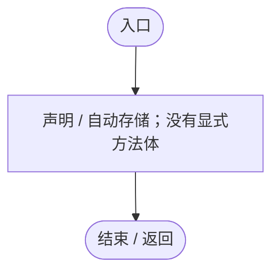
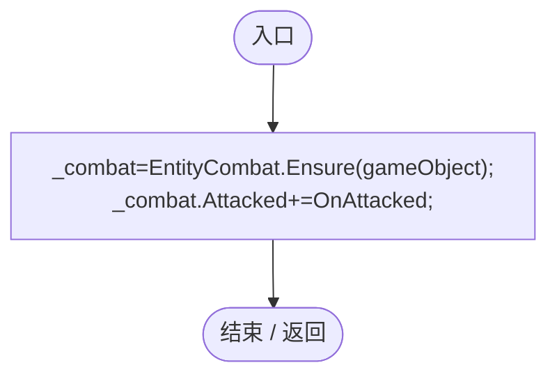
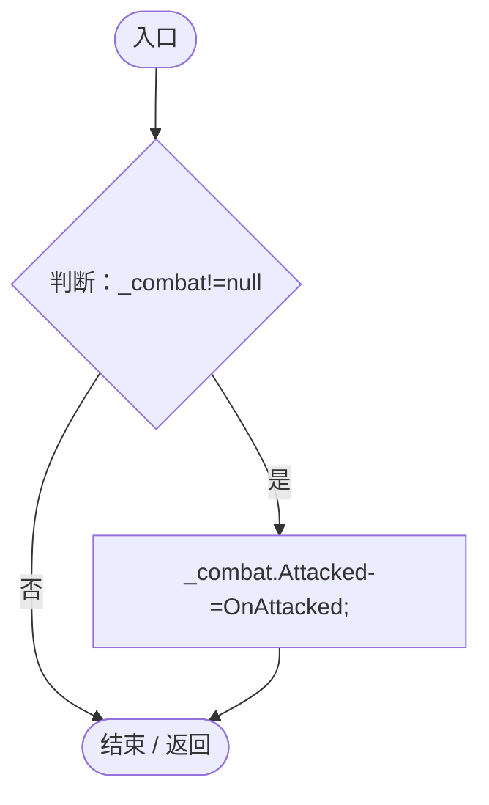
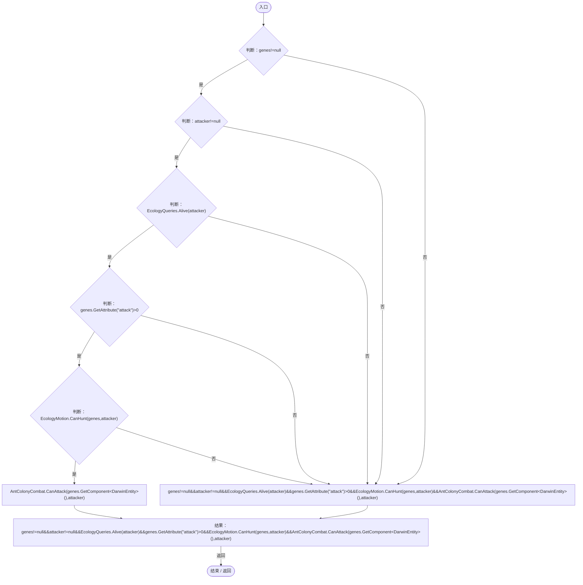
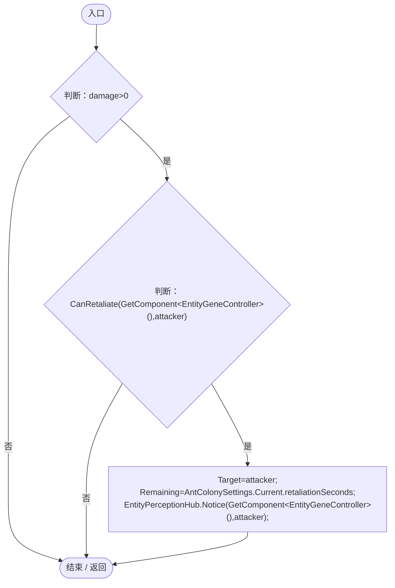
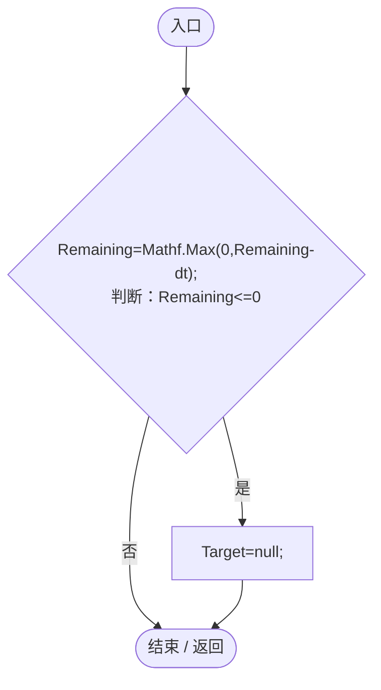
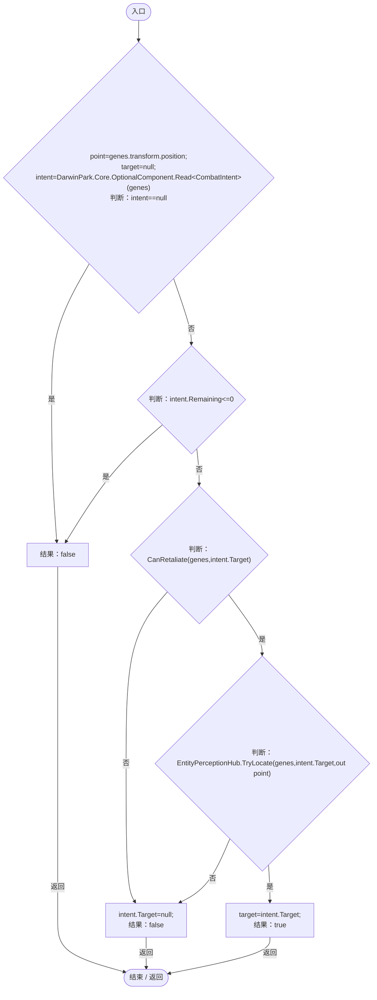
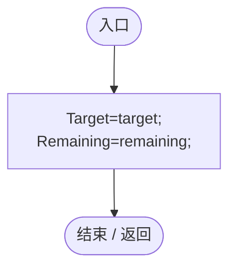
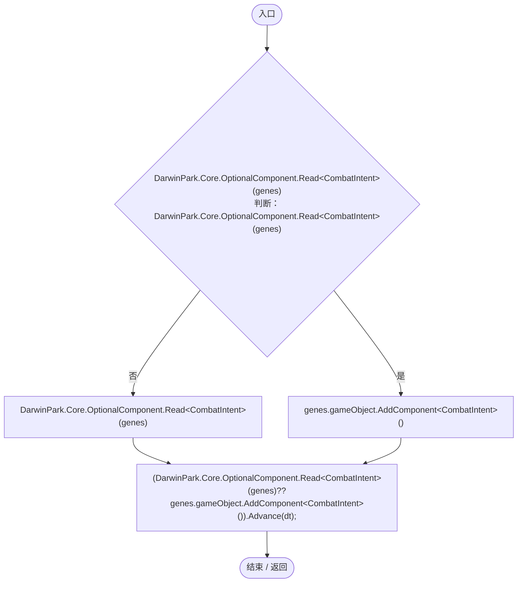

# CombatIntent.cs

[返回总索引](../README.md) · `Runtime` · `Assets/DarwinPark/Entities/Ecology/CombatIntent.cs`

[源文件](../../../Assets/DarwinPark/Entities/Ecology/CombatIntent.cs) · 源码校验：`acc8398044a588db9a6d55188b9e41d214ee3a64fd4c4bc5a2deb622830d4368`

方法按源文件位置排列。事件/回调引用不表示立即执行；分支与异常说明见总索引。完整源码与可点击关系图请打开离线手册。

## Target.get · L12

`get`

### Editor / Player · 语法控制结构 / 声明（非CFG）

## Target.set · L12

`private set`

### Editor / Player · 语法控制结构 / 声明（非CFG）

## Remaining.get · L13

`get`

### Editor / Player · 语法控制结构 / 声明（非CFG）

## Remaining.set · L13

`private set`

### Editor / Player · 语法控制结构 / 声明（非CFG）

## OnEnable · L15

`private void OnEnable()`

### Editor / Player · Roslyn编译器控制流

项目内调用/回调引用：

- [EntityCombat.Ensure · L12](a5b5b46ac6c197ae.md#me21fe8f31497e62f)（方法）
- [CombatIntent.OnAttacked · L18](34193b994b2c0894.md#m04d7a26177466e0a)（方法）

## OnDisable · L16

`private void OnDisable()`

### Editor / Player · Roslyn编译器控制流

项目内调用/回调引用：

- [CombatIntent.OnAttacked · L18](34193b994b2c0894.md#m04d7a26177466e0a)（方法）

## CanRetaliate · L17

`public static bool CanRetaliate(EntityGeneController genes,DarwinEntity attacker)`

### Editor / Player · Roslyn编译器控制流

项目内调用/回调引用：

- [EcologyQueries.Alive · L39](bdf7ccc2c9c0452f.md#m8352bfacbe2996a8)（方法）
- [EntityGeneController.GetAttribute · L288](7494d53178552f0e.md#m45127bcdd833aaf5)（方法）
- [EcologyMotion.CanHunt · L42](6ed9d0eedb456d32.md#m4f7dcb9782f82330)（方法）
- [AntColonyCombat.CanAttack · L9](aa858de55ec8e51a.md#mf20367836d4406a5)（方法）

## OnAttacked · L18

`private void OnAttacked(DarwinEntity attacker,float damage)`

### Editor / Player · Roslyn编译器控制流

项目内调用/回调引用：

- [CombatIntent.CanRetaliate · L17](34193b994b2c0894.md#mc5a8d04d3027ce21)（方法）
- [CombatIntent.Target.set · L12](34193b994b2c0894.md#m04379452d3f3242d)（访问器）
- [CombatIntent.Remaining.set · L13](34193b994b2c0894.md#m1b56958c9fe6fdb0)（访问器）
- [AntColonySettings.Current.get · L31](cb0a937e97c8fbb3.md#mcd121159f407ccdf)（访问器）
- [EntityPerceptionHub.Notice · L63](aeecc36cb2c3cc24.md#m5f831816fef69cd6)（方法）

## Advance · L20

`public void Advance(float dt)`

### Editor / Player · Roslyn编译器控制流

项目内调用/回调引用：

- [CombatIntent.Remaining.set · L13](34193b994b2c0894.md#m1b56958c9fe6fdb0)（访问器）
- [CombatIntent.Remaining.get · L13](34193b994b2c0894.md#m2bb2b9e45851e6de)（访问器）
- [CombatIntent.Target.set · L12](34193b994b2c0894.md#m04379452d3f3242d)（访问器）

## Destination · L21

`public static bool Destination(EntityGeneController genes,out Vector3 point,out DarwinEntity target)`

### Editor / Player · Roslyn编译器控制流

项目内调用/回调引用：

- [OptionalComponent.Read · L7](806c46b42ced4d36.md#m69622a4dee165c5a)（方法）
- [CombatIntent.Remaining.get · L13](34193b994b2c0894.md#m2bb2b9e45851e6de)（访问器）
- [CombatIntent.CanRetaliate · L17](34193b994b2c0894.md#mc5a8d04d3027ce21)（方法）
- [CombatIntent.Target.get · L12](34193b994b2c0894.md#m7bace2f2c50bd4c1)（访问器）
- [EntityPerceptionHub.TryLocate · L57](aeecc36cb2c3cc24.md#m2cd96337ffd40bb4)（方法）
- [CombatIntent.Target.set · L12](34193b994b2c0894.md#m04379452d3f3242d)（访问器）

## Capture · L28

`public CombatIntentSave Capture()`

### Editor / Player · Roslyn编译器控制流

项目内调用/回调引用：

- [CombatIntent.Target.get · L12](34193b994b2c0894.md#m7bace2f2c50bd4c1)（访问器）
- [EcologyIdentity.Of · L22](bdf7ccc2c9c0452f.md#mb23020fe763aafd3)（方法）
- [CombatIntent.Remaining.get · L13](34193b994b2c0894.md#m2bb2b9e45851e6de)（访问器）

## Restore · L29

`public void Restore(DarwinEntity target,float remaining)`

### Editor / Player · Roslyn编译器控制流

项目内调用/回调引用：

- [CombatIntent.Target.set · L12](34193b994b2c0894.md#m04379452d3f3242d)（访问器）
- [CombatIntent.Remaining.set · L13](34193b994b2c0894.md#m1b56958c9fe6fdb0)（访问器）

## AdvanceFor · L30

`public static void AdvanceFor(EntityGeneController genes,float dt)`

### Editor / Player · Roslyn编译器控制流

项目内调用/回调引用：

- [CombatIntent.Advance · L20](34193b994b2c0894.md#m58aa83f6d2b7f919)（方法）
- [OptionalComponent.Read · L7](806c46b42ced4d36.md#m69622a4dee165c5a)（方法）
