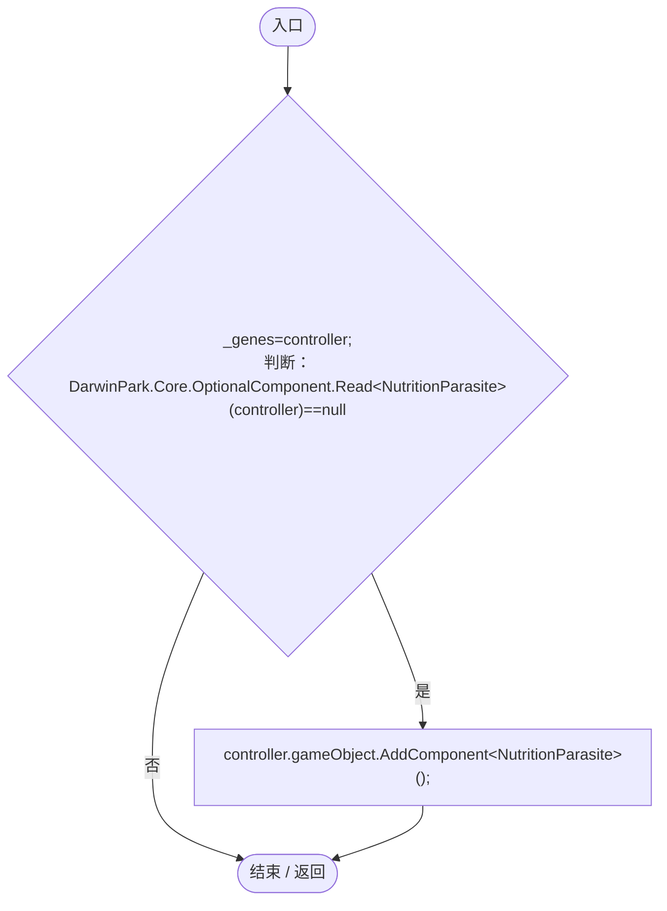
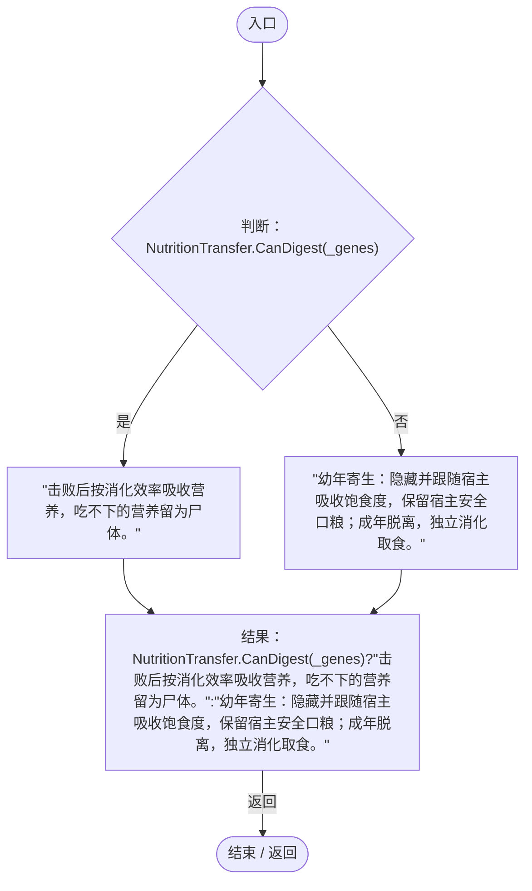
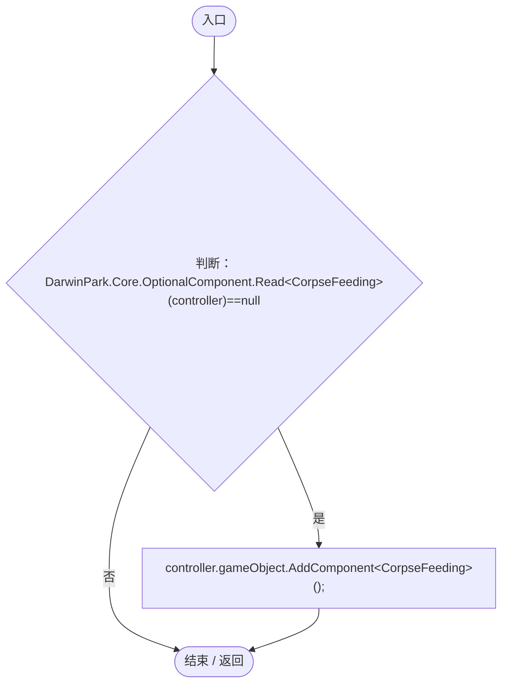
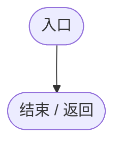
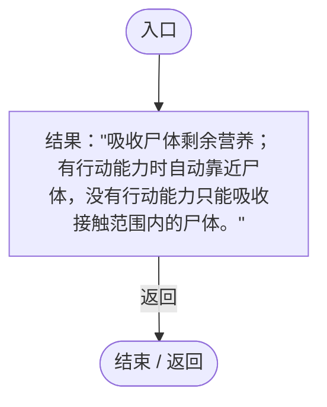

# HeterotrophyGeneLogic.cs

[返回总索引](../README.md) · `Runtime` · `Assets/DarwinPark/Entities/Logic/HeterotrophyGeneLogic.cs`

[源文件](../../../Assets/DarwinPark/Entities/Logic/HeterotrophyGeneLogic.cs) · 源码校验：`530914bdf0e9ee7e078917f5a90821bae7e970a5c90e4ab4c124b7d80b8de6e0`

方法按源文件位置排列。事件/回调引用不表示立即执行；分支与异常说明见总索引。完整源码与可点击关系图请打开离线手册。

## Initialize · L11

`public void Initialize(EntityGeneController controller,GeneInstance gene)`

### Editor / Player · Roslyn编译器控制流

项目内调用/回调引用：

- [OptionalComponent.Read · L7](806c46b42ced4d36.md#m69622a4dee165c5a)（方法）

## OnUpdate · L12

`public void OnUpdate(float dt)`

### Editor / Player · Roslyn编译器控制流

## GetTooltipInfo · L13

`public string GetTooltipInfo()`

### Editor / Player · Roslyn编译器控制流

项目内调用/回调引用：

- [NutritionTransfer.CanDigest · L19](081d3b8ff683e442.md#mb8b64a1a3a5f01a9)（方法）

## Initialize · L17

`public void Initialize(EntityGeneController controller,GeneInstance gene)`

### Editor / Player · Roslyn编译器控制流

项目内调用/回调引用：

- [OptionalComponent.Read · L7](806c46b42ced4d36.md#m69622a4dee165c5a)（方法）

## OnUpdate · L18

`public void OnUpdate(float dt)`

### Editor / Player · Roslyn编译器控制流

## GetTooltipInfo · L19

`public string GetTooltipInfo()`

### Editor / Player · Roslyn编译器控制流

