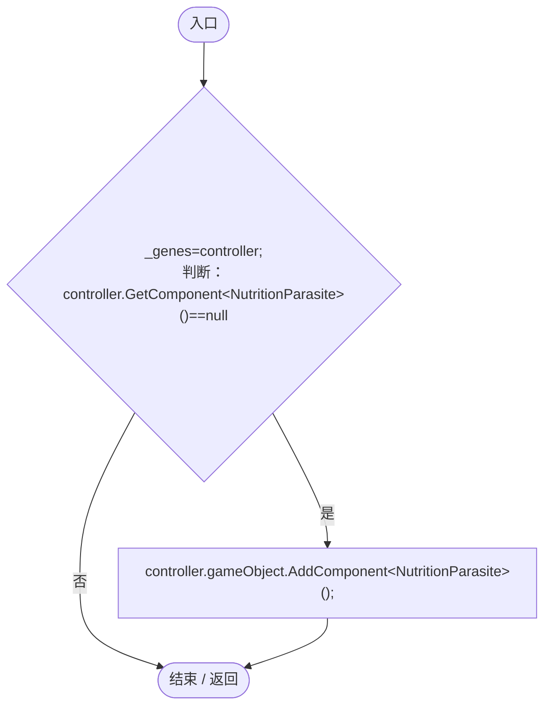
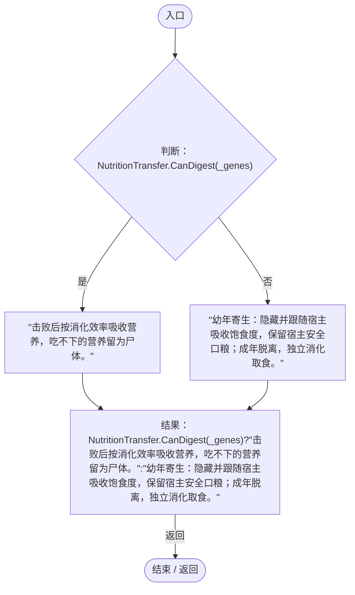
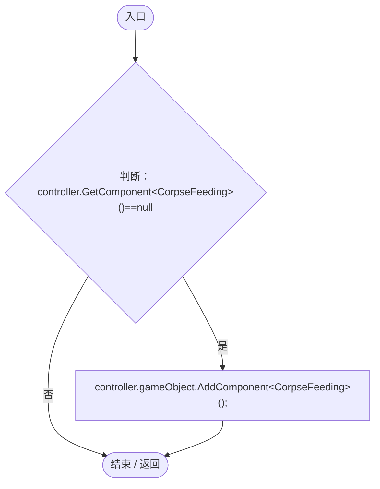
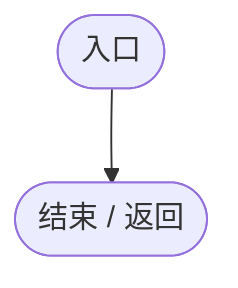
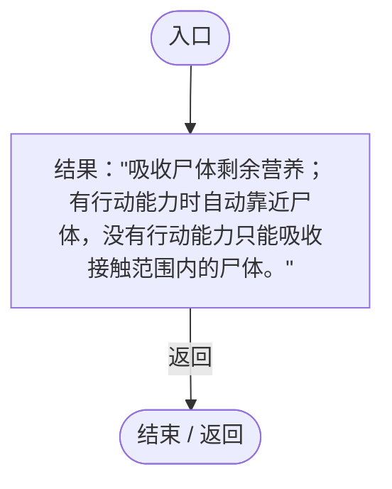

# HeterotrophyGeneLogic.cs

[返回总索引](../README.md) · `Runtime` · `Assets/DarwinPark/Entities/Logic/HeterotrophyGeneLogic.cs`

[源文件](../../../Assets/DarwinPark/Entities/Logic/HeterotrophyGeneLogic.cs) · 源码校验：`5f1ace61008035058c076c836b243dd0917f1ff53d1bb4ce7fef815ddf794188`

方法按源文件位置排列。事件/回调引用不表示立即执行；分支与异常说明见总索引。完整源码与可点击关系图请打开离线手册。

## Initialize · L10

`public void Initialize(EntityGeneController controller,GeneInstance gene)`

### Editor / Player · Roslyn编译器控制流

## OnUpdate · L11

`public void OnUpdate(float dt)`

### Editor / Player · Roslyn编译器控制流

## GetTooltipInfo · L12

`public string GetTooltipInfo()`

### Editor / Player · Roslyn编译器控制流

项目内调用/回调引用：

- [NutritionTransfer.CanDigest · L17](081d3b8ff683e442.md#m9a2dc0866fe95262)（方法）

## Initialize · L16

`public void Initialize(EntityGeneController controller,GeneInstance gene)`

### Editor / Player · Roslyn编译器控制流

## OnUpdate · L17

`public void OnUpdate(float dt)`

### Editor / Player · Roslyn编译器控制流

## GetTooltipInfo · L18

`public string GetTooltipInfo()`

### Editor / Player · Roslyn编译器控制流

