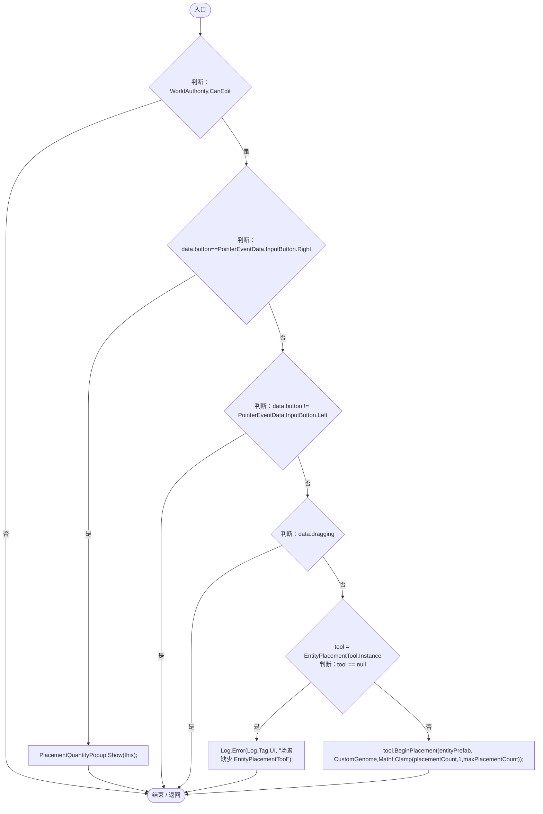
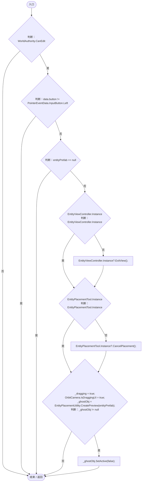
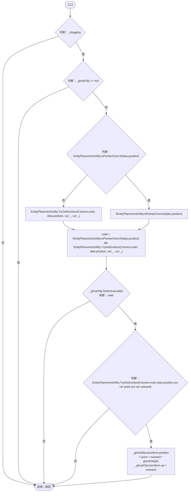
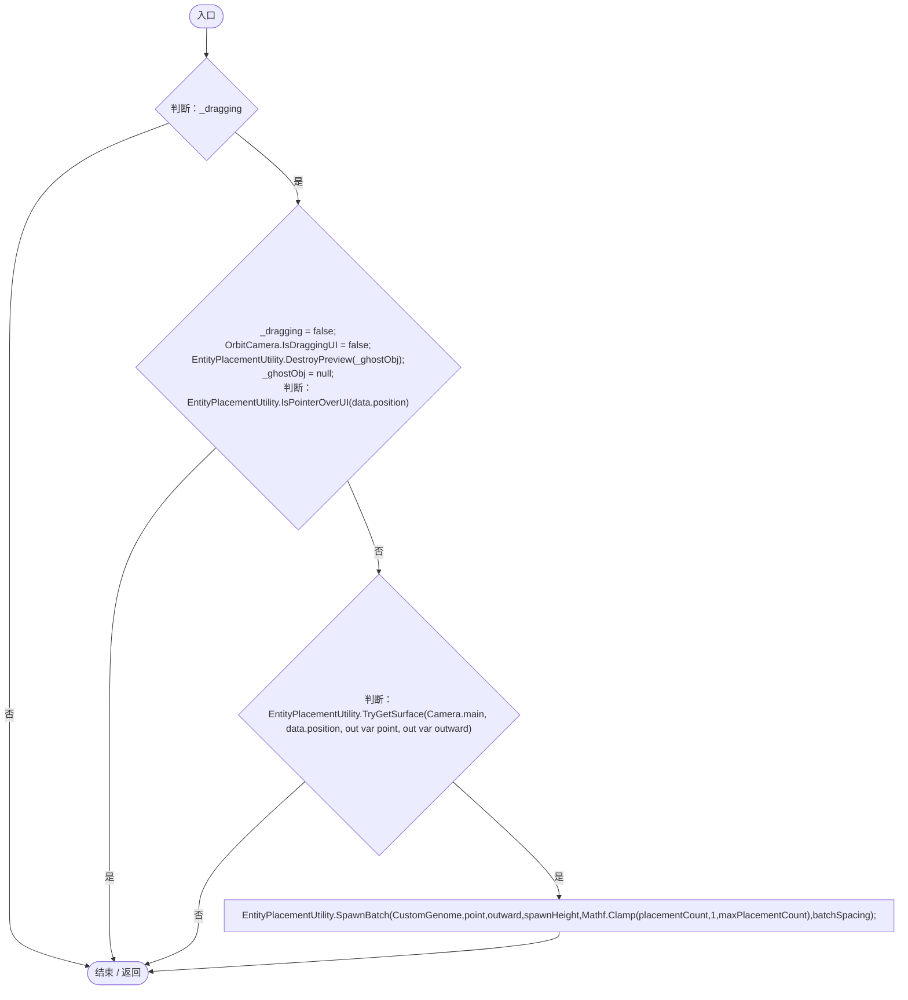
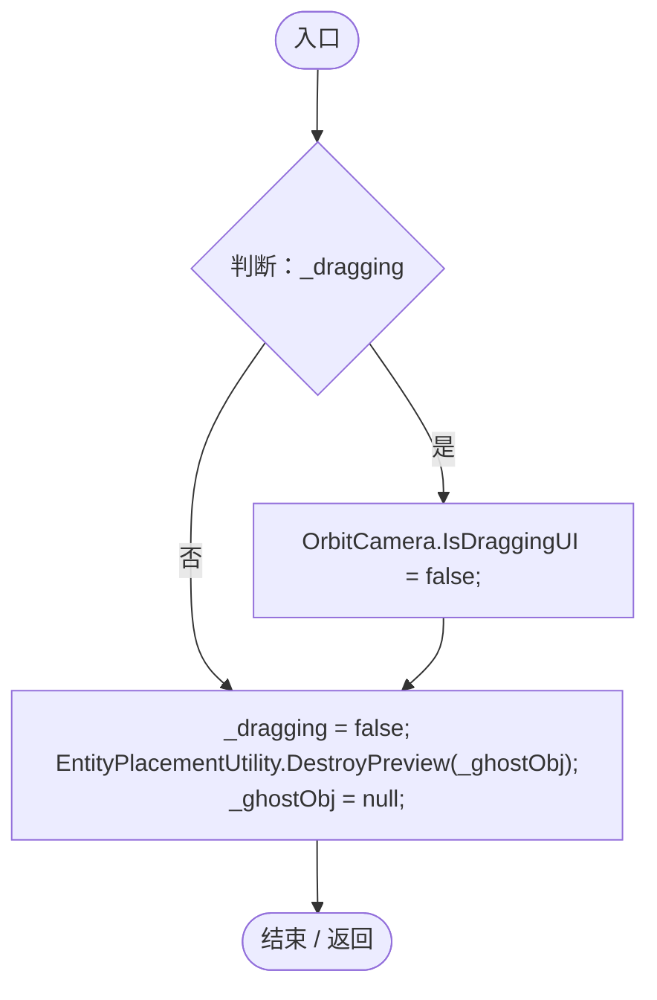

# EntitySpawnerUI.cs

[返回总索引](../README.md) · `Runtime` · `Assets/DarwinPark/UI/EntitySpawnerUI.cs`

[源文件](../../../Assets/DarwinPark/UI/EntitySpawnerUI.cs) · 源码校验：`173d55f25e16a665be6d2a2ac689224174d2f829c3455097142854e3103897d1`

方法按源文件位置排列。事件/回调引用不表示立即执行；分支与异常说明见总索引。完整源码与可点击关系图请打开离线手册。

## OnPointerClick · L20

`public void OnPointerClick(PointerEventData data)`

★ 适配：单击原来没有处理器；把新点击投放交互交给独立工具，原拖拽继续有效。

### Editor / Player · Roslyn编译器控制流

项目内调用/回调引用：

- [PlacementQuantityPopup.Show · L14](8e55f714deb963c4.md#md74c31acb6a5aa1a)（方法）
- [EntityPlacementTool.Instance.get · L13](2ca993947b0a7e7a.md#mafb26991c0dfcb86)（访问器）
- [Log.Error · L43](735e5abf0df2bddc.md#m2addd5e1d74b000d)（方法）
- [EntityPlacementTool.BeginPlacement · L27](2ca993947b0a7e7a.md#m6e111ed92099dcf2)（方法）

## OnBeginDrag · L30

`public void OnBeginDrag(PointerEventData data)`

### Editor / Player · Roslyn编译器控制流

项目内调用/回调引用：

- [EntityViewController.Instance.get · L15](0ad0345f83229ef0.md#mb3b8144b56e80842)（访问器）
- [EntityViewController.ExitView · L105](0ad0345f83229ef0.md#mca8619c7f27942c9)（方法）
- [EntityPlacementTool.Instance.get · L13](2ca993947b0a7e7a.md#mafb26991c0dfcb86)（访问器）
- [EntityPlacementTool.CancelPlacement · L81](2ca993947b0a7e7a.md#m5a9374d2c71f0a2d)（方法）
- [EntityPlacementUtility.CreatePreview · L89](6d2c32e632b9c147.md#m1f174d9daef88414)（方法）

## OnDrag · L42

`public void OnDrag(PointerEventData data)`

### Editor / Player · Roslyn编译器控制流

项目内调用/回调引用：

- [EntityPlacementUtility.IsPointerOverUI · L16](6d2c32e632b9c147.md#m126e7f8ff0d0a893)（方法）
- [EntityPlacementUtility.TryGetSurface · L23](6d2c32e632b9c147.md#mcaf74a1c76576237)（方法）

## OnEndDrag · L50

`public void OnEndDrag(PointerEventData data)`

### Editor / Player · Roslyn编译器控制流

项目内调用/回调引用：

- [EntityPlacementUtility.DestroyPreview · L134](6d2c32e632b9c147.md#m1ae2ba4853de4560)（方法）
- [EntityPlacementUtility.IsPointerOverUI · L16](6d2c32e632b9c147.md#m126e7f8ff0d0a893)（方法）
- [EntityPlacementUtility.TryGetSurface · L23](6d2c32e632b9c147.md#mcaf74a1c76576237)（方法）
- [EntityPlacementUtility.SpawnBatch · L41](6d2c32e632b9c147.md#m19dfca56b6218af1)（方法）

## OnDisable · L60

`private void OnDisable()`

### Editor / Player · Roslyn编译器控制流

项目内调用/回调引用：

- [EntityPlacementUtility.DestroyPreview · L134](6d2c32e632b9c147.md#m1ae2ba4853de4560)（方法）
