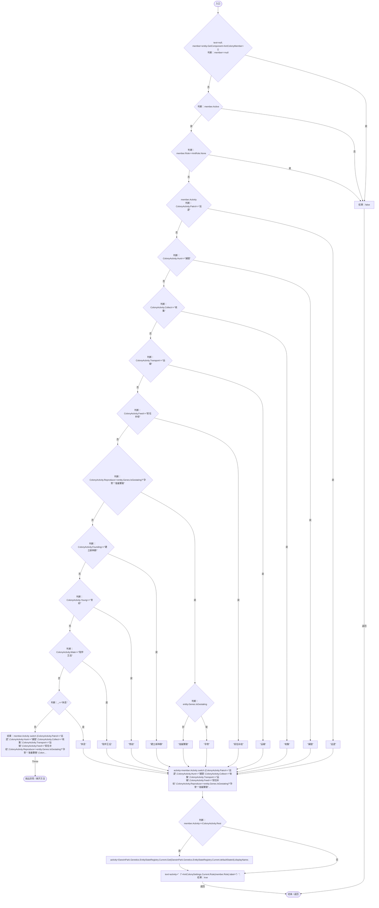
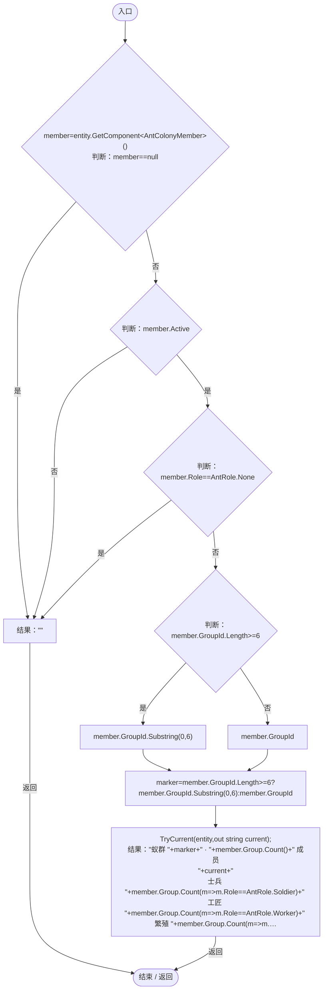
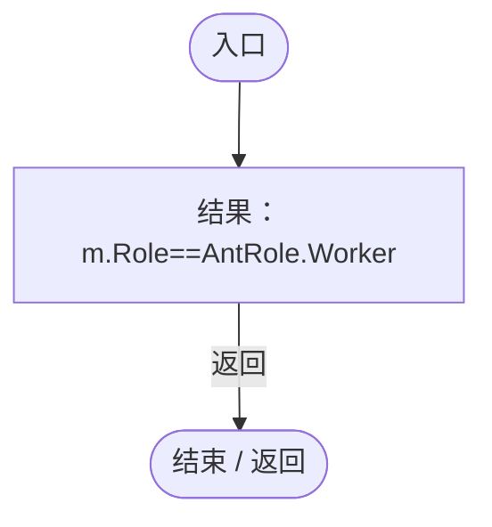
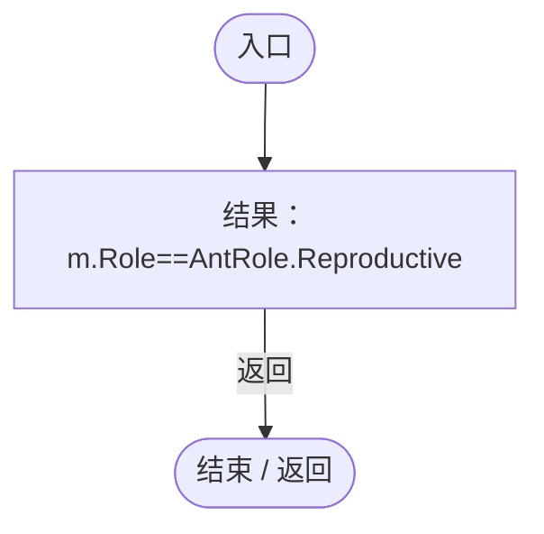

# ColonyStatusPresentation.cs

[返回总索引](../README.md) · `Runtime` · `Assets/DarwinPark/UI/ColonyStatusPresentation.cs`

[源文件](../../../Assets/DarwinPark/UI/ColonyStatusPresentation.cs) · 源码校验：`f51468058ace345bc8cd861d7f2f88fe5695eb08807db015eb3d7ec05a6b18e1`

方法按源文件位置排列。事件/回调引用不表示立即执行；分支与异常说明见总索引。完整源码与可点击关系图请打开离线手册。

## TryCurrent · L10

`public static bool TryCurrent(DarwinEntity entity,out string text)`

### Editor / Player · Roslyn编译器控制流

项目内调用/回调引用：

- [AntColonyMember.Role.get · L33](baebd85c05598377.md#mdf6df89f7116c7a3)（访问器）
- [AntColonyMember.Activity.get · L43](baebd85c05598377.md#m033aa4a066e4fd8c)（访问器）
- [DarwinEntity.Genes.get · L14](70798dde169f2e8b.md#m622eb1adf401d431)（访问器）
- [EntityStateDocument.Get · L32](440408d2db5c7d96.md#m52cb41ccf0c9d3c9)（方法）
- [EntityStateRegistry.Current.get · L41](440408d2db5c7d96.md#m61b7aa1a54b9a56c)（访问器）
- [AntColonySettings.Rule · L56](cb0a937e97c8fbb3.md#m46f80f7628c118a8)（方法）
- [AntColonySettings.Current.get · L31](cb0a937e97c8fbb3.md#mcd121159f407ccdf)（访问器）

## Summary · L18

`public static string Summary(DarwinEntity entity)`

### Editor / Player · Roslyn编译器控制流

项目内调用/回调引用：

- [AntColonyMember.Role.get · L33](baebd85c05598377.md#mdf6df89f7116c7a3)（访问器）
- [ColonyStatusPresentation.TryCurrent · L10](37a7c5ffa1a1a8c2.md#m0501c666d2846a93)（方法）
- [ColonyStatusPresentation.回调@23 · L23](37a7c5ffa1a1a8c2.md#m848e82c90b556096)（回调/委托）
- [ColonyStatusPresentation.回调@23 · L23](37a7c5ffa1a1a8c2.md#m99f0df052b188369)（回调/委托）
- [ColonyStatusPresentation.回调@23 · L23](37a7c5ffa1a1a8c2.md#md8824b32119282e9)（回调/委托）

## 回调@23 · L23

`m … => 回调`

### Editor / Player · Roslyn编译器控制流

项目内调用/回调引用：

- [AntColonyMember.Role.get · L33](baebd85c05598377.md#mdf6df89f7116c7a3)（访问器）

## 回调@23 · L23

`m … => 回调`

### Editor / Player · Roslyn编译器控制流

项目内调用/回调引用：

- [AntColonyMember.Role.get · L33](baebd85c05598377.md#mdf6df89f7116c7a3)（访问器）

## 回调@23 · L23

`m … => 回调`

### Editor / Player · Roslyn编译器控制流

项目内调用/回调引用：

- [AntColonyMember.Role.get · L33](baebd85c05598377.md#mdf6df89f7116c7a3)（访问器）
