# EntitySpawnPanel.cs

[返回总索引](../README.md) · `Runtime` · `Assets/DarwinPark/UI/EntitySpawnPanel.cs`

[源文件](../../../Assets/DarwinPark/UI/EntitySpawnPanel.cs) · 源码校验：`4d339704653391e1bdd97ef35cc41e3d3760491725571f3712c2fdc80fb8814a`

方法按源文件位置排列。事件/回调引用不表示立即执行；分支与异常说明见总索引。完整源码与可点击关系图请打开离线手册。

## Start · L16

`private void Start()`

### Editor / Player · Roslyn编译器控制流

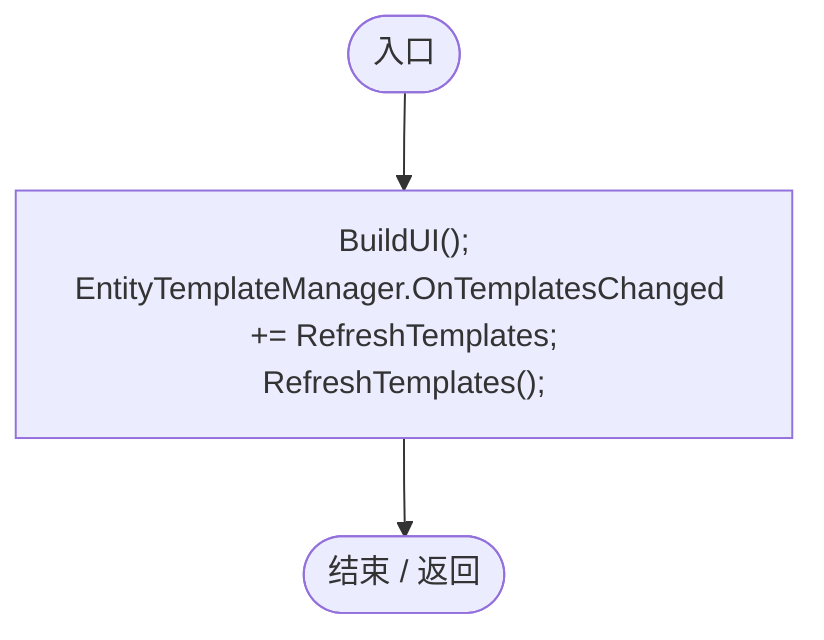

项目内调用/回调引用：

- [EntitySpawnPanel.BuildUI · L28](37e6224e1618ceb4.md#mb49b2f7676bd8c7d)（方法）
- [EntitySpawnPanel.RefreshTemplates · L111](37e6224e1618ceb4.md#m5926c62b61821563)（方法）

## OnDestroy · L23

`private void OnDestroy()`

### Editor / Player · Roslyn编译器控制流

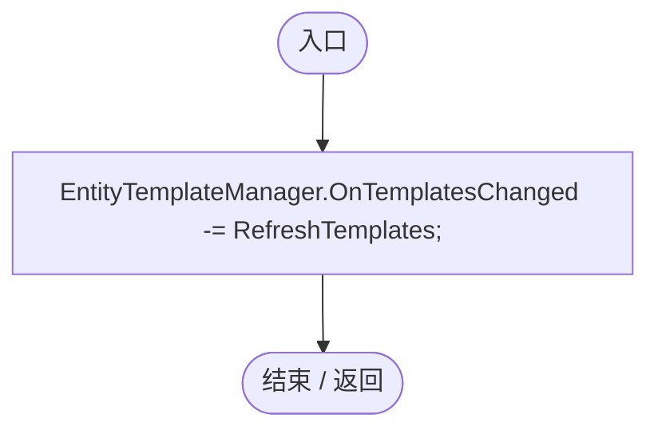

项目内调用/回调引用：

- [EntitySpawnPanel.RefreshTemplates · L111](37e6224e1618ceb4.md#m5926c62b61821563)（方法）

## BuildUI · L28

`private void BuildUI()`

### Editor / Player · Roslyn编译器控制流

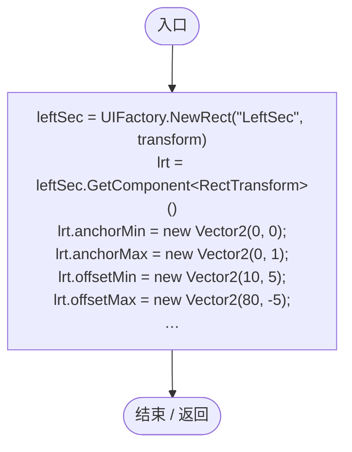

项目内调用/回调引用：

- [UIFactory.NewRect · L33](dd1096a6995423db.md#med612116f3152344)（方法）
- [EntitySpawnPanel.CreateSpawnSlot · L74](37e6224e1618ceb4.md#m0e0a15c5385c7841)（方法）
- [EntitySpawnPanel.CreateFavoritesButton · L90](37e6224e1618ceb4.md#m90f5055d28c45488)（方法）
- [EntitySpawnPanel.CreateDivider · L173](37e6224e1618ceb4.md#me37e6ce44044b416)（方法）
- [RandomSpawnPanel.Attach · L20](ff6518313bce61e2.md#me343a1dfc3431192)（方法）

## CreateSpawnSlot · L74

`private void CreateSpawnSlot(Transform parent, string label, GameObject prefab, Genome customGenome)`

### Editor / Player · Roslyn编译器控制流

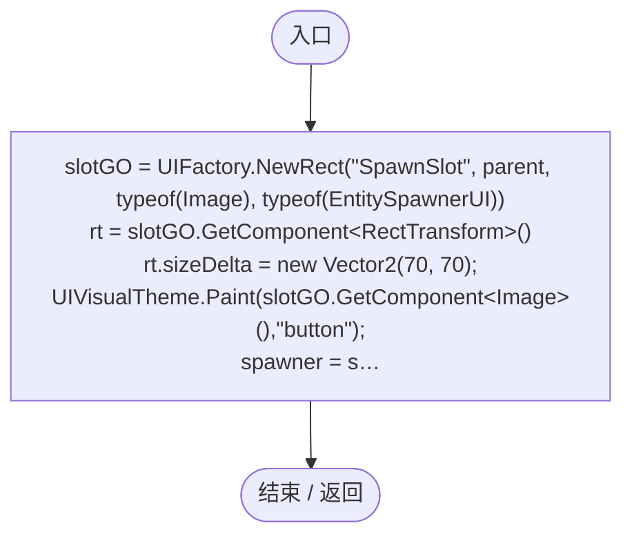

项目内调用/回调引用：

- [UIFactory.NewRect · L33](dd1096a6995423db.md#med612116f3152344)（方法）
- [UIVisualTheme.Paint · L58](ca525a798a08f966.md#m2d61a6b26ab24980)（方法）
- [UIFactory.NewText · L57](dd1096a6995423db.md#m9dbccb5f0c38189e)（方法）
- [UIFactory.Stretch · L150](dd1096a6995423db.md#m11d8f6c6d00cc047)（方法）

## CreateFavoritesButton · L90

`private void CreateFavoritesButton(Transform parent)`

### Editor / Player · Roslyn编译器控制流

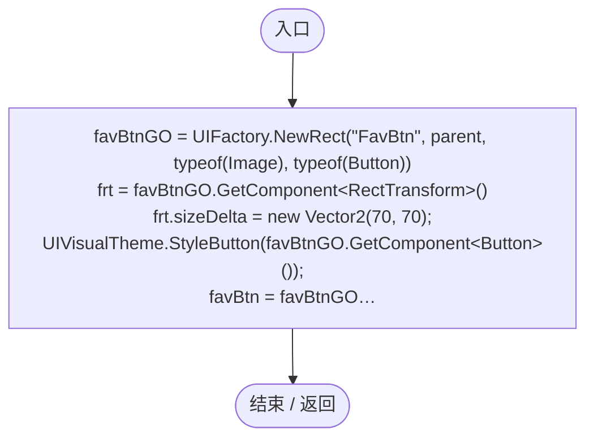

项目内调用/回调引用：

- [UIFactory.NewRect · L33](dd1096a6995423db.md#med612116f3152344)（方法）
- [UIVisualTheme.StyleButton · L67](ca525a798a08f966.md#mf2e64598de5115f3)（方法）
- [UIFactory.NewText · L57](dd1096a6995423db.md#m9dbccb5f0c38189e)（方法）
- [UIFactory.Stretch · L150](dd1096a6995423db.md#m11d8f6c6d00cc047)（方法）
- [UIVisualTheme.AddIcon · L79](ca525a798a08f966.md#mcae965e84a38acc6)（方法）
- [EntitySpawnPanel.回调@98 · L98](37e6224e1618ceb4.md#m888503946e959c4b)（回调/委托）

## 回调@98 · L98

`( … => 回调`

### Editor / Player · Roslyn编译器控制流

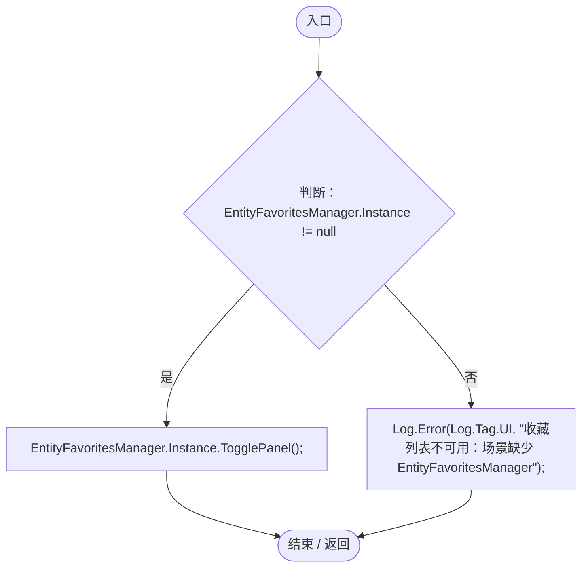

项目内调用/回调引用：

- [EntityFavoritesManager.Instance.get · L10](b60fb973e9d3815a.md#m0dac2feb106bac97)（访问器）
- [EntityFavoritesManager.TogglePanel · L36](b60fb973e9d3815a.md#ma95fb9dcce4925e2)（方法）
- [Log.Error · L43](735e5abf0df2bddc.md#m2addd5e1d74b000d)（方法）

## RefreshTemplates · L111

`private void RefreshTemplates()`

### Editor / Player · Roslyn编译器控制流

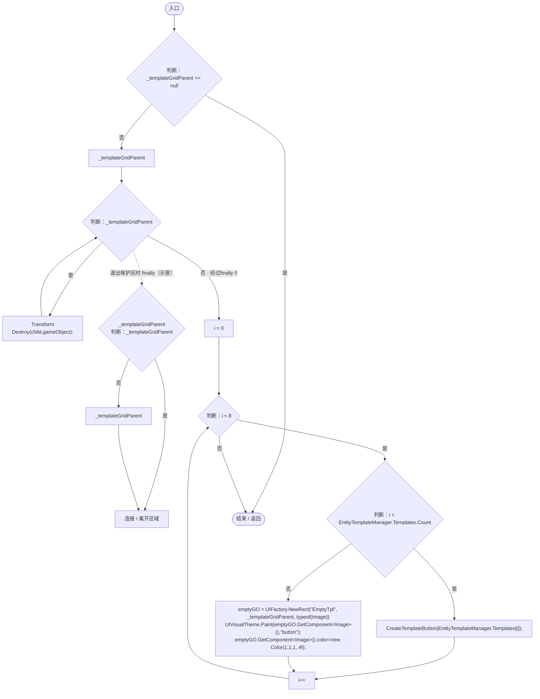

项目内调用/回调引用：

- [EntityTemplateManager.Templates.get · L23](ab5e6457e8a7aba0.md#m45cc5b075f7bf4ec)（访问器）
- [EntitySpawnPanel.CreateTemplateButton · L132](37e6224e1618ceb4.md#m002e35b528ddb93e)（方法）
- [UIFactory.NewRect · L33](dd1096a6995423db.md#med612116f3152344)（方法）
- [UIVisualTheme.Paint · L58](ca525a798a08f966.md#m2d61a6b26ab24980)（方法）

## CreateTemplateButton · L132

`private void CreateTemplateButton(EntityTemplateData tpl)`

### Editor / Player · Roslyn编译器控制流

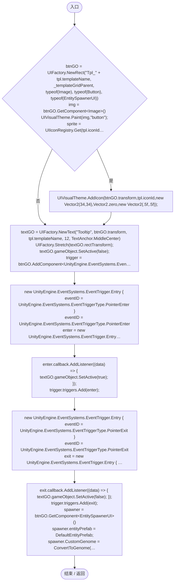

项目内调用/回调引用：

- [UIFactory.NewRect · L33](dd1096a6995423db.md#med612116f3152344)（方法）
- [UIVisualTheme.Paint · L58](ca525a798a08f966.md#m2d61a6b26ab24980)（方法）
- [UIIconRegistry.Get · L38](5e97f4545b48cac2.md#m95da89c0db2bbab9)（方法）
- [UIVisualTheme.AddIcon · L79](ca525a798a08f966.md#mcae965e84a38acc6)（方法）
- [UIFactory.NewText · L57](dd1096a6995423db.md#m9dbccb5f0c38189e)（方法）
- [UIFactory.Stretch · L150](dd1096a6995423db.md#m11d8f6c6d00cc047)（方法）
- [EntitySpawnPanel.ConvertToGenome · L163](37e6224e1618ceb4.md#m02ed8c559bafa6e0)（方法）
- [EntitySpawnPanel.回调@151 · L151](37e6224e1618ceb4.md#m8e9b7330f150c10b)（回调/委托）
- [EntitySpawnPanel.回调@155 · L155](37e6224e1618ceb4.md#m6ff789a65767c942)（回调/委托）

## 回调@151 · L151

`( … => 回调`

### Editor / Player · Roslyn编译器控制流

## 回调@155 · L155

`( … => 回调`

### Editor / Player · Roslyn编译器控制流

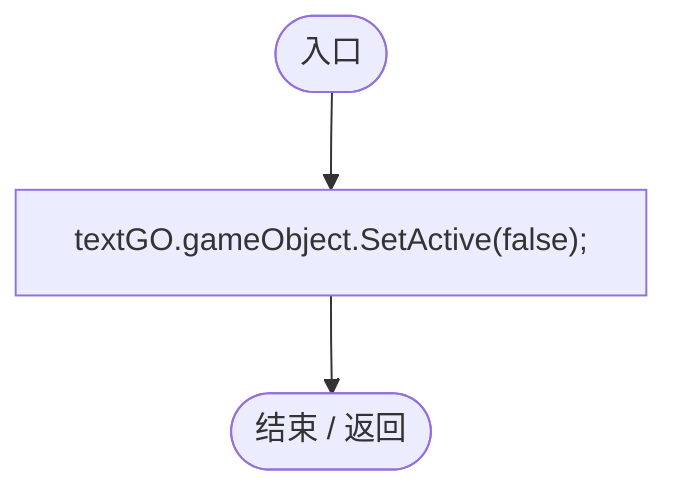

## ConvertToGenome · L163

`private Genome ConvertToGenome(List<GeneInstanceData> genes)`

### Editor / Player · Roslyn编译器控制流

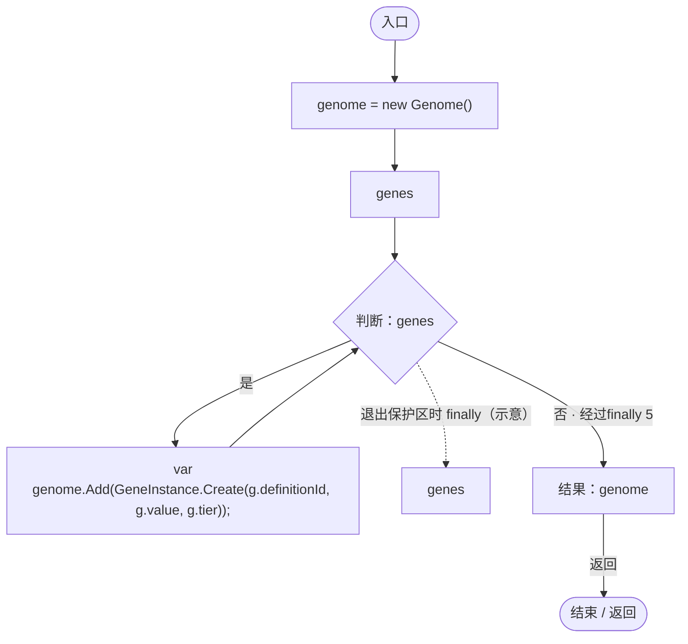

项目内调用/回调引用：

- [Genome.Add · L19](a2ef23f865bc7ee8.md#md9cfdc94b8b8d40f)（方法）
- [GeneInstance.Create · L20](f82e1498d67f5afd.md#m72e94c278de3cf8b)（方法）

## CreateDivider · L173

`private void CreateDivider(Transform parent, float xOffset)`

### Editor / Player · Roslyn编译器控制流

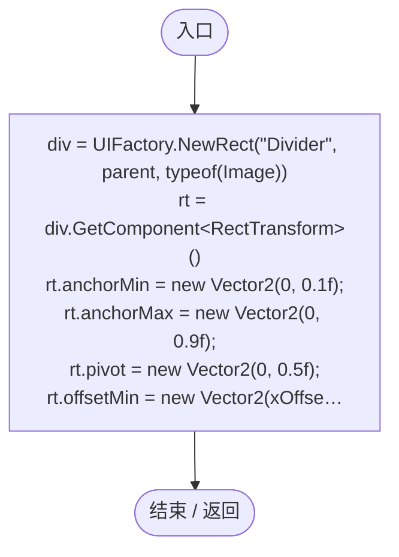

项目内调用/回调引用：

- [UIFactory.NewRect · L33](dd1096a6995423db.md#med612116f3152344)（方法）
