# MutationRoundController.cs

[返回总索引](../README.md) · `Runtime` · `Assets/DarwinPark/Entities/Simulation/MutationRoundController.cs`

[源文件](../../../Assets/DarwinPark/Entities/Simulation/MutationRoundController.cs) · 源码校验：`0b725d51e1298bf24caa998e1329c7e2e64f969e671902de89d6c2dc2a12ffb0`

方法按源文件位置排列。事件/回调引用不表示立即执行；分支与异常说明见总索引。完整源码与可点击关系图请打开离线手册。

## Rounds.get · L21

`public static long Rounds`

### Editor / Player · 语法控制结构 / 声明（非CFG）

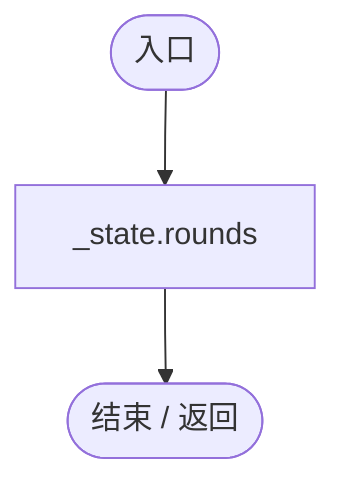

## Attempts.get · L21

`public static long Attempts`

### Editor / Player · 语法控制结构 / 声明（非CFG）

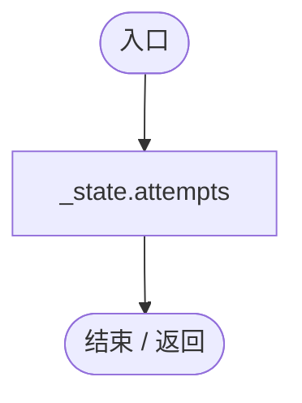

## Successes.get · L21

`public static long Successes`

### Editor / Player · 语法控制结构 / 声明（非CFG）

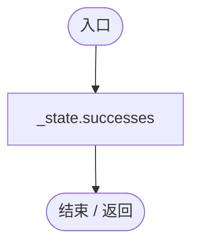

## LastPopulation.get · L22

`public static int LastPopulation`

### Editor / Player · 语法控制结构 / 声明（非CFG）

## LastSelected.get · L22

`public static int LastSelected`

### Editor / Player · 语法控制结构 / 声明（非CFG）

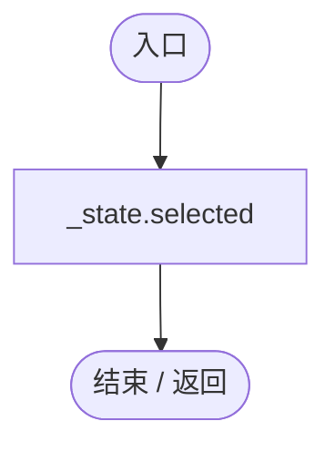

## Queued.get · L22

`public static int Queued`

### Editor / Player · 语法控制结构 / 声明（非CFG）

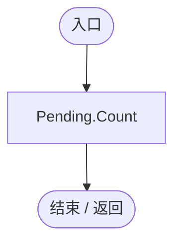

## Ensure · L23

`public static void Ensure(GameObject owner)`

### Editor / Player · Roslyn编译器控制流

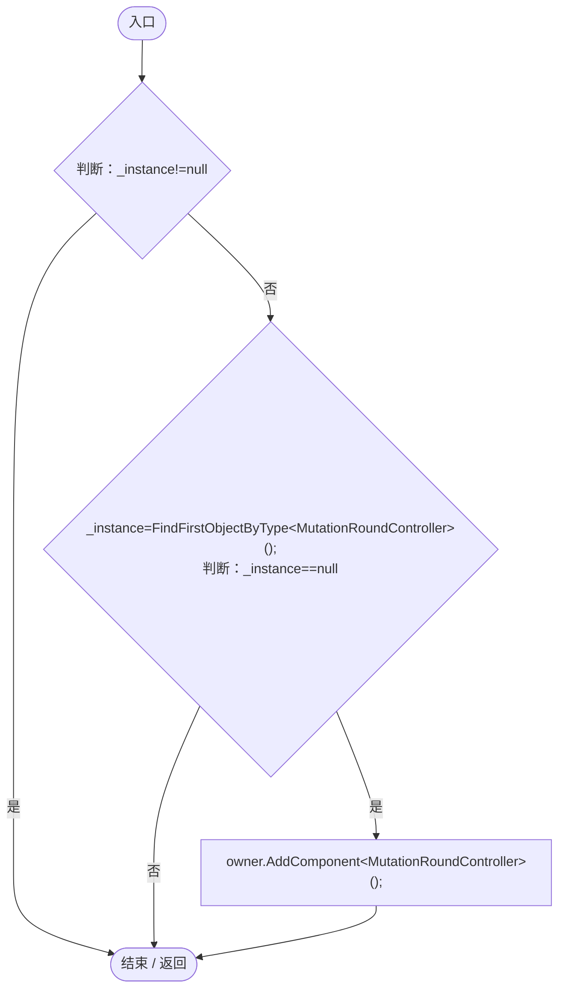

## Awake · L28

`private void Awake()`

### Editor / Player · Roslyn编译器控制流

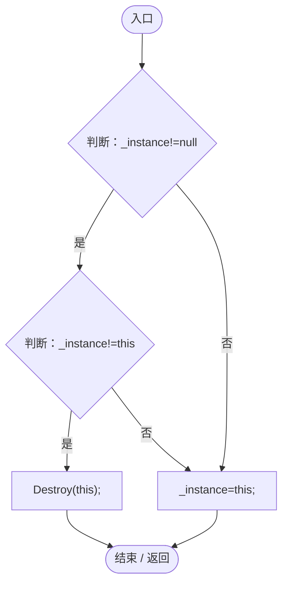

## OnDestroy · L29

`private void OnDestroy()`

### Editor / Player · Roslyn编译器控制流

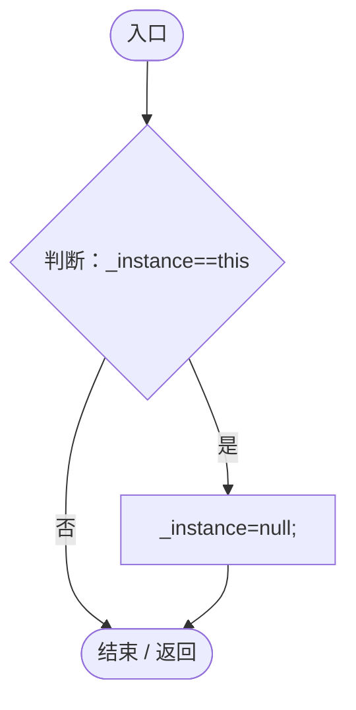

## Update · L30

`private void Update()`

### Editor / Player · Roslyn编译器控制流

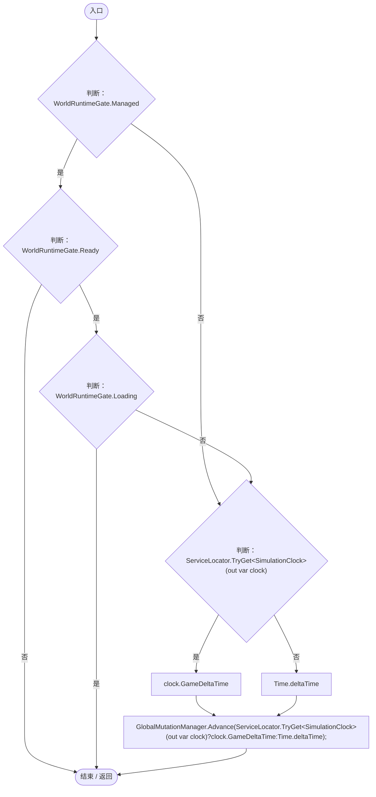

项目内调用/回调引用：

- [GlobalMutationManager.Advance · L6](debf58c0eabf33e3.md#m6825a28640333e7b)（方法）
- [ServiceLocator.TryGet · L26](f2fdbe9f9ccd93cb.md#m143b24e6d58471b0)（方法）
- [SimulationClock.GameDeltaTime.get · L26](a8f444aec9614b0a.md#me7f11abae18a4f2d)（访问器）

## Eligible · L31

`private static bool Eligible(DarwinEntity entity)`

### Editor / Player · Roslyn编译器控制流

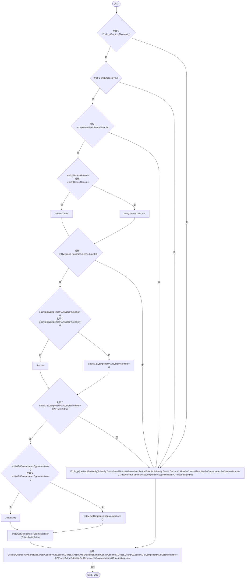

项目内调用/回调引用：

- [EcologyQueries.Alive · L39](bdf7ccc2c9c0452f.md#m8352bfacbe2996a8)（方法）
- [DarwinEntity.Genes.get · L14](70798dde169f2e8b.md#m622eb1adf401d431)（访问器）

## Advance · L32

`public static void Advance(float dt)`

### Editor / Player · Roslyn编译器控制流

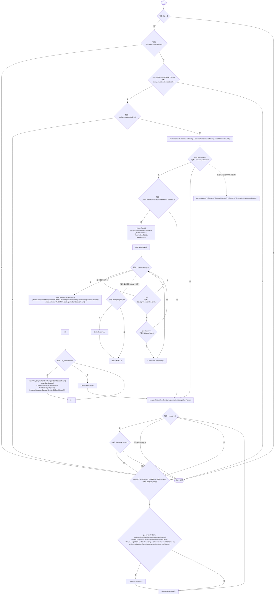

项目内调用/回调引用：

- [GameplayTuning.Current.get · L46](db546e5713b32d53.md#m4fa691bd8a3b9618)（访问器）
- [PerformanceTimings.Measure · L24](a8403a4c7503726d.md#mb452516394f3ebae)（方法）
- [EcologyQueries.Alive · L39](bdf7ccc2c9c0452f.md#m8352bfacbe2996a8)（方法）
- [MutationRoundController.Eligible · L31](3a238ee75b15c52c.md#m1c51363b7b76e989)（方法）
- [EcologyIdentity.Of · L22](bdf7ccc2c9c0452f.md#mb23020fe763aafd3)（方法）
- [EcologyIdentity.Find · L21](bdf7ccc2c9c0452f.md#mb670b64dc2baff58)（方法）
- [DarwinEntity.Genes.get · L14](70798dde169f2e8b.md#m622eb1adf401d431)（访问器）
- [GeneMutationSettings.CreateDefault · L14](202f10318a181ae1.md#mf2c33daa013981eb)（方法）
- [GeneMutator.Mutate · L18](f297edbfb98ef475.md#m4444eb9ce9b6a55a)（方法）
- [EntityGeneController.Recalculate · L118](7494d53178552f0e.md#m707d9a56b0c7c609)（方法）

## Capture · L54

`public static MutationRoundSave Capture()`

### Editor / Player · Roslyn编译器控制流

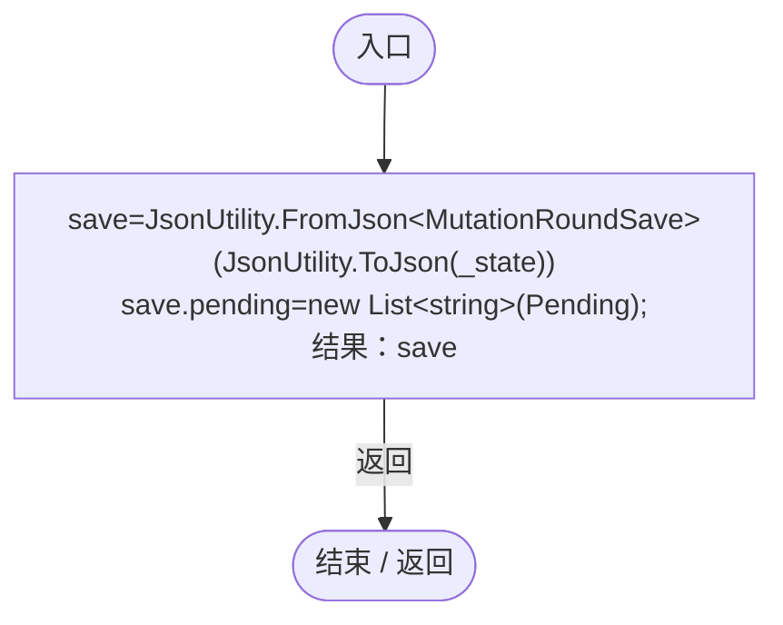

## Restore · L56

`public static void Restore(MutationRoundSave save)`

### Editor / Player · Roslyn编译器控制流

```mermaid
flowchart TD
  b0(["入口"])
  b1["Validate(save);<br/>Pending.Clear();<br/>Candidates.Clear();"]
  b2{"_state<br/>判断：save==null"}
  b3{"判断：save.version==0"}
  b4["new MutationRoundSave()"]
  b5["JsonUtility.FromJson&lt;MutationRoundSave&gt;(JsonUtility.ToJson(save))"]
  b6["_state=save==null&#124;&#124;save.version==0?new MutationRoundSave():JsonUtility.FromJson&lt;MutationRoundSave&gt;(JsonUtility.ToJson(save));"]
  b7["_state.pending"]
  b8{"判断：_state.pending"}
  b9["string<br/>Pending.Enqueue(id);"]
  b10["_state.pending"]
  b11["_state.pending.Clear();"]
  b12(["结束 / 返回"])
  b0 --> b1
  b1 --> b2
  b2 -->|"否"| b3
  b2 -->|"是"| b4
  b3 -->|"是"| b4
  b3 -->|"否"| b5
  b4 --> b6
  b5 --> b6
  b6 --> b7
  b7 --> b8
  b8 -->|"是"| b9
  b8 -->|"否 · 经过finally 10"| b11
  b9 --> b8
  b11 --> b12
  b8 -. "退出保护区时 finally（示意）" .-> b10

```

项目内调用/回调引用：

- [MutationRoundController.Validate · L61](3a238ee75b15c52c.md#ma902079930c7f779)（方法）

## Validate · L61

`public static void Validate(MutationRoundSave save)`

### Editor / Player · Roslyn编译器控制流

```mermaid
flowchart TD
  b0(["入口"])
  b1{"判断：save==null"}
  b2{"判断：save.version==0"}
  b3{"判断：save.elapsed==0"}
  b4{"判断：save.rounds==0"}
  b5{"判断：save.attempts==0"}
  b6{"判断：save.successes==0"}
  b7{"判断：save.population==0"}
  b8{"判断：save.quota==0"}
  b9{"判断：save.selected==0"}
  b10{"判断：save.pending==null"}
  b11{"判断：save.pending.Count==0"}
  b12{"判断：save.version!=1"}
  b13{"判断：double.IsNaN(save.elapsed)"}
  b14{"判断：double.IsInfinity(save.elapsed)"}
  b15{"判断：save.elapsed&lt;0"}
  b16{"判断：save.rounds&lt;0"}
  b17{"判断：save.attempts&lt;0"}
  b18{"判断：save.successes&lt;0"}
  b19{"判断：save.successes&gt;save.attempts"}
  b20{"判断：save.population&lt;0"}
  b21{"判断：save.quota&lt;0"}
  b22{"判断：save.quota&gt;save.population"}
  b23{"判断：save.selected&lt;0"}
  b24{"判断：save.selected&gt;save.quota"}
  b25{"判断：save.pending==null"}
  b26{"判断：save.pending.Count&gt;save.selected"}
  b27["结果：new InvalidDataException(&quot;全局变异轮次状态无效&quot;)"]
  x27(["抛出异常 / 离开方法"])
  b28["ids=new HashSet&lt;string&gt;()"]
  b29["save.pending"]
  b30{"判断：save.pending"}
  b31{"string<br/>判断：Guid.TryParseExact(id,&quot;N&quot;,out _)"}
  b32{"判断：ids.Add(id)"}
  b33["结果：new InvalidDataException(&quot;全局变异待执行名单无效或重复&quot;)"]
  x33(["抛出异常 / 离开方法"])
  b34["save.pending"]
  b35(["结束 / 返回"])
  b0 --> b1
  b1 -->|"是"| b35
  b1 -->|"否"| b2
  b2 -->|"是"| b3
  b2 -->|"否"| b12
  b3 -->|"是"| b4
  b3 -->|"否"| b12
  b4 -->|"是"| b5
  b4 -->|"否"| b12
  b5 -->|"是"| b6
  b5 -->|"否"| b12
  b6 -->|"是"| b7
  b6 -->|"否"| b12
  b7 -->|"是"| b8
  b7 -->|"否"| b12
  b8 -->|"是"| b9
  b8 -->|"否"| b12
  b9 -->|"是"| b10
  b9 -->|"否"| b12
  b10 -->|"否"| b11
  b10 -->|"是"| b35
  b11 -->|"是"| b35
  b11 -->|"否"| b12
  b12 -->|"否"| b13
  b12 -->|"是"| b27
  b13 -->|"否"| b14
  b13 -->|"是"| b27
  b14 -->|"否"| b15
  b14 -->|"是"| b27
  b15 -->|"否"| b16
  b15 -->|"是"| b27
  b16 -->|"否"| b17
  b16 -->|"是"| b27
  b17 -->|"否"| b18
  b17 -->|"是"| b27
  b18 -->|"否"| b19
  b18 -->|"是"| b27
  b19 -->|"否"| b20
  b19 -->|"是"| b27
  b20 -->|"否"| b21
  b20 -->|"是"| b27
  b21 -->|"否"| b22
  b21 -->|"是"| b27
  b22 -->|"否"| b23
  b22 -->|"是"| b27
  b23 -->|"否"| b24
  b23 -->|"是"| b27
  b24 -->|"否"| b25
  b24 -->|"是"| b27
  b25 -->|"否"| b26
  b25 -->|"是"| b27
  b26 -->|"是"| b27
  b26 -->|"否"| b28
  b27 -->|"Throw"| x27
  b28 --> b29
  b29 --> b30
  b30 -->|"是"| b31
  b30 -->|"否 · 经过finally 34"| b35
  b31 -->|"是"| b32
  b31 -->|"否"| b33
  b32 -->|"否"| b33
  b32 -->|"是"| b30
  b33 -->|"Throw"| x33
  b30 -. "退出保护区时 finally（示意）" .-> b34

```

## Reset · L68

`[RuntimeInitializeOnLoadMethod(RuntimeInitializeLoadType.SubsystemRegistration)]private static void Reset()`

### Editor / Player · Roslyn编译器控制流

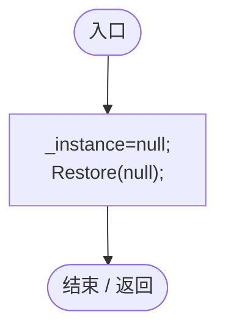

项目内调用/回调引用：

- [MutationRoundController.Restore · L56](3a238ee75b15c52c.md#m8fd13208bdd39731)（方法）
