# RtsSelectionInput.cs

[返回总索引](../README.md) · `Runtime` · `Assets/DarwinPark/UI/RtsSelectionInput.cs`

[源文件](../../../Assets/DarwinPark/UI/RtsSelectionInput.cs) · 源码校验：`239c6f61ed550457ed447d041e2f4c66540056a9d545a6daa44172103a278c28`

方法按源文件位置排列。事件/回调引用不表示立即执行；分支与异常说明见总索引。完整源码与可点击关系图请打开离线手册。

## toggleKey.get · L17

`public KeyCode toggleKey`

★ 适配：RTS开关读取本机按键设置，权限校验仍保留在原入口。

### Editor / Player · 语法控制结构 / 声明（非CFG）

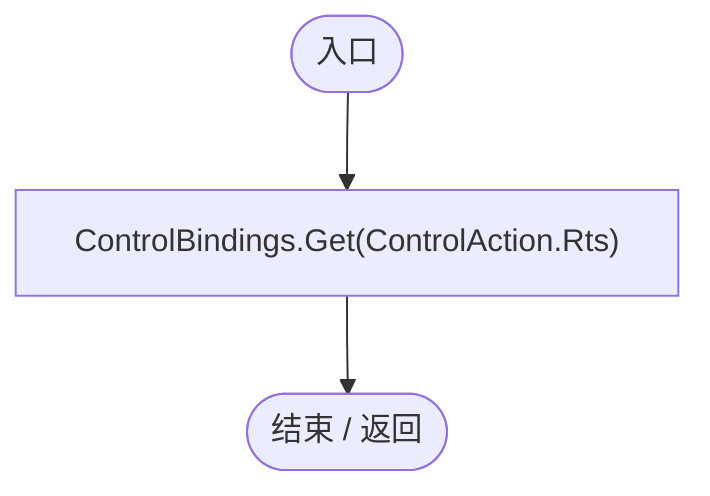

项目内调用/回调引用：

- [ControlBindings.Get · L45](b6735f8f133ee3f4.md#mb5707e6e63a56689)（方法）

## Instance.get · L20

`get`

### Editor / Player · 语法控制结构 / 声明（非CFG）

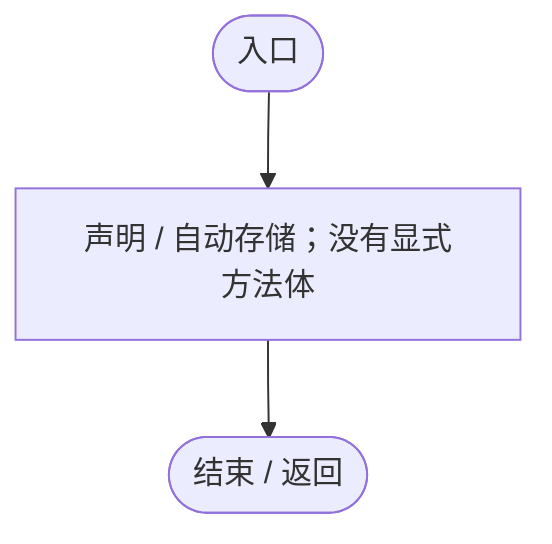

## Instance.set · L20

`private set`

### Editor / Player · 语法控制结构 / 声明（非CFG）

## Selected.get · L24

`public IReadOnlyList<DarwinEntity> Selected`

### Editor / Player · 语法控制结构 / 声明（非CFG）

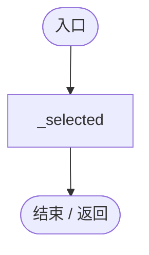

## Awake · L25

`private void Awake()`

### Editor / Player · Roslyn编译器控制流

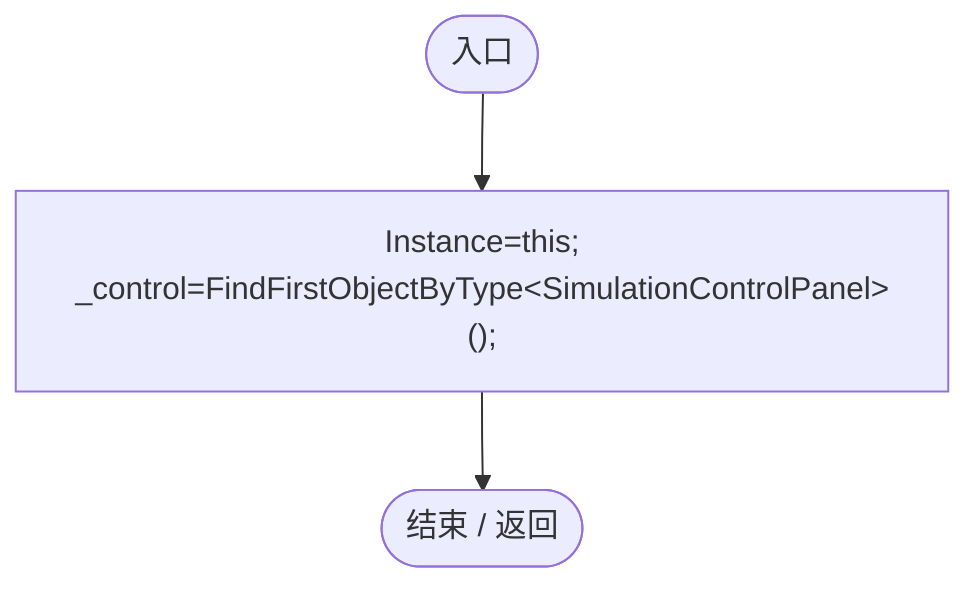

项目内调用/回调引用：

- [RtsSelectionInput.Instance.set · L20](3c8b37f7bbd7a10f.md#m61394b689ee9e5a7)（访问器）

## OnDestroy · L26

`private void OnDestroy()`

### Editor / Player · Roslyn编译器控制流

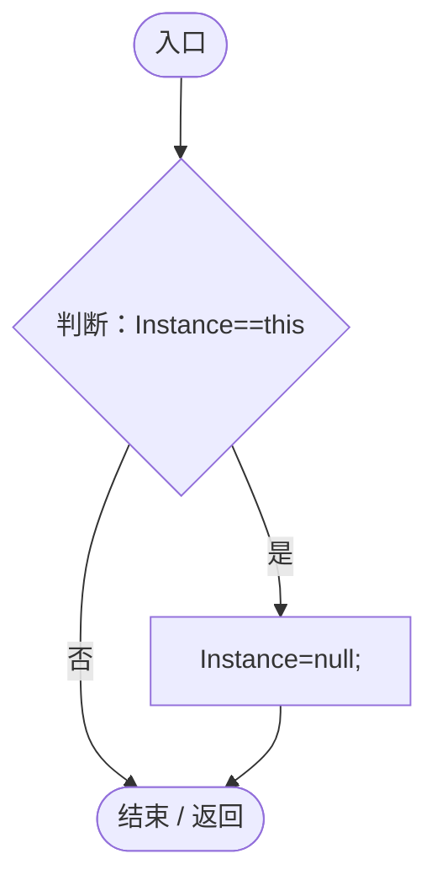

项目内调用/回调引用：

- [RtsSelectionInput.Instance.get · L20](3c8b37f7bbd7a10f.md#m8ea2edabb2816aec)（访问器）
- [RtsSelectionInput.Instance.set · L20](3c8b37f7bbd7a10f.md#m61394b689ee9e5a7)（访问器）

## CommandBarRect.get · L27

`public static Rect CommandBarRect`

### Editor / Player · 语法控制结构 / 声明（非CFG）

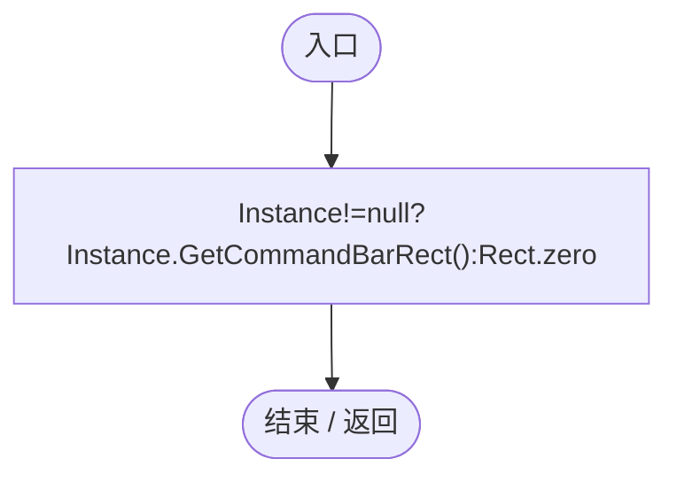

项目内调用/回调引用：

- [RtsSelectionInput.Instance.get · L20](3c8b37f7bbd7a10f.md#m8ea2edabb2816aec)（访问器）
- [RtsSelectionInput.GetCommandBarRect · L28](3c8b37f7bbd7a10f.md#mfd2c3410738f04b5)（方法）

## GetCommandBarRect · L28

`public Rect GetCommandBarRect()`

### Editor / Player · Roslyn编译器控制流

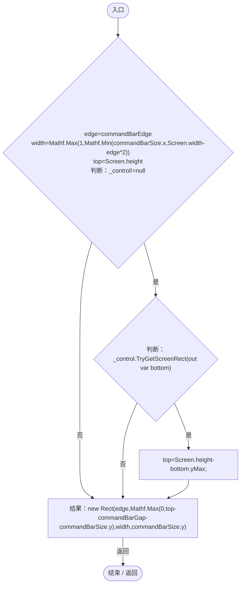

项目内调用/回调引用：

- [SimulationControlPanel.TryGetScreenRect · L33](76bc7add9187fd1f.md#m03c1c859770476c8)（方法）

## IsOverCommandBar · L35

`public static bool IsOverCommandBar(Vector2 screenPoint)`

### Editor / Player · Roslyn编译器控制流

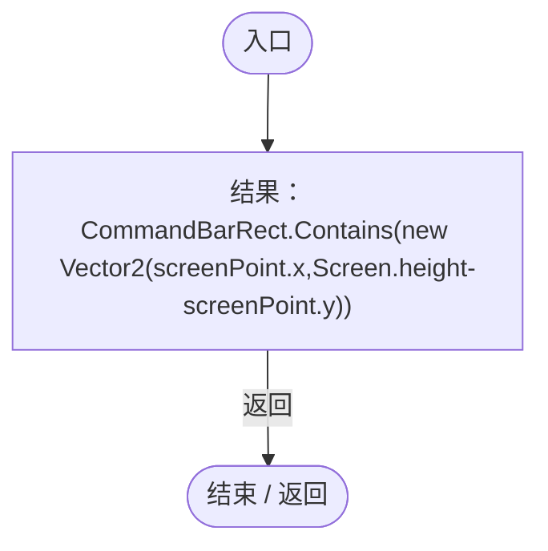

## Update · L36

`private void Update()`

### Editor / Player · Roslyn编译器控制流

```mermaid
flowchart TD
  b0(["入口"])
  b1{"session=LanSession.Instance<br/>判断：session==null"}
  b2{"判断：WorldRuntimeGate.Ready"}
  b3{"判断：GameInputGate.Blocked"}
  b4["_dragging=false;"]
  b5{"EventSystem.current<br/>判断：EventSystem.current"}
  b6[".currentSelectedGameObject"]
  b7["EventSystem.current"]
  b8["selected=EventSystem.current?.currentSelectedGameObject"]
  b9{"判断：selected!=null"}
  b10{"判断：selected.GetComponentInParent&lt;InputField&gt;() is InputField input"}
  b11{"判断：input.isFocused"}
  b12{"判断：Input.GetKeyDown(toggleKey)"}
  b13{"active=!WorldAuthority.RtsMode<br/>session.SetRtsMode(active);<br/>_selected.Clear();<br/>判断：active"}
  b14{"判断：session.IsClient"}
  b15{"判断：EcologyIdentity.Find(session.OwnedEntityId) is DarwinEntity entity"}
  b16["EntityViewController.Instance.EnterView(entity);"]
  b17{"判断：WorldAuthority.RtsMode"}
  b18{"判断：session.CanUseRts"}
  b19["session.SetRtsMode(false);<br/>_selected.Clear();"]
  b20["_selected.RemoveAll(e=&gt;!EcologyQueries.Alive(e)&#124;&#124;!session.CanCommand(e));"]
  b21{"判断：EntityPlacementUtility.IsPointerOverUI(Input.mousePosition)"}
  b22["IsOverCommandBar(Input.mousePosition)"]
  b23["EntityPlacementUtility.IsPointerOverUI(Input.mousePosition)"]
  b24["over=EntityPlacementUtility.IsPointerOverUI(Input.mousePosition)&#124;&#124;IsOverCommandBar(Input.mousePosition)"]
  b25{"判断：Input.GetMouseButtonDown(0)"}
  b26{"判断：over"}
  b27["_dragging=true;<br/>_start=Input.mousePosition;"]
  b28{"判断：Input.GetMouseButtonUp(0)"}
  b29{"判断：_dragging"}
  b30{"_dragging=false;<br/>判断：over"}
  b31{"SelectRectangle<br/>_start<br/>Input.mousePosition<br/>判断：Input.GetKey(KeyCode.LeftShift)"}
  b32["Input.GetKey(KeyCode.RightShift)"]
  b33["Input.GetKey(KeyCode.LeftShift)"]
  b34["SelectRectangle(_start,Input.mousePosition,Input.GetKey(KeyCode.LeftShift)&#124;&#124;Input.GetKey(KeyCode.RightShift));"]
  b35{"判断：Input.GetMouseButtonDown(1)"}
  b36{"判断：over"}
  b37{"判断：_selected.Count&gt;0"}
  b38{"camera=Camera.main<br/>判断：camera==null"}
  b39{"target=null<br/>ray=camera.ScreenPointToRay(Input.mousePosition)<br/>判断：Physics.Raycast(ray,out var hit,camera.farClipPlane,~0,QueryTriggerInteraction.Ignore)"}
  b40["target=hit.collider.GetComponentInParent&lt;DarwinEntity&gt;();"]
  b41{"判断：EntityPlacementUtility.TryGetSurface(camera,Input.mousePosition,out var point,out _)"}
  b42{"resource=ColonyResource.All.Where(r=&gt;r.State.kind==ColonyResourceKind.Corpse&amp;&amp;EcologyQueries.Distance(r.transform.position,point)&lt;=LanSettings.Current.rtsPickRadius).OrderBy(r=&gt;(r.transform.position-point).sqrMagnitude).FirstOrDefault()<br/>…"}
  b43{"判断：target!=null"}
  b44{"判断：_selected.Any(e=&gt;EcologyMotion.CanHunt(e.Genes,target))"}
  b45["mode=RtsOrderKind.Attack;"]
  b46["session.IssueRts(_selected.Select(EcologyIdentity.Of).ToArray(),mode,point,target,resource);<br/>_mode=RtsOrderKind.Move;"]
  b47(["结束 / 返回"])
  b0 --> b1
  b1 -->|"否"| b2
  b1 -->|"是"| b4
  b2 -->|"是"| b3
  b2 -->|"否"| b4
  b3 -->|"是"| b4
  b3 -->|"否"| b5
  b4 --> b47
  b5 -->|"否"| b6
  b5 -->|"是"| b7
  b6 --> b8
  b7 --> b8
  b8 --> b9
  b9 -->|"是"| b10
  b9 -->|"否"| b12
  b10 -->|"是"| b11
  b10 -->|"否"| b12
  b11 -->|"是"| b47
  b11 -->|"否"| b12
  b12 -->|"是"| b13
  b12 -->|"否"| b17
  b13 -->|"否"| b14
  b13 -->|"是"| b17
  b14 -->|"是"| b15
  b14 -->|"否"| b17
  b15 -->|"是"| b16
  b15 -->|"否"| b17
  b16 --> b17
  b17 -->|"否"| b47
  b17 -->|"是"| b18
  b18 -->|"否"| b19
  b18 -->|"是"| b20
  b19 --> b47
  b20 --> b21
  b21 -->|"否"| b22
  b21 -->|"是"| b23
  b22 --> b24
  b23 --> b24
  b24 --> b25
  b25 -->|"是"| b26
  b25 -->|"否"| b28
  b26 -->|"否"| b27
  b26 -->|"是"| b28
  b27 --> b28
  b28 -->|"是"| b29
  b28 -->|"否"| b35
  b29 -->|"是"| b30
  b29 -->|"否"| b35
  b30 -->|"否"| b31
  b30 -->|"是"| b35
  b31 -->|"否"| b32
  b31 -->|"是"| b33
  b32 --> b34
  b33 --> b34
  b34 --> b35
  b35 -->|"是"| b36
  b35 -->|"否"| b47
  b36 -->|"否"| b37
  b36 -->|"是"| b47
  b37 -->|"是"| b38
  b37 -->|"否"| b47
  b38 -->|"是"| b47
  b38 -->|"否"| b39
  b39 -->|"是"| b40
  b39 -->|"否"| b41
  b40 --> b41
  b41 -->|"否"| b47
  b41 -->|"是"| b42
  b42 -->|"是"| b43
  b42 -->|"否"| b46
  b43 -->|"是"| b44
  b43 -->|"否"| b46
  b44 -->|"是"| b45
  b44 -->|"否"| b46
  b45 --> b46
  b46 --> b47

```

项目内调用/回调引用：

- [LanSession.Instance.get · L23](9fb633eebffe669c.md#mbf83306994878383)（访问器）
- [GameInputGate.Blocked.get · L8](52955daae7e592ab.md#m765763b665829633)（访问器）
- [LanSession.SetRtsMode · L113](9fb633eebffe669c.md#md00374cca68a1203)（方法）
- [EcologyIdentity.Find · L20](bdf7ccc2c9c0452f.md#m58f756a3ba9ec990)（方法）
- [LanSession.OwnedEntityId.get · L30](9fb633eebffe669c.md#m5adc535c48d20cbe)（访问器）
- [EntityViewController.EnterView · L73](0ad0345f83229ef0.md#mbd7be6d2bbd0ec83)（方法）
- [EntityViewController.Instance.get · L15](0ad0345f83229ef0.md#mb3b8144b56e80842)（访问器）
- [EntityPlacementUtility.IsPointerOverUI · L16](6d2c32e632b9c147.md#m126e7f8ff0d0a893)（方法）
- [RtsSelectionInput.IsOverCommandBar · L35](3c8b37f7bbd7a10f.md#m35be0e064805f3ff)（方法）
- [RtsSelectionInput.SelectRectangle · L61](3c8b37f7bbd7a10f.md#me09460aa5540d76e)（方法）
- [EntityPlacementUtility.TryGetSurface · L23](6d2c32e632b9c147.md#mcaf74a1c76576237)（方法）
- [LanSession.IssueRts · L119](9fb633eebffe669c.md#m7bcbba11fd529ea2)（方法）
- [RtsSelectionInput.回调@46 · L46](3c8b37f7bbd7a10f.md#me01f5a3246c46e6a)（回调/委托）
- [RtsSelectionInput.回调@56 · L56](3c8b37f7bbd7a10f.md#ma86cc0c82ff54295)（回调/委托）
- [RtsSelectionInput.回调@56 · L56](3c8b37f7bbd7a10f.md#m8a479e3c74297f63)（回调/委托）
- [RtsSelectionInput.回调@57 · L57](3c8b37f7bbd7a10f.md#m593e7f5d3146dd58)（回调/委托）
- [EcologyIdentity.Of · L21](bdf7ccc2c9c0452f.md#m1143cf9570a93b72)（方法）

## 回调@46 · L46

`e … => 回调`

### Editor / Player · Roslyn编译器控制流

```mermaid
flowchart TD
  b0(["入口"])
  b1{"判断：EcologyQueries.Alive(e)"}
  b2["!session.CanCommand(e)"]
  b3["!EcologyQueries.Alive(e)"]
  b4["结果：!EcologyQueries.Alive(e)&#124;&#124;!session.CanCommand(e)"]
  b5(["结束 / 返回"])
  b0 --> b1
  b1 -->|"是"| b2
  b1 -->|"否"| b3
  b2 --> b4
  b3 --> b4
  b4 -->|"返回"| b5

```

项目内调用/回调引用：

- [EcologyQueries.Alive · L38](bdf7ccc2c9c0452f.md#mb2877c487f449970)（方法）
- [LanSession.CanCommand · L105](9fb633eebffe669c.md#m1b4c6d1ce7a79828)（方法）

## 回调@56 · L56

`r … => 回调`

### Editor / Player · Roslyn编译器控制流

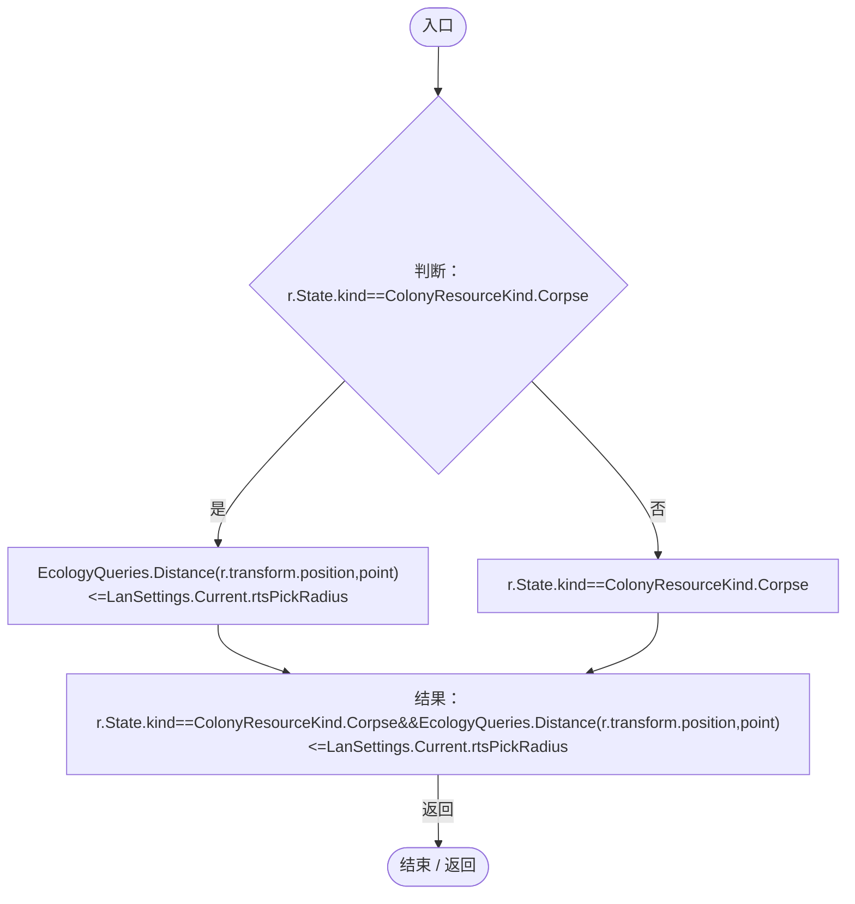

项目内调用/回调引用：

- [ColonyResource.State.get · L22](293dbaecfff4b585.md#m341a1355f4d657bf)（访问器）
- [EcologyQueries.Distance · L42](bdf7ccc2c9c0452f.md#mba9c3e3c95d0f2dd)（方法）
- [LanSettings.Current.get · L15](b87827166724b44d.md#m237a85bb88e296ff)（访问器）

## 回调@56 · L56

`r … => 回调`

### Editor / Player · Roslyn编译器控制流

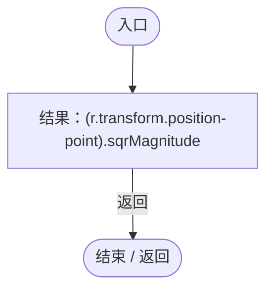

## 回调@57 · L57

`e … => 回调`

### Editor / Player · Roslyn编译器控制流

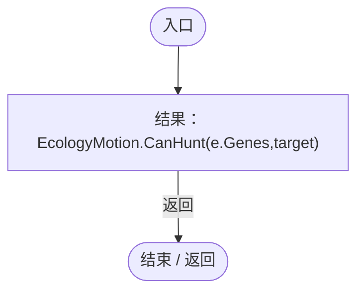

项目内调用/回调引用：

- [EcologyMotion.CanHunt · L38](6ed9d0eedb456d32.md#m4271864b37a65a94)（方法）
- [DarwinEntity.Genes.get · L14](70798dde169f2e8b.md#m622eb1adf401d431)（访问器）

## SelectRectangle · L61

`public void SelectRectangle(Vector2 start,Vector2 end,bool append=false)`

### Editor / Player · Roslyn编译器控制流

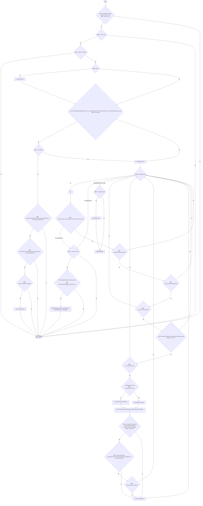

项目内调用/回调引用：

- [LanSession.Instance.get · L23](9fb633eebffe669c.md#mbf83306994878383)（访问器）
- [LanSession.CanCommand · L105](9fb633eebffe669c.md#m1b4c6d1ce7a79828)（方法）
- [LanSettings.Current.get · L15](b87827166724b44d.md#m237a85bb88e296ff)（访问器）
- [EcologyQueries.Alive · L38](bdf7ccc2c9c0452f.md#mb2877c487f449970)（方法）
- [GeneInspectorUI.ShowEntityInfo · L385](924e27c34e7b1f0a.md#mea69a0457b885287)（方法）

## OnGUI · L78

`private void OnGUI()`

### Editor / Player · Roslyn编译器控制流

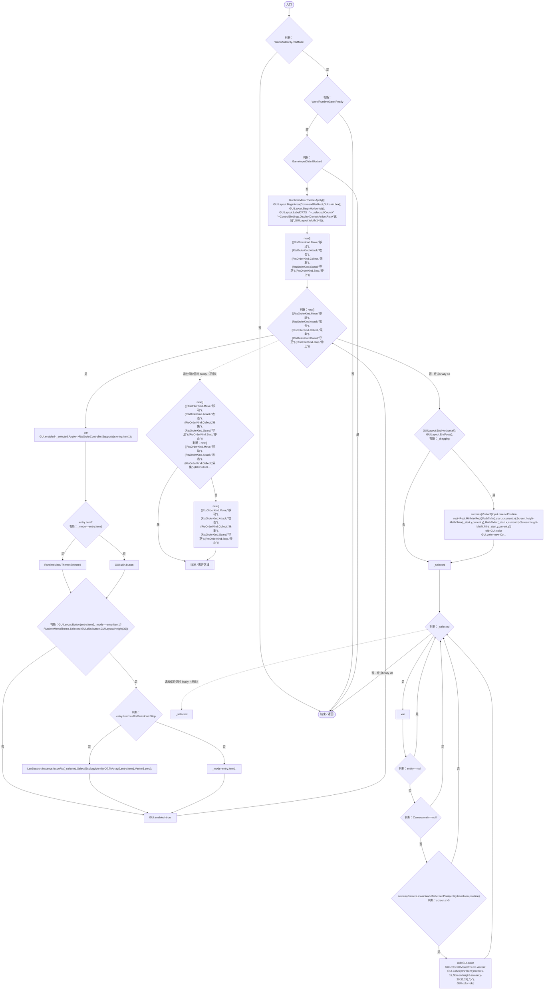

项目内调用/回调引用：

- [GameInputGate.Blocked.get · L8](52955daae7e592ab.md#m765763b665829633)（访问器）
- [RuntimeMenuTheme.Apply · L39](b9d8455882f2a532.md#m587a63eff5a85605)（方法）
- [ControlBindings.Display · L68](b6735f8f133ee3f4.md#m9bd4296160207463)（方法）
- [RuntimeMenuTheme.Selected.get · L12](b9d8455882f2a532.md#m0db940502f53ec10)（访问器）
- [LanSession.IssueRts · L119](9fb633eebffe669c.md#m7bcbba11fd529ea2)（方法）
- [LanSession.Instance.get · L23](9fb633eebffe669c.md#mbf83306994878383)（访问器）
- [RtsSelectionInput.回调@84 · L84](3c8b37f7bbd7a10f.md#m448027fb0b0e100e)（回调/委托）
- [EcologyIdentity.Of · L21](bdf7ccc2c9c0452f.md#m1143cf9570a93b72)（方法）

## 回调@84 · L84

`e … => 回调`

### Editor / Player · Roslyn编译器控制流

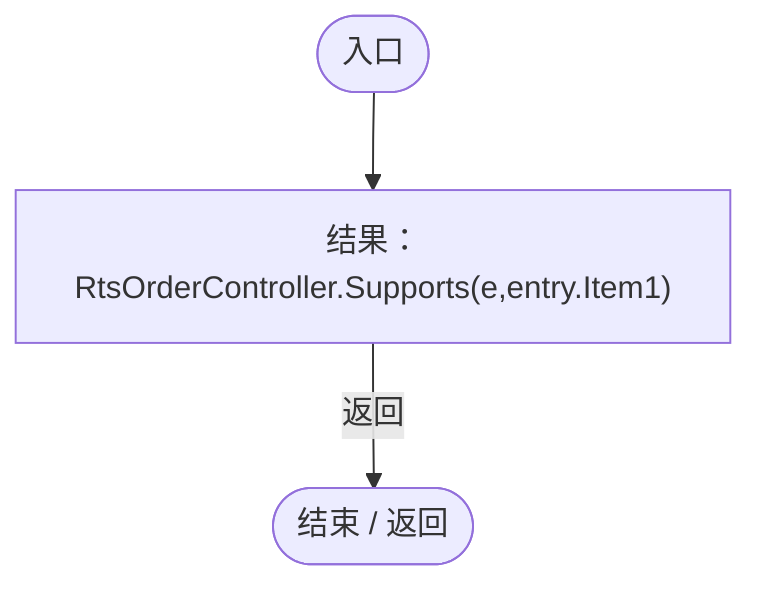

项目内调用/回调引用：

- [RtsOrderController.Supports · L19](cac3b6501f41ca35.md#m2aaa5c9fb23c15de)（方法）
