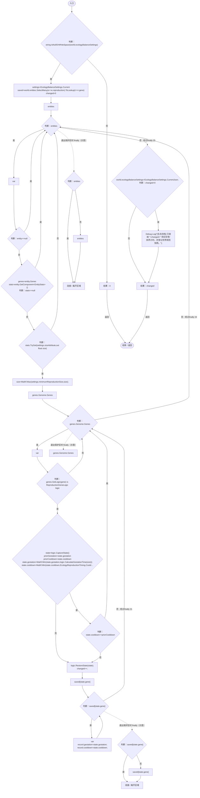
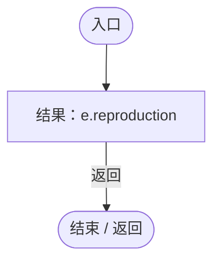
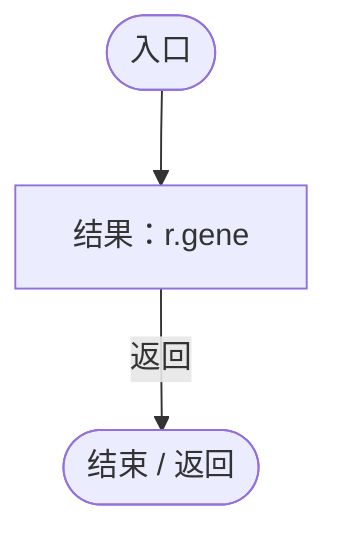

# EcologyLegacySaveUpgrade.cs

[返回总索引](../README.md) · `Runtime` · `Assets/DarwinPark/UI/EcologyLegacySaveUpgrade.cs`

[源文件](../../../Assets/DarwinPark/UI/EcologyLegacySaveUpgrade.cs) · 源码校验：`ae8706f567dd34bb1d0df287980316a9bb843a8d617d2fe8803b150828dddb98`

方法按源文件位置排列。事件/回调引用不表示立即执行；分支与异常说明见总索引。完整源码与可点击关系图请打开离线手册。

## Apply · L14

`public static int Apply(WorldSaveData world,IEnumerable<DarwinEntity> entities)`

### Editor / Player · Roslyn编译器控制流

项目内调用/回调引用：

- [EcologyBalanceSettings.Current.get · L29](5a37bc79f15f6238.md#md33d4c4b8f82540b)（访问器）
- [DarwinEntity.Genes.get · L14](70798dde169f2e8b.md#m622eb1adf401d431)（访问器）
- [EntityStats.TryGet · L90](75aa86a368efdf24.md#m24ee1433e4a70d94)（方法）
- [EntityGeneController.GetLogic · L211](7494d53178552f0e.md#maadb710e89e60395)（方法）
- [ReproductionGeneLogic.CaptureState · L33](ac319ea70bd8b723.md#mb3b414bac984dd2e)（方法）
- [ReproductionGeneLogic.CalculateGestationTime · L150](ac319ea70bd8b723.md#m1d2dd13f863c0d75)（方法）
- [EcologyReproductionTiming.CooldownSeconds · L21](f834876424538fa9.md#md8fcb789a14c5e5c)（方法）
- [ReproductionGeneLogic.RestoreState · L35](ac319ea70bd8b723.md#m2e3c6341cef3b9c0)（方法）
- [EcologyBalanceSettings.CurrentJson.get · L30](5a37bc79f15f6238.md#m4835e7fa2ac9560d)（访问器）
- [EcologyLegacySaveUpgrade.回调@18 · L18](3ea317ee2852be05.md#m0e446c033fa28174)（回调/委托）
- [EcologyLegacySaveUpgrade.回调@18 · L18](3ea317ee2852be05.md#m85546f2d4dfad585)（回调/委托）

## 回调@18 · L18

`e … => 回调`

### Editor / Player · Roslyn编译器控制流

## 回调@18 · L18

`r … => 回调`

### Editor / Player · Roslyn编译器控制流

