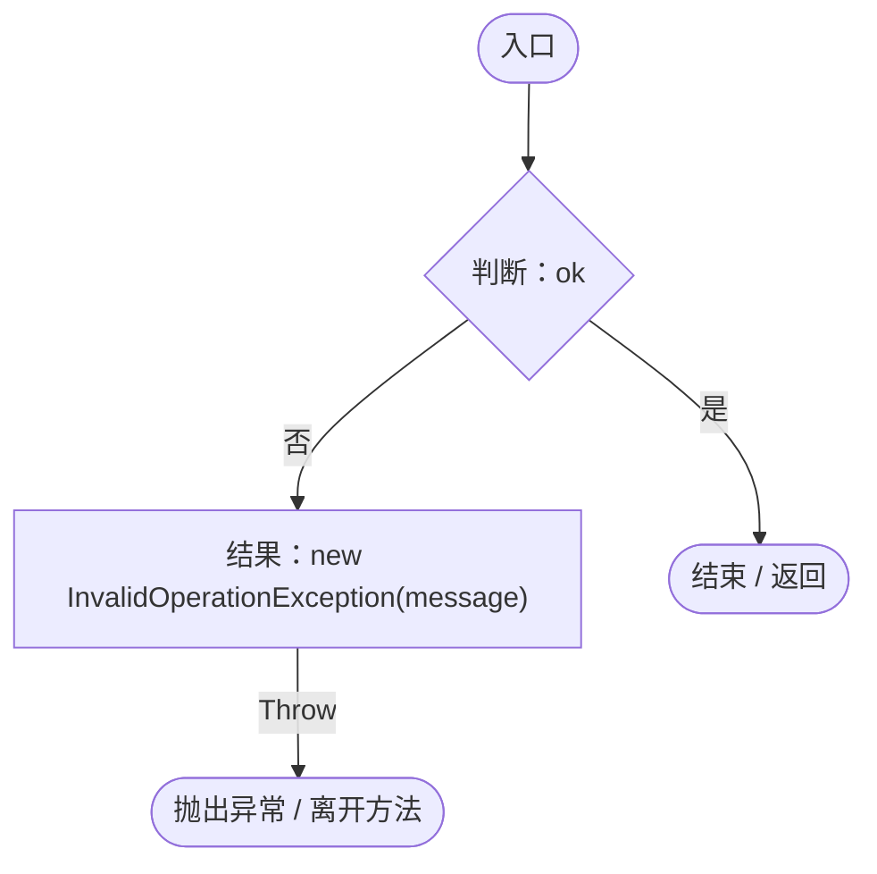
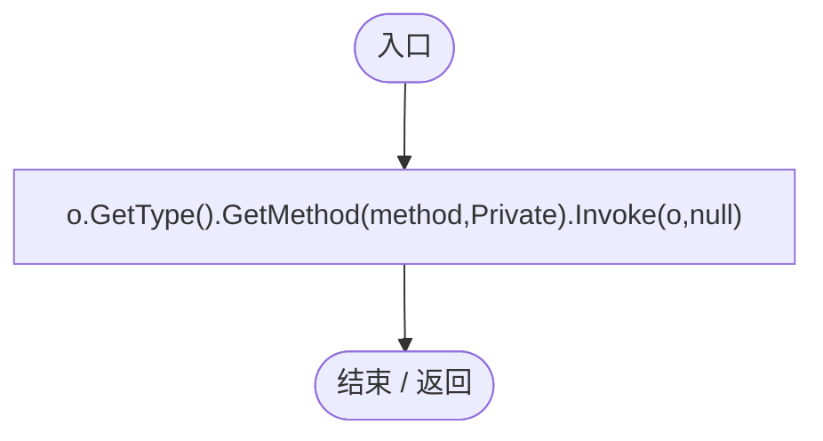
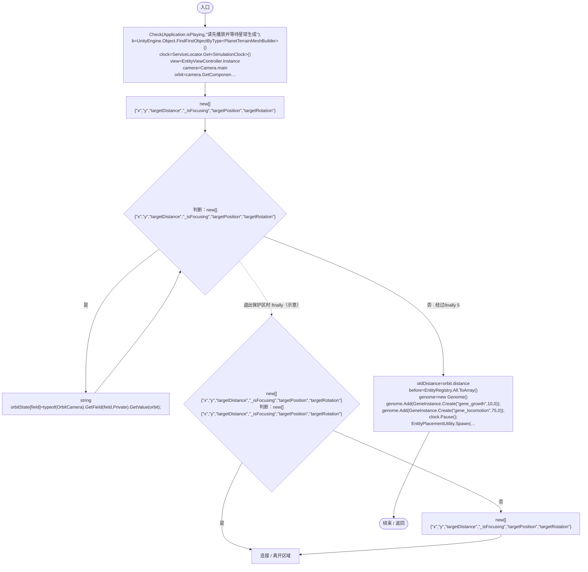
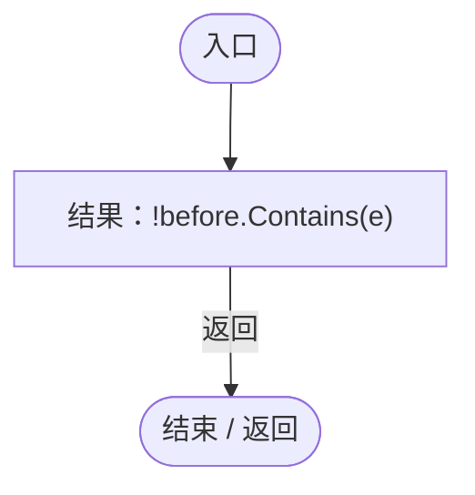
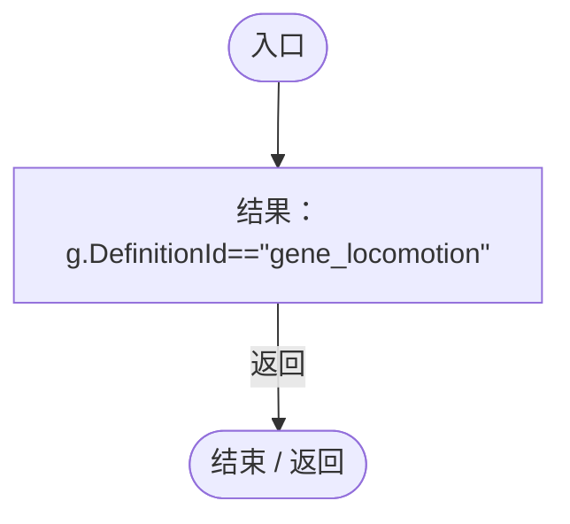

```mermaid
flowchart TD
  b0(["入口"])
  b1{"判断：Application.isPlaying"}
  b2["EditorApplication.update-=wait;"]
  b3{"判断：EditorApplication.timeSinceStartup&lt;ready"}
  b4["EditorApplication.update-=wait;<br/>report=new StringBuilder()"]
  b5{"clock.Play();<br/>clock.SetTimeScale(1);<br/>body=entity.GetComponent&lt;Rigidbody&gt;()<br/>body.interpolation=RigidbodyInterpolation.None;<br/>genes=entity.GetComponent&lt;EntityGeneController&gt;()<br/>stats=entity.GetComponent&lt;EntityStats&gt;()<br/>cfg=ServiceLocator.Get&lt;…"}
  b6["moved=Vector3.right;"]
  b7["entity.transform.position=body.position=b.transform.position+moved*(b.WaterRadius+10);<br/>Physics.SyncTransforms();<br/>Call(view,&quot;LateUpdate&quot;);<br/>view.ExitView();"]
  b8["frame=0"]
  b9{"判断：frame&lt;5"}
  b10["Call(orbit,&quot;LateUpdate&quot;);<br/>frame++"]
  b11{"判断：view.Target==null"}
  b12{"判断：orbit.EntityViewActive"}
  b13{"判断：Cursor.visible"}
  b14["Cursor.lockState==CursorLockMode.None"]
  b15["view.Target==null &amp;&amp; !orbit.EntityViewActive &amp;&amp; Cursor.visible &amp;&amp; Cursor.lockState==CursorLockMode.None"]
  b16["Check(view.Target==null &amp;&amp; !orbit.EntityViewActive &amp;&amp; Cursor.visible &amp;&amp; Cursor.lockState==CursorLockMode.None,&quot;退出未释放控制&quot;);"]
  b17["viewport=camera.WorldToViewportPoint(entity.transform.position)"]
  b18{"判断：viewport.z&gt;0"}
  b19{"判断：Mathf.Abs(viewport.x-.5f)&lt;.01f"}
  b20["Mathf.Abs(viewport.y-.5f)&lt;.01f"]
  b21["viewport.z&gt;0 &amp;&amp; Mathf.Abs(viewport.x-.5f)&lt;.01f &amp;&amp; Mathf.Abs(viewport.y-.5f)&lt;.01f"]
  b22["Check(viewport.z&gt;0 &amp;&amp; Mathf.Abs(viewport.x-.5f)&lt;.01f &amp;&amp; Mathf.Abs(viewport.y-.5f)&lt;.01f,&quot;退出后未对准移动后的实体，或被旧轨道覆盖&quot;);"]
  b23["report.AppendLine(&quot;PASS: move entity to another hemisphere, exit, advance orbit 5 frames; entity remains centred; cursor/control released&quot;);<br/>Check(view.EnterView(entity),&quot;水中测试无法进入操控&quot;);<br/>manual=entity.GetComponent&lt;EntityManualControl&gt;()<br/>ju…"]
  b24{"判断：Vector3.ProjectOnPlane(body.linearVelocity,moved).magnitude&lt;.001f"}
  b25["Vector3.Dot(body.linearVelocity,moved)&lt;0"]
  b26["Vector3.ProjectOnPlane(body.linearVelocity,moved).magnitude&lt;.001f"]
  b27["Check(Vector3.ProjectOnPlane(body.linearVelocity,moved).magnitude&lt;.001f &amp;&amp; Vector3.Dot(body.linearVelocity,moved)&lt;0,&quot;无游泳能力仍可手动推进/停止下沉&quot;);"]
  b28["manual.Release();<br/>body.linearVelocity=Vector3.zero;<br/>action=genes.Genome.Genes.First(g=&gt;g.DefinitionId==&quot;gene_locomotion&quot;)<br/>genes.GetLogic(action).OnUpdate(.1f);<br/>Check(body.linearVelocity.sqrMagnitude&lt;.001f,&quot;AI 在水中仍推进&quot;);<br/>Call(entity.GetCom…"]
  b29{"判断：entity.transform.Find(&quot;SwimLight&quot;).GetComponent&lt;Light&gt;().enabled"}
  b30["!jump.TryJump(true)"]
  b31["!entity.transform.Find(&quot;SwimLight&quot;).GetComponent&lt;Light&gt;().enabled"]
  b32["Check(!entity.transform.Find(&quot;SwimLight&quot;).GetComponent&lt;Light&gt;().enabled &amp;&amp; !jump.TryJump(true),&quot;无游泳能力获得光效或海底跳跃&quot;);"]
  b33["typeof(EntityEnvironmentHazard).GetField(&quot;_config&quot;,Private).SetValue(hazard,cfg);<br/>stats.TryGet(&quot;health&quot;,out float hp);<br/>typeof(EntityEnvironmentHazard).GetMethod(&quot;UpdateDrowning&quot;,Private).Invoke(hazard,new object[]{1f});<br/>stats.TryGet(&quot;hea…"]
  b34{"判断：hazard.IsDrowning"}
  b35["hp-damaged&gt;=cfg.drowningHealthDamagePerSecond*cfg.minimumDrowningSeverity-.001f"]
  b36["hazard.IsDrowning"]
  b37["Check(hazard.IsDrowning &amp;&amp; hp-damaged&gt;=cfg.drowningHealthDamagePerSecond*cfg.minimumDrowningSeverity-.001f,&quot;近水面溺水未持续扣血&quot;);"]
  b38["entity.transform.position=body.position=b.transform.position+moved*(b.WaterRadius-5);<br/>Physics.SyncTransforms();<br/>typeof(EntityEnvironmentHazard).GetMethod(&quot;UpdateDrowning&quot;,Private).Invoke(hazard,new object[]{1f});<br/>stats.TryGet(&quot;health&quot;,ou…"]
  b39{"判断：hazard.IsDrowning"}
  b40["dryHp==pausedHp"]
  b41["!hazard.IsDrowning"]
  b42["Check(!hazard.IsDrowning &amp;&amp; dryHp==pausedHp,&quot;离水后仍结算溺水&quot;);"]
  b43["report.AppendLine($&quot;PASS: land-only manual/AI movement blocked underwater; full inward gravity; no swim light or underwater jump; shallow damage {hp-damaged:F1}, deep damage {damaged-deepHp:F1}; real Update damages; pause and leaving wat…"]
  b44["view.ExitView();<br/>entity.gameObject.SetActive(false);<br/>UnityEngine.Object.Destroy(entity.gameObject);<br/>camera.transform.SetPositionAndRotation(oldPos,oldRot);<br/>orbit.distance=oldDistance;"]
  b45["orbitState"]
  b46{"判断：orbitState"}
  b47["var<br/>typeof(OrbitCamera).GetField(pair.Key,Private).SetValue(orbit,pair.Value);"]
  b48["orbitState"]
  b49{"clock<br/>判断：scale&gt;0"}
  b50["scale"]
  b51["1"]
  b52["clock.SetTimeScale(scale&gt;0?scale:1);"]
  b53{"判断：running"}
  b54["clock.Play();"]
  b55["clock.Pause();"]
  b56["typeof(SimulationClock).GetField(&quot;&lt;GameDeltaTime&gt;k__BackingField&quot;,Private).SetValue(clock,oldDt);"]
  b57(["结束 / 返回"])
  b0 --> b1
  b1 -->|"否"| b2
  b1 -->|"是"| b3
  b2 --> b57
  b3 -->|"是"| b57
  b3 -->|"否"| b4
  b4 --> b5
  b5 -->|"是"| b6
  b5 -->|"否"| b7
  b6 --> b7
  b7 --> b8
  b8 --> b9
  b9 -->|"是"| b10
  b9 -->|"否"| b11
  b10 --> b9
  b11 -->|"是"| b12
  b11 -->|"否"| b15
  b12 -->|"否"| b13
  b12 -->|"是"| b15
  b13 -->|"是"| b14
  b13 -->|"否"| b15
  b14 --> b16
  b15 --> b16
  b16 --> b17
  b17 --> b18
  b18 -->|"是"| b19
  b18 -->|"否"| b21
  b19 -->|"是"| b20
  b19 -->|"否"| b21
  b20 --> b22
  b21 --> b22
  b22 --> b23
  b23 --> b24
  b24 -->|"是"| b25
  b24 -->|"否"| b26
  b25 --> b27
  b26 --> b27
  b27 --> b28
  b28 --> b29
  b29 -->|"否"| b30
  b29 -->|"是"| b31
  b30 --> b32
  b31 --> b32
  b32 --> b33
  b33 --> b34
  b34 -->|"是"| b35
  b34 -->|"否"| b36
  b35 --> b37
  b36 --> b37
  b37 --> b38
  b38 --> b39
  b39 -->|"否"| b40
  b39 -->|"是"| b41
  b40 --> b42
  b41 --> b42
  b42 --> b43
  b43 -->|"经过finally 44"| b57
  b44 --> b45
  b45 --> b46
  b46 -->|"是"| b47
  b46 -->|"否 · 经过finally 48"| b49
  b47 --> b46
  b49 -->|"是"| b50
  b49 -->|"否"| b51
  b50 --> b52
  b51 --> b52
  b52 --> b53
  b53 -->|"是"| b54
  b53 -->|"否"| b55
  b54 --> b56
  b55 --> b56
  b5 -. "退出保护区时 finally（示意）" .-> b44
  b46 -. "退出保护区时 finally（示意）" .-> b48

```

# WaterAndExitRegression.cs

[返回总索引](../README.md) · `Editor` · `Assets/DarwinPark/Editor/WaterAndExitRegression.cs`

[源文件](../../../Assets/DarwinPark/Editor/WaterAndExitRegression.cs) · 源码校验：`968ea7945c2b349bc9c45c136aa53e9015aa87f34fc6cb3ca9cc5d9115b3f0f6`

方法按源文件位置排列。事件/回调引用不表示立即执行；分支与异常说明见总索引。完整源码与可点击关系图请打开离线手册。

## Check · L23

`private static void Check(bool ok,string message)`

### Editor · Roslyn编译器控制流

## Call · L24

`private static void Call(object o,string method)`

### Editor · Roslyn编译器控制流

## Validate · L25

`[MenuItem("Tools/Darwin Park/Validate Water and Exit")] public static void Validate()`

### Editor · Roslyn编译器控制流

项目内调用/回调引用：

- [WaterAndExitRegression.Check · L23](3fa9502d023c4aca.md#m0c6e4610f40f9347)（方法）
- [ServiceLocator.Get · L33](f2fdbe9f9ccd93cb.md#m2ae625299520c56d)（方法）
- [EntityViewController.Instance.get · L15](0ad0345f83229ef0.md#mb3b8144b56e80842)（访问器）
- [SimulationClock.IsRunning.get · L22](a8f444aec9614b0a.md#m10f4fe307faca0f0)（访问器）
- [SimulationClock.GameDeltaTime.get · L26](a8f444aec9614b0a.md#me7f11abae18a4f2d)（访问器）
- [Genome.Add · L19](a2ef23f865bc7ee8.md#md9cfdc94b8b8d40f)（方法）
- [GeneInstance.Create · L20](f82e1498d67f5afd.md#m72e94c278de3cf8b)（方法）
- [SimulationClock.Pause · L79](a8f444aec9614b0a.md#m30929d45a885d0f1)（方法）
- [EntityPlacementUtility.Spawn · L77](6d2c32e632b9c147.md#m79ec74c5c23421cd)（方法）
- [PlanetTerrainMeshBuilder.WaterRadius.get · L94](415285cf043354a9.md#m28d8809083881ec1)（访问器）
- [WaterAndExitRegression.回调@40 · L40](3fa9502d023c4aca.md#mfc442a10c9660763)（回调/委托）
- [WaterAndExitRegression.回调@46 · L46](3fa9502d023c4aca.md#m9f03c3b0c23dd6cd)（回调/委托）

## 回调@40 · L40

`e … => 回调`

### Editor · Roslyn编译器控制流

## 回调@46 · L46

`( … => 回调`

### Editor · Roslyn编译器控制流

项目内调用/回调引用：

- [SimulationClock.Play · L78](a8f444aec9614b0a.md#m7aa9e64b7de60ed0)（方法）
- [SimulationClock.SetTimeScale · L81](a8f444aec9614b0a.md#mecaa463a0561aca3)（方法）
- [EnvironmentSystem.Config.get · L25](bfb4f2987b577f02.md#m89db420c1afba8f5)（访问器）
- [ServiceLocator.Get · L33](f2fdbe9f9ccd93cb.md#m2ae625299520c56d)（方法）
- [WaterAndExitRegression.Check · L23](3fa9502d023c4aca.md#m0c6e4610f40f9347)（方法）
- [EntityViewController.EnterView · L73](0ad0345f83229ef0.md#mbd7be6d2bbd0ec83)（方法）
- [PlanetTerrainMeshBuilder.WaterRadius.get · L94](415285cf043354a9.md#m28d8809083881ec1)（访问器）
- [WaterAndExitRegression.Call · L24](3fa9502d023c4aca.md#m9fdf05a6482856c3)（方法）
- [EntityViewController.ExitView · L105](0ad0345f83229ef0.md#mca8619c7f27942c9)（方法）
- [EntityViewController.Target.get · L16](0ad0345f83229ef0.md#m87ca090092a884ab)（访问器）
- [OrbitCamera.EntityViewActive.get · L39](42eb429559b42bcb.md#m4b320edff61e06a5)（访问器）
- [EntityEnvironmentHazard.IsSubmerged.get · L31](5c434d0ba85333b1.md#mab7b6057b8137739)（访问器）
- [EntityManualControl.SetInput · L33](a6969896da35e1f0.md#m7c7f5613b3bebc74)（方法）
- [EntityManualControl.Release · L37](a6969896da35e1f0.md#m87aa0efacece2c5b)（方法）
- [IGeneLogic.OnUpdate · L9](5304fdad773967f8.md#m829188d65276f8e5)（方法）
- [EntityGeneController.GetLogic · L211](7494d53178552f0e.md#maadb710e89e60395)（方法）
- [EntityJumpMotor.TryJump · L22](fa3269c9da0aa692.md#m5d4b3420e4d2918e)（方法）
- [EntityStats.TryGet · L90](75aa86a368efdf24.md#m24ee1433e4a70d94)（方法）
- [EntityEnvironmentHazard.IsDrowning.get · L27](5c434d0ba85333b1.md#md1684c4e763e2899)（访问器）
- [SimulationClock.Pause · L79](a8f444aec9614b0a.md#m30929d45a885d0f1)（方法）
- [WaterAndExitRegression.回调@76 · L76](3fa9502d023c4aca.md#m5216cf8031d5849e)（回调/委托）

## 回调@76 · L76

`g … => 回调`

### Editor · Roslyn编译器控制流

