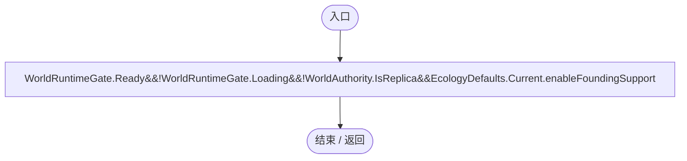
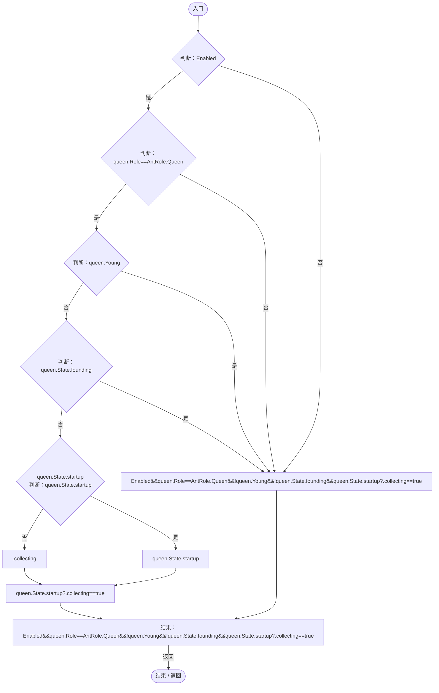
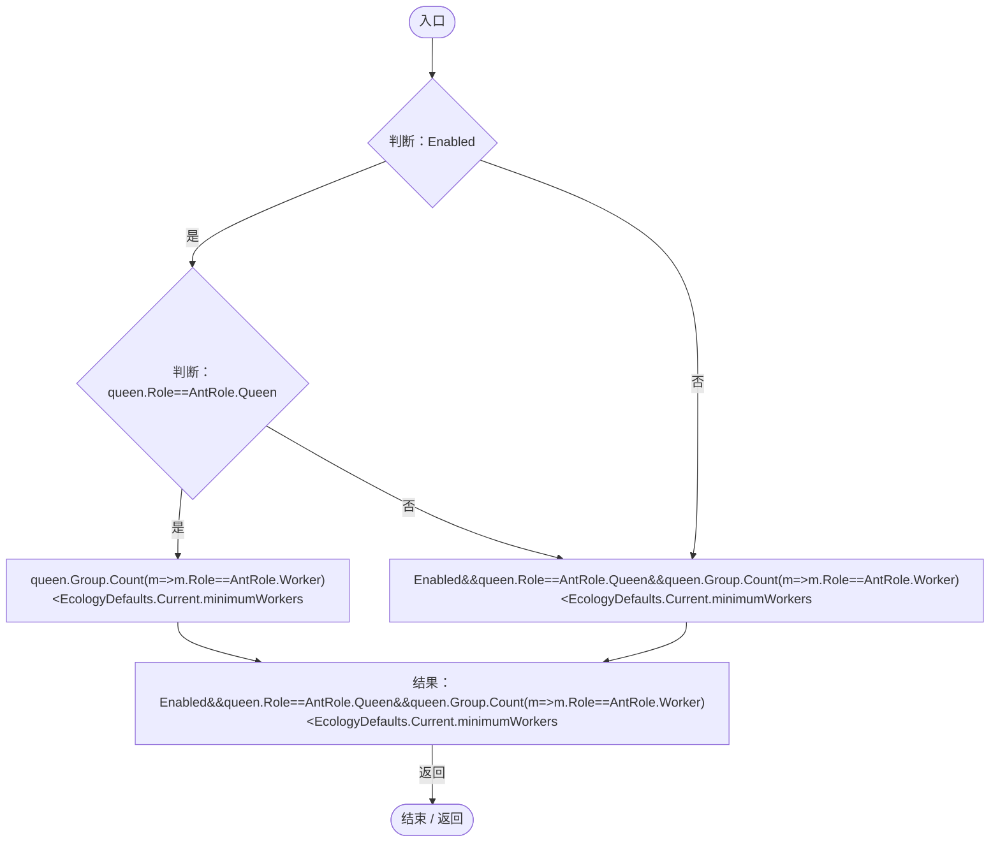
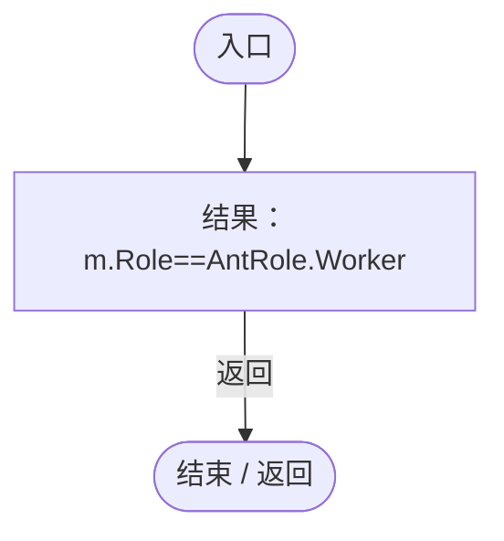
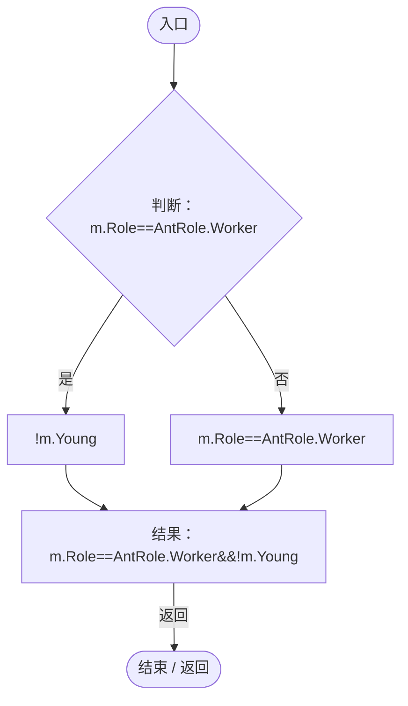
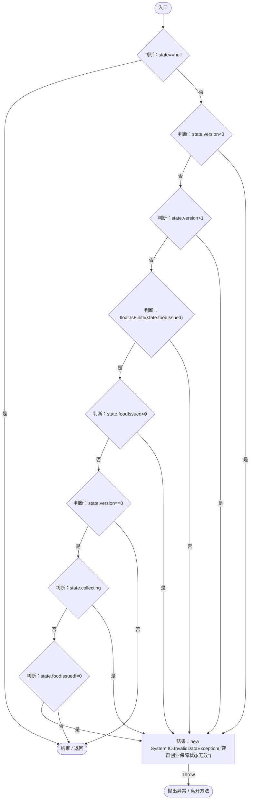

```mermaid
flowchart TD
  b0(["入口"])
  b1{"判断：Enabled"}
  b2{"判断：dt&lt;=0"}
  b3{"判断：queen.Young"}
  b4{"判断：queen.Role!=AntRole.Queen"}
  b5{"判断：queen.State.founding"}
  b6["settings=EcologyDefaults.Current"]
  b7["queen.State.startup"]
  b8{"queen.State.startup<br/>判断：queen.State.startup"}
  b9["queen.State.startup??=new ColonyFoundingSave()"]
  b10["queen.State.startup??=new ColonyFoundingSave()"]
  b11["state=queen.State.startup??=new ColonyFoundingSave()"]
  b12{"判断：state.version==0"}
  b13{"state.version=1;<br/>判断：queen.Group.Count()&lt;=settings.maximumFoundingMembers"}
  b14{"判断：queen.Group.All(m=&gt;m.Role!=AntRole.Worker&#124;&#124;m.Young)"}
  b15{"判断：settings.foundingFood&gt;0"}
  b16["ColonyResource.Convert(queen.GroupId,queen.transform.position,settings.foundingFood,true);<br/>state.foodIssued=settings.foundingFood;"]
  b17["needsWorkers=queen.Group.Count(m=&gt;m.Role==AntRole.Worker&amp;&amp;!m.Young)&lt;settings.minimumWorkers"]
  b18{"判断：string.IsNullOrEmpty(queen.State.carriedResource)"}
  b19["!string.IsNullOrEmpty(queen.State.carriedLiving)"]
  b20["!string.IsNullOrEmpty(queen.State.carriedResource)"]
  b21["carrying=!string.IsNullOrEmpty(queen.State.carriedResource)&#124;&#124;!string.IsNullOrEmpty(queen.State.carriedLiving)"]
  b22{"state.collecting<br/>判断：needsWorkers"}
  b23["carrying"]
  b24["needsWorkers"]
  b25["state.collecting=needsWorkers&#124;&#124;carrying;"]
  b26{"判断：state.collecting"}
  b27["AntColonyWorker.Advance(queen,dt);"]
  b28(["结束 / 返回"])
  b0 --> b1
  b1 -->|"是"| b2
  b1 -->|"否"| b28
  b2 -->|"否"| b3
  b2 -->|"是"| b28
  b3 -->|"否"| b4
  b3 -->|"是"| b28
  b4 -->|"否"| b5
  b4 -->|"是"| b28
  b5 -->|"是"| b28
  b5 -->|"否"| b6
  b6 --> b7
  b7 --> b8
  b8 -->|"否"| b9
  b8 -->|"是"| b10
  b9 --> b11
  b10 --> b11
  b11 --> b12
  b12 -->|"是"| b13
  b12 -->|"否"| b17
  b13 -->|"是"| b14
  b13 -->|"否"| b17
  b14 -->|"是"| b15
  b14 -->|"否"| b17
  b15 -->|"是"| b16
  b15 -->|"否"| b17
  b16 --> b17
  b17 --> b18
  b18 -->|"是"| b19
  b18 -->|"否"| b20
  b19 --> b21
  b20 --> b21
  b21 --> b22
  b22 -->|"否"| b23
  b22 -->|"是"| b24
  b23 --> b25
  b24 --> b25
  b25 --> b26
  b26 -->|"是"| b27
  b26 -->|"否"| b28
  b27 --> b28

```

```mermaid
flowchart TD
  b0(["入口"])
  b1{"判断：m.Role!=AntRole.Worker"}
  b2["m.Young"]
  b3["m.Role!=AntRole.Worker"]
  b4["结果：m.Role!=AntRole.Worker&#124;&#124;m.Young"]
  b5(["结束 / 返回"])
  b0 --> b1
  b1 -->|"否"| b2
  b1 -->|"是"| b3
  b2 --> b4
  b3 --> b4
  b4 -->|"返回"| b5

```

# ColonyFoundingSupport.cs

[返回总索引](../README.md) · `Runtime` · `Assets/DarwinPark/Entities/Ecology/ColonyFoundingSupport.cs`

[源文件](../../../Assets/DarwinPark/Entities/Ecology/ColonyFoundingSupport.cs) · 源码校验：`5b9fdcefe95577d86d44d76ad4864282d4c56ef090b81c3e0913a362acd94795`

方法按源文件位置排列。事件/回调引用不表示立即执行；分支与异常说明见总索引。完整源码与可点击关系图请打开离线手册。

## Enabled.get · L12

`private static bool Enabled`

### Editor / Player · 语法控制结构 / 声明（非CFG）

项目内调用/回调引用：

- [EcologyDefaults.Current.get · L35](5b565b57de741d98.md#m75cb60b88e3cc1c7)（访问器）

## Collecting · L13

`public static bool Collecting(AntColonyMember queen)`

### Editor / Player · Roslyn编译器控制流

项目内调用/回调引用：

- [AntColonyMember.Role.get · L38](baebd85c05598377.md#mab30d459d599e4df)（访问器）
- [AntColonyMember.State.get · L32](baebd85c05598377.md#m426db6a7c12dd7aa)（访问器）

## NeedsWorker · L14

`public static bool NeedsWorker(AntColonyMember queen)`

### Editor / Player · Roslyn编译器控制流

项目内调用/回调引用：

- [AntColonyMember.Role.get · L38](baebd85c05598377.md#mab30d459d599e4df)（访问器）
- [EcologyDefaults.Current.get · L35](5b565b57de741d98.md#m75cb60b88e3cc1c7)（访问器）
- [ColonyFoundingSupport.回调@15 · L15](404bb05c7f82518a.md#m59d6078e3be3e6dd)（回调/委托）

## 回调@15 · L15

`m … => 回调`

### Editor / Player · Roslyn编译器控制流

项目内调用/回调引用：

- [AntColonyMember.Role.get · L38](baebd85c05598377.md#mab30d459d599e4df)（访问器）

## Advance · L16

`public static void Advance(AntColonyMember queen,float dt)`

### Editor / Player · Roslyn编译器控制流

项目内调用/回调引用：

- [AntColonyMember.Role.get · L38](baebd85c05598377.md#mab30d459d599e4df)（访问器）
- [AntColonyMember.State.get · L32](baebd85c05598377.md#m426db6a7c12dd7aa)（访问器）
- [EcologyDefaults.Current.get · L35](5b565b57de741d98.md#m75cb60b88e3cc1c7)（访问器）
- [ColonyResource.Convert · L86](293dbaecfff4b585.md#m96f8abbbed49b7ed)（方法）
- [AntColonyWorker.Advance · L38](8a0cca2020271b6f.md#m50cbc0299445ba6b)（方法）
- [ColonyFoundingSupport.回调@24 · L24](404bb05c7f82518a.md#m286daf0aefa97bc8)（回调/委托）
- [ColonyFoundingSupport.回调@27 · L27](404bb05c7f82518a.md#m57b161e7ac8254cd)（回调/委托）

## 回调@24 · L24

`m … => 回调`

### Editor / Player · Roslyn编译器控制流

项目内调用/回调引用：

- [AntColonyMember.Role.get · L38](baebd85c05598377.md#mab30d459d599e4df)（访问器）

## 回调@27 · L27

`m … => 回调`

### Editor / Player · Roslyn编译器控制流

项目内调用/回调引用：

- [AntColonyMember.Role.get · L38](baebd85c05598377.md#mab30d459d599e4df)（访问器）

## Validate · L33

`public static void Validate(ColonyFoundingSave state)`

### Editor / Player · Roslyn编译器控制流

