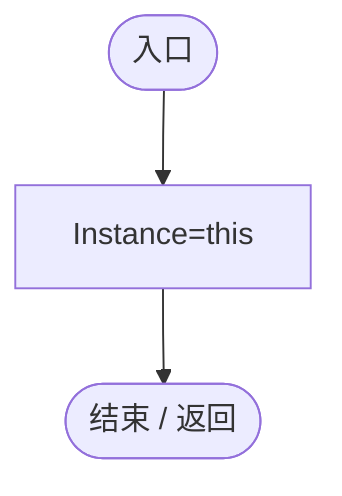
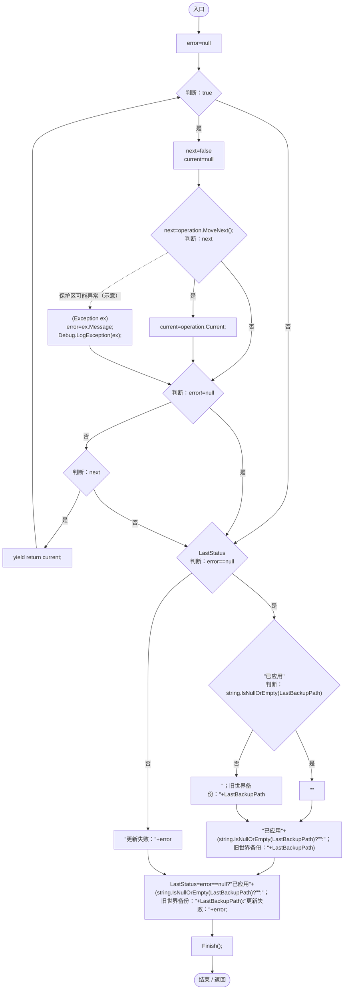

```mermaid
flowchart TD
  b0(["入口"])
  b1{"message=&quot;&quot;;<br/>world=Object.FindFirstObjectByType&lt;WorldSessionManager&gt;()<br/>builder=Object.FindFirstObjectByType&lt;PlanetTerrainMeshBuilder&gt;()<br/>判断：Busy"}
  b2{"判断：WorldRuntimeGate.Loading"}
  b3{"world<br/>判断：world"}
  b4[".Busy"]
  b5["world"]
  b6{"判断：world?.Busy==true"}
  b7["message=&quot;正在更新，请稍候&quot;;<br/>结果：false"]
  b8{"判断：WorldAuthority.CanEdit"}
  b9{"判断：WorldAuthority.IsReplica"}
  b10{"判断：WorldRuntimeGate.Ready"}
  b11{"builder<br/>判断：builder"}
  b12[".Data"]
  b13["builder"]
  b14{"判断：builder?.Data==null"}
  b15["message=&quot;当前世界不可修改&quot;;<br/>结果：false"]
  b16{"WorldLandformEdits.Kind(id)<br/>判断：WorldLandformEdits.Kind(id)"}
  b17["WorldLandformEdits.Kind(id)"]
  b18{"判断：id!=null"}
  b19{"判断：id.Contains(&quot;seed&quot;)"}
  b20["&quot;seed&quot;"]
  b21{"判断：id!=null"}
  b22{"判断：id.Contains(&quot;terrain&quot;)"}
  b23["&quot;terrain&quot;"]
  b24{"判断：id!=null"}
  b25{"判断：id.Contains(&quot;temp&quot;)"}
  b26["&quot;temp&quot;"]
  b27{"判断：id!=null"}
  b28{"判断：id.Contains(&quot;hum&quot;)"}
  b29["&quot;hum&quot;"]
  b30["null"]
  b31["kind=WorldLandformEdits.Kind(id)??(id!=null&amp;&amp;id.Contains(&quot;seed&quot;)?&quot;seed&quot;:id!=null&amp;&amp;id.Contains(&quot;terrain&quot;)?&quot;terrain&quot;:id!=null&amp;&amp;id.Contains(&quot;temp&quot;)?&quot;temp&quot;:id!=null&amp;&amp;id.Contains(&quot;hum&quot;)?&quot;hum&quot;:null)"]
  b32{"判断：kind==null"}
  b33["message=&quot;未知参数&quot;;<br/>结果：false"]
  b34{"seed=builder.seed<br/>判断：kind==&quot;seed&quot;"}
  b35{"判断：int.TryParse(raw,NumberStyles.Integer,CultureInfo.InvariantCulture,out seed)"}
  b36["message=&quot;请输入有效的32位整数种子&quot;;<br/>结果：false"]
  b37["value=0;"]
  b38{"判断：float.TryParse(raw,NumberStyles.Float,CultureInfo.InvariantCulture,out value)"}
  b39{"判断：float.IsFinite(value)"}
  b40["message=&quot;请输入有效数字&quot;;<br/>结果：false"]
  b41["environment=ServiceLocator.Get&lt;EnvironmentSystem&gt;()"]
  b42{"判断：kind==&quot;temp&quot;"}
  b43["temperatureRange"]
  b44{"判断：kind==&quot;hum&quot;"}
  b45["humidityRange"]
  b46["landPercentRange"]
  b47["range=kind==&quot;temp&quot;?temperatureRange:kind==&quot;hum&quot;?humidityRange:landPercentRange"]
  b48{"判断：kind==&quot;landforms&quot;"}
  b49{"判断：value!=0"}
  b50{"判断：value!=1"}
  b51["message=&quot;地貌开关只接受0或1&quot;;<br/>结果：false"]
  b52{"判断：kind!=&quot;seed&quot;"}
  b53{"判断：kind!=&quot;landforms&quot;"}
  b54{"判断：value&lt;range.x"}
  b55{"判断：value&gt;range.y"}
  b56["message=&quot;数值超出允许范围&quot;;<br/>结果：false"]
  b57{"判断：kind==&quot;landforms&quot;"}
  b58{"判断：builder.landforms.enabled==(value&gt;0)"}
  b59{"判断：value&lt;=0"}
  b60["builder.landforms.version==LandformSettings.CurrentVersion"]
  b61["value&lt;=0"]
  b62["builder.landforms.enabled==(value&gt;0)"]
  b63{"判断：kind==&quot;seed&quot;"}
  b64["seed==builder.seed"]
  b65{"判断：kind==&quot;terrain&quot;"}
  b66["Mathf.Approximately(value/100,builder.continentRatio)"]
  b67{"判断：kind==&quot;temp&quot;"}
  b68["Mathf.Approximately(value,environment.BaseTemperature)"]
  b69["Mathf.Approximately(value,environment.BaseHumidity)"]
  b70["unchanged=kind==&quot;landforms&quot;?builder.landforms.enabled==(value&gt;0)&amp;&amp;(value&lt;=0&#124;&#124;builder.landforms.version==LandformSettings.CurrentVersion):kind==&quot;seed&quot;?seed==builder.seed:kind==&quot;terrain&quot;?Mathf.Approximately(value/100,builder.continentRatio…"]
  b71{"判断：unchanged"}
  b72["message=&quot;参数未变化&quot;;<br/>LastStatus=message;<br/>结果：true"]
  b73{"WorldGameSettingsPanel.Instance<br/>判断：WorldGameSettingsPanel.Instance"}
  b74["WorldGameSettingsPanel.Instance?.Close();"]
  b75["LastBackupPath=null;<br/>BeginCapture();<br/>Busy=true;<br/>Progress=0;<br/>Status=&quot;准备更新参数&quot;;<br/>LastStatus=&quot;正在更新&quot;;<br/>StartCoroutine(Guard(UpdateWorld(builder,environment,world,kind,seed,value)));<br/>message=&quot;正在更新&quot;;<br/>结果：true"]
  b76(["结束 / 返回"])
  b0 --> b1
  b1 -->|"否"| b2
  b1 -->|"是"| b7
  b2 -->|"否"| b3
  b2 -->|"是"| b7
  b3 -->|"否"| b4
  b3 -->|"是"| b5
  b4 --> b6
  b5 --> b6
  b6 -->|"是"| b7
  b6 -->|"否"| b8
  b7 -->|"返回"| b76
  b8 -->|"是"| b9
  b8 -->|"否"| b15
  b9 -->|"否"| b10
  b9 -->|"是"| b15
  b10 -->|"是"| b11
  b10 -->|"否"| b15
  b11 -->|"否"| b12
  b11 -->|"是"| b13
  b12 --> b14
  b13 --> b14
  b14 -->|"是"| b15
  b14 -->|"否"| b16
  b15 -->|"返回"| b76
  b16 -->|"否"| b17
  b16 -->|"是"| b18
  b17 --> b31
  b18 -->|"是"| b19
  b18 -->|"否"| b21
  b19 -->|"是"| b20
  b19 -->|"否"| b21
  b20 --> b31
  b21 -->|"是"| b22
  b21 -->|"否"| b24
  b22 -->|"是"| b23
  b22 -->|"否"| b24
  b23 --> b31
  b24 -->|"是"| b25
  b24 -->|"否"| b27
  b25 -->|"是"| b26
  b25 -->|"否"| b27
  b26 --> b31
  b27 -->|"是"| b28
  b27 -->|"否"| b30
  b28 -->|"是"| b29
  b28 -->|"否"| b30
  b29 --> b31
  b30 --> b31
  b31 --> b32
  b32 -->|"是"| b33
  b32 -->|"否"| b34
  b33 -->|"返回"| b76
  b34 -->|"是"| b35
  b34 -->|"否"| b38
  b35 -->|"否"| b36
  b35 -->|"是"| b37
  b36 -->|"返回"| b76
  b37 --> b41
  b38 -->|"是"| b39
  b38 -->|"否"| b40
  b39 -->|"否"| b40
  b39 -->|"是"| b41
  b40 -->|"返回"| b76
  b41 --> b42
  b42 -->|"是"| b43
  b42 -->|"否"| b44
  b43 --> b47
  b44 -->|"是"| b45
  b44 -->|"否"| b46
  b45 --> b47
  b46 --> b47
  b47 --> b48
  b48 -->|"是"| b49
  b48 -->|"否"| b52
  b49 -->|"是"| b50
  b49 -->|"否"| b52
  b50 -->|"是"| b51
  b50 -->|"否"| b52
  b51 -->|"返回"| b76
  b52 -->|"是"| b53
  b52 -->|"否"| b57
  b53 -->|"是"| b54
  b53 -->|"否"| b57
  b54 -->|"否"| b55
  b54 -->|"是"| b56
  b55 -->|"是"| b56
  b55 -->|"否"| b57
  b56 -->|"返回"| b76
  b57 -->|"是"| b58
  b57 -->|"否"| b63
  b58 -->|"是"| b59
  b58 -->|"否"| b62
  b59 -->|"否"| b60
  b59 -->|"是"| b61
  b60 --> b70
  b61 --> b70
  b62 --> b70
  b63 -->|"是"| b64
  b63 -->|"否"| b65
  b64 --> b70
  b65 -->|"是"| b66
  b65 -->|"否"| b67
  b66 --> b70
  b67 -->|"是"| b68
  b67 -->|"否"| b69
  b68 --> b70
  b69 --> b70
  b70 --> b71
  b71 -->|"是"| b72
  b71 -->|"否"| b73
  b72 -->|"返回"| b76
  b73 -->|"否"| b74
  b73 -->|"是"| b75
  b74 --> b75
  b75 -->|"返回"| b76

```

```mermaid
flowchart TD
  b0(["入口"])
  b1["yield return null;<br/>yield return new WaitForEndOfFrame();<br/>config=builder.CaptureConfiguration()<br/>oldData=builder.Data"]
  b2{"判断：kind==&quot;seed&quot;"}
  b3{"判断：kind==&quot;terrain&quot;"}
  b4["kind==&quot;landforms&quot;"]
  b5["kind==&quot;seed&quot;&#124;&#124;kind==&quot;terrain&quot;&#124;&#124;kind==&quot;landforms&quot;"]
  b6["terrain=kind==&quot;seed&quot;&#124;&#124;kind==&quot;terrain&quot;&#124;&#124;kind==&quot;landforms&quot;"]
  b7{"判断：kind==&quot;landforms&quot;"}
  b8{"world<br/>判断：world"}
  b9[".Current"]
  b10["world"]
  b11{"判断：world?.Current!=null"}
  b12["world.SaveNow(_running);<br/>original=WorldSaveStore.FileFor(world.Current.id)<br/>folder=Path.Combine(Path.GetDirectoryName(original),&quot;backups&quot;)<br/>Directory.CreateDirectory(folder);<br/>LastBackupPath=Path.Combine(folder,&quot;terrain-&quot;+DateTime.UtcNow.To…"]
  b13["WorldLandformEdits.Apply(config,kind,value);"]
  b14{"判断：terrain"}
  b15["new TerrainResourceRelocation(builder,minimumSurfaceOffset,maximumPreservedAltitude)"]
  b16["null"]
  b17["resources=terrain?new TerrainResourceRelocation(builder,minimumSurfaceOffset,maximumPreservedAltitude):null"]
  b18{"config.seed<br/>判断：kind==&quot;seed&quot;"}
  b19["seed"]
  b20["builder.seed"]
  b21["config.seed=kind==&quot;seed&quot;?seed:builder.seed;"]
  b22{"判断：kind==&quot;terrain&quot;"}
  b23["value/100"]
  b24["builder.continentRatio"]
  b25["land=kind==&quot;terrain&quot;?value/100:builder.continentRatio"]
  b26{"判断：kind==&quot;temp&quot;"}
  b27["value"]
  b28["environment.BaseTemperature"]
  b29["temp=kind==&quot;temp&quot;?value:environment.BaseTemperature"]
  b30{"判断：kind==&quot;hum&quot;"}
  b31["value"]
  b32["environment.BaseHumidity"]
  b33["humidity=kind==&quot;hum&quot;?value:environment.BaseHumidity"]
  b34{"data=oldData<br/>判断：terrain"}
  b35["_bodies"]
  b36{"判断：_bodies"}
  b37["var"]
  b38{"判断：body.entity==null"}
  b39["offset=body.position-builder.transform.position<br/>body.direction=offset.normalized;<br/>oldRadius=builder.radius+PlanetTerrainSampler.SampleHeight(oldData,builder.transform.InverseTransformDirection(body.direction))*builder.heightScale<br/>body.al…"]
  b40{"body.relocate<br/>判断：AntColonyWorker.IsCarried(body.entity)"}
  b41{"body.entity.GetComponent&lt;ParasiteBehavior&gt;()<br/>判断：body.entity.GetComponent&lt;ParasiteBehavior&gt;()"}
  b42[".Host"]
  b43["body.entity.GetComponent&lt;ParasiteBehavior&gt;()"]
  b44{"判断：body.entity.GetComponent&lt;ParasiteBehavior&gt;()?.Host==null"}
  b45{"body.entity.GetComponent&lt;NutritionParasite&gt;()<br/>判断：body.entity.GetComponent&lt;NutritionParasite&gt;()"}
  b46[".Host"]
  b47["body.entity.GetComponent&lt;NutritionParasite&gt;()"]
  b48["body.entity.GetComponent&lt;NutritionParasite&gt;()?.Host==null"]
  b49["!AntColonyWorker.IsCarried(body.entity)&amp;&amp;body.entity.GetComponent&lt;ParasiteBehavior&gt;()?.Host==null&amp;&amp;body.entity.GetComponent&lt;NutritionParasite&gt;()?.Host==null"]
  b50["body.relocate=!AntColonyWorker.IsCarried(body.entity)&amp;&amp;body.entity.GetComponent&lt;ParasiteBehavior&gt;()?.Host==null&amp;&amp;body.entity.GetComponent&lt;NutritionParasite&gt;()?.Host==null;"]
  b51["_bodies"]
  b52["Progress=.12f;<br/>Status=&quot;生成地形与山脉&quot;;<br/>sea=builder.seaLevelRatio<br/>task=Task.Run(()=&gt;PlanetTerrainGenerator.Generate(config,sea,land))"]
  b53{"判断：task.IsCompleted"}
  b54["yield return null;"]
  b55{"判断：task.IsFaulted"}
  b56["结果：task.Exception"]
  x56(["抛出异常 / 离开方法"])
  b57["data=task.Result;"]
  b58{"Progress<br/>判断：terrain"}
  b59[".58f"]
  b60[".2f"]
  b61["Progress=terrain ? .58f : .2f;"]
  b62["Status=&quot;计算温度、湿度与气候&quot;;<br/>climate=PlanetClimateMap.Instance<br/>climateConfig=JsonUtility.FromJson&lt;PlanetClimateConfig&gt;(JsonUtility.ToJson(PlanetClimateSystem.Instance.config))<br/>resolution=climate.mapResolution<br/>climateSeed=config.seed<br/>climateData=…"]
  b63{"判断：climateTask.IsCompleted"}
  b64["yield return null;"]
  b65{"判断：climateTask.IsFaulted"}
  b66["结果：climateTask.Exception"]
  x66(["抛出异常 / 离开方法"])
  b67{"Progress=.85f;<br/>Status=&quot;更新画面与地表碰撞&quot;;<br/>yield return null;<br/>判断：terrain"}
  b68["builder.seed=config.seed;<br/>builder.continentRatio=land;<br/>builder.landforms=config.landforms;<br/>builder.ApplyGeneratedData(data);<br/>StationaryBodyRest.Clear();"]
  b69["environment.BaseTemperature=temp;<br/>environment.BaseHumidity=humidity;<br/>ClimateDataHub.BaseTemperature=temp;<br/>ClimateDataHub.BaseHumidity=humidity;<br/>climate.ApplyGeneratedClimate(climateTask.Result);"]
  b70["_bodies"]
  b71{"判断：_bodies"}
  b72{"var<br/>判断：body.entity!=null"}
  b73{"position=body.position<br/>判断：terrain"}
  b74{"判断：body.relocate"}
  b75["radius=builder.radius+PlanetTerrainSampler.SampleHeight(data,builder.transform.InverseTransformDirection(body.direction))*builder.heightScale<br/>position=builder.transform.position+body.direction*(radius+body.altitude);"]
  b76{"body.entity.transform.position=position;<br/>判断：body.body!=null"}
  b77["body.body.position=position;"]
  b78["EntityNeighborhood.ObservePosition(body.entity.Genes);"]
  b79["_bodies"]
  b80{"resources<br/>判断：resources"}
  b81["resources?.Restore(builder);"]
  b82["Physics.SyncTransforms();<br/>Progress=.96f;<br/>Status=&quot;保存参数并恢复原世界&quot;;<br/>yield return null;"]
  b83{"world<br/>判断：world"}
  b84[".Current"]
  b85["world"]
  b86{"判断：world?.Current!=null"}
  b87["world.SaveNow(_running);"]
  b88["Progress=1;<br/>Status=&quot;更新完成&quot;;<br/>yield return new WaitForEndOfFrame();<br/>Debug.Log(&quot;[世界参数] 原世界更新完成：&quot;+kind+&quot;，实体=&quot;+EntityRegistry.All.Count);"]
  b89(["结束 / 返回"])
  b0 --> b1
  b1 --> b2
  b2 -->|"否"| b3
  b2 -->|"是"| b5
  b3 -->|"否"| b4
  b3 -->|"是"| b5
  b4 --> b6
  b5 --> b6
  b6 --> b7
  b7 -->|"是"| b8
  b7 -->|"否"| b13
  b8 -->|"否"| b9
  b8 -->|"是"| b10
  b9 --> b11
  b10 --> b11
  b11 -->|"是"| b12
  b11 -->|"否"| b13
  b12 --> b13
  b13 --> b14
  b14 -->|"是"| b15
  b14 -->|"否"| b16
  b15 --> b17
  b16 --> b17
  b17 --> b18
  b18 -->|"是"| b19
  b18 -->|"否"| b20
  b19 --> b21
  b20 --> b21
  b21 --> b22
  b22 -->|"是"| b23
  b22 -->|"否"| b24
  b23 --> b25
  b24 --> b25
  b25 --> b26
  b26 -->|"是"| b27
  b26 -->|"否"| b28
  b27 --> b29
  b28 --> b29
  b29 --> b30
  b30 -->|"是"| b31
  b30 -->|"否"| b32
  b31 --> b33
  b32 --> b33
  b33 --> b34
  b34 -->|"是"| b35
  b34 -->|"否"| b58
  b35 --> b36
  b36 -->|"是"| b37
  b36 -->|"否 · 经过finally 51"| b52
  b37 --> b38
  b38 -->|"是"| b36
  b38 -->|"否"| b39
  b39 --> b40
  b40 -->|"否"| b41
  b40 -->|"是"| b49
  b41 -->|"否"| b42
  b41 -->|"是"| b43
  b42 --> b44
  b43 --> b44
  b44 -->|"是"| b45
  b44 -->|"否"| b49
  b45 -->|"否"| b46
  b45 -->|"是"| b47
  b46 --> b48
  b47 --> b48
  b48 --> b50
  b49 --> b50
  b50 --> b36
  b52 --> b53
  b53 -->|"否"| b54
  b53 -->|"是"| b55
  b54 --> b53
  b55 -->|"是"| b56
  b55 -->|"否"| b57
  b56 -->|"Throw"| x56
  b57 --> b58
  b58 -->|"是"| b59
  b58 -->|"否"| b60
  b59 --> b61
  b60 --> b61
  b61 --> b62
  b62 --> b63
  b63 -->|"否"| b64
  b63 -->|"是"| b65
  b64 --> b63
  b65 -->|"是"| b66
  b65 -->|"否"| b67
  b66 -->|"Throw"| x66
  b67 -->|"是"| b68
  b67 -->|"否"| b69
  b68 --> b69
  b69 --> b70
  b70 --> b71
  b71 -->|"是"| b72
  b71 -->|"否 · 经过finally 79"| b80
  b72 -->|"是"| b73
  b72 -->|"否"| b71
  b73 -->|"是"| b74
  b73 -->|"否"| b76
  b74 -->|"是"| b75
  b74 -->|"否"| b76
  b75 --> b76
  b76 -->|"是"| b77
  b76 -->|"否"| b78
  b77 --> b78
  b78 --> b71
  b80 -->|"否"| b81
  b80 -->|"是"| b82
  b81 --> b82
  b82 --> b83
  b83 -->|"否"| b84
  b83 -->|"是"| b85
  b84 --> b86
  b85 --> b86
  b86 -->|"是"| b87
  b86 -->|"否"| b88
  b87 --> b88
  b88 --> b89
  b36 -. "退出保护区时 finally（示意）" .-> b51
  b71 -. "退出保护区时 finally（示意）" .-> b79

```

# WorldParameterUpdate.cs

[返回总索引](../README.md) · `Runtime` · `Assets/DarwinPark/UI/WorldParameterUpdate.cs`

[源文件](../../../Assets/DarwinPark/UI/WorldParameterUpdate.cs) · 源码校验：`cc7d3faf197266aaacf235051992d51fb56b892bd59624d0a0f37186796604b0`

方法按源文件位置排列。事件/回调引用不表示立即执行；分支与异常说明见总索引。完整源码与可点击关系图请打开离线手册。

<a id="m500ebc066f291f0d"></a>

## Instance.get · L20

`get`


### Editor / Player · 语法控制结构 / 声明（非CFG）


<a id="m3a6702409d036500"></a>

## Instance.set · L20

`private set`


### Editor / Player · 语法控制结构 / 声明（非CFG）


<a id="m5597f9f51df8166b"></a>

## Busy.get · L21

`get`


### Editor / Player · 语法控制结构 / 声明（非CFG）


<a id="m6c7fd3260117c20a"></a>

## Busy.set · L21

`private set`


### Editor / Player · 语法控制结构 / 声明（非CFG）


<a id="ma5a5fa7085496aca"></a>

## Progress.get · L21

`get`


### Editor / Player · 语法控制结构 / 声明（非CFG）


<a id="m925548177a19904d"></a>

## Progress.set · L21

`private set`


### Editor / Player · 语法控制结构 / 声明（非CFG）


<a id="m271c8f67db658f72"></a>

## Status.get · L21

`get`


### Editor / Player · 语法控制结构 / 声明（非CFG）


<a id="m21edd5247ca2e736"></a>

## Status.set · L21

`private set`


### Editor / Player · 语法控制结构 / 声明（非CFG）


<a id="m4e13f82419a1fec2"></a>

## LastBackupPath.get · L22

`get`


### Editor / Player · 语法控制结构 / 声明（非CFG）


<a id="m0ebc8d46c032a780"></a>

## LastBackupPath.set · L22

`private set`


### Editor / Player · 语法控制结构 / 声明（非CFG）


<a id="m18e52034bf4bc4eb"></a>

## LastStatus.get · L23

`get`


### Editor / Player · 语法控制结构 / 声明（非CFG）


<a id="mb122338bd1442c33"></a>

## LastStatus.set · L23

`private set`


### Editor / Player · 语法控制结构 / 声明（非CFG）


<a id="m253b0f5f983e2ee0"></a>

## Awake · L28

`private void Awake()`


### Editor / Player · Roslyn编译器控制流



项目内调用/回调引用：

- [WorldParameterUpdate.Instance.set · L20](4087d9be2a65e96f.md#m3a6702409d036500)（访问器）

<a id="m486ce2b8f9ba798f"></a>

## Ensure · L29

`public static WorldParameterUpdate Ensure()`


### Editor / Player · Roslyn编译器控制流


项目内调用/回调引用：

- [WorldParameterUpdate.Instance.get · L20](4087d9be2a65e96f.md#m500ebc066f291f0d)（访问器）
- [ServiceLocator.Get · L33](f2fdbe9f9ccd93cb.md#m2ae625299520c56d)（方法）

<a id="m9f7325c90aa4ee6e"></a>

## Request · L30

`public bool Request(string id,string raw,out string message)`


### Editor / Player · Roslyn编译器控制流



项目内调用/回调引用：

- [WorldParameterUpdate.Busy.get · L21](4087d9be2a65e96f.md#m5597f9f51df8166b)（访问器）
- [WorldSessionManager.Busy.get · L24](08741c7b7b9d9344.md#m4483e2e4f28f7c85)（访问器）
- [PlanetTerrainMeshBuilder.Data.get · L81](415285cf043354a9.md#m1a65abfe0f34c5d8)（访问器）
- [WorldLandformEdits.Kind · L22](a492c83bf894e14d.md#mbe76906d1aab82a6)（方法）
- [ServiceLocator.Get · L33](f2fdbe9f9ccd93cb.md#m2ae625299520c56d)（方法）
- [WorldParameterUpdate.LastStatus.set · L23](4087d9be2a65e96f.md#mb122338bd1442c33)（访问器）
- [WorldGameSettingsPanel.Instance.get · L11](6df051f7f7177d08.md#mcccf01908bb54d27)（访问器）
- [WorldGameSettingsPanel.Close · L39](6df051f7f7177d08.md#m019774ab8575ddd2)（方法）
- [WorldParameterUpdate.LastBackupPath.set · L22](4087d9be2a65e96f.md#m0ebc8d46c032a780)（访问器）
- [WorldParameterUpdate.BeginCapture · L51](4087d9be2a65e96f.md#m2ea0fa5178fc0aa8)（方法）
- [WorldParameterUpdate.Busy.set · L21](4087d9be2a65e96f.md#m6c7fd3260117c20a)（访问器）
- [WorldParameterUpdate.Progress.set · L21](4087d9be2a65e96f.md#m925548177a19904d)（访问器）
- [WorldParameterUpdate.Status.set · L21](4087d9be2a65e96f.md#m21edd5247ca2e736)（访问器）
- [WorldParameterUpdate.Guard · L64](4087d9be2a65e96f.md#m109507c526311ac0)（方法）
- [WorldParameterUpdate.UpdateWorld · L74](4087d9be2a65e96f.md#m818ce0863bdc3276)（方法）

<a id="m2ea0fa5178fc0aa8"></a>

## BeginCapture · L51

`private void BeginCapture()`


### Editor / Player · Roslyn编译器控制流


项目内调用/回调引用：

- [GameInputGate.Blocked.get · L8](52955daae7e592ab.md#m765763b665829633)（访问器）
- [SimulationClock.IsRunning.get · L22](a8f444aec9614b0a.md#m10f4fe307faca0f0)（访问器）
- [ServiceLocator.Get · L33](f2fdbe9f9ccd93cb.md#m2ae625299520c56d)（方法）
- [GameInputGate.Blocked.set · L8](52955daae7e592ab.md#m578697f6379686f4)（访问器）
- [SimulationClock.Pause · L79](a8f444aec9614b0a.md#m30929d45a885d0f1)（方法）
- [EntityPlacementTool.Instance.get · L13](2ca993947b0a7e7a.md#mafb26991c0dfcb86)（访问器）
- [EntityPlacementTool.CancelPlacement · L81](2ca993947b0a7e7a.md#m5a9374d2c71f0a2d)（方法）
- [RandomPlanetSpawner.Cancel · L92](1c13222a547b265c.md#ma34d7509b5f0cc9a)（方法）
- [UIRoot.MainCanvas.get · L14](9c1421378791f0e0.md#maa2cc9baf1248477)（访问器）
- [UIRoot.WorldCanvas.get · L15](9c1421378791f0e0.md#mf389c1a94092ec8a)（访问器）

<a id="m109507c526311ac0"></a>

## Guard · L64

`private IEnumerator Guard(IEnumerator operation)`


### Editor / Player · Roslyn编译器控制流



项目内调用/回调引用：

- [WorldParameterUpdate.LastStatus.set · L23](4087d9be2a65e96f.md#mb122338bd1442c33)（访问器）
- [WorldParameterUpdate.LastBackupPath.get · L22](4087d9be2a65e96f.md#m4e13f82419a1fec2)（访问器）
- [WorldParameterUpdate.Finish · L119](4087d9be2a65e96f.md#m51230dc127c921d4)（方法）

<a id="m818ce0863bdc3276"></a>

## UpdateWorld · L74

`private IEnumerator UpdateWorld(PlanetTerrainMeshBuilder builder,EnvironmentSystem environment,WorldSessionManager world,string kind,int seed,float value)`


### Editor / Player · Roslyn编译器控制流



项目内调用/回调引用：

- [PlanetTerrainMeshBuilder.CaptureConfiguration · L116](415285cf043354a9.md#m9eddff328d672f73)（方法）
- [PlanetTerrainMeshBuilder.Data.get · L81](415285cf043354a9.md#m1a65abfe0f34c5d8)（访问器）
- [WorldSessionManager.Current.get · L21](08741c7b7b9d9344.md#m5d26a5eb846a8504)（访问器）
- [WorldSessionManager.SaveNow · L169](08741c7b7b9d9344.md#m43f61078d8513f73)（方法）
- [WorldSaveStore.FileFor · L50](d67a35e5e3814c15.md#mce4509883be2e47e)（方法）
- [WorldParameterUpdate.LastBackupPath.set · L22](4087d9be2a65e96f.md#m0ebc8d46c032a780)（访问器）
- [WorldParameterUpdate.LastBackupPath.get · L22](4087d9be2a65e96f.md#m4e13f82419a1fec2)（访问器）
- [WorldLandformEdits.Apply · L23](a492c83bf894e14d.md#m26aa5e47cf8b4157)（方法）
- [TerrainResourceRelocation.TerrainResourceRelocation.ctor · L11](76faddc0f6e77241.md#m1529160443086235)（构造函数）
- [PlanetTerrainSampler.SampleHeight · L32](fd5c1d83b88a7c8b.md#m759508f0c5a04b21)（方法）
- [AntColonyWorker.IsCarried · L132](8a0cca2020271b6f.md#m0ec4e12a23e5a9fa)（方法）
- [ParasiteBehavior.Host.get · L18](ec21ecbd299caaed.md#m26d7e4af4cdffdbb)（访问器）
- [NutritionParasite.Host.get · L22](4a18785b7c1e1484.md#m5812c5feaf5f3103)（访问器）
- [WorldParameterUpdate.Progress.set · L21](4087d9be2a65e96f.md#m925548177a19904d)（访问器）
- [WorldParameterUpdate.Status.set · L21](4087d9be2a65e96f.md#m21edd5247ca2e736)（访问器）
- [PlanetClimateMap.Instance.get · L16](b4e9726c1bcf4c37.md#m3add54a419aeef9f)（访问器）
- [PlanetClimateSystem.Instance.get · L33](ba86e31da9b7d0a5.md#md8b21cc929db37b1)（访问器）
- [PlanetTerrainMeshBuilder.ApplyGeneratedData · L170](415285cf043354a9.md#m2a940ee9ce3364cb)（方法）
- [StationaryBodyRest.Clear · L45](19e6d310d5522440.md#m080c8c50d8571503)（方法）
- [PlanetClimateMap.ApplyGeneratedClimate · L114](b4e9726c1bcf4c37.md#m20ba66ec7eca94e5)（方法）
- [EntityNeighborhood.ObservePosition · L81](e5e24c4aff0395b1.md#m232339f32a8c5875)（方法）
- [DarwinEntity.Genes.get · L14](70798dde169f2e8b.md#m622eb1adf401d431)（访问器）
- [TerrainResourceRelocation.Restore · L13](76faddc0f6e77241.md#m0120f3d738fc9a23)（方法）
- [WorldParameterUpdate.回调@97 · L97](4087d9be2a65e96f.md#md57a5c365129083d)（回调/委托）
- [WorldParameterUpdate.回调@102 · L102](4087d9be2a65e96f.md#m0e8f0baba91edc7e)（回调/委托）

<a id="md57a5c365129083d"></a>

## 回调@97 · L97

`( … => 回调`


### Editor / Player · Roslyn编译器控制流


项目内调用/回调引用：

- [PlanetTerrainGenerator.Generate · L20](cde9e7b164fab46e.md#m7c6d74a69a660a78)（方法）

<a id="m0e8f0baba91edc7e"></a>

## 回调@102 · L102

`( … => 回调`


### Editor / Player · Roslyn编译器控制流


项目内调用/回调引用：

- [PlanetClimateModel.Generate · L59](0249d34bf86f4fa3.md#m49a6e534a85dc57e)（方法）
- [PlanetClimateModel.PlanetClimateModel.ctor · L48](0249d34bf86f4fa3.md#m49e0c243be23136b)（构造函数）

<a id="m51230dc127c921d4"></a>

## Finish · L119

`private void Finish()`


### Editor / Player · Roslyn编译器控制流

```mermaid
flowchart TD
  b0(["入口"])
  b1{"判断：Busy"}
  b2["_bodies"]
  b3{"判断：_bodies"}
  b4{"var<br/>判断：state.body!=null"}
  b5{"判断：state.body.isKinematic"}
  b6["state.body.linearVelocity=state.velocity;<br/>state.body.angularVelocity=state.angular;"]
  b7["_bodies"]
  b8{"_bodies.Clear();<br/>判断：_root!=null"}
  b9{"_root.MainCanvas.enabled=_canvasEnabled;<br/>判断：_root.WorldCanvas!=null"}
  b10["_root.WorldCanvas.enabled=_worldCanvasEnabled;"]
  b11{"GameInputGate.Blocked=_blocked;<br/>WorldRuntimeGate.Loading=_loading;<br/>Busy=false;<br/>判断：_running"}
  b12{"判断：WorldRuntimeGate.Ready"}
  b13{"判断：ServiceLocator.TryGet&lt;SimulationClock&gt;(out var clock)"}
  b14["clock.Play();"]
  b15["Cursor.lockState=_cursorLock;<br/>Cursor.visible=_cursorVisible;"]
  b16(["结束 / 返回"])
  b0 --> b1
  b1 -->|"否"| b16
  b1 -->|"是"| b2
  b2 --> b3
  b3 -->|"是"| b4
  b3 -->|"否 · 经过finally 7"| b8
  b4 -->|"是"| b5
  b4 -->|"否"| b3
  b5 -->|"否"| b6
  b5 -->|"是"| b3
  b6 --> b3
  b8 -->|"是"| b9
  b8 -->|"否"| b11
  b9 -->|"是"| b10
  b9 -->|"否"| b11
  b10 --> b11
  b11 -->|"是"| b12
  b11 -->|"否"| b15
  b12 -->|"是"| b13
  b12 -->|"否"| b15
  b13 -->|"是"| b14
  b13 -->|"否"| b15
  b14 --> b15
  b15 --> b16
  b3 -. "退出保护区时 finally（示意）" .-> b7

```

项目内调用/回调引用：

- [WorldParameterUpdate.Busy.get · L21](4087d9be2a65e96f.md#m5597f9f51df8166b)（访问器）
- [UIRoot.MainCanvas.get · L14](9c1421378791f0e0.md#maa2cc9baf1248477)（访问器）
- [UIRoot.WorldCanvas.get · L15](9c1421378791f0e0.md#mf389c1a94092ec8a)（访问器）
- [GameInputGate.Blocked.set · L8](52955daae7e592ab.md#m578697f6379686f4)（访问器）
- [WorldParameterUpdate.Busy.set · L21](4087d9be2a65e96f.md#m6c7fd3260117c20a)（访问器）
- [ServiceLocator.TryGet · L26](f2fdbe9f9ccd93cb.md#m143b24e6d58471b0)（方法）
- [SimulationClock.Play · L78](a8f444aec9614b0a.md#m7aa9e64b7de60ed0)（方法）

<a id="ma40f19af1075c305"></a>

## OnGUI · L126

`private void OnGUI()`


### Editor / Player · Roslyn编译器控制流

```mermaid
flowchart TD
  b0(["入口"])
  b1{"判断：Busy"}
  b2["GUI.depth=-1500;<br/>RuntimeMenuTheme.Apply();<br/>GUI.color=new Color(.025f,.04f,.065f,.7f);<br/>GUI.DrawTexture(new Rect(0,0,Screen.width,Screen.height),Texture2D.whiteTexture);<br/>GUI.color=Color.white;<br/>width=Mathf.Min(480,Screen.width-32)<br/>height=Ma…"]
  b3(["结束 / 返回"])
  b0 --> b1
  b1 -->|"否"| b3
  b1 -->|"是"| b2
  b2 --> b3

```

项目内调用/回调引用：

- [WorldParameterUpdate.Busy.get · L21](4087d9be2a65e96f.md#m5597f9f51df8166b)（访问器）
- [RuntimeMenuTheme.Apply · L39](b9d8455882f2a532.md#m587a63eff5a85605)（方法）
- [RuntimeMenuTheme.Title.get · L14](b9d8455882f2a532.md#m0b3a4a9f7e8e69ae)（访问器）
- [WorldLoadingView.Draw · L9](4db2e9fa805980b7.md#m78c78e77f9d1d246)（方法）
- [WorldParameterUpdate.Status.get · L21](4087d9be2a65e96f.md#m271c8f67db658f72)（访问器）
- [WorldParameterUpdate.Progress.get · L21](4087d9be2a65e96f.md#ma5a5fa7085496aca)（访问器）

<a id="m624b4eaa236ce15d"></a>

## OnDisable · L131

`private void OnDisable()`


### Editor / Player · Roslyn编译器控制流

```mermaid
flowchart TD
  b0(["入口"])
  b1["StopAllCoroutines();<br/>Finish();"]
  b2(["结束 / 返回"])
  b0 --> b1
  b1 --> b2

```

项目内调用/回调引用：

- [WorldParameterUpdate.Finish · L119](4087d9be2a65e96f.md#m51230dc127c921d4)（方法）

<a id="md0f91de229eef326"></a>

## OnDestroy · L132

`private void OnDestroy()`


### Editor / Player · Roslyn编译器控制流

```mermaid
flowchart TD
  b0(["入口"])
  b1{"判断：Instance==this"}
  b2["Instance=null;"]
  b3(["结束 / 返回"])
  b0 --> b1
  b1 -->|"是"| b2
  b1 -->|"否"| b3
  b2 --> b3

```

项目内调用/回调引用：

- [WorldParameterUpdate.Instance.get · L20](4087d9be2a65e96f.md#m500ebc066f291f0d)（访问器）
- [WorldParameterUpdate.Instance.set · L20](4087d9be2a65e96f.md#m3a6702409d036500)（访问器）
