# WorldParameterUpdate.cs

[返回总索引](../README.md) · `Runtime` · `Assets/DarwinPark/UI/WorldParameterUpdate.cs`

[源文件](../../../Assets/DarwinPark/UI/WorldParameterUpdate.cs) · 源码校验：`ece8201fab7b65b7ea9f9136dea714258a1e1e1fa722cf99bec1a2d9a4d7c7ac`

方法按源文件位置排列。事件/回调引用不表示立即执行；分支与异常说明见总索引。完整源码与可点击关系图请打开离线手册。

<a id="m32aebfe3914ccd0e"></a>

## Instance.get · L19

`get`


### Editor / Player · 语法控制结构 / 声明（非CFG）


<a id="mbdfcefeb65dea8e2"></a>

## Instance.set · L19

`private set`


### Editor / Player · 语法控制结构 / 声明（非CFG）


<a id="mec2ac85b8ff3f127"></a>

## Busy.get · L20

`get`


### Editor / Player · 语法控制结构 / 声明（非CFG）


<a id="m00c0b74aa3fdbce3"></a>

## Busy.set · L20

`private set`


### Editor / Player · 语法控制结构 / 声明（非CFG）


<a id="m489c3e5d93e68225"></a>

## Progress.get · L20

`get`


### Editor / Player · 语法控制结构 / 声明（非CFG）


<a id="m9d6a35b4682858cf"></a>

## Progress.set · L20

`private set`


### Editor / Player · 语法控制结构 / 声明（非CFG）

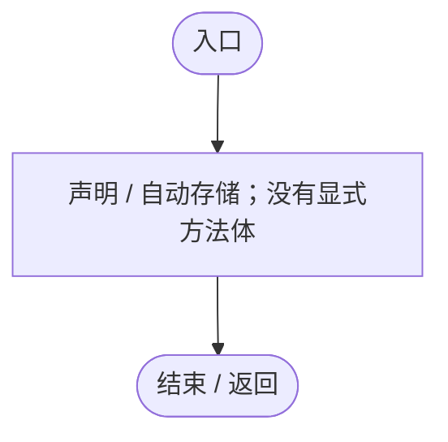

<a id="mfe8b0a6918f81b44"></a>

## Status.get · L20

`get`


### Editor / Player · 语法控制结构 / 声明（非CFG）


<a id="m6de350cb521b7b99"></a>

## Status.set · L20

`private set`


### Editor / Player · 语法控制结构 / 声明（非CFG）


<a id="m9aff979be84ce935"></a>

## LastStatus.get · L21

`get`


### Editor / Player · 语法控制结构 / 声明（非CFG）


<a id="m12111e84e62e0c80"></a>

## LastStatus.set · L21

`private set`


### Editor / Player · 语法控制结构 / 声明（非CFG）


<a id="m2022b8ffcacd6ee4"></a>

## Awake · L26

`private void Awake()`


### Editor / Player · Roslyn编译器控制流

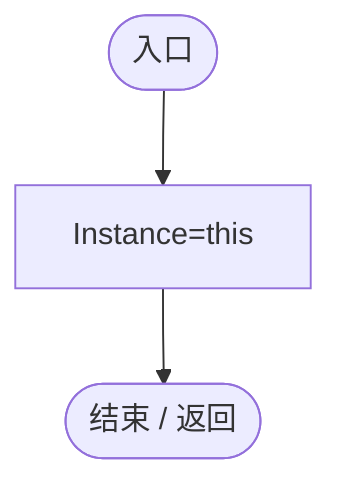

项目内调用/回调引用：

- [WorldParameterUpdate.Instance.set · L19](4087d9be2a65e96f.md#mbdfcefeb65dea8e2)（访问器）

<a id="mcefc896cc38899a6"></a>

## Ensure · L27

`public static WorldParameterUpdate Ensure()`


### Editor / Player · Roslyn编译器控制流

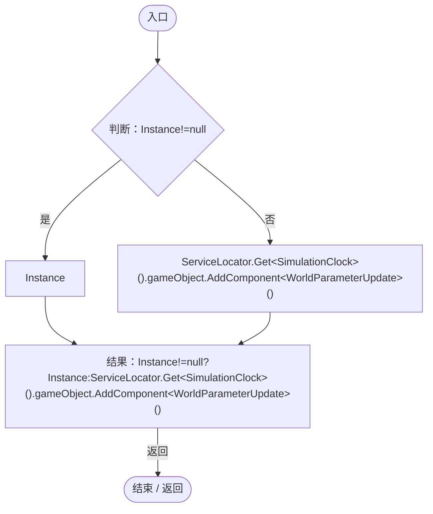

项目内调用/回调引用：

- [WorldParameterUpdate.Instance.get · L19](4087d9be2a65e96f.md#m32aebfe3914ccd0e)（访问器）
- [ServiceLocator.Get · L33](f2fdbe9f9ccd93cb.md#m2ae625299520c56d)（方法）

<a id="m942de54d110fe265"></a>

## Request · L28

`public bool Request(string id,string raw,out string message)`


### Editor / Player · Roslyn编译器控制流

```mermaid
flowchart TD
  b0(["入口"])
  b1{"message=&quot;&quot;;<br/>world=Object.FindFirstObjectByType&lt;WorldSessionManager&gt;()<br/>builder=Object.FindFirstObjectByType&lt;PlanetTerrainMeshBuilder&gt;()<br/>判断：Busy"}
  b2{"判断：WorldRuntimeGate.Loading"}
  b3{"world<br/>判断：world"}
  b4[".Busy"]
  b5["world"]
  b6{"判断：world?.Busy==true"}
  b7["message=&quot;正在更新，请稍候&quot;;<br/>结果：false"]
  b8{"判断：WorldAuthority.CanEdit"}
  b9{"判断：WorldAuthority.IsReplica"}
  b10{"判断：WorldRuntimeGate.Ready"}
  b11{"builder<br/>判断：builder"}
  b12[".Data"]
  b13["builder"]
  b14{"判断：builder?.Data==null"}
  b15["message=&quot;当前世界不可修改&quot;;<br/>结果：false"]
  b16{"判断：id!=null"}
  b17{"判断：id.Contains(&quot;seed&quot;)"}
  b18["&quot;seed&quot;"]
  b19{"判断：id!=null"}
  b20{"判断：id.Contains(&quot;terrain&quot;)"}
  b21["&quot;terrain&quot;"]
  b22{"判断：id!=null"}
  b23{"判断：id.Contains(&quot;temp&quot;)"}
  b24["&quot;temp&quot;"]
  b25{"判断：id!=null"}
  b26{"判断：id.Contains(&quot;hum&quot;)"}
  b27["&quot;hum&quot;"]
  b28["null"]
  b29["kind=id!=null&amp;&amp;id.Contains(&quot;seed&quot;)?&quot;seed&quot;:id!=null&amp;&amp;id.Contains(&quot;terrain&quot;)?&quot;terrain&quot;:id!=null&amp;&amp;id.Contains(&quot;temp&quot;)?&quot;temp&quot;:id!=null&amp;&amp;id.Contains(&quot;hum&quot;)?&quot;hum&quot;:null"]
  b30{"判断：kind==null"}
  b31["message=&quot;未知参数&quot;;<br/>结果：false"]
  b32{"seed=builder.seed<br/>判断：kind==&quot;seed&quot;"}
  b33{"判断：int.TryParse(raw,NumberStyles.Integer,CultureInfo.InvariantCulture,out seed)"}
  b34["message=&quot;请输入有效的32位整数种子&quot;;<br/>结果：false"]
  b35["value=0;"]
  b36{"判断：float.TryParse(raw,NumberStyles.Float,CultureInfo.InvariantCulture,out value)"}
  b37{"判断：float.IsFinite(value)"}
  b38["message=&quot;请输入有效数字&quot;;<br/>结果：false"]
  b39["environment=ServiceLocator.Get&lt;EnvironmentSystem&gt;()"]
  b40{"判断：kind==&quot;temp&quot;"}
  b41["temperatureRange"]
  b42{"判断：kind==&quot;hum&quot;"}
  b43["humidityRange"]
  b44["landPercentRange"]
  b45["range=kind==&quot;temp&quot;?temperatureRange:kind==&quot;hum&quot;?humidityRange:landPercentRange"]
  b46{"判断：kind!=&quot;seed&quot;"}
  b47{"判断：value&lt;range.x"}
  b48{"判断：value&gt;range.y"}
  b49["message=&quot;数值超出允许范围&quot;;<br/>结果：false"]
  b50{"判断：kind==&quot;seed&quot;"}
  b51["seed==builder.seed"]
  b52{"判断：kind==&quot;terrain&quot;"}
  b53["Mathf.Approximately(value/100,builder.continentRatio)"]
  b54{"判断：kind==&quot;temp&quot;"}
  b55["Mathf.Approximately(value,environment.BaseTemperature)"]
  b56["Mathf.Approximately(value,environment.BaseHumidity)"]
  b57["unchanged=kind==&quot;seed&quot;?seed==builder.seed:kind==&quot;terrain&quot;?Mathf.Approximately(value/100,builder.continentRatio):kind==&quot;temp&quot;?Mathf.Approximately(value,environment.BaseTemperature):Mathf.Approximately(value,environment.BaseHumidity)"]
  b58{"判断：unchanged"}
  b59["message=&quot;参数未变化&quot;;<br/>LastStatus=message;<br/>结果：true"]
  b60{"WorldGameSettingsPanel.Instance<br/>判断：WorldGameSettingsPanel.Instance"}
  b61["WorldGameSettingsPanel.Instance?.Close();"]
  b62["BeginCapture();<br/>Busy=true;<br/>Progress=0;<br/>Status=&quot;准备更新参数&quot;;<br/>LastStatus=&quot;正在更新&quot;;<br/>StartCoroutine(Guard(UpdateWorld(builder,environment,world,kind,seed,value)));<br/>message=&quot;正在更新&quot;;<br/>结果：true"]
  b63(["结束 / 返回"])
  b0 --> b1
  b1 -->|"否"| b2
  b1 -->|"是"| b7
  b2 -->|"否"| b3
  b2 -->|"是"| b7
  b3 -->|"否"| b4
  b3 -->|"是"| b5
  b4 --> b6
  b5 --> b6
  b6 -->|"是"| b7
  b6 -->|"否"| b8
  b7 -->|"返回"| b63
  b8 -->|"是"| b9
  b8 -->|"否"| b15
  b9 -->|"否"| b10
  b9 -->|"是"| b15
  b10 -->|"是"| b11
  b10 -->|"否"| b15
  b11 -->|"否"| b12
  b11 -->|"是"| b13
  b12 --> b14
  b13 --> b14
  b14 -->|"是"| b15
  b14 -->|"否"| b16
  b15 -->|"返回"| b63
  b16 -->|"是"| b17
  b16 -->|"否"| b19
  b17 -->|"是"| b18
  b17 -->|"否"| b19
  b18 --> b29
  b19 -->|"是"| b20
  b19 -->|"否"| b22
  b20 -->|"是"| b21
  b20 -->|"否"| b22
  b21 --> b29
  b22 -->|"是"| b23
  b22 -->|"否"| b25
  b23 -->|"是"| b24
  b23 -->|"否"| b25
  b24 --> b29
  b25 -->|"是"| b26
  b25 -->|"否"| b28
  b26 -->|"是"| b27
  b26 -->|"否"| b28
  b27 --> b29
  b28 --> b29
  b29 --> b30
  b30 -->|"是"| b31
  b30 -->|"否"| b32
  b31 -->|"返回"| b63
  b32 -->|"是"| b33
  b32 -->|"否"| b36
  b33 -->|"否"| b34
  b33 -->|"是"| b35
  b34 -->|"返回"| b63
  b35 --> b39
  b36 -->|"是"| b37
  b36 -->|"否"| b38
  b37 -->|"否"| b38
  b37 -->|"是"| b39
  b38 -->|"返回"| b63
  b39 --> b40
  b40 -->|"是"| b41
  b40 -->|"否"| b42
  b41 --> b45
  b42 -->|"是"| b43
  b42 -->|"否"| b44
  b43 --> b45
  b44 --> b45
  b45 --> b46
  b46 -->|"是"| b47
  b46 -->|"否"| b50
  b47 -->|"否"| b48
  b47 -->|"是"| b49
  b48 -->|"是"| b49
  b48 -->|"否"| b50
  b49 -->|"返回"| b63
  b50 -->|"是"| b51
  b50 -->|"否"| b52
  b51 --> b57
  b52 -->|"是"| b53
  b52 -->|"否"| b54
  b53 --> b57
  b54 -->|"是"| b55
  b54 -->|"否"| b56
  b55 --> b57
  b56 --> b57
  b57 --> b58
  b58 -->|"是"| b59
  b58 -->|"否"| b60
  b59 -->|"返回"| b63
  b60 -->|"否"| b61
  b60 -->|"是"| b62
  b61 --> b62
  b62 -->|"返回"| b63

```

项目内调用/回调引用：

- [WorldParameterUpdate.Busy.get · L20](4087d9be2a65e96f.md#mec2ac85b8ff3f127)（访问器）
- [WorldSessionManager.Busy.get · L24](08741c7b7b9d9344.md#m4483e2e4f28f7c85)（访问器）
- [PlanetTerrainMeshBuilder.Data.get · L78](415285cf043354a9.md#m8382f579717fbc6d)（访问器）
- [ServiceLocator.Get · L33](f2fdbe9f9ccd93cb.md#m2ae625299520c56d)（方法）
- [WorldParameterUpdate.LastStatus.set · L21](4087d9be2a65e96f.md#m12111e84e62e0c80)（访问器）
- [WorldGameSettingsPanel.Instance.get · L11](6df051f7f7177d08.md#mcccf01908bb54d27)（访问器）
- [WorldGameSettingsPanel.Close · L39](6df051f7f7177d08.md#m019774ab8575ddd2)（方法）
- [WorldParameterUpdate.BeginCapture · L48](4087d9be2a65e96f.md#mc58bb76b0ec98ea3)（方法）
- [WorldParameterUpdate.Busy.set · L20](4087d9be2a65e96f.md#m00c0b74aa3fdbce3)（访问器）
- [WorldParameterUpdate.Progress.set · L20](4087d9be2a65e96f.md#m9d6a35b4682858cf)（访问器）
- [WorldParameterUpdate.Status.set · L20](4087d9be2a65e96f.md#m6de350cb521b7b99)（访问器）
- [WorldParameterUpdate.Guard · L61](4087d9be2a65e96f.md#m9fdde53c7861ceab)（方法）
- [WorldParameterUpdate.UpdateWorld · L71](4087d9be2a65e96f.md#m086e9eb9d240395a)（方法）

<a id="mc58bb76b0ec98ea3"></a>

## BeginCapture · L48

`private void BeginCapture()`


### Editor / Player · Roslyn编译器控制流

```mermaid
flowchart TD
  b0(["入口"])
  b1["_blocked=GameInputGate.Blocked;<br/>_loading=WorldRuntimeGate.Loading;<br/>_running=ServiceLocator.Get&lt;SimulationClock&gt;().IsRunning;<br/>_cursorLock=Cursor.lockState;<br/>_cursorVisible=Cursor.visible;<br/>GameInputGate.Blocked=true;<br/>WorldRuntimeGate.Loadin…"]
  b2{"EntityPlacementTool.Instance<br/>判断：EntityPlacementTool.Instance"}
  b3["EntityPlacementTool.Instance?.CancelPlacement();"]
  b4["Object.FindObjectsByType&lt;RandomPlanetSpawner&gt;(FindObjectsSortMode.None)"]
  b5{"判断：Object.FindObjectsByType&lt;RandomPlanetSpawner&gt;(FindObjectsSortMode.None)"}
  b6["var<br/>job.Cancel();"]
  b7{"Object.FindObjectsByType&lt;RandomPlanetSpawner&gt;(FindObjectsSortMode.None)<br/>判断：Object.FindObjectsByType&lt;RandomPlanetSpawner&gt;(FindObjectsSortMode.None)"}
  b8["Object.FindObjectsByType&lt;RandomPlanetSpawner&gt;(FindObjectsSortMode.None)"]
  b9["连接 / 离开区域"]
  b10["_root=ServiceLocator.Get&lt;UIRoot&gt;();<br/>_canvasEnabled=_root.MainCanvas.enabled;<br/>_root.MainCanvas.enabled=false;"]
  b11{"_worldCanvasEnabled<br/>判断：_root.WorldCanvas!=null"}
  b12["_root.WorldCanvas.enabled"]
  b13["_root.WorldCanvas!=null"]
  b14["_worldCanvasEnabled=_root.WorldCanvas!=null&amp;&amp;_root.WorldCanvas.enabled;"]
  b15{"判断：_root.WorldCanvas!=null"}
  b16["_root.WorldCanvas.enabled=false;"]
  b17["Cursor.lockState=CursorLockMode.None;<br/>Cursor.visible=true;<br/>_bodies.Clear();"]
  b18["EntityRegistry.All"]
  b19{"判断：EntityRegistry.All"}
  b20["var"]
  b21["body=entity.GetComponent&lt;Rigidbody&gt;()"]
  b22["_bodies<br/>new BodyState{entity=entity,body=body,position=entity.transform.position,velocity=body!=null&amp;&amp;!body.isKinematic?body.linearVelocity:Vector3.zero,angular=body!=null&amp;&amp;!body.isKinematic?body.angularVelocity:Vector3.zero}<br/>entity=enti…"]
  b23{"判断：body!=null"}
  b24{"判断：body.isKinematic"}
  b25["body.linearVelocity"]
  b26["Vector3.zero"]
  b27["velocity=body!=null&amp;&amp;!body.isKinematic?body.linearVelocity:Vector3.zero"]
  b28{"判断：body!=null"}
  b29{"判断：body.isKinematic"}
  b30["body.angularVelocity"]
  b31["Vector3.zero"]
  b32["angular=body!=null&amp;&amp;!body.isKinematic?body.angularVelocity:Vector3.zero"]
  b33["_bodies.Add(new BodyState{entity=entity,body=body,position=entity.transform.position,velocity=body!=null&amp;&amp;!body.isKinematic?body.linearVelocity:Vector3.zero,angular=body!=null&amp;&amp;!body.isKinematic?body.angularVelocity:Vector3.zero});"]
  b34{"判断：EntityRegistry.All"}
  b35["EntityRegistry.All"]
  b36["连接 / 离开区域"]
  b37(["结束 / 返回"])
  b0 --> b1
  b1 --> b2
  b2 -->|"否"| b3
  b2 -->|"是"| b4
  b3 --> b4
  b4 --> b5
  b5 -->|"是"| b6
  b5 -->|"否 · 经过finally 7"| b10
  b6 --> b5
  b7 -->|"否"| b8
  b7 -->|"是"| b9
  b8 --> b9
  b10 --> b11
  b11 -->|"是"| b12
  b11 -->|"否"| b13
  b12 --> b14
  b13 --> b14
  b14 --> b15
  b15 -->|"是"| b16
  b15 -->|"否"| b17
  b16 --> b17
  b17 --> b18
  b18 --> b19
  b19 -->|"是"| b20
  b19 -->|"否 · 经过finally 34"| b37
  b20 --> b21
  b21 --> b22
  b22 --> b23
  b23 -->|"是"| b24
  b23 -->|"否"| b26
  b24 -->|"否"| b25
  b24 -->|"是"| b26
  b25 --> b27
  b26 --> b27
  b27 --> b28
  b28 -->|"是"| b29
  b28 -->|"否"| b31
  b29 -->|"否"| b30
  b29 -->|"是"| b31
  b30 --> b32
  b31 --> b32
  b32 --> b33
  b33 --> b19
  b34 -->|"否"| b35
  b34 -->|"是"| b36
  b35 --> b36
  b5 -. "退出保护区时 finally（示意）" .-> b7
  b19 -. "退出保护区时 finally（示意）" .-> b34

```

项目内调用/回调引用：

- [GameInputGate.Blocked.get · L8](52955daae7e592ab.md#m765763b665829633)（访问器）
- [SimulationClock.IsRunning.get · L22](a8f444aec9614b0a.md#m10f4fe307faca0f0)（访问器）
- [ServiceLocator.Get · L33](f2fdbe9f9ccd93cb.md#m2ae625299520c56d)（方法）
- [GameInputGate.Blocked.set · L8](52955daae7e592ab.md#m578697f6379686f4)（访问器）
- [SimulationClock.Pause · L79](a8f444aec9614b0a.md#m30929d45a885d0f1)（方法）
- [EntityPlacementTool.Instance.get · L13](2ca993947b0a7e7a.md#mafb26991c0dfcb86)（访问器）
- [EntityPlacementTool.CancelPlacement · L81](2ca993947b0a7e7a.md#m5a9374d2c71f0a2d)（方法）
- [RandomPlanetSpawner.Cancel · L91](1c13222a547b265c.md#m13321aa05f521986)（方法）
- [UIRoot.MainCanvas.get · L14](9c1421378791f0e0.md#maa2cc9baf1248477)（访问器）
- [UIRoot.WorldCanvas.get · L15](9c1421378791f0e0.md#mf389c1a94092ec8a)（访问器）

<a id="m9fdde53c7861ceab"></a>

## Guard · L61

`private IEnumerator Guard(IEnumerator operation)`


### Editor / Player · Roslyn编译器控制流

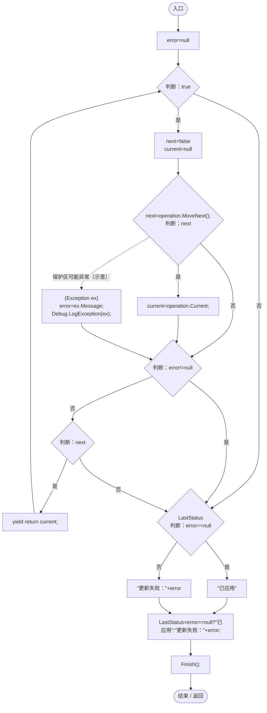

项目内调用/回调引用：

- [WorldParameterUpdate.LastStatus.set · L21](4087d9be2a65e96f.md#m12111e84e62e0c80)（访问器）
- [WorldParameterUpdate.Finish · L111](4087d9be2a65e96f.md#m9777a2f3ee61a2f0)（方法）

<a id="m086e9eb9d240395a"></a>

## UpdateWorld · L71

`private IEnumerator UpdateWorld(PlanetTerrainMeshBuilder builder,EnvironmentSystem environment,WorldSessionManager world,string kind,int seed,float value)`


### Editor / Player · Roslyn编译器控制流

```mermaid
flowchart TD
  b0(["入口"])
  b1["yield return null;<br/>yield return new WaitForEndOfFrame();<br/>config=builder.CaptureConfiguration()<br/>oldData=builder.Data"]
  b2{"判断：kind==&quot;seed&quot;"}
  b3["kind==&quot;terrain&quot;"]
  b4["kind==&quot;seed&quot;"]
  b5["terrain=kind==&quot;seed&quot;&#124;&#124;kind==&quot;terrain&quot;"]
  b6{"config.seed<br/>判断：kind==&quot;seed&quot;"}
  b7["seed"]
  b8["builder.seed"]
  b9["config.seed=kind==&quot;seed&quot;?seed:builder.seed;"]
  b10{"判断：kind==&quot;terrain&quot;"}
  b11["value/100"]
  b12["builder.continentRatio"]
  b13["land=kind==&quot;terrain&quot;?value/100:builder.continentRatio"]
  b14{"判断：kind==&quot;temp&quot;"}
  b15["value"]
  b16["environment.BaseTemperature"]
  b17["temp=kind==&quot;temp&quot;?value:environment.BaseTemperature"]
  b18{"判断：kind==&quot;hum&quot;"}
  b19["value"]
  b20["environment.BaseHumidity"]
  b21["humidity=kind==&quot;hum&quot;?value:environment.BaseHumidity"]
  b22{"data=oldData<br/>判断：terrain"}
  b23["_bodies"]
  b24{"判断：_bodies"}
  b25["var"]
  b26{"判断：body.entity==null"}
  b27["offset=body.position-builder.transform.position<br/>body.direction=offset.normalized;<br/>oldRadius=builder.radius+PlanetTerrainSampler.SampleHeight(oldData,builder.transform.InverseTransformDirection(body.direction))*builder.heightScale<br/>body.al…"]
  b28{"body.relocate<br/>判断：AntColonyWorker.IsCarried(body.entity)"}
  b29{"body.entity.GetComponent&lt;ParasiteBehavior&gt;()<br/>判断：body.entity.GetComponent&lt;ParasiteBehavior&gt;()"}
  b30[".Host"]
  b31["body.entity.GetComponent&lt;ParasiteBehavior&gt;()"]
  b32{"判断：body.entity.GetComponent&lt;ParasiteBehavior&gt;()?.Host==null"}
  b33{"body.entity.GetComponent&lt;NutritionParasite&gt;()<br/>判断：body.entity.GetComponent&lt;NutritionParasite&gt;()"}
  b34[".Host"]
  b35["body.entity.GetComponent&lt;NutritionParasite&gt;()"]
  b36["body.entity.GetComponent&lt;NutritionParasite&gt;()?.Host==null"]
  b37["!AntColonyWorker.IsCarried(body.entity)&amp;&amp;body.entity.GetComponent&lt;ParasiteBehavior&gt;()?.Host==null&amp;&amp;body.entity.GetComponent&lt;NutritionParasite&gt;()?.Host==null"]
  b38["body.relocate=!AntColonyWorker.IsCarried(body.entity)&amp;&amp;body.entity.GetComponent&lt;ParasiteBehavior&gt;()?.Host==null&amp;&amp;body.entity.GetComponent&lt;NutritionParasite&gt;()?.Host==null;"]
  b39["_bodies"]
  b40["Progress=.12f;<br/>Status=&quot;生成地形与山脉&quot;;<br/>sea=builder.seaLevelRatio<br/>task=Task.Run(()=&gt;PlanetTerrainGenerator.Generate(config,sea,land))"]
  b41{"判断：task.IsCompleted"}
  b42["yield return null;"]
  b43{"判断：task.IsFaulted"}
  b44["结果：task.Exception"]
  x44(["抛出异常 / 离开方法"])
  b45["data=task.Result;"]
  b46{"Progress<br/>判断：terrain"}
  b47[".58f"]
  b48[".2f"]
  b49["Progress=terrain ? .58f : .2f;"]
  b50["Status=&quot;计算温度、湿度与气候&quot;;<br/>climate=PlanetClimateMap.Instance<br/>climateConfig=JsonUtility.FromJson&lt;PlanetClimateConfig&gt;(JsonUtility.ToJson(PlanetClimateSystem.Instance.config))<br/>resolution=climate.mapResolution<br/>climateSeed=config.seed<br/>climateData=…"]
  b51{"判断：climateTask.IsCompleted"}
  b52["yield return null;"]
  b53{"判断：climateTask.IsFaulted"}
  b54["结果：climateTask.Exception"]
  x54(["抛出异常 / 离开方法"])
  b55{"Progress=.85f;<br/>Status=&quot;更新画面与地表碰撞&quot;;<br/>yield return null;<br/>判断：terrain"}
  b56["builder.seed=config.seed;<br/>builder.continentRatio=land;<br/>builder.ApplyGeneratedData(data);<br/>StationaryBodyRest.Clear();"]
  b57["environment.BaseTemperature=temp;<br/>environment.BaseHumidity=humidity;<br/>ClimateDataHub.BaseTemperature=temp;<br/>ClimateDataHub.BaseHumidity=humidity;<br/>climate.ApplyGeneratedClimate(climateTask.Result);"]
  b58["_bodies"]
  b59{"判断：_bodies"}
  b60{"var<br/>判断：body.entity!=null"}
  b61{"position=body.position<br/>判断：terrain"}
  b62{"判断：body.relocate"}
  b63["radius=builder.radius+PlanetTerrainSampler.SampleHeight(data,builder.transform.InverseTransformDirection(body.direction))*builder.heightScale<br/>position=builder.transform.position+body.direction*(radius+body.altitude);"]
  b64{"body.entity.transform.position=position;<br/>判断：body.body!=null"}
  b65["body.body.position=position;"]
  b66["EntityNeighborhood.ObservePosition(body.entity.Genes);"]
  b67["_bodies"]
  b68["Physics.SyncTransforms();<br/>Progress=.96f;<br/>Status=&quot;保存参数并恢复原世界&quot;;<br/>yield return null;"]
  b69{"world<br/>判断：world"}
  b70[".Current"]
  b71["world"]
  b72{"判断：world?.Current!=null"}
  b73["world.SaveNow(_running);"]
  b74["Progress=1;<br/>Status=&quot;更新完成&quot;;<br/>yield return new WaitForEndOfFrame();<br/>Debug.Log(&quot;[世界参数] 原世界更新完成：&quot;+kind+&quot;，实体=&quot;+EntityRegistry.All.Count);"]
  b75(["结束 / 返回"])
  b0 --> b1
  b1 --> b2
  b2 -->|"否"| b3
  b2 -->|"是"| b4
  b3 --> b5
  b4 --> b5
  b5 --> b6
  b6 -->|"是"| b7
  b6 -->|"否"| b8
  b7 --> b9
  b8 --> b9
  b9 --> b10
  b10 -->|"是"| b11
  b10 -->|"否"| b12
  b11 --> b13
  b12 --> b13
  b13 --> b14
  b14 -->|"是"| b15
  b14 -->|"否"| b16
  b15 --> b17
  b16 --> b17
  b17 --> b18
  b18 -->|"是"| b19
  b18 -->|"否"| b20
  b19 --> b21
  b20 --> b21
  b21 --> b22
  b22 -->|"是"| b23
  b22 -->|"否"| b46
  b23 --> b24
  b24 -->|"是"| b25
  b24 -->|"否 · 经过finally 39"| b40
  b25 --> b26
  b26 -->|"是"| b24
  b26 -->|"否"| b27
  b27 --> b28
  b28 -->|"否"| b29
  b28 -->|"是"| b37
  b29 -->|"否"| b30
  b29 -->|"是"| b31
  b30 --> b32
  b31 --> b32
  b32 -->|"是"| b33
  b32 -->|"否"| b37
  b33 -->|"否"| b34
  b33 -->|"是"| b35
  b34 --> b36
  b35 --> b36
  b36 --> b38
  b37 --> b38
  b38 --> b24
  b40 --> b41
  b41 -->|"否"| b42
  b41 -->|"是"| b43
  b42 --> b41
  b43 -->|"是"| b44
  b43 -->|"否"| b45
  b44 -->|"Throw"| x44
  b45 --> b46
  b46 -->|"是"| b47
  b46 -->|"否"| b48
  b47 --> b49
  b48 --> b49
  b49 --> b50
  b50 --> b51
  b51 -->|"否"| b52
  b51 -->|"是"| b53
  b52 --> b51
  b53 -->|"是"| b54
  b53 -->|"否"| b55
  b54 -->|"Throw"| x54
  b55 -->|"是"| b56
  b55 -->|"否"| b57
  b56 --> b57
  b57 --> b58
  b58 --> b59
  b59 -->|"是"| b60
  b59 -->|"否 · 经过finally 67"| b68
  b60 -->|"是"| b61
  b60 -->|"否"| b59
  b61 -->|"是"| b62
  b61 -->|"否"| b64
  b62 -->|"是"| b63
  b62 -->|"否"| b64
  b63 --> b64
  b64 -->|"是"| b65
  b64 -->|"否"| b66
  b65 --> b66
  b66 --> b59
  b68 --> b69
  b69 -->|"否"| b70
  b69 -->|"是"| b71
  b70 --> b72
  b71 --> b72
  b72 -->|"是"| b73
  b72 -->|"否"| b74
  b73 --> b74
  b74 --> b75
  b24 -. "退出保护区时 finally（示意）" .-> b39
  b59 -. "退出保护区时 finally（示意）" .-> b67

```

项目内调用/回调引用：

- [PlanetTerrainMeshBuilder.CaptureConfiguration · L108](415285cf043354a9.md#mec13ac0a32e0de61)（方法）
- [PlanetTerrainMeshBuilder.Data.get · L78](415285cf043354a9.md#m8382f579717fbc6d)（访问器）
- [PlanetTerrainSampler.SampleHeight · L32](fd5c1d83b88a7c8b.md#m759508f0c5a04b21)（方法）
- [AntColonyWorker.IsCarried · L140](8a0cca2020271b6f.md#mf552b19f9aeffe97)（方法）
- [ParasiteBehavior.Host.get · L16](ec21ecbd299caaed.md#m854b55763184d078)（访问器）
- [NutritionParasite.Host.get · L19](4a18785b7c1e1484.md#me3131db9b6e16399)（访问器）
- [WorldParameterUpdate.Progress.set · L20](4087d9be2a65e96f.md#m9d6a35b4682858cf)（访问器）
- [WorldParameterUpdate.Status.set · L20](4087d9be2a65e96f.md#m6de350cb521b7b99)（访问器）
- [PlanetClimateMap.Instance.get · L16](b4e9726c1bcf4c37.md#m3add54a419aeef9f)（访问器）
- [PlanetClimateSystem.Instance.get · L32](ba86e31da9b7d0a5.md#mf8e5c7e126d7b598)（访问器）
- [PlanetTerrainMeshBuilder.ApplyGeneratedData · L160](415285cf043354a9.md#m3e899cb84c9a0081)（方法）
- [StationaryBodyRest.Clear · L38](19e6d310d5522440.md#m9446711c3916bb36)（方法）
- [PlanetClimateMap.ApplyGeneratedClimate · L114](b4e9726c1bcf4c37.md#m20ba66ec7eca94e5)（方法）
- [EntityNeighborhood.ObservePosition · L63](e5e24c4aff0395b1.md#m994f4a7ab30bcd1d)（方法）
- [DarwinEntity.Genes.get · L14](70798dde169f2e8b.md#m622eb1adf401d431)（访问器）
- [WorldSessionManager.Current.get · L21](08741c7b7b9d9344.md#m5d26a5eb846a8504)（访问器）
- [WorldSessionManager.SaveNow · L157](08741c7b7b9d9344.md#mbecd8b5c222ba46b)（方法）
- [WorldParameterUpdate.回调@90 · L90](4087d9be2a65e96f.md#m867b43ebe664fda4)（回调/委托）
- [WorldParameterUpdate.回调@95 · L95](4087d9be2a65e96f.md#ma294dbb01eb3b59f)（回调/委托）

<a id="m867b43ebe664fda4"></a>

## 回调@90 · L90

`( … => 回调`


### Editor / Player · Roslyn编译器控制流

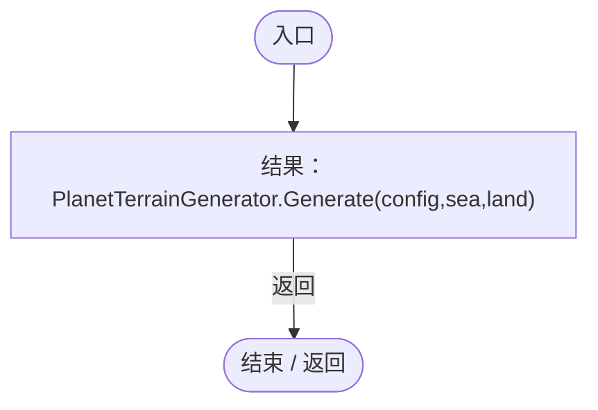

项目内调用/回调引用：

- [PlanetTerrainGenerator.Generate · L20](cde9e7b164fab46e.md#m7c6d74a69a660a78)（方法）

<a id="ma294dbb01eb3b59f"></a>

## 回调@95 · L95

`( … => 回调`


### Editor / Player · Roslyn编译器控制流

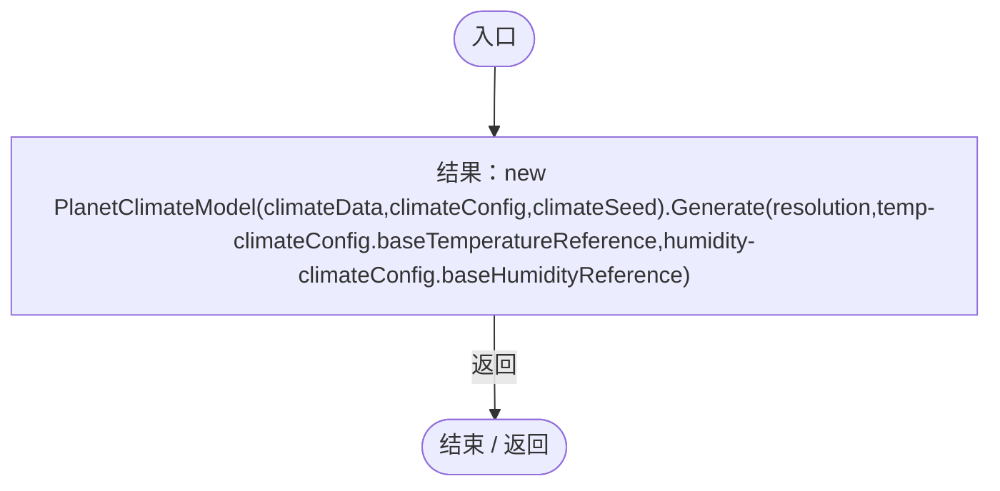

项目内调用/回调引用：

- [PlanetClimateModel.Generate · L59](0249d34bf86f4fa3.md#m49a6e534a85dc57e)（方法）
- [PlanetClimateModel.PlanetClimateModel.ctor · L48](0249d34bf86f4fa3.md#m49e0c243be23136b)（构造函数）

<a id="m9777a2f3ee61a2f0"></a>

## Finish · L111

`private void Finish()`


### Editor / Player · Roslyn编译器控制流

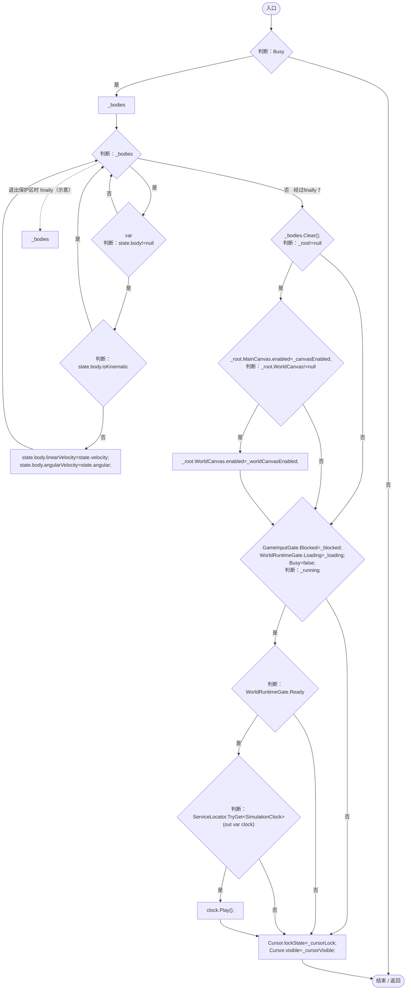

项目内调用/回调引用：

- [WorldParameterUpdate.Busy.get · L20](4087d9be2a65e96f.md#mec2ac85b8ff3f127)（访问器）
- [UIRoot.MainCanvas.get · L14](9c1421378791f0e0.md#maa2cc9baf1248477)（访问器）
- [UIRoot.WorldCanvas.get · L15](9c1421378791f0e0.md#mf389c1a94092ec8a)（访问器）
- [GameInputGate.Blocked.set · L8](52955daae7e592ab.md#m578697f6379686f4)（访问器）
- [WorldParameterUpdate.Busy.set · L20](4087d9be2a65e96f.md#m00c0b74aa3fdbce3)（访问器）
- [ServiceLocator.TryGet · L26](f2fdbe9f9ccd93cb.md#m143b24e6d58471b0)（方法）
- [SimulationClock.Play · L78](a8f444aec9614b0a.md#m7aa9e64b7de60ed0)（方法）

<a id="m9e1992e6a6f7ba0a"></a>

## OnGUI · L118

`private void OnGUI()`


### Editor / Player · Roslyn编译器控制流

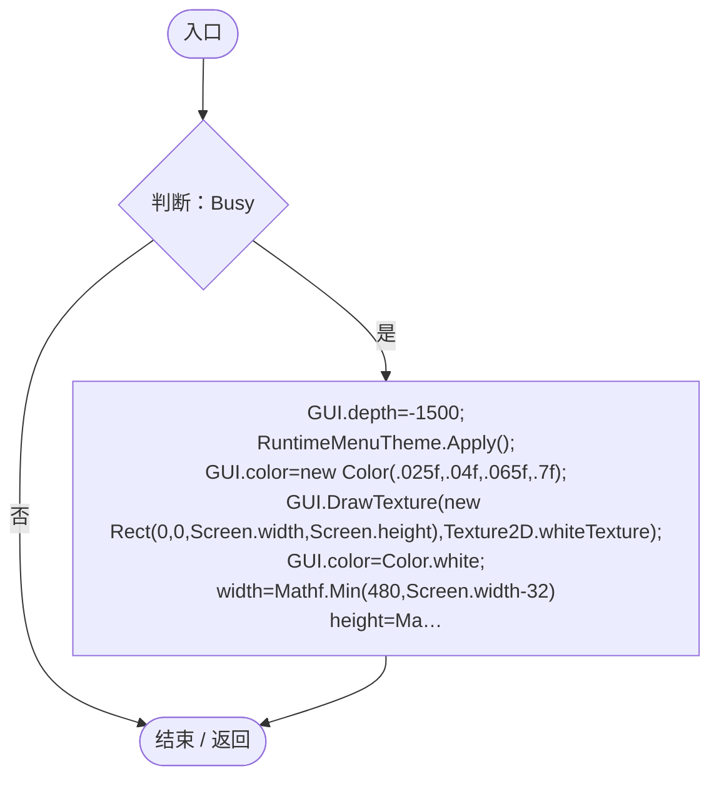

项目内调用/回调引用：

- [WorldParameterUpdate.Busy.get · L20](4087d9be2a65e96f.md#mec2ac85b8ff3f127)（访问器）
- [RuntimeMenuTheme.Apply · L39](b9d8455882f2a532.md#m587a63eff5a85605)（方法）
- [RuntimeMenuTheme.Title.get · L14](b9d8455882f2a532.md#m0b3a4a9f7e8e69ae)（访问器）
- [WorldLoadingView.Draw · L9](4db2e9fa805980b7.md#m78c78e77f9d1d246)（方法）
- [WorldParameterUpdate.Status.get · L20](4087d9be2a65e96f.md#mfe8b0a6918f81b44)（访问器）
- [WorldParameterUpdate.Progress.get · L20](4087d9be2a65e96f.md#m489c3e5d93e68225)（访问器）

<a id="me170f2aff238f9f9"></a>

## OnDisable · L123

`private void OnDisable()`


### Editor / Player · Roslyn编译器控制流

```mermaid
flowchart TD
  b0(["入口"])
  b1["StopAllCoroutines();<br/>Finish();"]
  b2(["结束 / 返回"])
  b0 --> b1
  b1 --> b2

```

项目内调用/回调引用：

- [WorldParameterUpdate.Finish · L111](4087d9be2a65e96f.md#m9777a2f3ee61a2f0)（方法）

<a id="m987270be5534b36c"></a>

## OnDestroy · L124

`private void OnDestroy()`


### Editor / Player · Roslyn编译器控制流

```mermaid
flowchart TD
  b0(["入口"])
  b1{"判断：Instance==this"}
  b2["Instance=null;"]
  b3(["结束 / 返回"])
  b0 --> b1
  b1 -->|"是"| b2
  b1 -->|"否"| b3
  b2 --> b3

```

项目内调用/回调引用：

- [WorldParameterUpdate.Instance.get · L19](4087d9be2a65e96f.md#m32aebfe3914ccd0e)（访问器）
- [WorldParameterUpdate.Instance.set · L19](4087d9be2a65e96f.md#mbdfcefeb65dea8e2)（访问器）
