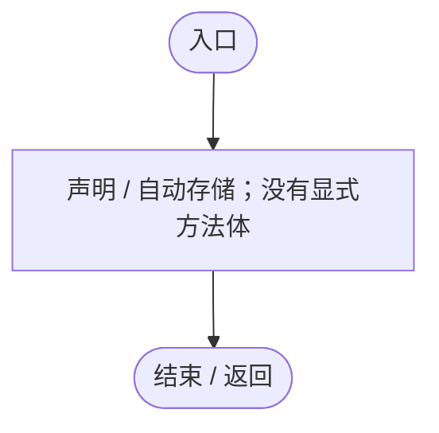
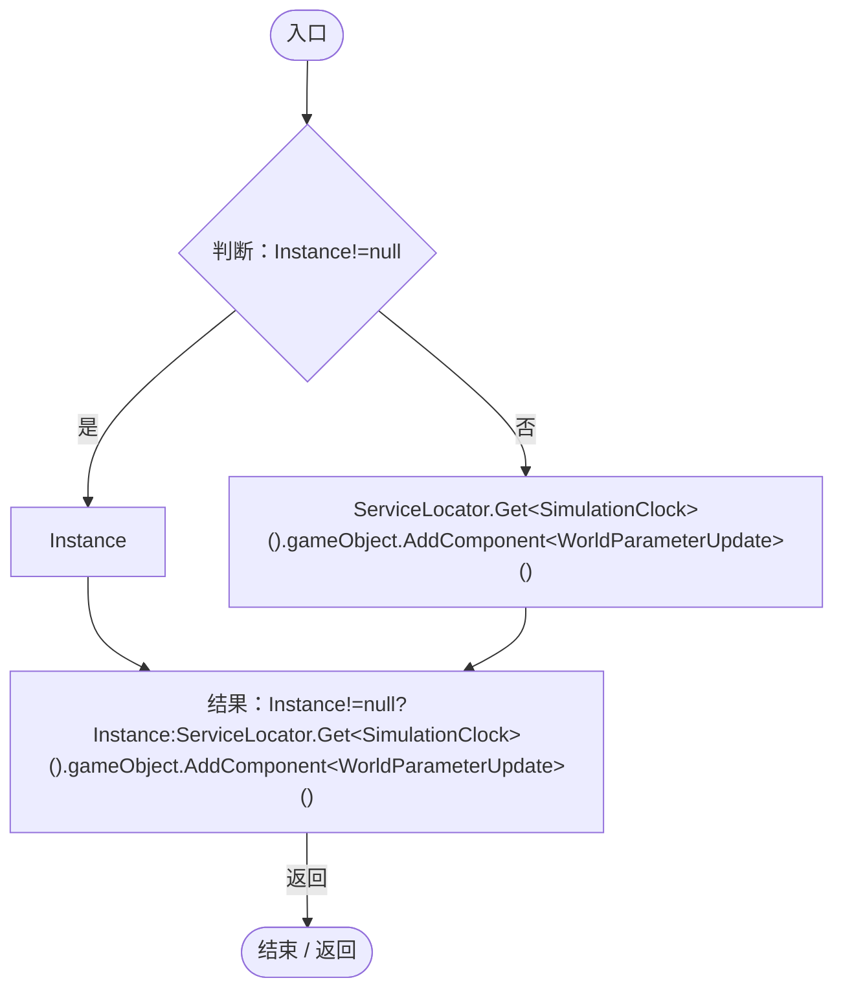
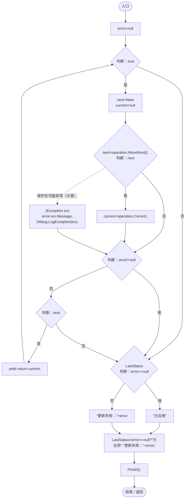
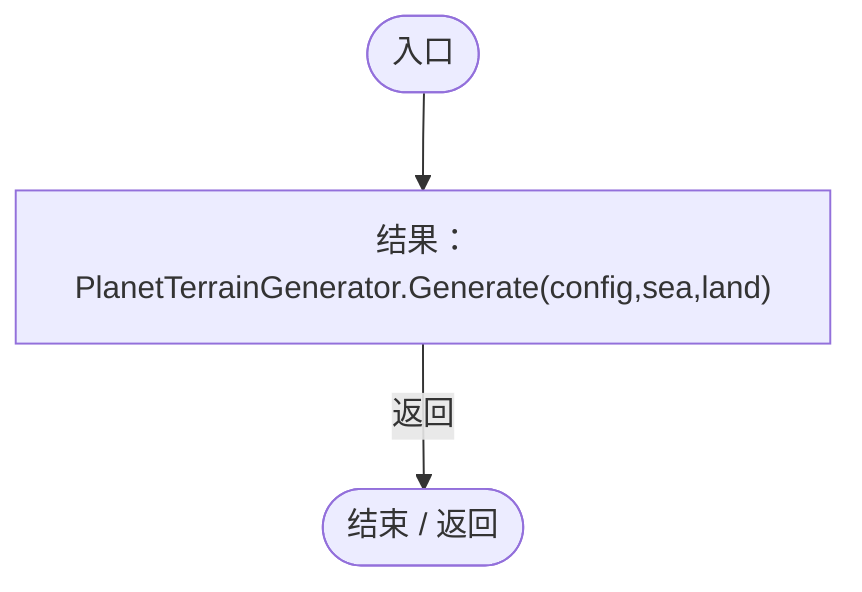
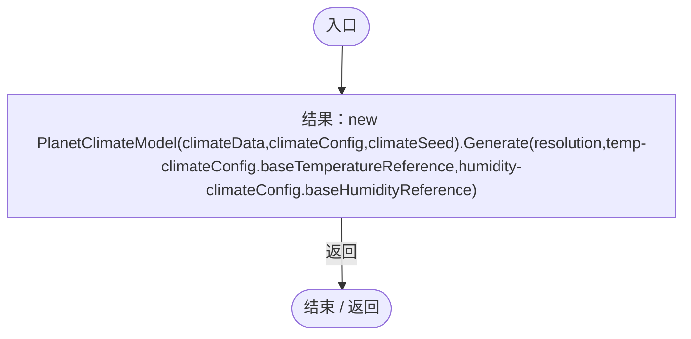
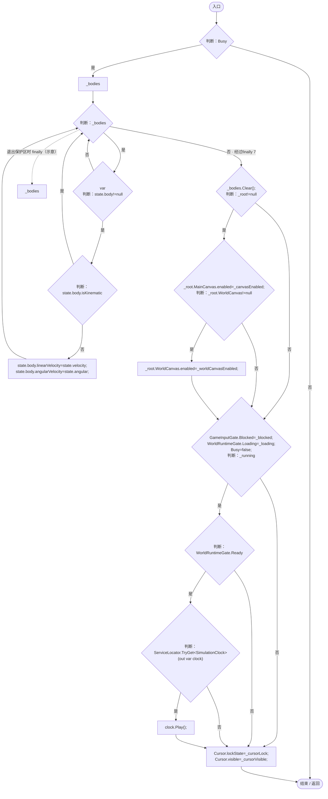
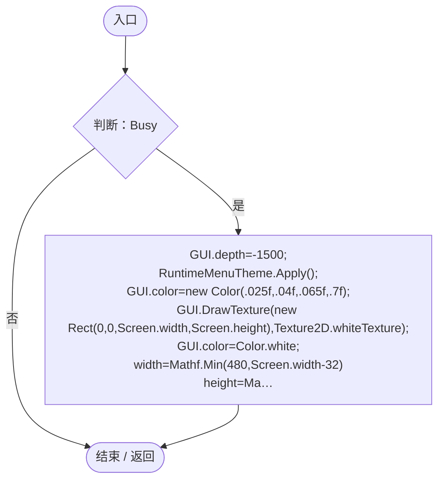

```mermaid
flowchart TD
  b0(["入口"])
  b1{"message=&quot;&quot;;<br/>world=Object.FindFirstObjectByType&lt;WorldSessionManager&gt;()<br/>builder=Object.FindFirstObjectByType&lt;PlanetTerrainMeshBuilder&gt;()<br/>判断：Busy"}
  b2{"判断：WorldRuntimeGate.Loading"}
  b3{"world<br/>判断：world"}
  b4[".Busy"]
  b5["world"]
  b6{"判断：world?.Busy==true"}
  b7["message=&quot;正在更新，请稍候&quot;;<br/>结果：false"]
  b8{"判断：WorldAuthority.CanEdit"}
  b9{"判断：WorldAuthority.IsReplica"}
  b10{"判断：WorldRuntimeGate.Ready"}
  b11{"builder<br/>判断：builder"}
  b12[".Data"]
  b13["builder"]
  b14{"判断：builder?.Data==null"}
  b15["message=&quot;当前世界不可修改&quot;;<br/>结果：false"]
  b16{"WorldLandformEdits.Kind(id)<br/>判断：WorldLandformEdits.Kind(id)"}
  b17["WorldLandformEdits.Kind(id)"]
  b18{"判断：id!=null"}
  b19{"判断：id.Contains(&quot;seed&quot;)"}
  b20["&quot;seed&quot;"]
  b21{"判断：id!=null"}
  b22{"判断：id.Contains(&quot;terrain&quot;)"}
  b23["&quot;terrain&quot;"]
  b24{"判断：id!=null"}
  b25{"判断：id.Contains(&quot;temp&quot;)"}
  b26["&quot;temp&quot;"]
  b27{"判断：id!=null"}
  b28{"判断：id.Contains(&quot;hum&quot;)"}
  b29["&quot;hum&quot;"]
  b30["null"]
  b31["kind=WorldLandformEdits.Kind(id)??(id!=null&amp;&amp;id.Contains(&quot;seed&quot;)?&quot;seed&quot;:id!=null&amp;&amp;id.Contains(&quot;terrain&quot;)?&quot;terrain&quot;:id!=null&amp;&amp;id.Contains(&quot;temp&quot;)?&quot;temp&quot;:id!=null&amp;&amp;id.Contains(&quot;hum&quot;)?&quot;hum&quot;:null)"]
  b32{"判断：kind==null"}
  b33["message=&quot;未知参数&quot;;<br/>结果：false"]
  b34{"seed=builder.seed<br/>判断：kind==&quot;seed&quot;"}
  b35{"判断：int.TryParse(raw,NumberStyles.Integer,CultureInfo.InvariantCulture,out seed)"}
  b36["message=&quot;请输入有效的32位整数种子&quot;;<br/>结果：false"]
  b37["value=0;"]
  b38{"判断：float.TryParse(raw,NumberStyles.Float,CultureInfo.InvariantCulture,out value)"}
  b39{"判断：float.IsFinite(value)"}
  b40["message=&quot;请输入有效数字&quot;;<br/>结果：false"]
  b41["environment=ServiceLocator.Get&lt;EnvironmentSystem&gt;()"]
  b42{"判断：kind==&quot;temp&quot;"}
  b43["temperatureRange"]
  b44{"判断：kind==&quot;hum&quot;"}
  b45["humidityRange"]
  b46["landPercentRange"]
  b47["range=kind==&quot;temp&quot;?temperatureRange:kind==&quot;hum&quot;?humidityRange:landPercentRange"]
  b48{"判断：kind==&quot;landforms&quot;"}
  b49{"判断：value!=0"}
  b50{"判断：value!=1"}
  b51["message=&quot;地貌开关只接受0或1&quot;;<br/>结果：false"]
  b52{"判断：kind!=&quot;seed&quot;"}
  b53{"判断：kind!=&quot;landforms&quot;"}
  b54{"判断：value&lt;range.x"}
  b55{"判断：value&gt;range.y"}
  b56["message=&quot;数值超出允许范围&quot;;<br/>结果：false"]
  b57{"判断：kind==&quot;landforms&quot;"}
  b58["builder.landforms.enabled==(value&gt;0)"]
  b59{"判断：kind==&quot;seed&quot;"}
  b60["seed==builder.seed"]
  b61{"判断：kind==&quot;terrain&quot;"}
  b62["Mathf.Approximately(value/100,builder.continentRatio)"]
  b63{"判断：kind==&quot;temp&quot;"}
  b64["Mathf.Approximately(value,environment.BaseTemperature)"]
  b65["Mathf.Approximately(value,environment.BaseHumidity)"]
  b66["unchanged=kind==&quot;landforms&quot;?builder.landforms.enabled==(value&gt;0):kind==&quot;seed&quot;?seed==builder.seed:kind==&quot;terrain&quot;?Mathf.Approximately(value/100,builder.continentRatio):kind==&quot;temp&quot;?Mathf.Approximately(value,environment.BaseTemperature):Ma…"]
  b67{"判断：unchanged"}
  b68["message=&quot;参数未变化&quot;;<br/>LastStatus=message;<br/>结果：true"]
  b69{"WorldGameSettingsPanel.Instance<br/>判断：WorldGameSettingsPanel.Instance"}
  b70["WorldGameSettingsPanel.Instance?.Close();"]
  b71["BeginCapture();<br/>Busy=true;<br/>Progress=0;<br/>Status=&quot;准备更新参数&quot;;<br/>LastStatus=&quot;正在更新&quot;;<br/>StartCoroutine(Guard(UpdateWorld(builder,environment,world,kind,seed,value)));<br/>message=&quot;正在更新&quot;;<br/>结果：true"]
  b72(["结束 / 返回"])
  b0 --> b1
  b1 -->|"否"| b2
  b1 -->|"是"| b7
  b2 -->|"否"| b3
  b2 -->|"是"| b7
  b3 -->|"否"| b4
  b3 -->|"是"| b5
  b4 --> b6
  b5 --> b6
  b6 -->|"是"| b7
  b6 -->|"否"| b8
  b7 -->|"返回"| b72
  b8 -->|"是"| b9
  b8 -->|"否"| b15
  b9 -->|"否"| b10
  b9 -->|"是"| b15
  b10 -->|"是"| b11
  b10 -->|"否"| b15
  b11 -->|"否"| b12
  b11 -->|"是"| b13
  b12 --> b14
  b13 --> b14
  b14 -->|"是"| b15
  b14 -->|"否"| b16
  b15 -->|"返回"| b72
  b16 -->|"否"| b17
  b16 -->|"是"| b18
  b17 --> b31
  b18 -->|"是"| b19
  b18 -->|"否"| b21
  b19 -->|"是"| b20
  b19 -->|"否"| b21
  b20 --> b31
  b21 -->|"是"| b22
  b21 -->|"否"| b24
  b22 -->|"是"| b23
  b22 -->|"否"| b24
  b23 --> b31
  b24 -->|"是"| b25
  b24 -->|"否"| b27
  b25 -->|"是"| b26
  b25 -->|"否"| b27
  b26 --> b31
  b27 -->|"是"| b28
  b27 -->|"否"| b30
  b28 -->|"是"| b29
  b28 -->|"否"| b30
  b29 --> b31
  b30 --> b31
  b31 --> b32
  b32 -->|"是"| b33
  b32 -->|"否"| b34
  b33 -->|"返回"| b72
  b34 -->|"是"| b35
  b34 -->|"否"| b38
  b35 -->|"否"| b36
  b35 -->|"是"| b37
  b36 -->|"返回"| b72
  b37 --> b41
  b38 -->|"是"| b39
  b38 -->|"否"| b40
  b39 -->|"否"| b40
  b39 -->|"是"| b41
  b40 -->|"返回"| b72
  b41 --> b42
  b42 -->|"是"| b43
  b42 -->|"否"| b44
  b43 --> b47
  b44 -->|"是"| b45
  b44 -->|"否"| b46
  b45 --> b47
  b46 --> b47
  b47 --> b48
  b48 -->|"是"| b49
  b48 -->|"否"| b52
  b49 -->|"是"| b50
  b49 -->|"否"| b52
  b50 -->|"是"| b51
  b50 -->|"否"| b52
  b51 -->|"返回"| b72
  b52 -->|"是"| b53
  b52 -->|"否"| b57
  b53 -->|"是"| b54
  b53 -->|"否"| b57
  b54 -->|"否"| b55
  b54 -->|"是"| b56
  b55 -->|"是"| b56
  b55 -->|"否"| b57
  b56 -->|"返回"| b72
  b57 -->|"是"| b58
  b57 -->|"否"| b59
  b58 --> b66
  b59 -->|"是"| b60
  b59 -->|"否"| b61
  b60 --> b66
  b61 -->|"是"| b62
  b61 -->|"否"| b63
  b62 --> b66
  b63 -->|"是"| b64
  b63 -->|"否"| b65
  b64 --> b66
  b65 --> b66
  b66 --> b67
  b67 -->|"是"| b68
  b67 -->|"否"| b69
  b68 -->|"返回"| b72
  b69 -->|"否"| b70
  b69 -->|"是"| b71
  b70 --> b71
  b71 -->|"返回"| b72

```

```mermaid
flowchart TD
  b0(["入口"])
  b1["_blocked=GameInputGate.Blocked;<br/>_loading=WorldRuntimeGate.Loading;<br/>_running=ServiceLocator.Get&lt;SimulationClock&gt;().IsRunning;<br/>_cursorLock=Cursor.lockState;<br/>_cursorVisible=Cursor.visible;<br/>GameInputGate.Blocked=true;<br/>WorldRuntimeGate.Loadin…"]
  b2{"EntityPlacementTool.Instance<br/>判断：EntityPlacementTool.Instance"}
  b3["EntityPlacementTool.Instance?.CancelPlacement();"]
  b4["Object.FindObjectsByType&lt;RandomPlanetSpawner&gt;(FindObjectsSortMode.None)"]
  b5{"判断：Object.FindObjectsByType&lt;RandomPlanetSpawner&gt;(FindObjectsSortMode.None)"}
  b6["var<br/>job.Cancel();"]
  b7{"Object.FindObjectsByType&lt;RandomPlanetSpawner&gt;(FindObjectsSortMode.None)<br/>判断：Object.FindObjectsByType&lt;RandomPlanetSpawner&gt;(FindObjectsSortMode.None)"}
  b8["Object.FindObjectsByType&lt;RandomPlanetSpawner&gt;(FindObjectsSortMode.None)"]
  b9["连接 / 离开区域"]
  b10["_root=ServiceLocator.Get&lt;UIRoot&gt;();<br/>_canvasEnabled=_root.MainCanvas.enabled;<br/>_root.MainCanvas.enabled=false;"]
  b11{"_worldCanvasEnabled<br/>判断：_root.WorldCanvas!=null"}
  b12["_root.WorldCanvas.enabled"]
  b13["_root.WorldCanvas!=null"]
  b14["_worldCanvasEnabled=_root.WorldCanvas!=null&amp;&amp;_root.WorldCanvas.enabled;"]
  b15{"判断：_root.WorldCanvas!=null"}
  b16["_root.WorldCanvas.enabled=false;"]
  b17["Cursor.lockState=CursorLockMode.None;<br/>Cursor.visible=true;<br/>_bodies.Clear();"]
  b18["EntityRegistry.All"]
  b19{"判断：EntityRegistry.All"}
  b20["var"]
  b21["body=entity.GetComponent&lt;Rigidbody&gt;()"]
  b22["_bodies<br/>new BodyState{entity=entity,body=body,position=entity.transform.position,velocity=body!=null&amp;&amp;!body.isKinematic?body.linearVelocity:Vector3.zero,angular=body!=null&amp;&amp;!body.isKinematic?body.angularVelocity:Vector3.zero}<br/>entity=enti…"]
  b23{"判断：body!=null"}
  b24{"判断：body.isKinematic"}
  b25["body.linearVelocity"]
  b26["Vector3.zero"]
  b27["velocity=body!=null&amp;&amp;!body.isKinematic?body.linearVelocity:Vector3.zero"]
  b28{"判断：body!=null"}
  b29{"判断：body.isKinematic"}
  b30["body.angularVelocity"]
  b31["Vector3.zero"]
  b32["angular=body!=null&amp;&amp;!body.isKinematic?body.angularVelocity:Vector3.zero"]
  b33["_bodies.Add(new BodyState{entity=entity,body=body,position=entity.transform.position,velocity=body!=null&amp;&amp;!body.isKinematic?body.linearVelocity:Vector3.zero,angular=body!=null&amp;&amp;!body.isKinematic?body.angularVelocity:Vector3.zero});"]
  b34{"判断：EntityRegistry.All"}
  b35["EntityRegistry.All"]
  b36["连接 / 离开区域"]
  b37(["结束 / 返回"])
  b0 --> b1
  b1 --> b2
  b2 -->|"否"| b3
  b2 -->|"是"| b4
  b3 --> b4
  b4 --> b5
  b5 -->|"是"| b6
  b5 -->|"否 · 经过finally 7"| b10
  b6 --> b5
  b7 -->|"否"| b8
  b7 -->|"是"| b9
  b8 --> b9
  b10 --> b11
  b11 -->|"是"| b12
  b11 -->|"否"| b13
  b12 --> b14
  b13 --> b14
  b14 --> b15
  b15 -->|"是"| b16
  b15 -->|"否"| b17
  b16 --> b17
  b17 --> b18
  b18 --> b19
  b19 -->|"是"| b20
  b19 -->|"否 · 经过finally 34"| b37
  b20 --> b21
  b21 --> b22
  b22 --> b23
  b23 -->|"是"| b24
  b23 -->|"否"| b26
  b24 -->|"否"| b25
  b24 -->|"是"| b26
  b25 --> b27
  b26 --> b27
  b27 --> b28
  b28 -->|"是"| b29
  b28 -->|"否"| b31
  b29 -->|"否"| b30
  b29 -->|"是"| b31
  b30 --> b32
  b31 --> b32
  b32 --> b33
  b33 --> b19
  b34 -->|"否"| b35
  b34 -->|"是"| b36
  b35 --> b36
  b5 -. "退出保护区时 finally（示意）" .-> b7
  b19 -. "退出保护区时 finally（示意）" .-> b34

```

```mermaid
flowchart TD
  b0(["入口"])
  b1["yield return null;<br/>yield return new WaitForEndOfFrame();<br/>config=builder.CaptureConfiguration()<br/>oldData=builder.Data"]
  b2{"判断：kind==&quot;seed&quot;"}
  b3{"判断：kind==&quot;terrain&quot;"}
  b4["kind==&quot;landforms&quot;"]
  b5["kind==&quot;seed&quot;&#124;&#124;kind==&quot;terrain&quot;&#124;&#124;kind==&quot;landforms&quot;"]
  b6["terrain=kind==&quot;seed&quot;&#124;&#124;kind==&quot;terrain&quot;&#124;&#124;kind==&quot;landforms&quot;"]
  b7["WorldLandformEdits.Apply(config,kind,value);"]
  b8{"判断：terrain"}
  b9["new TerrainResourceRelocation(builder,minimumSurfaceOffset,maximumPreservedAltitude)"]
  b10["null"]
  b11["resources=terrain?new TerrainResourceRelocation(builder,minimumSurfaceOffset,maximumPreservedAltitude):null"]
  b12{"config.seed<br/>判断：kind==&quot;seed&quot;"}
  b13["seed"]
  b14["builder.seed"]
  b15["config.seed=kind==&quot;seed&quot;?seed:builder.seed;"]
  b16{"判断：kind==&quot;terrain&quot;"}
  b17["value/100"]
  b18["builder.continentRatio"]
  b19["land=kind==&quot;terrain&quot;?value/100:builder.continentRatio"]
  b20{"判断：kind==&quot;temp&quot;"}
  b21["value"]
  b22["environment.BaseTemperature"]
  b23["temp=kind==&quot;temp&quot;?value:environment.BaseTemperature"]
  b24{"判断：kind==&quot;hum&quot;"}
  b25["value"]
  b26["environment.BaseHumidity"]
  b27["humidity=kind==&quot;hum&quot;?value:environment.BaseHumidity"]
  b28{"data=oldData<br/>判断：terrain"}
  b29["_bodies"]
  b30{"判断：_bodies"}
  b31["var"]
  b32{"判断：body.entity==null"}
  b33["offset=body.position-builder.transform.position<br/>body.direction=offset.normalized;<br/>oldRadius=builder.radius+PlanetTerrainSampler.SampleHeight(oldData,builder.transform.InverseTransformDirection(body.direction))*builder.heightScale<br/>body.al…"]
  b34{"body.relocate<br/>判断：AntColonyWorker.IsCarried(body.entity)"}
  b35{"body.entity.GetComponent&lt;ParasiteBehavior&gt;()<br/>判断：body.entity.GetComponent&lt;ParasiteBehavior&gt;()"}
  b36[".Host"]
  b37["body.entity.GetComponent&lt;ParasiteBehavior&gt;()"]
  b38{"判断：body.entity.GetComponent&lt;ParasiteBehavior&gt;()?.Host==null"}
  b39{"body.entity.GetComponent&lt;NutritionParasite&gt;()<br/>判断：body.entity.GetComponent&lt;NutritionParasite&gt;()"}
  b40[".Host"]
  b41["body.entity.GetComponent&lt;NutritionParasite&gt;()"]
  b42["body.entity.GetComponent&lt;NutritionParasite&gt;()?.Host==null"]
  b43["!AntColonyWorker.IsCarried(body.entity)&amp;&amp;body.entity.GetComponent&lt;ParasiteBehavior&gt;()?.Host==null&amp;&amp;body.entity.GetComponent&lt;NutritionParasite&gt;()?.Host==null"]
  b44["body.relocate=!AntColonyWorker.IsCarried(body.entity)&amp;&amp;body.entity.GetComponent&lt;ParasiteBehavior&gt;()?.Host==null&amp;&amp;body.entity.GetComponent&lt;NutritionParasite&gt;()?.Host==null;"]
  b45["_bodies"]
  b46["Progress=.12f;<br/>Status=&quot;生成地形与山脉&quot;;<br/>sea=builder.seaLevelRatio<br/>task=Task.Run(()=&gt;PlanetTerrainGenerator.Generate(config,sea,land))"]
  b47{"判断：task.IsCompleted"}
  b48["yield return null;"]
  b49{"判断：task.IsFaulted"}
  b50["结果：task.Exception"]
  x50(["抛出异常 / 离开方法"])
  b51["data=task.Result;"]
  b52{"Progress<br/>判断：terrain"}
  b53[".58f"]
  b54[".2f"]
  b55["Progress=terrain ? .58f : .2f;"]
  b56["Status=&quot;计算温度、湿度与气候&quot;;<br/>climate=PlanetClimateMap.Instance<br/>climateConfig=JsonUtility.FromJson&lt;PlanetClimateConfig&gt;(JsonUtility.ToJson(PlanetClimateSystem.Instance.config))<br/>resolution=climate.mapResolution<br/>climateSeed=config.seed<br/>climateData=…"]
  b57{"判断：climateTask.IsCompleted"}
  b58["yield return null;"]
  b59{"判断：climateTask.IsFaulted"}
  b60["结果：climateTask.Exception"]
  x60(["抛出异常 / 离开方法"])
  b61{"Progress=.85f;<br/>Status=&quot;更新画面与地表碰撞&quot;;<br/>yield return null;<br/>判断：terrain"}
  b62["builder.seed=config.seed;<br/>builder.continentRatio=land;<br/>builder.landforms=config.landforms;<br/>builder.ApplyGeneratedData(data);<br/>StationaryBodyRest.Clear();"]
  b63["environment.BaseTemperature=temp;<br/>environment.BaseHumidity=humidity;<br/>ClimateDataHub.BaseTemperature=temp;<br/>ClimateDataHub.BaseHumidity=humidity;<br/>climate.ApplyGeneratedClimate(climateTask.Result);"]
  b64["_bodies"]
  b65{"判断：_bodies"}
  b66{"var<br/>判断：body.entity!=null"}
  b67{"position=body.position<br/>判断：terrain"}
  b68{"判断：body.relocate"}
  b69["radius=builder.radius+PlanetTerrainSampler.SampleHeight(data,builder.transform.InverseTransformDirection(body.direction))*builder.heightScale<br/>position=builder.transform.position+body.direction*(radius+body.altitude);"]
  b70{"body.entity.transform.position=position;<br/>判断：body.body!=null"}
  b71["body.body.position=position;"]
  b72["EntityNeighborhood.ObservePosition(body.entity.Genes);"]
  b73["_bodies"]
  b74{"resources<br/>判断：resources"}
  b75["resources?.Restore(builder);"]
  b76["Physics.SyncTransforms();<br/>Progress=.96f;<br/>Status=&quot;保存参数并恢复原世界&quot;;<br/>yield return null;"]
  b77{"world<br/>判断：world"}
  b78[".Current"]
  b79["world"]
  b80{"判断：world?.Current!=null"}
  b81["world.SaveNow(_running);"]
  b82["Progress=1;<br/>Status=&quot;更新完成&quot;;<br/>yield return new WaitForEndOfFrame();<br/>Debug.Log(&quot;[世界参数] 原世界更新完成：&quot;+kind+&quot;，实体=&quot;+EntityRegistry.All.Count);"]
  b83(["结束 / 返回"])
  b0 --> b1
  b1 --> b2
  b2 -->|"否"| b3
  b2 -->|"是"| b5
  b3 -->|"否"| b4
  b3 -->|"是"| b5
  b4 --> b6
  b5 --> b6
  b6 --> b7
  b7 --> b8
  b8 -->|"是"| b9
  b8 -->|"否"| b10
  b9 --> b11
  b10 --> b11
  b11 --> b12
  b12 -->|"是"| b13
  b12 -->|"否"| b14
  b13 --> b15
  b14 --> b15
  b15 --> b16
  b16 -->|"是"| b17
  b16 -->|"否"| b18
  b17 --> b19
  b18 --> b19
  b19 --> b20
  b20 -->|"是"| b21
  b20 -->|"否"| b22
  b21 --> b23
  b22 --> b23
  b23 --> b24
  b24 -->|"是"| b25
  b24 -->|"否"| b26
  b25 --> b27
  b26 --> b27
  b27 --> b28
  b28 -->|"是"| b29
  b28 -->|"否"| b52
  b29 --> b30
  b30 -->|"是"| b31
  b30 -->|"否 · 经过finally 45"| b46
  b31 --> b32
  b32 -->|"是"| b30
  b32 -->|"否"| b33
  b33 --> b34
  b34 -->|"否"| b35
  b34 -->|"是"| b43
  b35 -->|"否"| b36
  b35 -->|"是"| b37
  b36 --> b38
  b37 --> b38
  b38 -->|"是"| b39
  b38 -->|"否"| b43
  b39 -->|"否"| b40
  b39 -->|"是"| b41
  b40 --> b42
  b41 --> b42
  b42 --> b44
  b43 --> b44
  b44 --> b30
  b46 --> b47
  b47 -->|"否"| b48
  b47 -->|"是"| b49
  b48 --> b47
  b49 -->|"是"| b50
  b49 -->|"否"| b51
  b50 -->|"Throw"| x50
  b51 --> b52
  b52 -->|"是"| b53
  b52 -->|"否"| b54
  b53 --> b55
  b54 --> b55
  b55 --> b56
  b56 --> b57
  b57 -->|"否"| b58
  b57 -->|"是"| b59
  b58 --> b57
  b59 -->|"是"| b60
  b59 -->|"否"| b61
  b60 -->|"Throw"| x60
  b61 -->|"是"| b62
  b61 -->|"否"| b63
  b62 --> b63
  b63 --> b64
  b64 --> b65
  b65 -->|"是"| b66
  b65 -->|"否 · 经过finally 73"| b74
  b66 -->|"是"| b67
  b66 -->|"否"| b65
  b67 -->|"是"| b68
  b67 -->|"否"| b70
  b68 -->|"是"| b69
  b68 -->|"否"| b70
  b69 --> b70
  b70 -->|"是"| b71
  b70 -->|"否"| b72
  b71 --> b72
  b72 --> b65
  b74 -->|"否"| b75
  b74 -->|"是"| b76
  b75 --> b76
  b76 --> b77
  b77 -->|"否"| b78
  b77 -->|"是"| b79
  b78 --> b80
  b79 --> b80
  b80 -->|"是"| b81
  b80 -->|"否"| b82
  b81 --> b82
  b82 --> b83
  b30 -. "退出保护区时 finally（示意）" .-> b45
  b65 -. "退出保护区时 finally（示意）" .-> b73

```

# WorldParameterUpdate.cs

[返回总索引](../README.md) · `Runtime` · `Assets/DarwinPark/UI/WorldParameterUpdate.cs`

[源文件](../../../Assets/DarwinPark/UI/WorldParameterUpdate.cs) · 源码校验：`ae348c46d7ec3d268f7c71f6d256a8c79a24700a2b7023a346dd54511467d03c`

方法按源文件位置排列。事件/回调引用不表示立即执行；分支与异常说明见总索引。完整源码与可点击关系图请打开离线手册。

<a id="m32aebfe3914ccd0e"></a>

## Instance.get · L19

`get`


### Editor / Player · 语法控制结构 / 声明（非CFG）


<a id="mbdfcefeb65dea8e2"></a>

## Instance.set · L19

`private set`


### Editor / Player · 语法控制结构 / 声明（非CFG）


<a id="mec2ac85b8ff3f127"></a>

## Busy.get · L20

`get`


### Editor / Player · 语法控制结构 / 声明（非CFG）


<a id="m00c0b74aa3fdbce3"></a>

## Busy.set · L20

`private set`


### Editor / Player · 语法控制结构 / 声明（非CFG）


<a id="m489c3e5d93e68225"></a>

## Progress.get · L20

`get`


### Editor / Player · 语法控制结构 / 声明（非CFG）


<a id="m9d6a35b4682858cf"></a>

## Progress.set · L20

`private set`


### Editor / Player · 语法控制结构 / 声明（非CFG）


<a id="mfe8b0a6918f81b44"></a>

## Status.get · L20

`get`


### Editor / Player · 语法控制结构 / 声明（非CFG）


<a id="m6de350cb521b7b99"></a>

## Status.set · L20

`private set`


### Editor / Player · 语法控制结构 / 声明（非CFG）


<a id="m9aff979be84ce935"></a>

## LastStatus.get · L21

`get`


### Editor / Player · 语法控制结构 / 声明（非CFG）



<a id="m12111e84e62e0c80"></a>

## LastStatus.set · L21

`private set`


### Editor / Player · 语法控制结构 / 声明（非CFG）


<a id="m2022b8ffcacd6ee4"></a>

## Awake · L26

`private void Awake()`


### Editor / Player · Roslyn编译器控制流


项目内调用/回调引用：

- [WorldParameterUpdate.Instance.set · L19](4087d9be2a65e96f.md#mbdfcefeb65dea8e2)（访问器）

<a id="mcefc896cc38899a6"></a>

## Ensure · L27

`public static WorldParameterUpdate Ensure()`


### Editor / Player · Roslyn编译器控制流



项目内调用/回调引用：

- [WorldParameterUpdate.Instance.get · L19](4087d9be2a65e96f.md#m32aebfe3914ccd0e)（访问器）
- [ServiceLocator.Get · L33](f2fdbe9f9ccd93cb.md#m2ae625299520c56d)（方法）

<a id="m942de54d110fe265"></a>

## Request · L28

`public bool Request(string id,string raw,out string message)`


### Editor / Player · Roslyn编译器控制流



项目内调用/回调引用：

- [WorldParameterUpdate.Busy.get · L20](4087d9be2a65e96f.md#mec2ac85b8ff3f127)（访问器）
- [WorldSessionManager.Busy.get · L24](08741c7b7b9d9344.md#m4483e2e4f28f7c85)（访问器）
- [PlanetTerrainMeshBuilder.Data.get · L81](415285cf043354a9.md#m1a65abfe0f34c5d8)（访问器）
- [WorldLandformEdits.Kind · L22](a492c83bf894e14d.md#m203fe22b72124d0d)（方法）
- [ServiceLocator.Get · L33](f2fdbe9f9ccd93cb.md#m2ae625299520c56d)（方法）
- [WorldParameterUpdate.LastStatus.set · L21](4087d9be2a65e96f.md#m12111e84e62e0c80)（访问器）
- [WorldGameSettingsPanel.Instance.get · L11](6df051f7f7177d08.md#mcccf01908bb54d27)（访问器）
- [WorldGameSettingsPanel.Close · L39](6df051f7f7177d08.md#m019774ab8575ddd2)（方法）
- [WorldParameterUpdate.BeginCapture · L49](4087d9be2a65e96f.md#mcfd5990487721b3c)（方法）
- [WorldParameterUpdate.Busy.set · L20](4087d9be2a65e96f.md#m00c0b74aa3fdbce3)（访问器）
- [WorldParameterUpdate.Progress.set · L20](4087d9be2a65e96f.md#m9d6a35b4682858cf)（访问器）
- [WorldParameterUpdate.Status.set · L20](4087d9be2a65e96f.md#m6de350cb521b7b99)（访问器）
- [WorldParameterUpdate.Guard · L62](4087d9be2a65e96f.md#maa056ee6c49f26be)（方法）
- [WorldParameterUpdate.UpdateWorld · L72](4087d9be2a65e96f.md#m2f96fa23e1a196bc)（方法）

<a id="mcfd5990487721b3c"></a>

## BeginCapture · L49

`private void BeginCapture()`


### Editor / Player · Roslyn编译器控制流



项目内调用/回调引用：

- [GameInputGate.Blocked.get · L8](52955daae7e592ab.md#m765763b665829633)（访问器）
- [SimulationClock.IsRunning.get · L22](a8f444aec9614b0a.md#m10f4fe307faca0f0)（访问器）
- [ServiceLocator.Get · L33](f2fdbe9f9ccd93cb.md#m2ae625299520c56d)（方法）
- [GameInputGate.Blocked.set · L8](52955daae7e592ab.md#m578697f6379686f4)（访问器）
- [SimulationClock.Pause · L79](a8f444aec9614b0a.md#m30929d45a885d0f1)（方法）
- [EntityPlacementTool.Instance.get · L13](2ca993947b0a7e7a.md#mafb26991c0dfcb86)（访问器）
- [EntityPlacementTool.CancelPlacement · L81](2ca993947b0a7e7a.md#m5a9374d2c71f0a2d)（方法）
- [RandomPlanetSpawner.Cancel · L92](1c13222a547b265c.md#ma34d7509b5f0cc9a)（方法）
- [UIRoot.MainCanvas.get · L14](9c1421378791f0e0.md#maa2cc9baf1248477)（访问器）
- [UIRoot.WorldCanvas.get · L15](9c1421378791f0e0.md#mf389c1a94092ec8a)（访问器）

<a id="maa056ee6c49f26be"></a>

## Guard · L62

`private IEnumerator Guard(IEnumerator operation)`


### Editor / Player · Roslyn编译器控制流



项目内调用/回调引用：

- [WorldParameterUpdate.LastStatus.set · L21](4087d9be2a65e96f.md#m12111e84e62e0c80)（访问器）
- [WorldParameterUpdate.Finish · L114](4087d9be2a65e96f.md#m80d28f3d3279b173)（方法）

<a id="m2f96fa23e1a196bc"></a>

## UpdateWorld · L72

`private IEnumerator UpdateWorld(PlanetTerrainMeshBuilder builder,EnvironmentSystem environment,WorldSessionManager world,string kind,int seed,float value)`


### Editor / Player · Roslyn编译器控制流



项目内调用/回调引用：

- [PlanetTerrainMeshBuilder.CaptureConfiguration · L116](415285cf043354a9.md#m9eddff328d672f73)（方法）
- [PlanetTerrainMeshBuilder.Data.get · L81](415285cf043354a9.md#m1a65abfe0f34c5d8)（访问器）
- [WorldLandformEdits.Apply · L23](a492c83bf894e14d.md#m87037da8d6480876)（方法）
- [TerrainResourceRelocation.TerrainResourceRelocation.ctor · L11](76faddc0f6e77241.md#m1529160443086235)（构造函数）
- [PlanetTerrainSampler.SampleHeight · L32](fd5c1d83b88a7c8b.md#m759508f0c5a04b21)（方法）
- [AntColonyWorker.IsCarried · L132](8a0cca2020271b6f.md#m78b7b08c935b36c0)（方法）
- [ParasiteBehavior.Host.get · L16](ec21ecbd299caaed.md#m854b55763184d078)（访问器）
- [NutritionParasite.Host.get · L20](4a18785b7c1e1484.md#m04cde9f68ca91f6a)（访问器）
- [WorldParameterUpdate.Progress.set · L20](4087d9be2a65e96f.md#m9d6a35b4682858cf)（访问器）
- [WorldParameterUpdate.Status.set · L20](4087d9be2a65e96f.md#m6de350cb521b7b99)（访问器）
- [PlanetClimateMap.Instance.get · L16](b4e9726c1bcf4c37.md#m3add54a419aeef9f)（访问器）
- [PlanetClimateSystem.Instance.get · L33](ba86e31da9b7d0a5.md#md8b21cc929db37b1)（访问器）
- [PlanetTerrainMeshBuilder.ApplyGeneratedData · L170](415285cf043354a9.md#m2a940ee9ce3364cb)（方法）
- [StationaryBodyRest.Clear · L45](19e6d310d5522440.md#m48e94a60d1d047de)（方法）
- [PlanetClimateMap.ApplyGeneratedClimate · L114](b4e9726c1bcf4c37.md#m20ba66ec7eca94e5)（方法）
- [EntityNeighborhood.ObservePosition · L81](e5e24c4aff0395b1.md#m232339f32a8c5875)（方法）
- [DarwinEntity.Genes.get · L14](70798dde169f2e8b.md#m622eb1adf401d431)（访问器）
- [TerrainResourceRelocation.Restore · L13](76faddc0f6e77241.md#m0120f3d738fc9a23)（方法）
- [WorldSessionManager.Current.get · L21](08741c7b7b9d9344.md#m5d26a5eb846a8504)（访问器）
- [WorldSessionManager.SaveNow · L169](08741c7b7b9d9344.md#m43f61078d8513f73)（方法）
- [WorldParameterUpdate.回调@92 · L92](4087d9be2a65e96f.md#m0eac93fe2a1ea4ba)（回调/委托）
- [WorldParameterUpdate.回调@97 · L97](4087d9be2a65e96f.md#m4cf8a5ae9c5acf3a)（回调/委托）

<a id="m0eac93fe2a1ea4ba"></a>

## 回调@92 · L92

`( … => 回调`


### Editor / Player · Roslyn编译器控制流



项目内调用/回调引用：

- [PlanetTerrainGenerator.Generate · L20](cde9e7b164fab46e.md#m7c6d74a69a660a78)（方法）

<a id="m4cf8a5ae9c5acf3a"></a>

## 回调@97 · L97

`( … => 回调`


### Editor / Player · Roslyn编译器控制流



项目内调用/回调引用：

- [PlanetClimateModel.Generate · L59](0249d34bf86f4fa3.md#m49a6e534a85dc57e)（方法）
- [PlanetClimateModel.PlanetClimateModel.ctor · L48](0249d34bf86f4fa3.md#m49e0c243be23136b)（构造函数）

<a id="m80d28f3d3279b173"></a>

## Finish · L114

`private void Finish()`


### Editor / Player · Roslyn编译器控制流



项目内调用/回调引用：

- [WorldParameterUpdate.Busy.get · L20](4087d9be2a65e96f.md#mec2ac85b8ff3f127)（访问器）
- [UIRoot.MainCanvas.get · L14](9c1421378791f0e0.md#maa2cc9baf1248477)（访问器）
- [UIRoot.WorldCanvas.get · L15](9c1421378791f0e0.md#mf389c1a94092ec8a)（访问器）
- [GameInputGate.Blocked.set · L8](52955daae7e592ab.md#m578697f6379686f4)（访问器）
- [WorldParameterUpdate.Busy.set · L20](4087d9be2a65e96f.md#m00c0b74aa3fdbce3)（访问器）
- [ServiceLocator.TryGet · L26](f2fdbe9f9ccd93cb.md#m143b24e6d58471b0)（方法）
- [SimulationClock.Play · L78](a8f444aec9614b0a.md#m7aa9e64b7de60ed0)（方法）

<a id="mc437fa39d41d87bc"></a>

## OnGUI · L121

`private void OnGUI()`


### Editor / Player · Roslyn编译器控制流



项目内调用/回调引用：

- [WorldParameterUpdate.Busy.get · L20](4087d9be2a65e96f.md#mec2ac85b8ff3f127)（访问器）
- [RuntimeMenuTheme.Apply · L39](b9d8455882f2a532.md#m587a63eff5a85605)（方法）
- [RuntimeMenuTheme.Title.get · L14](b9d8455882f2a532.md#m0b3a4a9f7e8e69ae)（访问器）
- [WorldLoadingView.Draw · L9](4db2e9fa805980b7.md#m78c78e77f9d1d246)（方法）
- [WorldParameterUpdate.Status.get · L20](4087d9be2a65e96f.md#mfe8b0a6918f81b44)（访问器）
- [WorldParameterUpdate.Progress.get · L20](4087d9be2a65e96f.md#m489c3e5d93e68225)（访问器）

<a id="m6d6a30777a46adb2"></a>

## OnDisable · L126

`private void OnDisable()`


### Editor / Player · Roslyn编译器控制流

```mermaid
flowchart TD
  b0(["入口"])
  b1["StopAllCoroutines();<br/>Finish();"]
  b2(["结束 / 返回"])
  b0 --> b1
  b1 --> b2

```

项目内调用/回调引用：

- [WorldParameterUpdate.Finish · L114](4087d9be2a65e96f.md#m80d28f3d3279b173)（方法）

<a id="m9227f7887a50938f"></a>

## OnDestroy · L127

`private void OnDestroy()`


### Editor / Player · Roslyn编译器控制流

```mermaid
flowchart TD
  b0(["入口"])
  b1{"判断：Instance==this"}
  b2["Instance=null;"]
  b3(["结束 / 返回"])
  b0 --> b1
  b1 -->|"是"| b2
  b1 -->|"否"| b3
  b2 --> b3

```

项目内调用/回调引用：

- [WorldParameterUpdate.Instance.get · L19](4087d9be2a65e96f.md#m32aebfe3914ccd0e)（访问器）
- [WorldParameterUpdate.Instance.set · L19](4087d9be2a65e96f.md#mbdfcefeb65dea8e2)（访问器）
