# SessionLogWriter.cs

[返回总索引](../README.md) · `Runtime` · `Assets/DarwinPark/Core/Logging/SessionLogWriter.cs`

[源文件](../../../Assets/DarwinPark/Core/Logging/SessionLogWriter.cs) · 源码校验：`c26a5df1c5200ab7c937aadf3720e4a795e45d57105a0e2ad88ac16cca23e467`

方法按源文件位置排列。事件/回调引用不表示立即执行；分支与异常说明见总索引。完整源码与可点击关系图请打开离线手册。

## DirectoryPath.get · L22

`get`

### Editor / Player · 语法控制结构 / 声明（非CFG）

## CurrentFilePath.get · L23

`public string CurrentFilePath`

### Editor / Player · 语法控制结构 / 声明（非CFG）

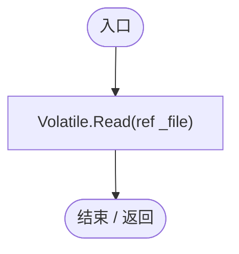

## Failure.get · L24

`public string Failure`

### Editor / Player · 语法控制结构 / 声明（非CFG）

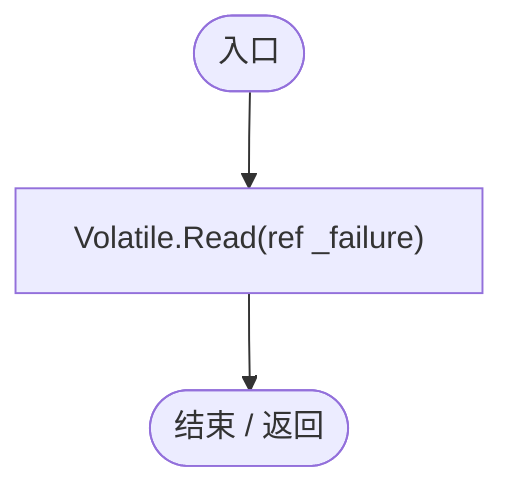

## FallbackReason.get · L25

`get`

### Editor / Player · 语法控制结构 / 声明（非CFG）

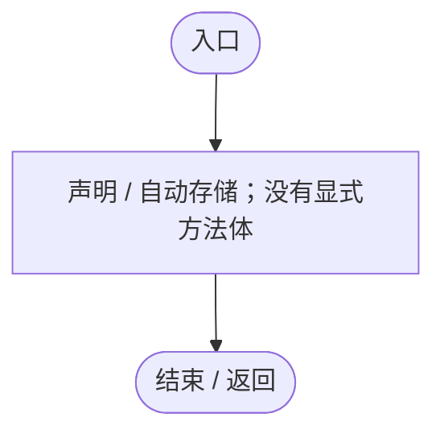

## SessionLogWriter.ctor · L26

`public SessionLogWriter(RuntimeLogSettings settings,string preferredDirectory,string fallbackDirectory)`

### Editor / Player · Roslyn编译器控制流

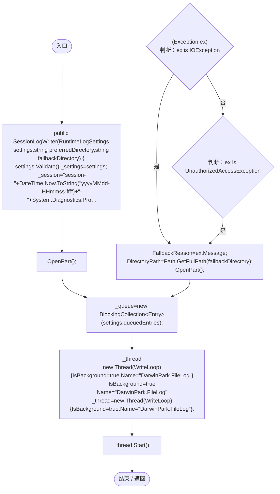

项目内调用/回调引用：

- [RuntimeLogSettings.Validate · L14](ade1290a5194a825.md#m362aa19b15ccb5ce)（方法）
- [SessionLogWriter.OpenPart · L92](40cf249053355538.md#m12aa53cd46750adb)（方法）
- [SessionLogWriter.WriteLoop · L57](40cf249053355538.md#m896eb7bc22394aaf)（方法）

## Write · L40

`public void Write(string message,string stack,LogType type)`

### Editor / Player · Roslyn编译器控制流

```mermaid
flowchart TD
  b0(["入口"])
  b1{"判断：Volatile.Read(ref _stopped)!=0"}
  b2{"判断：Failure!=null"}
  b3{"message<br/>判断：message"}
  b4["message"]
  b5["&quot;&quot;"]
  b6["detail=message??&quot;&quot;"]
  b7{"判断：type!=LogType.Log"}
  b8{"判断：string.IsNullOrWhiteSpace(stack)"}
  b9["detail+=&quot;\n&quot;+stack;"]
  b10{"判断：detail.Length&gt;_settings.maximumEntryCharacters"}
  b11["detail=detail.Substring(0,_settings.maximumEntryCharacters)+&quot;…[已截断]&quot;;"]
  b12["new Entry{text=DateTimeOffset.Now.ToString(&quot;O&quot;)+&quot; [&quot;+type+&quot;] [线程 &quot;+Thread.CurrentThread.ManagedThreadId+&quot;] &quot;+detail,important=type==LogType.Error&#124;&#124;type==LogType.Exception&#124;&#124;type==LogType.Assert}<br/>text=DateTimeOffset.Now.ToString(&quot;O&quot;)+&quot; [&quot;+…"]
  b13{"判断：type==LogType.Error"}
  b14{"判断：type==LogType.Exception"}
  b15["type==LogType.Assert"]
  b16["type==LogType.Error&#124;&#124;type==LogType.Exception&#124;&#124;type==LogType.Assert"]
  b17["important=type==LogType.Error&#124;&#124;type==LogType.Exception&#124;&#124;type==LogType.Assert"]
  b18["entry=new Entry{text=DateTimeOffset.Now.ToString(&quot;O&quot;)+&quot; [&quot;+type+&quot;] [线程 &quot;+Thread.CurrentThread.ManagedThreadId+&quot;] &quot;+detail,important=type==LogType.Error&#124;&#124;type==LogType.Exception&#124;&#124;type==LogType.Assert}"]
  b19{"判断：_queue.TryAdd(entry)"}
  b20["Interlocked.Increment(ref _dropped);"]
  b21["连接 / 离开区域"]
  b22(["结束 / 返回"])
  b0 --> b1
  b1 -->|"否"| b2
  b1 -->|"是"| b22
  b2 -->|"是"| b22
  b2 -->|"否"| b3
  b3 -->|"否"| b4
  b3 -->|"是"| b5
  b4 --> b6
  b5 --> b6
  b6 --> b7
  b7 -->|"是"| b8
  b7 -->|"否"| b10
  b8 -->|"否"| b9
  b8 -->|"是"| b10
  b9 --> b10
  b10 -->|"是"| b11
  b10 -->|"否"| b12
  b11 --> b12
  b12 --> b13
  b13 -->|"否"| b14
  b13 -->|"是"| b16
  b14 -->|"否"| b15
  b14 -->|"是"| b16
  b15 --> b17
  b16 --> b17
  b17 --> b18
  b18 --> b19
  b19 -->|"否"| b20
  b19 -->|"是"| b22
  b20 --> b22
  b21 --> b22
  b19 -. "保护区可能异常（示意）" .-> b21

```

## Flush · L49

`public bool Flush()`

### Editor / Player · Roslyn编译器控制流

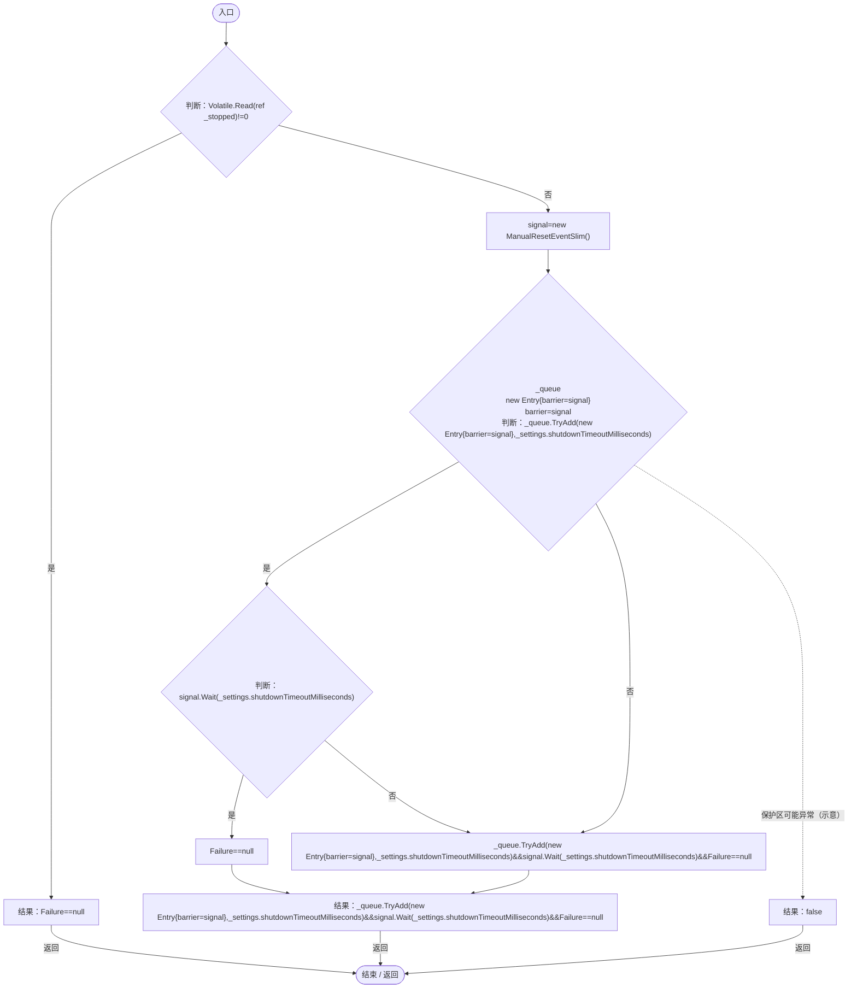

## WriteLoop · L57

`private void WriteLoop()`

### Editor / Player · Roslyn编译器控制流

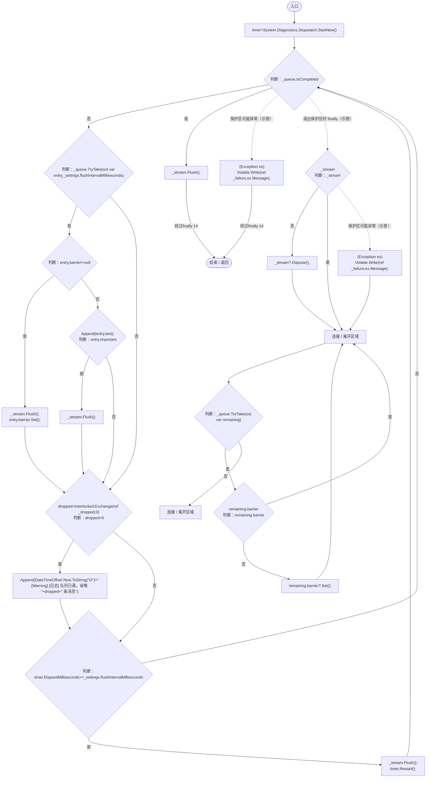

项目内调用/回调引用：

- [SessionLogWriter.Append · L86](40cf249053355538.md#md911c8294589968c)（方法）

## Append · L86

`private void Append(string text)`

### Editor / Player · Roslyn编译器控制流

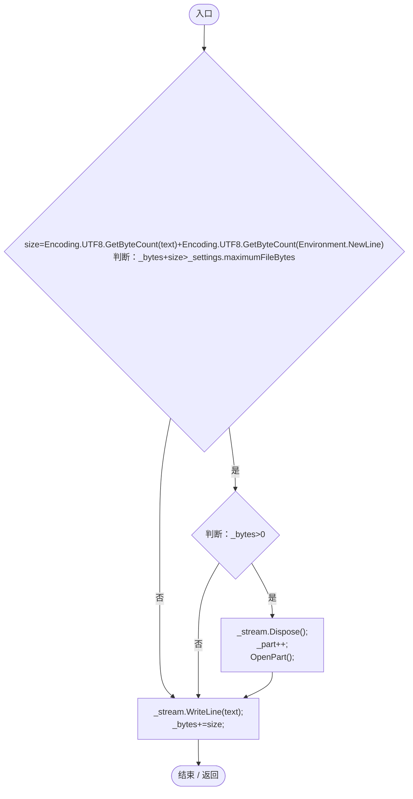

项目内调用/回调引用：

- [SessionLogWriter.OpenPart · L92](40cf249053355538.md#m12aa53cd46750adb)（方法）

## OpenPart · L92

`private void OpenPart()`

### Editor / Player · Roslyn编译器控制流

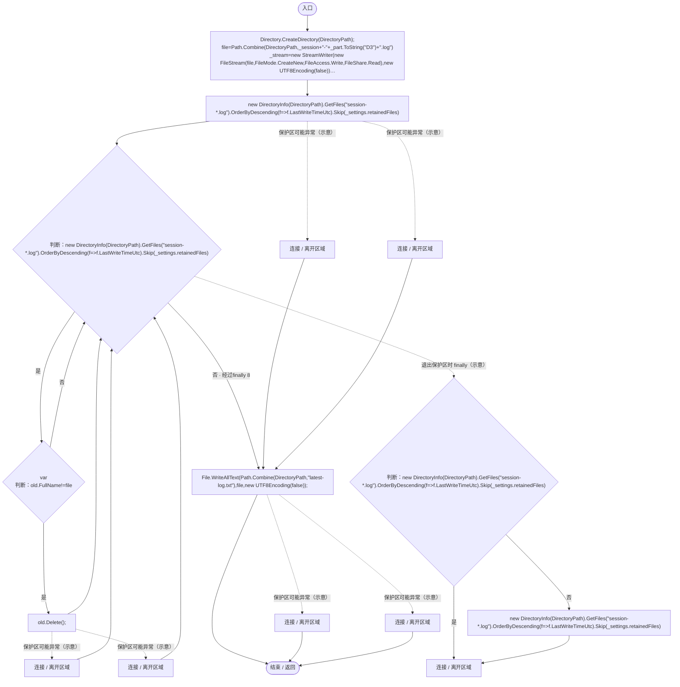

项目内调用/回调引用：

- [SessionLogWriter.DirectoryPath.get · L22](40cf249053355538.md#m87f743b3f976472b)（访问器）
- [SessionLogWriter.回调@99 · L99](40cf249053355538.md#m4abaebe93770372a)（回调/委托）

## 回调@99 · L99

`f … => 回调`

### Editor / Player · Roslyn编译器控制流

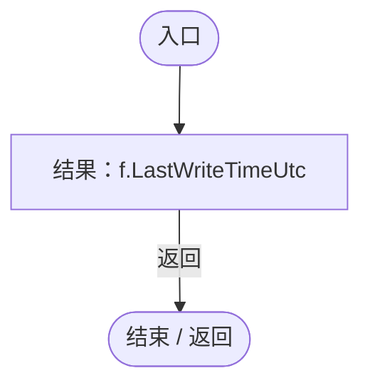

## Dispose · L105

`public void Dispose()`

### Editor / Player · Roslyn编译器控制流

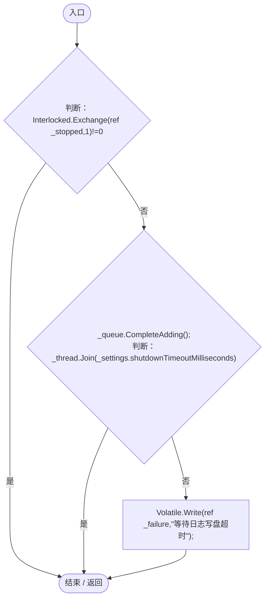
