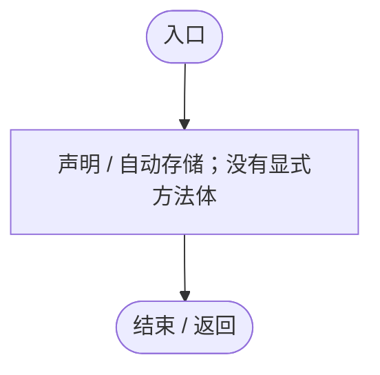
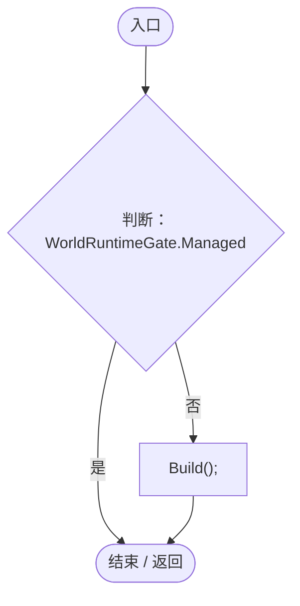
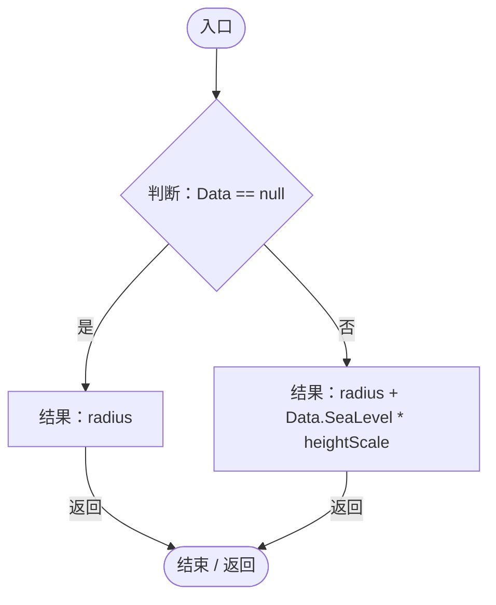
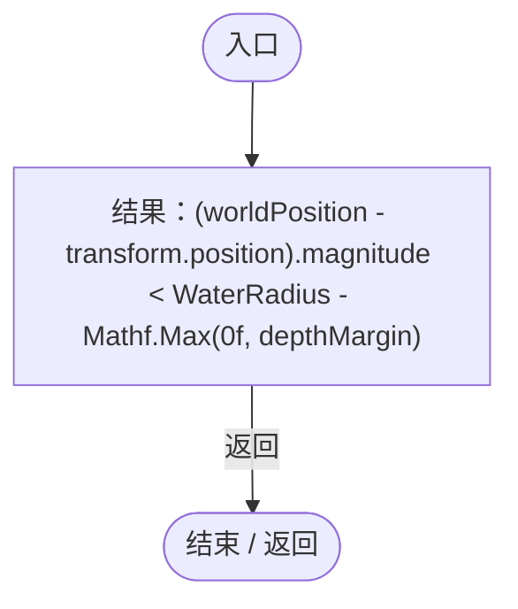
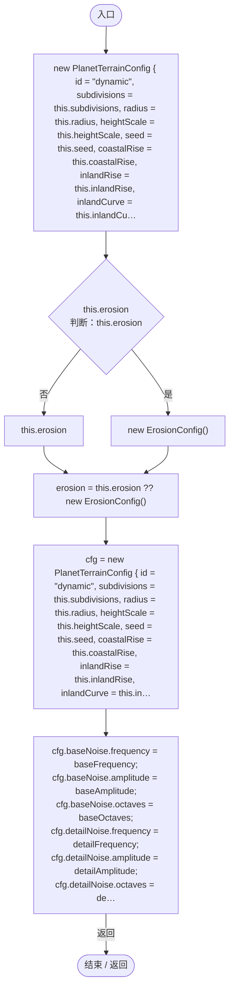
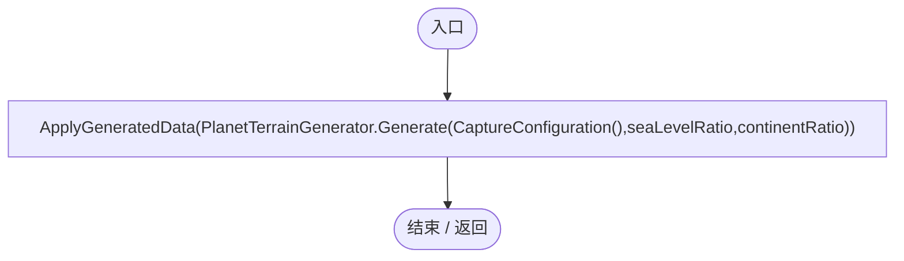
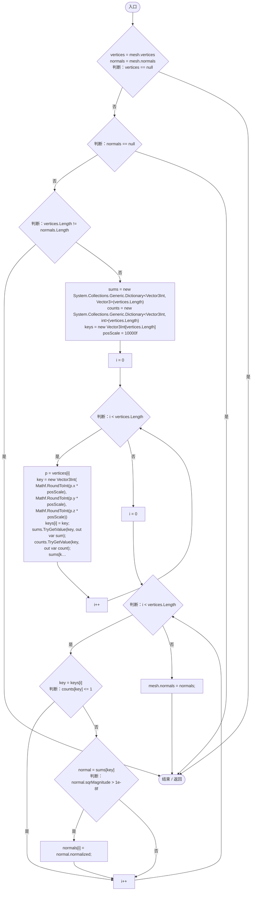

```mermaid
flowchart TD
  b0(["入口"])
  b1{"Data=data;<br/>判断：Data == null"}
  b2["Log.Error(Log.Tag.Planet, &quot;地形生成失败：生成器返回空数据&quot;);"]
  b3{"mc = GetComponent&lt;MeshCollider&gt;()<br/>判断：mc == null"}
  b4["mc = gameObject.AddComponent&lt;MeshCollider&gt;();"]
  b5{"mc.sharedMesh = null;<br/>判断：_mesh == null"}
  b6["_mesh<br/>new Mesh { name = &quot;PlanetTerrain&quot; }<br/>name = &quot;PlanetTerrain&quot;<br/>_mesh = new Mesh { name = &quot;PlanetTerrain&quot; };"]
  b7["_mesh.indexFormat = UnityEngine.Rendering.IndexFormat.UInt32;"]
  b8{"_mesh.Clear();<br/>_mesh.vertices = Data.Vertices;<br/>_mesh.triangles = Data.Triangles;<br/>_mesh.RecalculateNormals();<br/>SmoothSeamNormals(_mesh);<br/>_mesh.RecalculateBounds();<br/>GetComponent&lt;MeshFilter&gt;().mesh = _mesh;<br/>mr = GetComponent&lt;MeshRenderer&gt;()<br/>…"}
  b9["mr.sharedMaterial = TerrainMaterial;"]
  b10{"block = new MaterialPropertyBlock()<br/>mr.GetPropertyBlock(block);<br/>block.SetFloat(&quot;_PlanetRadius&quot;, radius);<br/>block.SetFloat(&quot;_HeightScale&quot;, heightScale);<br/>block.SetFloat(&quot;_SeaLevel&quot;, Data.SeaLevel);<br/>block.SetFloat(&quot;_MaxHeight&quot;, PlanetTerrainD…"}
  b11{"判断：Data.Triangles.Length / 3 &lt;= FastMidphaseTriangleLimit"}
  b12["cooking &#124;= MeshColliderCookingOptions.UseFastMidphase;"]
  b13["mc.cookingOptions = cooking;<br/>mc.sharedMesh = _mesh;"]
  b14{"GetComponent&lt;PlanetWeatherVisuals&gt;()<br/>判断：GetComponent&lt;PlanetWeatherVisuals&gt;()"}
  b15["GetComponent&lt;PlanetWeatherVisuals&gt;()?.Rebuild();"]
  b16["minHeight = float.MaxValue<br/>maxHeight = float.MinValue<br/>mountainCells = 0<br/>totalCells = 0"]
  b17["face = 0"]
  b18{"判断：face &lt; 6"}
  b19{"hs = Data.FaceHeights[face]<br/>判断：hs == null"}
  b20["i = 0"]
  b21{"判断：i &lt; hs.Length"}
  b22{"h = hs[i]<br/>判断：h &lt; minHeight"}
  b23["minHeight = h;"]
  b24{"判断：h &gt; maxHeight"}
  b25["maxHeight = h;"]
  b26{"判断：h &gt; Data.SeaLevel + 0.10f"}
  b27["mountainCells++;"]
  b28["totalCells++;"]
  b29["i++"]
  b30["face++"]
  b31["peakAboveSea = (maxHeight - Data.SeaLevel) * heightScale<br/>oceanDepth = (Data.SeaLevel - minHeight) * heightScale<br/>Log.Info(Log.Tag.Planet, $&quot;地形生成完成：vert={Data.Vertices.Length}, seaLevel={Data.SeaLevel:F3}, waterRadius={WaterRadius:F1}, &quot; +…"]
  b32(["结束 / 返回"])
  b0 --> b1
  b1 -->|"是"| b2
  b1 -->|"否"| b3
  b2 --> b32
  b3 -->|"是"| b4
  b3 -->|"否"| b5
  b4 --> b5
  b5 -->|"是"| b6
  b5 -->|"否"| b8
  b6 --> b7
  b7 --> b8
  b8 -->|"是"| b9
  b8 -->|"否"| b10
  b9 --> b10
  b10 -->|"是"| b11
  b10 -->|"否"| b13
  b11 -->|"是"| b12
  b11 -->|"否"| b13
  b12 --> b13
  b13 --> b14
  b14 -->|"否"| b15
  b14 -->|"是"| b16
  b15 --> b16
  b16 --> b17
  b17 --> b18
  b18 -->|"是"| b19
  b18 -->|"否"| b31
  b19 -->|"是"| b30
  b19 -->|"否"| b20
  b20 --> b21
  b21 -->|"是"| b22
  b21 -->|"否"| b30
  b22 -->|"是"| b23
  b22 -->|"否"| b24
  b23 --> b24
  b24 -->|"是"| b25
  b24 -->|"否"| b26
  b25 --> b26
  b26 -->|"是"| b27
  b26 -->|"否"| b28
  b27 --> b28
  b28 --> b29
  b29 --> b21
  b30 --> b18
  b31 --> b32

```

# PlanetTerrainMeshBuilder.cs

[返回总索引](../README.md) · `Runtime` · `Assets/DarwinPark/Planet/Terrain/PlanetTerrainMeshBuilder.cs`

[源文件](../../../Assets/DarwinPark/Planet/Terrain/PlanetTerrainMeshBuilder.cs) · 源码校验：`881dee28605e863d35e8dbcffee6b869a61496bec44128f1e9e25e3f9fb6ae01`

方法按源文件位置排列。事件/回调引用不表示立即执行；分支与异常说明见总索引。完整源码与可点击关系图请打开离线手册。

## Data.get · L78

`get`

### Editor / Player · 语法控制结构 / 声明（非CFG）

## Data.set · L78

`private set`

### Editor / Player · 语法控制结构 / 声明（非CFG）

## Start · L82

`private void Start()`

★ 适配：有世界选择流程时延迟生成，避免菜单出现前阻塞。

### Editor / Player · Roslyn编译器控制流

项目内调用/回调引用：

- [PlanetTerrainMeshBuilder.Build · L158](415285cf043354a9.md#m3cb263b66d834f1f)（方法）

## WaterRadius.get · L94

`get`

### Editor / Player · Roslyn编译器控制流

项目内调用/回调引用：

- [PlanetTerrainMeshBuilder.Data.get · L78](415285cf043354a9.md#m8382f579717fbc6d)（访问器）

## IsSubmerged · L102

`public bool IsSubmerged(Vector3 worldPosition, float depthMargin = 0f)`

★ 适配：判断世界坐标是否位于海平面以下。

### Editor / Player · Roslyn编译器控制流

项目内调用/回调引用：

- [PlanetTerrainMeshBuilder.WaterRadius.get · L94](415285cf043354a9.md#m28d8809083881ec1)（访问器）

## CaptureConfiguration · L108

`public PlanetTerrainConfig CaptureConfiguration()`

★ 适配：纯参数快照供后台计算；网格上传留在主线程。

### Editor / Player · Roslyn编译器控制流

## Build · L158

`public void Build()`

### Editor / Player · Roslyn编译器控制流

项目内调用/回调引用：

- [PlanetTerrainMeshBuilder.ApplyGeneratedData · L160](415285cf043354a9.md#m3e899cb84c9a0081)（方法）
- [PlanetTerrainGenerator.Generate · L20](cde9e7b164fab46e.md#m7c6d74a69a660a78)（方法）
- [PlanetTerrainMeshBuilder.CaptureConfiguration · L108](415285cf043354a9.md#mec13ac0a32e0de61)（方法）

## ApplyGeneratedData · L160

`public void ApplyGeneratedData(PlanetTerrainData data)`

★ 适配：后台计算完成后一次接入原网格/碰撞/天气装配链路。

### Editor / Player · Roslyn编译器控制流

项目内调用/回调引用：

- [PlanetTerrainMeshBuilder.Data.set · L78](415285cf043354a9.md#mad65b22f2ee22e76)（访问器）
- [PlanetTerrainMeshBuilder.Data.get · L78](415285cf043354a9.md#m8382f579717fbc6d)（访问器）
- [Log.Error · L43](735e5abf0df2bddc.md#m2addd5e1d74b000d)（方法）
- [PlanetTerrainMeshBuilder.SmoothSeamNormals · L244](415285cf043354a9.md#mb208a59e4b3471a8)（方法）
- [PlanetWeatherVisuals.Rebuild · L38](2d18e9bc2efd11b8.md#mcf4d95bea5ecf2c6)（方法）
- [Log.Info · L31](735e5abf0df2bddc.md#md1fe08215a3ce4d3)（方法）
- [PlanetTerrainMeshBuilder.WaterRadius.get · L94](415285cf043354a9.md#m28d8809083881ec1)（访问器）

## SmoothSeamNormals · L244

`private static void SmoothSeamNormals(Mesh mesh)`

把同一位置（主要是 6 面接缝）的重复顶点法线取平均并归一化。

### Editor / Player · Roslyn编译器控制流

