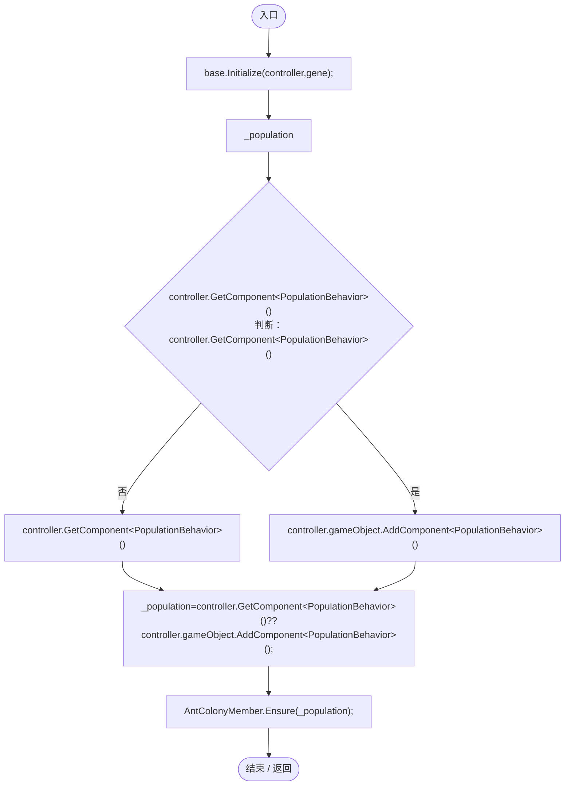
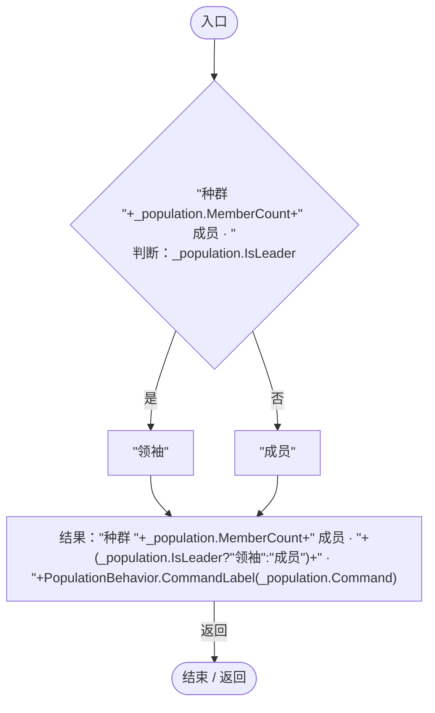

# PopulationGeneLogic.cs

[返回总索引](../README.md) · `Runtime` · `Assets/DarwinPark/Entities/Logic/PopulationGeneLogic.cs`

[源文件](../../../Assets/DarwinPark/Entities/Logic/PopulationGeneLogic.cs) · 源码校验：`3781594c7eef7357ce3496309c49cfe90de09667afae8adfa6812961c4198b9a`

方法按源文件位置排列。事件/回调引用不表示立即执行；分支与异常说明见总索引。完整源码与可点击关系图请打开离线手册。

## Initialize · L9

`public override void Initialize(EntityGeneController controller,GeneInstance gene)`

### Editor / Player · Roslyn编译器控制流

项目内调用/回调引用：

- [TerritoryGeneLogic.Initialize · L9](539b07a85ca816cf.md#m2a1dd29725a6fe3f)（方法）
- [AntColonyMember.Ensure · L51](baebd85c05598377.md#m408f716118716988)（方法）

## GetTooltipInfo · L13

`public override string GetTooltipInfo()`

### Editor / Player · Roslyn编译器控制流

项目内调用/回调引用：

- [PopulationBehavior.CommandLabel · L208](21e4f62f75a9a80f.md#m7907c38716c35174)（方法）
- [PopulationBehavior.Command.get · L23](21e4f62f75a9a80f.md#md6a4209cecb72885)（访问器）
