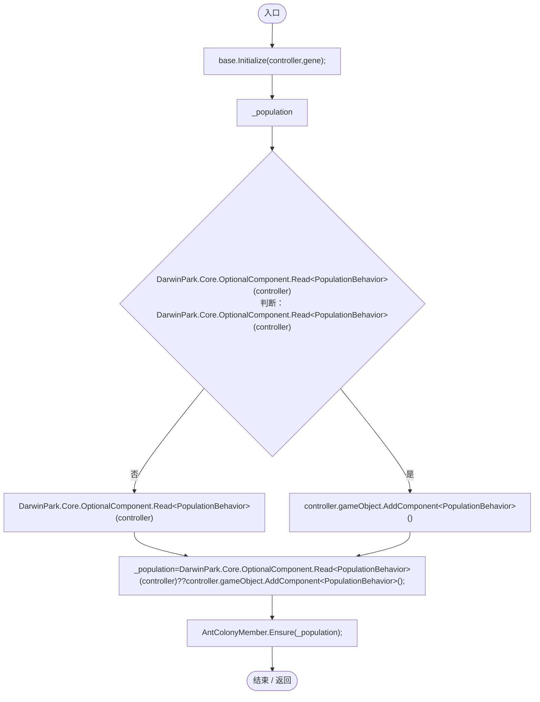
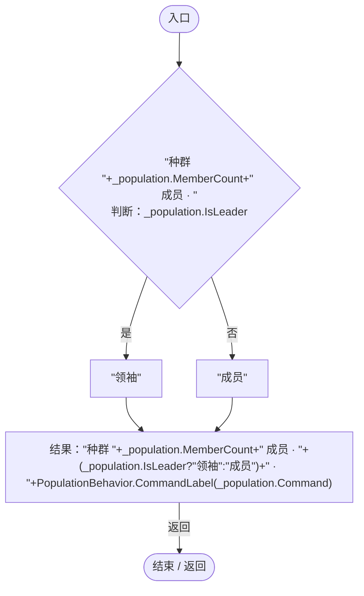

# PopulationGeneLogic.cs

[返回总索引](../README.md) · `Runtime` · `Assets/DarwinPark/Entities/Logic/PopulationGeneLogic.cs`

[源文件](../../../Assets/DarwinPark/Entities/Logic/PopulationGeneLogic.cs) · 源码校验：`f049cd459f3facc08e606c9d1c14ba828b8e458f4275fd8fa57f59146ad4c005`

方法按源文件位置排列。事件/回调引用不表示立即执行；分支与异常说明见总索引。完整源码与可点击关系图请打开离线手册。

## Initialize · L10

`public override void Initialize(EntityGeneController controller,GeneInstance gene)`

### Editor / Player · Roslyn编译器控制流

项目内调用/回调引用：

- [TerritoryGeneLogic.Initialize · L10](539b07a85ca816cf.md#m38bba9dfff39a4cd)（方法）
- [OptionalComponent.Read · L7](806c46b42ced4d36.md#m69622a4dee165c5a)（方法）
- [AntColonyMember.Ensure · L61](baebd85c05598377.md#m4e1194d3f46affcd)（方法）

## GetTooltipInfo · L14

`public override string GetTooltipInfo()`

### Editor / Player · Roslyn编译器控制流

项目内调用/回调引用：

- [PopulationBehavior.CommandLabel · L214](21e4f62f75a9a80f.md#mcafdcc62475a87c3)（方法）
- [PopulationBehavior.Command.get · L25](21e4f62f75a9a80f.md#m9d9e3eebbb011253)（访问器）
