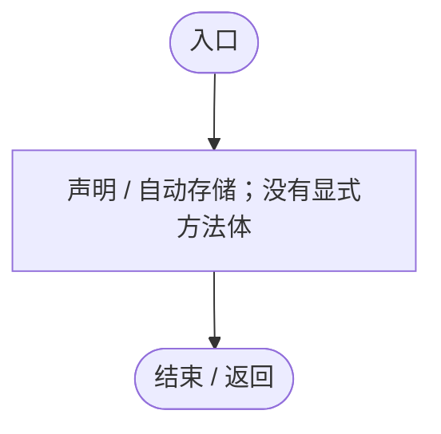
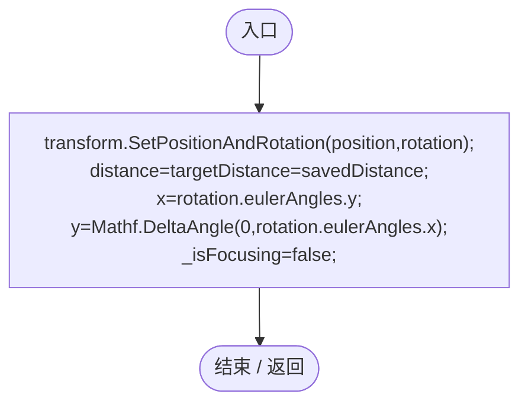
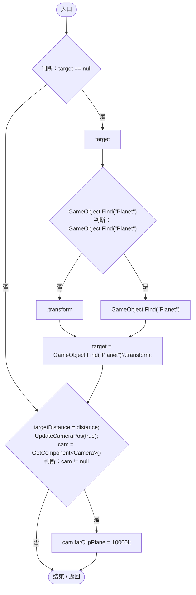
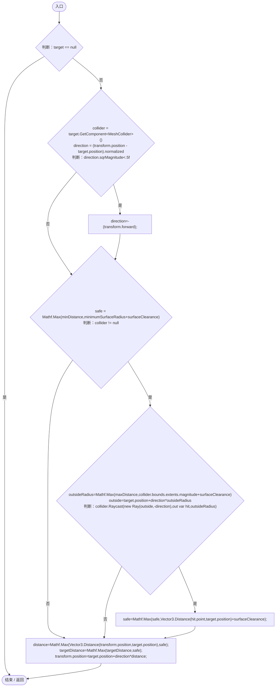
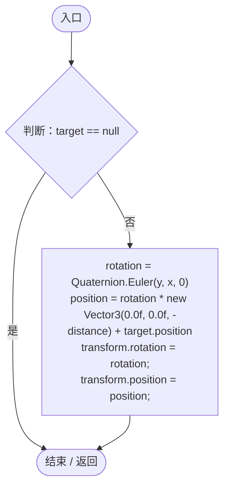
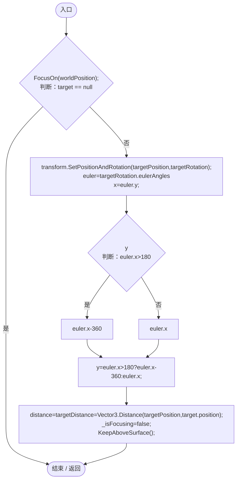
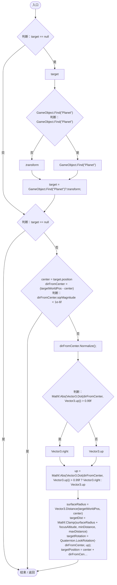

```mermaid
flowchart TD
  b0(["入口"])
  b1{"判断：DarwinPark.Core.GameInputGate.Blocked"}
  b2{"判断：EntityViewActive"}
  b3{"判断：target == null"}
  b4{"判断：EventSystem.current != null"}
  b5["EventSystem.current.IsPointerOverGameObject()"]
  b6["EventSystem.current != null"]
  b7["pointerOverUI = EventSystem.current != null &amp;&amp; EventSystem.current.IsPointerOverGameObject()"]
  b8{"判断：WorldAuthority.RtsMode"}
  b9["2"]
  b10["0"]
  b11["dragButton=WorldAuthority.RtsMode?2:0"]
  b12{"判断：Input.GetMouseButtonDown(dragButton)"}
  b13{"_leftDragStarted<br/>判断：IsDraggingUI"}
  b14["!pointerOverUI"]
  b15["!IsDraggingUI"]
  b16["_leftDragStarted=!IsDraggingUI &amp;&amp; !pointerOverUI;"]
  b17["_leftDragOrigin=Input.mousePosition;"]
  b18{"判断：Input.GetMouseButtonUp(dragButton)"}
  b19{"判断：IsDraggingUI"}
  b20["_leftDragStarted=false;"]
  b21{"判断：_leftDragStarted"}
  b22{"判断：pointerOverUI"}
  b23{"判断：Input.GetMouseButton(dragButton)"}
  b24{"判断：Vector2.Distance(_leftDragOrigin,(Vector2)Input.mousePosition)&gt;dragThresholdPixels"}
  b25["_isFocusing = false;<br/>distRatio = Mathf.InverseLerp(minDistance, maxDistance, distance)<br/>sensitivity = Mathf.Lerp(0.05f, 1.0f, distRatio)"]
  b26{"dragSpeedMultiplier<br/>判断：Input.GetKey(KeyCode.LeftShift)"}
  b27{"判断：Input.GetKey(KeyCode.RightShift)"}
  b28["shiftDragMultiplier"]
  b29["1"]
  b30["multiplier=dragSpeedMultiplier*((Input.GetKey(KeyCode.LeftShift)&#124;&#124;Input.GetKey(KeyCode.RightShift))?shiftDragMultiplier:1)"]
  b31["x += Input.GetAxis(&quot;Mouse X&quot;) * baseRotateSpeed * sensitivity * 0.02f * multiplier;<br/>y -= Input.GetAxis(&quot;Mouse Y&quot;) * baseRotateSpeed * sensitivity * 0.02f * multiplier;<br/>y = Mathf.Clamp(y, -85f, 85f);"]
  b32{"scroll = Input.GetAxis(&quot;Mouse ScrollWheel&quot;)<br/>判断：IsDraggingUI"}
  b33{"判断：pointerOverUI"}
  b34{"判断：Mathf.Abs(scroll) &gt; 0.001f"}
  b35["_isFocusing = false;<br/>targetDistance -= scroll * zoomSpeed;<br/>targetDistance = Mathf.Clamp(targetDistance, minDistance, maxDistance);"]
  b36{"判断：_isFocusing"}
  b37["transform.rotation = Quaternion.Slerp(transform.rotation, targetRotation, Time.deltaTime * 5f);<br/>focusRadius = Mathf.Lerp(Vector3.Distance(transform.position,target.position), Vector3.Distance(targetPosition,target.position),Time.deltaTim…"]
  b38{"y<br/>判断：euler.x &gt; 180"}
  b39["euler.x - 360"]
  b40["euler.x"]
  b41["y = euler.x &gt; 180 ? euler.x - 360 : euler.x;"]
  b42{"distance = Vector3.Distance(transform.position, target.position);<br/>targetDistance = distance;<br/>判断：Vector3.Distance(transform.position, targetPosition) &lt; 0.5f"}
  b43["_isFocusing = false;"]
  b44["distance = Mathf.Lerp(distance, targetDistance, Time.deltaTime * 8f);<br/>UpdateCameraPos(false);"]
  b45["KeepAboveSurface();"]
  b46(["结束 / 返回"])
  b0 --> b1
  b1 -->|"是"| b46
  b1 -->|"否"| b2
  b2 -->|"是"| b46
  b2 -->|"否"| b3
  b3 -->|"是"| b46
  b3 -->|"否"| b4
  b4 -->|"是"| b5
  b4 -->|"否"| b6
  b5 --> b7
  b6 --> b7
  b7 --> b8
  b8 -->|"是"| b9
  b8 -->|"否"| b10
  b9 --> b11
  b10 --> b11
  b11 --> b12
  b12 -->|"是"| b13
  b12 -->|"否"| b18
  b13 -->|"否"| b14
  b13 -->|"是"| b15
  b14 --> b16
  b15 --> b16
  b16 --> b17
  b17 --> b18
  b18 -->|"否"| b19
  b18 -->|"是"| b20
  b19 -->|"是"| b20
  b19 -->|"否"| b21
  b20 --> b21
  b21 -->|"是"| b22
  b21 -->|"否"| b32
  b22 -->|"否"| b23
  b22 -->|"是"| b32
  b23 -->|"是"| b24
  b23 -->|"否"| b32
  b24 -->|"是"| b25
  b24 -->|"否"| b32
  b25 --> b26
  b26 -->|"否"| b27
  b26 -->|"是"| b28
  b27 -->|"是"| b28
  b27 -->|"否"| b29
  b28 --> b30
  b29 --> b30
  b30 --> b31
  b31 --> b32
  b32 -->|"否"| b33
  b32 -->|"是"| b36
  b33 -->|"否"| b34
  b33 -->|"是"| b36
  b34 -->|"是"| b35
  b34 -->|"否"| b36
  b35 --> b36
  b36 -->|"是"| b37
  b36 -->|"否"| b44
  b37 --> b38
  b38 -->|"是"| b39
  b38 -->|"否"| b40
  b39 --> b41
  b40 --> b41
  b41 --> b42
  b42 -->|"是"| b43
  b42 -->|"否"| b45
  b43 --> b45
  b44 --> b45
  b45 --> b46

```

# OrbitCamera.cs

[返回总索引](../README.md) · `Runtime` · `Assets/DarwinPark/Core/OrbitCamera.cs`

[源文件](../../../Assets/DarwinPark/Core/OrbitCamera.cs) · 源码校验：`ab72e3cb0fff2ce86d8242a9d8c15a999709569c26ac8c94f1ccd6fef8bdc38e`

方法按源文件位置排列。事件/回调引用不表示立即执行；分支与异常说明见总索引。完整源码与可点击关系图请打开离线手册。

## EntityViewActive.get · L39

`get`

### Editor / Player · 语法控制结构 / 声明（非CFG）

## EntityViewActive.set · L39

`set`

### Editor / Player · 语法控制结构 / 声明（非CFG）

## RestoreView · L42

`public void RestoreView(Vector3 position,Quaternion rotation,float savedDistance)`

★ 适配：读档同步轨道缓存，恢复位置后不会在下一帧跳回旧镜头。

### Editor / Player · Roslyn编译器控制流

## Start · L44

`void Start()`

### Editor / Player · Roslyn编译器控制流

项目内调用/回调引用：

- [OrbitCamera.UpdateCameraPos · L146](42eb429559b42bcb.md#m91a6da243c25ca0f)（方法）

## LateUpdate · L58

`void LateUpdate()`

### Editor / Player · Roslyn编译器控制流

项目内调用/回调引用：

- [GameInputGate.Blocked.get · L8](52955daae7e592ab.md#m765763b665829633)（访问器）
- [OrbitCamera.EntityViewActive.get · L39](42eb429559b42bcb.md#m4b320edff61e06a5)（访问器）
- [OrbitCamera.UpdateCameraPos · L146](42eb429559b42bcb.md#m91a6da243c25ca0f)（方法）
- [OrbitCamera.KeepAboveSurface · L126](42eb429559b42bcb.md#m72ccc25ca5662551)（方法）

## KeepAboveSurface · L126

`private void KeepAboveSurface()`

### Editor / Player · Roslyn编译器控制流

## UpdateCameraPos · L146

`private void UpdateCameraPos(bool immediate)`

### Editor / Player · Roslyn编译器控制流

## ReturnToEntity · L157

`public void ReturnToEntity(Vector3 worldPosition)`

★ 修复（防Bug回归）：退出操控需要同步轨道角度和距离，否则下一帧会被旧轨道状态拉回原处。

### Editor / Player · Roslyn编译器控制流

项目内调用/回调引用：

- [OrbitCamera.FocusOn · L170](42eb429559b42bcb.md#m90f6d4818e064f1d)（方法）
- [OrbitCamera.KeepAboveSurface · L126](42eb429559b42bcb.md#m72ccc25ca5662551)（方法）

## FocusOn · L170

`public void FocusOn(Vector3 targetWorldPos)`

平滑聚焦到目标实体

### Editor / Player · Roslyn编译器控制流

