# EntityStateRegistry.cs

[返回总索引](../README.md) · `Runtime` · `Assets/DarwinPark/Genetics/EntityStateRegistry.cs`

[源文件](../../../Assets/DarwinPark/Genetics/EntityStateRegistry.cs) · 源码校验：`e20bd8a7726c63e9e4feef9e0efb818d602206f413990a0267b5b8b05234567c`

方法按源文件位置排列。事件/回调引用不表示立即执行；分支与异常说明见总索引。完整源码与可点击关系图请打开离线手册。

## Behavior.get · L25

`public EntityStateBehavior Behavior`

### Editor / Player · 语法控制结构 / 声明（非CFG）

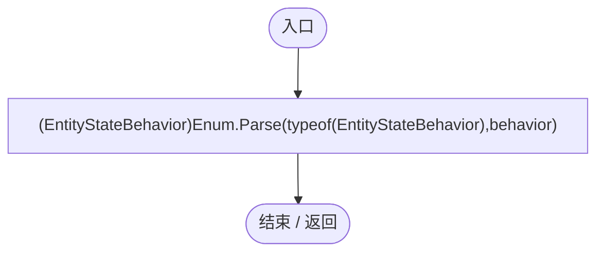

## Get · L32

`public EntityStateDefinition Get(string id)`

### Editor / Player · Roslyn编译器控制流

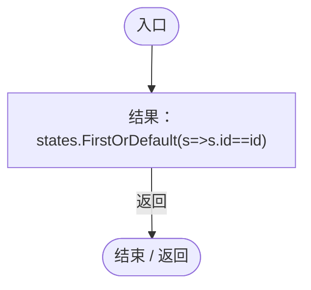

项目内调用/回调引用：

- [EntityStateDocument.回调@32 · L32](440408d2db5c7d96.md#m26cb8c644e460a22)（回调/委托）

## 回调@32 · L32

`s … => 回调`

### Editor / Player · Roslyn编译器控制流

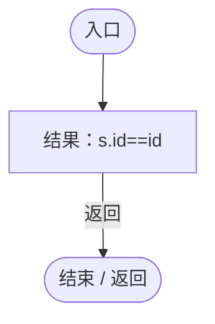

## ConfiguredPath.get · L38

`public static string ConfiguredPath`

### Editor / Player · 语法控制结构 / 声明（非CFG）

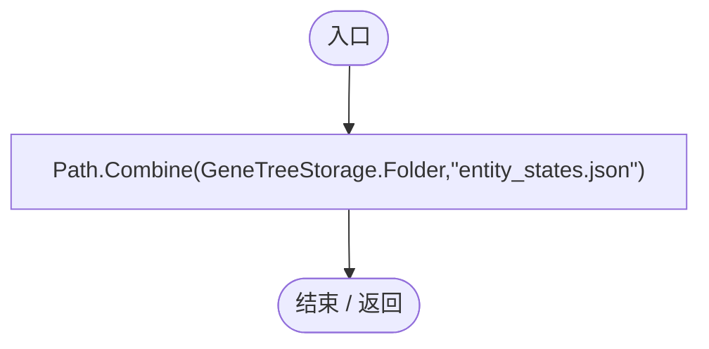

## Current.get · L41

`get`

### Editor / Player · Roslyn编译器控制流

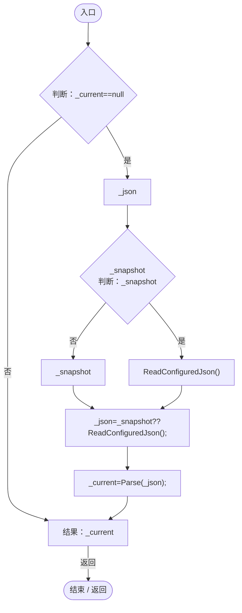

项目内调用/回调引用：

- [EntityStateRegistry.ReadConfiguredJson · L44](440408d2db5c7d96.md#mf18b710e5c3e8d7c)（方法）
- [EntityStateRegistry.Parse · L57](440408d2db5c7d96.md#m4543a04396bcbc54)（方法）

## CurrentJson.get · L43

`get`

### Editor / Player · Roslyn编译器控制流

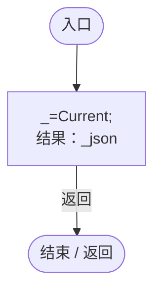

项目内调用/回调引用：

- [EntityStateRegistry.Current.get · L41](440408d2db5c7d96.md#m61b7aa1a54b9a56c)（访问器）

## ReadConfiguredJson · L44

`public static string ReadConfiguredJson()`

### Editor / Player · Roslyn编译器控制流

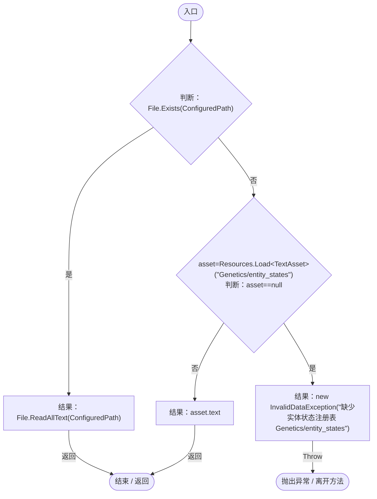

## UseSnapshot · L52

`public static void UseSnapshot(string json)`

★ 适配：存档使用自己的注册表快照；缺少该字段的旧档使用当前配置，异常必须明确阻止加载。

### Editor / Player · Roslyn编译器控制流

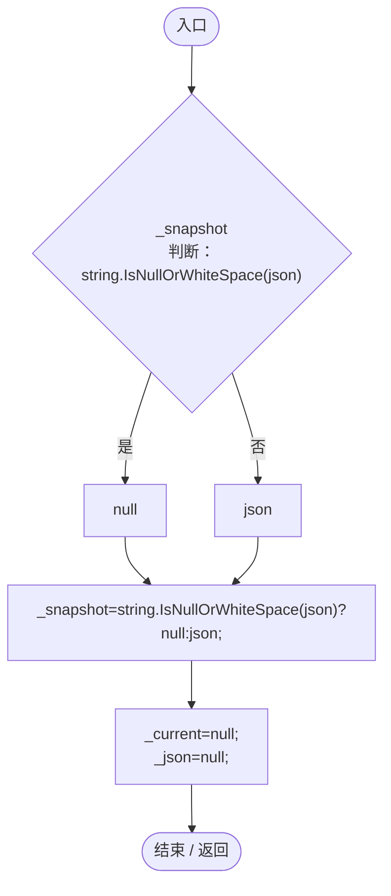

## ReloadConfigured · L54

`public static void ReloadConfigured()`

### Editor / Player · Roslyn编译器控制流

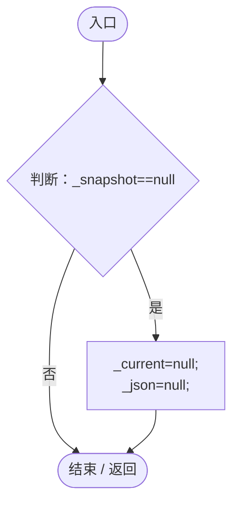

## Clear · L55

`[RuntimeInitializeOnLoadMethod(RuntimeInitializeLoadType.SubsystemRegistration)] public static void Clear()`

### Editor / Player · Roslyn编译器控制流

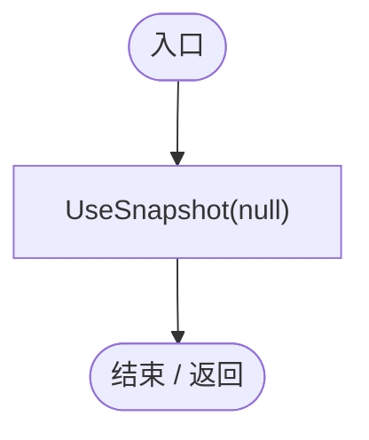

项目内调用/回调引用：

- [EntityStateRegistry.UseSnapshot · L52](440408d2db5c7d96.md#m6013e583cbf33e79)（方法）

## Parse · L57

`public static EntityStateDocument Parse(string json)`

### Editor / Player · Roslyn编译器控制流

```mermaid
flowchart TD
  b0(["入口"])
  b1{"doc=JsonUtility.FromJson&lt;EntityStateDocument&gt;(json)<br/>判断：doc==null"}
  b2{"判断：doc.version!=1"}
  b3{"判断：doc.states==null"}
  b4{"判断：doc.states.Count==0"}
  b5["结果：new InvalidDataException(&quot;实体状态注册表版本或内容无效&quot;)"]
  x5(["抛出异常 / 离开方法"])
  b6["ids=new HashSet&lt;string&gt;()"]
  b7["doc.states"]
  b8{"判断：doc.states"}
  b9["var"]
  b10{"判断：state==null"}
  b11{"state.id<br/>判断：state.id"}
  b12["state.id"]
  b13["&quot;&quot;"]
  b14{"判断：System.Text.RegularExpressions.Regex.IsMatch(state.id??&quot;&quot;,&quot;^[A-Za-z0-9_-]+$&quot;)"}
  b15{"判断：ids.Add(state.id)"}
  b16{"判断：string.IsNullOrWhiteSpace(state.displayName)"}
  b17{"判断：Enum.TryParse&lt;EntityStateBehavior&gt;(state.behavior,out var behavior)"}
  b18{"判断：Enum.IsDefined(typeof(EntityStateBehavior),behavior)"}
  b19{"判断：state.transitions==null"}
  b20["&quot;实体状态缺失、重复或行为未注册：&quot;"]
  b21{"state<br/>判断：state"}
  b22[".id"]
  b23["state"]
  b24["结果：new InvalidDataException(&quot;实体状态缺失、重复或行为未注册：&quot;+state?.id)"]
  x24(["抛出异常 / 离开方法"])
  b25{"ValidateRules(state.entryAny);<br/>判断：behavior==EntityStateBehavior.Hunt"}
  b26{"判断：string.IsNullOrEmpty(state.targetRangeAttributeId)"}
  b27["结果：new InvalidDataException(&quot;捕猎状态缺少目标感知属性：&quot;+state.id)"]
  x27(["抛出异常 / 离开方法"])
  b28["state.transitions"]
  b29{"判断：state.transitions"}
  b30{"var<br/>判断：transition==null"}
  b31["结果：new InvalidDataException(&quot;实体状态迁移为空&quot;)"]
  x31(["抛出异常 / 离开方法"])
  b32["ValidateRules(transition.any);"]
  b33["state.transitions"]
  b34["doc.states"]
  b35{"判断：ids.Contains(doc.defaultStateId)"}
  b36["结果：new InvalidDataException(&quot;实体默认状态未注册&quot;)"]
  x36(["抛出异常 / 离开方法"])
  b37["doc.states"]
  b38{"判断：doc.states"}
  b39["var"]
  b40["state.transitions"]
  b41{"判断：state.transitions"}
  b42{"var<br/>判断：ids.Contains(transition.to)"}
  b43["结果：new InvalidDataException(&quot;实体迁移目标未注册：&quot;+transition.to)"]
  x43(["抛出异常 / 离开方法"])
  b44["state.transitions"]
  b45["doc.states"]
  b46["结果：doc"]
  b47(["结束 / 返回"])
  b0 --> b1
  b1 -->|"否"| b2
  b1 -->|"是"| b5
  b2 -->|"否"| b3
  b2 -->|"是"| b5
  b3 -->|"否"| b4
  b3 -->|"是"| b5
  b4 -->|"是"| b5
  b4 -->|"否"| b6
  b5 -->|"Throw"| x5
  b6 --> b7
  b7 --> b8
  b8 -->|"是"| b9
  b8 -->|"否 · 经过finally 34"| b35
  b9 --> b10
  b10 -->|"否"| b11
  b10 -->|"是"| b20
  b11 -->|"否"| b12
  b11 -->|"是"| b13
  b12 --> b14
  b13 --> b14
  b14 -->|"是"| b15
  b14 -->|"否"| b20
  b15 -->|"是"| b16
  b15 -->|"否"| b20
  b16 -->|"否"| b17
  b16 -->|"是"| b20
  b17 -->|"是"| b18
  b17 -->|"否"| b20
  b18 -->|"是"| b19
  b18 -->|"否"| b20
  b19 -->|"是"| b20
  b19 -->|"否"| b25
  b20 --> b21
  b21 -->|"否"| b22
  b21 -->|"是"| b23
  b22 --> b24
  b23 --> b24
  b24 -->|"Throw"| x24
  b25 -->|"是"| b26
  b25 -->|"否"| b28
  b26 -->|"是"| b27
  b26 -->|"否"| b28
  b27 -->|"Throw"| x27
  b28 --> b29
  b29 -->|"是"| b30
  b29 -->|"否 · 经过finally 33"| b8
  b30 -->|"是"| b31
  b30 -->|"否"| b32
  b31 -->|"Throw"| x31
  b32 --> b29
  b35 -->|"否"| b36
  b35 -->|"是"| b37
  b36 -->|"Throw"| x36
  b37 --> b38
  b38 -->|"是"| b39
  b38 -->|"否 · 经过finally 45"| b46
  b39 --> b40
  b40 --> b41
  b41 -->|"是"| b42
  b41 -->|"否 · 经过finally 44"| b38
  b42 -->|"否"| b43
  b42 -->|"是"| b41
  b43 -->|"Throw"| x43
  b46 -->|"返回"| b47
  b29 -. "退出保护区时 finally（示意）" .-> b33
  b8 -. "退出保护区时 finally（示意）" .-> b34
  b41 -. "退出保护区时 finally（示意）" .-> b44
  b38 -. "退出保护区时 finally（示意）" .-> b45

```

项目内调用/回调引用：

- [EntityStateRegistry.ValidateRules · L74](440408d2db5c7d96.md#m03ea93b2a185d496)（方法）

## ValidateRules · L74

`private static void ValidateRules(List<EntityStateRule> rules)`

### Editor / Player · Roslyn编译器控制流

```mermaid
flowchart TD
  b0(["入口"])
  b1{"判断：rules==null"}
  b2["结果：new InvalidDataException(&quot;实体状态条件列表为空&quot;)"]
  x2(["抛出异常 / 离开方法"])
  b3["rules"]
  b4{"判断：rules"}
  b5["var"]
  b6{"rule<br/>判断：rule"}
  b7[".all"]
  b8["rule"]
  b9{"判断：rule?.all==null"}
  b10{"判断：rule.all.Count==0"}
  b11["结果：new InvalidDataException(&quot;实体状态条件组不能为空&quot;)"]
  x11(["抛出异常 / 离开方法"])
  b12["rule.all"]
  b13{"判断：rule.all"}
  b14["var"]
  b15{"判断：condition==null"}
  b16["结果：new InvalidDataException(&quot;实体状态条件为空&quot;)"]
  x16(["抛出异常 / 离开方法"])
  b17{"判断：condition.kind==&quot;stat&quot;"}
  b18{"判断：string.IsNullOrEmpty(condition.attributeId)"}
  b19{"判断：new[]{&quot;gt&quot;,&quot;lte&quot;}.Contains(condition.comparison)"}
  b20{"判断：float.IsNaN(condition.value)"}
  b21{"判断：float.IsInfinity(condition.value)"}
  b22{"判断：condition.kind==&quot;nearby_gene_state&quot;"}
  b23{"判断：string.IsNullOrEmpty(condition.geneId)"}
  b24{"判断：string.IsNullOrEmpty(condition.geneStateId)"}
  b25{"判断：string.IsNullOrEmpty(condition.rangeAttributeId)"}
  b26["new[]{&quot;present&quot;,&quot;absent&quot;}.Contains(condition.comparison)"]
  b27["condition.kind==&quot;nearby_gene_state&quot;&amp;&amp;!string.IsNullOrEmpty(condition.geneId)&amp;&amp;!string.IsNullOrEmpty(condition.geneStateId)&amp;&amp;!string.IsNullOrEmpty(condition.rangeAttributeId)&amp;&amp;new[]{&quot;present&quot;,&quot;absent&quot;}.Contains(condition.comparison)"]
  b28["condition.kind==&quot;stat&quot;&amp;&amp;!string.IsNullOrEmpty(condition.attributeId)&amp;&amp;new[]{&quot;gt&quot;,&quot;lte&quot;}.Contains(condition.comparison)&amp;&amp;!float.IsNaN(condition.value)&amp;&amp;!float.IsInfinity(condition.value)"]
  b29["valid=condition.kind==&quot;stat&quot;&amp;&amp;!string.IsNullOrEmpty(condition.attributeId)&amp;&amp;new[]{&quot;gt&quot;,&quot;lte&quot;}.Contains(condition.comparison)&amp;&amp;!float.IsNaN(condition.value)&amp;&amp;!float.IsInfinity(condition.value)&#124;&#124; condition.kind==&quot;nearby_gene_state&quot;&amp;&amp;!strin…"]
  b30{"判断：valid"}
  b31["结果：new InvalidDataException(&quot;实体状态条件类型、比较方式或参数无效：&quot;+condition.kind)"]
  x31(["抛出异常 / 离开方法"])
  b32["rule.all"]
  b33["rules"]
  b34(["结束 / 返回"])
  b0 --> b1
  b1 -->|"是"| b2
  b1 -->|"否"| b3
  b2 -->|"Throw"| x2
  b3 --> b4
  b4 -->|"是"| b5
  b4 -->|"否 · 经过finally 33"| b34
  b5 --> b6
  b6 -->|"否"| b7
  b6 -->|"是"| b8
  b7 --> b9
  b8 --> b9
  b9 -->|"否"| b10
  b9 -->|"是"| b11
  b10 -->|"是"| b11
  b10 -->|"否"| b12
  b11 -->|"Throw"| x11
  b12 --> b13
  b13 -->|"是"| b14
  b13 -->|"否 · 经过finally 32"| b4
  b14 --> b15
  b15 -->|"是"| b16
  b15 -->|"否"| b17
  b16 -->|"Throw"| x16
  b17 -->|"是"| b18
  b17 -->|"否"| b22
  b18 -->|"否"| b19
  b18 -->|"是"| b22
  b19 -->|"是"| b20
  b19 -->|"否"| b22
  b20 -->|"否"| b21
  b20 -->|"是"| b22
  b21 -->|"是"| b22
  b21 -->|"否"| b28
  b22 -->|"是"| b23
  b22 -->|"否"| b27
  b23 -->|"否"| b24
  b23 -->|"是"| b27
  b24 -->|"否"| b25
  b24 -->|"是"| b27
  b25 -->|"否"| b26
  b25 -->|"是"| b27
  b26 --> b29
  b27 --> b29
  b28 --> b29
  b29 --> b30
  b30 -->|"否"| b31
  b30 -->|"是"| b13
  b31 -->|"Throw"| x31
  b13 -. "退出保护区时 finally（示意）" .-> b32
  b4 -. "退出保护区时 finally（示意）" .-> b33

```

## ExpandTags · L89

`public static HashSet<string> ExpandTags(IEnumerable<string> tags,EntityStateDocument doc)`

### Editor / Player · Roslyn编译器控制流

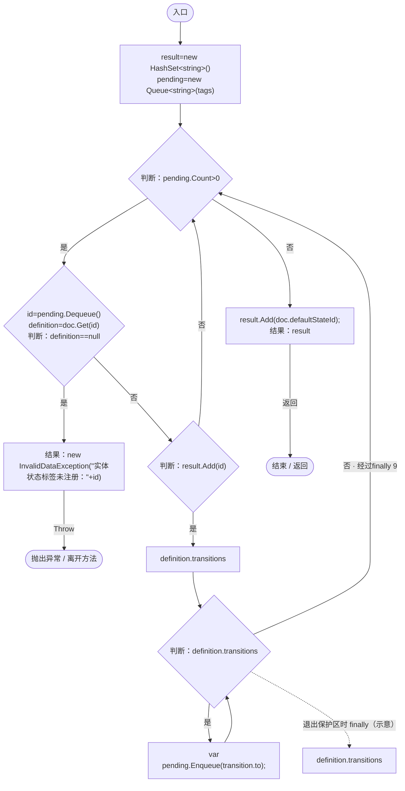

项目内调用/回调引用：

- [EntityStateDocument.Get · L32](440408d2db5c7d96.md#m52cb41ccf0c9d3c9)（方法）
