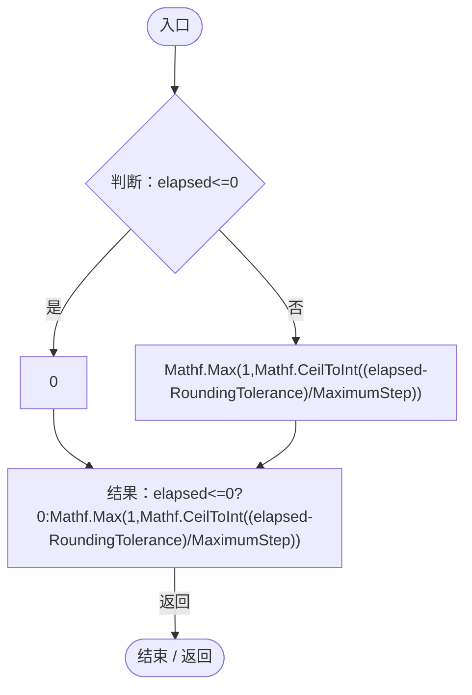
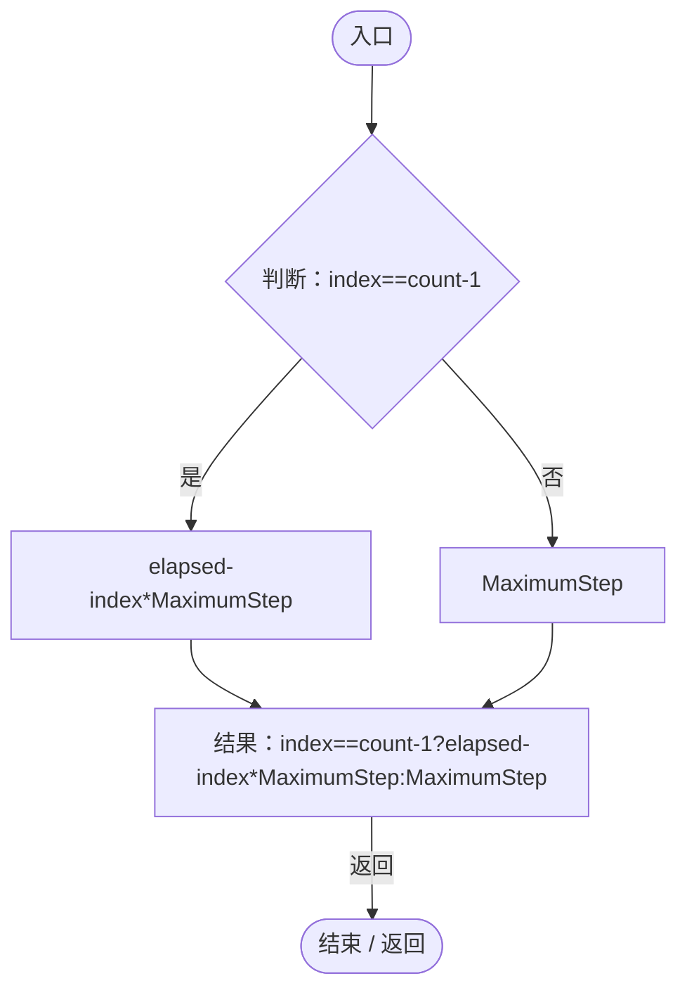

# SimulationSubsteps.cs

[返回总索引](../README.md) · `Runtime` · `Assets/DarwinPark/Core/SimulationSubsteps.cs`

[源文件](../../../Assets/DarwinPark/Core/SimulationSubsteps.cs) · 源码校验：`527be5f06f1dc41b696520ee8f5d1e99aecc330b32a1059863e12748975236c6`

方法按源文件位置排列。事件/回调引用不表示立即执行；分支与异常说明见总索引。完整源码与可点击关系图请打开离线手册。

## Count · L10

`public static int Count(float elapsed)`

### Editor / Player · Roslyn编译器控制流

## Slice · L11

`public static float Slice(float elapsed,int index,int count)`

### Editor / Player · Roslyn编译器控制流

