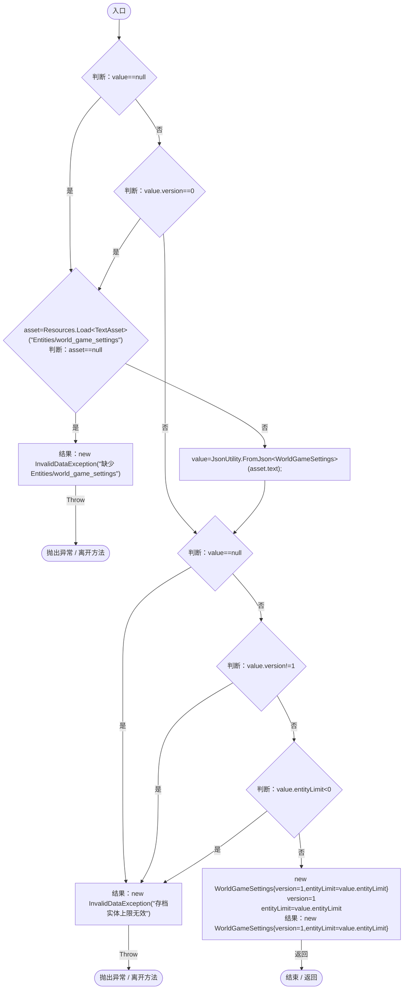
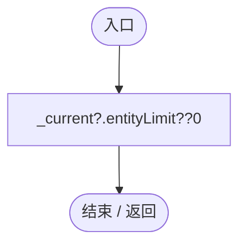
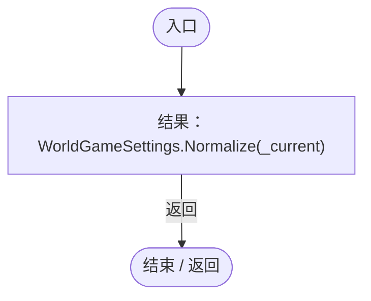
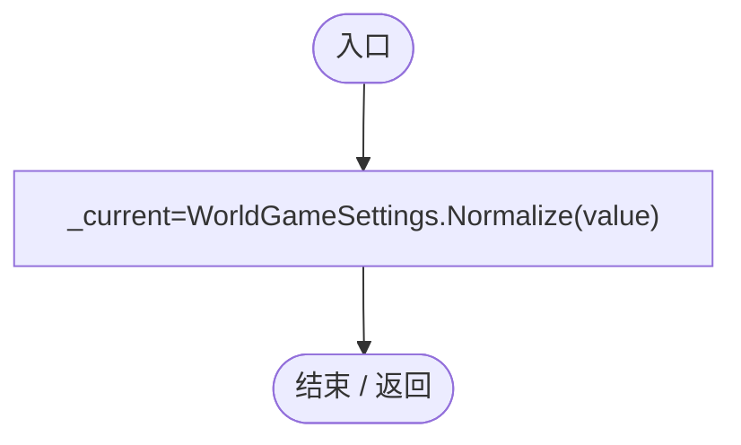
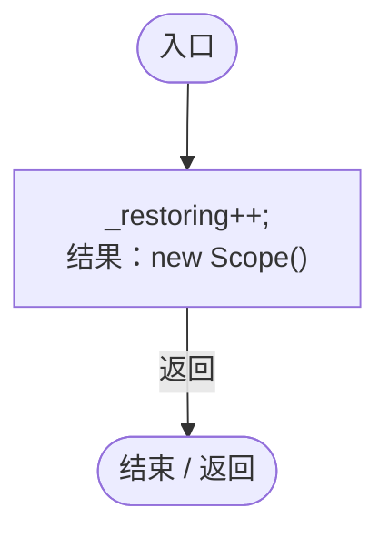
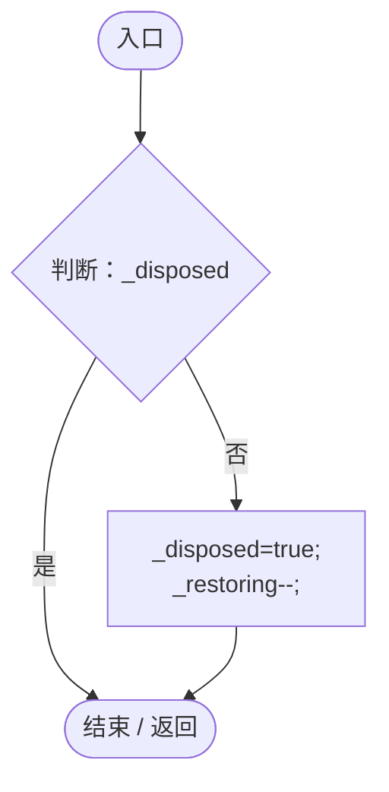
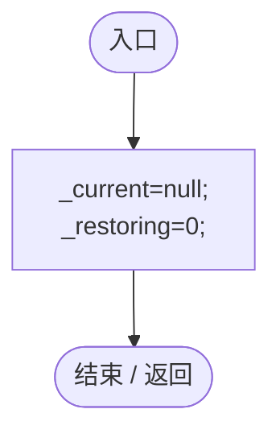

# WorldGameSettings.cs

[返回总索引](../README.md) · `Runtime` · `Assets/DarwinPark/Entities/WorldGameSettings.cs`

[源文件](../../../Assets/DarwinPark/Entities/WorldGameSettings.cs) · 源码校验：`48561a32a089349641c675b02657af31aa5ab28795afce6e5d342303fe0edfe4`

方法按源文件位置排列。事件/回调引用不表示立即执行；分支与异常说明见总索引。完整源码与可点击关系图请打开离线手册。

## Normalize · L12

`public static WorldGameSettings Normalize(WorldGameSettings value)`

### Editor / Player · Roslyn编译器控制流

## Maximum.get · L27

`public static int Maximum`

### Editor / Player · 语法控制结构 / 声明（非CFG）

## CanSpawn.get · L28

`public static bool CanSpawn`

### Editor / Player · 语法控制结构 / 声明（非CFG）

```mermaid
flowchart TD
  n2(["入口"])
  n1["WorldAuthority.IsReplica&#124;&#124;_restoring&gt;0&#124;&#124;!WorldRuntimeGate.Loading&amp;&amp;(Maximum==0&#124;&#124;EntityRegistry.All.Count&lt;Maximum)"]
  n0(["结束 / 返回"])
  n1 --> n0
  n2 --> n1

```

## Capture · L29

`public static WorldGameSettings Capture()`

### Editor / Player · Roslyn编译器控制流

项目内调用/回调引用：

- [WorldGameSettings.Normalize · L12](44f717c5df79d270.md#m61ad45483cbf0aa2)（方法）

## UseSnapshot · L30

`public static void UseSnapshot(WorldGameSettings value)`

### Editor / Player · Roslyn编译器控制流

项目内调用/回调引用：

- [WorldGameSettings.Normalize · L12](44f717c5df79d270.md#m61ad45483cbf0aa2)（方法）

## RestoreScope · L32

`public static IDisposable RestoreScope()`

★ 适配：超出新上限的旧存档必须完整恢复；按单个实体使用作用域，不跨yield持有豁免。

### Editor / Player · Roslyn编译器控制流

## Dispose · L33

`public void Dispose()`

### Editor / Player · Roslyn编译器控制流

## Clear · L34

`[RuntimeInitializeOnLoadMethod(RuntimeInitializeLoadType.SubsystemRegistration)] public static void Clear()`

### Editor / Player · Roslyn编译器控制流

