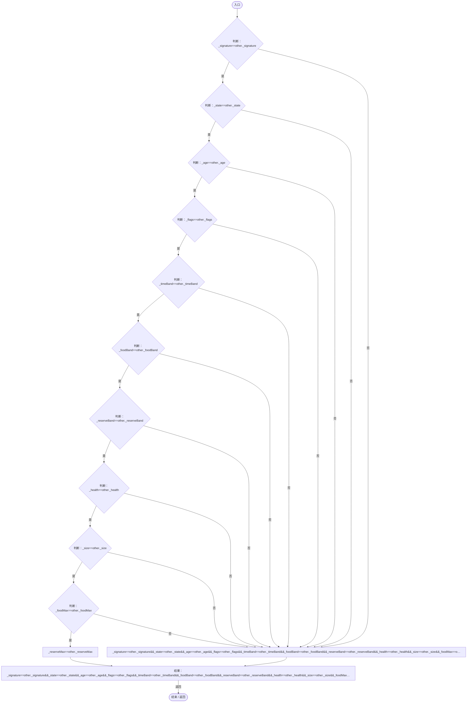
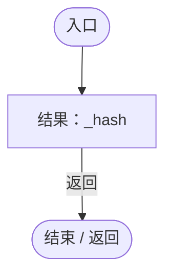
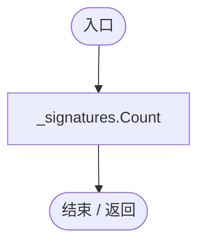

# EntityWorkScheduler.cs

[返回总索引](../README.md) · `Runtime` · `Assets/DarwinPark/Entities/Simulation/EntityWorkScheduler.cs`

[源文件](../../../Assets/DarwinPark/Entities/Simulation/EntityWorkScheduler.cs) · 源码校验：`ec96b07f09fda12eb58506df9f664dd071c5f829d0e97ee5818330ce96214b3c`

方法按源文件位置排列。事件/回调引用不表示立即执行；分支与异常说明见总索引。完整源码与可点击关系图请打开离线手册。

<a id="m2277186a9d64d8a1"></a>

## pending.get · L22

`get`


### Editor / Player · Roslyn编译器控制流


<a id="m05caefbe3ec968d5"></a>

## pending.set · L22

`set`


### Editor / Player · Roslyn编译器控制流


<a id="me0066a576bd0b975"></a>

## SharedState.ctor · L32

`public SharedState(Entry entry,GameplayTuning tuning)`


### Editor / Player · Roslyn编译器控制流


项目内调用/回调引用：

- [EntityGeneController.CurrentAge.get · L36](7494d53178552f0e.md#me8997b269f94cf38)（访问器）
- [EntityWorkScheduler.Entry.pending.get · L22](465ccdbb260bcac2.md#m2277186a9d64d8a1)（访问器）
- [EntityStats.TryGet · L90](75aa86a368efdf24.md#m24ee1433e4a70d94)（方法）
- [EntityStats.CapacityRemaining · L92](75aa86a368efdf24.md#m574f0a6509120d00)（方法）

<a id="mf566f41837097a0d"></a>

## Equals · L43

`public bool Equals(SharedState other)`


### Editor / Player · Roslyn编译器控制流



<a id="m5803d31b326a4f35"></a>

## Equals · L44

`public override bool Equals(object value)`


### Editor / Player · Roslyn编译器控制流


项目内调用/回调引用：

- [EntityWorkScheduler.SharedState.Equals · L43](465ccdbb260bcac2.md#mf566f41837097a0d)（方法）

<a id="m00cbcaa6f58b1b67"></a>

## GetHashCode · L45

`public override int GetHashCode()`


### Editor / Player · Roslyn编译器控制流



<a id="mc408cfe43b07c8ed"></a>

## RepresentativeSteps.get · L60

`get`


### Editor / Player · 语法控制结构 / 声明（非CFG）


<a id="mf198d1663d98be9f"></a>

## RepresentativeSteps.set · L60

`private set`


### Editor / Player · 语法控制结构 / 声明（非CFG）


<a id="m7216d1baa9607fe2"></a>

## SharedMemberSteps.get · L61

`get`


### Editor / Player · 语法控制结构 / 声明（非CFG）


<a id="m11f65bb1b55024bb"></a>

## SharedMemberSteps.set · L61

`private set`


### Editor / Player · 语法控制结构 / 声明（非CFG）


<a id="m80cc7658ba70a598"></a>

## DormantMembers.get · L62

`get`


### Editor / Player · 语法控制结构 / 声明（非CFG）


<a id="mbca8fbede82c05c9"></a>

## DormantMembers.set · L62

`private set`


### Editor / Player · 语法控制结构 / 声明（非CFG）


<a id="m61da9029a5ff38bd"></a>

## CohortPoolSize.get · L63

`public int CohortPoolSize`


### Editor / Player · 语法控制结构 / 声明（非CFG）


<a id="ma959ab847c48c207"></a>

## SignatureCacheSize.get · L64

`public int SignatureCacheSize`


### Editor / Player · 语法控制结构 / 声明（非CFG）



<a id="m85d78c0b3566894d"></a>

## Ensure · L65

`public static void Ensure(GameObject owner)`


### Editor / Player · Roslyn编译器控制流


<a id="mf8efb7bc626d4bca"></a>

## Awake · L66

`private void Awake()`


### Editor / Player · Roslyn编译器控制流


<a id="mb8889d98cea01f0e"></a>

## OnDestroy · L67

`private void OnDestroy()`


### Editor / Player · Roslyn编译器控制流


<a id="mfb5258928e5f7a5d"></a>

## Handled · L68

`public static bool Handled(EntityGeneController genes)`


### Editor / Player · Roslyn编译器控制流


<a id="md43b98c19bd19e9c"></a>

## Dormant · L69

`public static bool Dormant(EntityGeneController genes)`


### Editor / Player · Roslyn编译器控制流


项目内调用/回调引用：

- [EntityWorkScheduler.Handled · L68](465ccdbb260bcac2.md#mfb5258928e5f7a5d)（方法）

<a id="m6a04736e7c77ddcc"></a>

## Wake · L70

`public static void Wake(EntityGeneController genes)`


### Editor / Player · Roslyn编译器控制流


<a id="mbbfeb803ee52c5ab"></a>

## AdvanceUnscheduled · L71

`public static void AdvanceUnscheduled(EntityGeneController genes,float dt)`


### Editor / Player · Roslyn编译器控制流

```mermaid
flowchart TD
  b0(["入口"])
  b1{"判断：dt&lt;=0"}
  b2{"判断：WorldAuthority.IsReplica"}
  b3{"owed=Mathf.Min(genes.PendingSimulationTime,GameplayTuning.Current.mergeMaximumCatchupSeconds)<br/>genes.PendingSimulationTime-=owed;<br/>genes.AdvanceSimulation(dt+owed);<br/>判断：owed&gt;0"}
  b4{"判断：genes!=null"}
  b5{"判断：genes.gameObject.activeInHierarchy"}
  b6["StationaryCohortKernel.AdvanceCore(genes,owed);"]
  b7(["结束 / 返回"])
  b0 --> b1
  b1 -->|"否"| b2
  b1 -->|"是"| b7
  b2 -->|"是"| b7
  b2 -->|"否"| b3
  b3 -->|"是"| b4
  b3 -->|"否"| b7
  b4 -->|"是"| b5
  b4 -->|"否"| b7
  b5 -->|"是"| b6
  b5 -->|"否"| b7
  b6 --> b7

```

项目内调用/回调引用：

- [GameplayTuning.Current.get · L31](db546e5713b32d53.md#m557c9ecc76cc372d)（访问器）
- [EntityGeneController.AdvanceSimulation · L70](7494d53178552f0e.md#m8d432f097da8bbf7)（方法）
- [StationaryCohortKernel.AdvanceCore · L43](9d3f50e550ab5beb.md#m94052ba96a85dd98)（方法）

<a id="mb819ba724b68267a"></a>

## TryCohortOrdinal · L78

`public static bool TryCohortOrdinal(EntityGeneController genes,out int ordinal,out int count)`


### Editor / Player · Roslyn编译器控制流

```mermaid
flowchart TD
  b0(["入口"])
  b1{"ordinal=0;<br/>count=1;<br/>判断：Handled(genes)"}
  b2["结果：false"]
  b3["entry=_instance._entries[genes]<br/>ordinal=entry.ordinal;<br/>count=entry.count;<br/>结果：count&gt;1"]
  b4(["结束 / 返回"])
  b0 --> b1
  b1 -->|"否"| b2
  b1 -->|"是"| b3
  b2 -->|"返回"| b4
  b3 -->|"返回"| b4

```

项目内调用/回调引用：

- [EntityWorkScheduler.Handled · L68](465ccdbb260bcac2.md#mfb5258928e5f7a5d)（方法）

<a id="mf3e9eec9cf2e082c"></a>

## Get · L82

`private Entry Get(EntityGeneController genes)`


### Editor / Player · Roslyn编译器控制流

```mermaid
flowchart TD
  b0(["入口"])
  b1{"判断：_entries.TryGetValue(genes,out var entry)"}
  b2["结果：entry"]
  b3["entry<br/>new Entry{genes=genes,entity=genes.GetComponent&lt;DarwinEntity&gt;(),stats=genes.GetComponent&lt;EntityStats&gt;(),life=genes.GetComponent&lt;EntityLifeCycle&gt;(),vitals=genes.GetComponent&lt;EntityVitals&gt;(),environment=genes.GetComponent&lt;EntityEnvir…"]
  b4["_entries.Add(genes,entry);<br/>结果：entry"]
  b5(["结束 / 返回"])
  b0 --> b1
  b1 -->|"是"| b2
  b1 -->|"否"| b3
  b2 -->|"返回"| b5
  b3 --> b4
  b4 -->|"返回"| b5

```

<a id="m43062c87fbbfd329"></a>

## Update · L88

`private void Update()`


### Editor / Player · Roslyn编译器控制流

```mermaid
flowchart TD
  b0(["入口"])
  b1{"Advance<br/>判断：ServiceLocator.TryGet&lt;SimulationClock&gt;(out var clock)"}
  b2["clock.GameDeltaTime"]
  b3["Time.deltaTime"]
  b4["Advance(ServiceLocator.TryGet&lt;SimulationClock&gt;(out var clock)?clock.GameDeltaTime:Time.deltaTime)"]
  b5(["结束 / 返回"])
  b0 --> b1
  b1 -->|"是"| b2
  b1 -->|"否"| b3
  b2 --> b4
  b3 --> b4
  b4 --> b5

```

项目内调用/回调引用：

- [EntityWorkScheduler.Advance · L89](465ccdbb260bcac2.md#m7dd64f9f7a760a0c)（方法）
- [ServiceLocator.TryGet · L26](f2fdbe9f9ccd93cb.md#m143b24e6d58471b0)（方法）
- [SimulationClock.GameDeltaTime.get · L26](a8f444aec9614b0a.md#me7f11abae18a4f2d)（访问器）

<a id="m7dd64f9f7a760a0c"></a>

## Advance · L89

`public void Advance(float dt)`


### Editor / Player · Roslyn编译器控制流

```mermaid
flowchart TD
  b0(["入口"])
  b1{"判断：dt&lt;=0"}
  b2{"判断：WorldAuthority.IsReplica"}
  b3{"判断：_membership!=EntityRegistry.MembershipRevision"}
  b4["_present.Clear();"]
  b5["EntityRegistry.All"]
  b6{"判断：EntityRegistry.All"}
  b7{"var<br/>判断：entity!=null"}
  b8{"判断：entity.Genes!=null"}
  b9["_present.Add(entity.Genes);"]
  b10{"判断：EntityRegistry.All"}
  b11["EntityRegistry.All"]
  b12["连接 / 离开区域"]
  b13["_removed.Clear();"]
  b14["_entries.Keys"]
  b15{"判断：_entries.Keys"}
  b16{"var<br/>判断：key==null"}
  b17{"判断：_present.Contains(key)"}
  b18["_removed.Add(key);"]
  b19["_entries.Keys"]
  b20["_removed"]
  b21{"判断：_removed"}
  b22["var<br/>_entries.Remove(key);"]
  b23["_removed"]
  b24{"判断：_removed.Count&gt;0"}
  b25["_signaturesDirty=true;"]
  b26{"判断：_entries.Count==0"}
  b27["_signatures.Clear();<br/>_nextSignature=0;"]
  b28["_present"]
  b29{"判断：_present"}
  b30["var<br/>Get(genes);"]
  b31["_present"]
  b32["_membership=EntityRegistry.MembershipRevision;"]
  b33["_groups"]
  b34{"判断：_groups"}
  b35["var<br/>previous.members.Clear();<br/>previous.next=null;"]
  b36["_groups"]
  b37["_active.Clear();<br/>_controlled.Clear();<br/>_injured.Clear();<br/>_groups.Clear();<br/>_cells.Clear();<br/>_usedGroups=0;<br/>DormantMembers=0;<br/>tuning=GameplayTuning.Current"]
  b38["_entries.Values"]
  b39{"判断：_entries.Values"}
  b40["var"]
  b41{"genes=entry.genes<br/>判断：genes==null"}
  b42{"判断：genes.isActiveAndEnabled"}
  b43{"判断：entry.life==null"}
  b44["entry.life=genes.GetComponent&lt;EntityLifeCycle&gt;();"]
  b45{"判断：entry.manual==null"}
  b46["entry.manual=genes.GetComponent&lt;EntityManualControl&gt;();"]
  b47{"entry.frame=Time.frameCount;<br/>entry.ordinal=0;<br/>entry.count=1;<br/>判断：tuning.mergeStationaryEntities"}
  b48["entry.dormant=false;<br/>entry.quiet=0;<br/>QueueActive(entry);"]
  b49{"stationary=(genes.transform.position-entry.position).sqrMagnitude&lt;=tuning.mergeWakeDistance*tuning.mergeWakeDistance<br/>entry.position=genes.transform.position;<br/>判断：entry.revision!=genes.LogicRevision"}
  b50{"entry.revision=genes.LogicRevision;<br/>entry.supported=StationaryCohortKernel.Supported(genes);<br/>entry.quiet=0;<br/>entry.state=genes.GetComponent&lt;EntityStateController&gt;();<br/>entry.signature=0;<br/>_signaturesDirty=true;<br/>判断：entry.supported"}
  b51{"signature=Signature(genes)<br/>判断：_signatures.TryGetValue(signature,out entry.signature)"}
  b52["entry.signature=++_nextSignature;<br/>_signatures.Add(signature,entry.signature);"]
  b53{"判断：entry.supported"}
  b54{"entry.state<br/>判断：entry.state"}
  b55[".Current"]
  b56{"判断：.Current"}
  b57[".id"]
  b58["entry.state?.Current?.id"]
  b59{"判断：entry.state?.Current?.id"}
  b60["entry.state?.Current?.id"]
  b61["&quot;&quot;"]
  b62["&quot;&quot;"]
  b63["currentState=entry.supported?entry.state?.Current?.id??&quot;&quot;:&quot;&quot;"]
  b64{"判断：entry.stateId!=currentState"}
  b65["entry.stateId=currentState;<br/>entry.quiet=0;"]
  b66{"判断：entry.supported"}
  b67["entry.nutritionParasite=genes.GetComponent&lt;NutritionParasite&gt;();<br/>entry.parasite=genes.GetComponent&lt;ParasiteBehavior&gt;();<br/>entry.egg=genes.GetComponent&lt;EggIncubation&gt;();"]
  b68{"判断：stationary"}
  b69["Eligible(entry)"]
  b70["stationary"]
  b71["eligible=stationary&amp;&amp;Eligible(entry)"]
  b72{"entry.quiet<br/>判断：eligible"}
  b73["entry.quiet+dt"]
  b74["0"]
  b75["entry.quiet=eligible?entry.quiet+dt:0;"]
  b76{"entry.dormant<br/>判断：eligible"}
  b77["entry.quiet&gt;=tuning.mergeQuietSeconds"]
  b78["eligible"]
  b79["entry.dormant=eligible&amp;&amp;entry.quiet&gt;=tuning.mergeQuietSeconds;"]
  b80{"判断：entry.dormant"}
  b81["QueueActive(entry);"]
  b82{"DormantMembers++;<br/>entry.pending+=dt;<br/>判断：entry.pending+0.00001f&gt;=tuning.mergeInterval"}
  b83["AddGroup(entry,tuning);"]
  b84["_entries.Values"]
  b85{"判断：_signaturesDirty"}
  b86["TrimSignatures();"]
  b87["_groups"]
  b88{"判断：_groups"}
  b89["var"]
  b90["group.members"]
  b91{"判断：group.members"}
  b92["var<br/>member.count=group.members.Count;"]
  b93["group.members"]
  b94["_groups"]
  b95["AdvanceActive(_controlled,dt,tuning);<br/>AdvanceActive(_injured,dt,tuning);<br/>AdvanceActive(_active,dt,tuning);<br/>_groups.Sort((a,b)=&gt;b.priority.CompareTo(a.priority));<br/>budget=Mathf.FloorToInt(tuning.mergeGroupsPerFrame)"]
  b96["_groups"]
  b97{"判断：_groups"}
  b98["var"]
  b99{"判断：budget--&lt;=0"}
  b100["first=group.members[0]<br/>elapsed=Mathf.Min(group.time,tuning.mergeMaximumCatchupSeconds)"]
  b101["group.members"]
  b102{"判断：group.members"}
  b103["var<br/>entry.pending=Mathf.Max(0,entry.pending-elapsed);"]
  b104["group.members"]
  b105{"判断：group.members.Count==1"}
  b106{"判断：first.genes!=null"}
  b107{"判断：first.genes.isActiveAndEnabled"}
  b108{"first.genes.AdvanceSimulation(elapsed);<br/>判断：first.genes!=null"}
  b109{"判断：first.genes.isActiveAndEnabled"}
  b110["StationaryCohortKernel.AdvanceCore(first.genes,elapsed);"]
  b111["steps=Mathf.CeilToInt(elapsed/.1f)"]
  b112["step=0"]
  b113{"判断：step&lt;steps"}
  b114{"slice=Mathf.Min(.1f,elapsed-step*.1f)<br/>share=CanShare(group,first)<br/>判断：share"}
  b115["speed=StationaryCohortKernel.LifeSpeed(first.genes)<br/>delta=StationaryCohortKernel.Sample(first.genes,first.stats,first.environment,first.vitals,slice)<br/>RepresentativeSteps++;"]
  b116["index=0"]
  b117{"判断：index&lt;group.members.Count"}
  b118{"entry=group.members[index]<br/>判断：index&gt;0"}
  b119["StationaryCohortKernel.Apply(first.environment,entry.genes,entry.stats,entry.environment,entry.entity,delta);<br/>SharedMemberSteps++;"]
  b120{"entry.life<br/>判断：entry.life"}
  b121["entry.life?.AdvanceShared(slice,speed);"]
  b122{"判断：entry.genes.gameObject.activeInHierarchy"}
  b123{"entry.life<br/>判断：entry.life"}
  b124[".HasDied"]
  b125["entry.life"]
  b126{"判断：entry.life?.HasDied!=true"}
  b127{"判断：entry.reproductionRevision!=entry.genes.LogicRevision"}
  b128["entry.reproduction=StationaryCohortKernel.PrimaryReproduction(entry.genes);<br/>entry.reproductionRevision=entry.genes.LogicRevision;"]
  b129{"entry.reproduction<br/>判断：entry.reproduction"}
  b130["entry.reproduction?.OnUpdate(slice);"]
  b131["index++"]
  b132["group.members"]
  b133{"判断：group.members"}
  b134{"var<br/>判断：entry.genes==null"}
  b135{"判断：entry.genes.gameObject.activeInHierarchy"}
  b136["entry.genes.AdvanceSimulation(slice);<br/>StationaryCohortKernel.AdvanceCore(entry.genes,slice);"]
  b137["group.members"]
  b138["step++"]
  b139["_groups"]
  b140(["结束 / 返回"])
  b0 --> b1
  b1 -->|"否"| b2
  b1 -->|"是"| b140
  b2 -->|"是"| b140
  b2 -->|"否"| b3
  b3 -->|"是"| b4
  b3 -->|"否"| b33
  b4 --> b5
  b5 --> b6
  b6 -->|"是"| b7
  b6 -->|"否 · 经过finally 10"| b13
  b7 -->|"是"| b8
  b7 -->|"否"| b6
  b8 -->|"是"| b9
  b8 -->|"否"| b6
  b9 --> b6
  b10 -->|"否"| b11
  b10 -->|"是"| b12
  b11 --> b12
  b13 --> b14
  b14 --> b15
  b15 -->|"是"| b16
  b15 -->|"否 · 经过finally 19"| b20
  b16 -->|"否"| b17
  b16 -->|"是"| b18
  b17 -->|"否"| b18
  b17 -->|"是"| b15
  b18 --> b15
  b20 --> b21
  b21 -->|"是"| b22
  b21 -->|"否 · 经过finally 23"| b24
  b22 --> b21
  b24 -->|"是"| b25
  b24 -->|"否"| b26
  b25 --> b26
  b26 -->|"是"| b27
  b26 -->|"否"| b28
  b27 --> b28
  b28 --> b29
  b29 -->|"是"| b30
  b29 -->|"否 · 经过finally 31"| b32
  b30 --> b29
  b32 --> b33
  b33 --> b34
  b34 -->|"是"| b35
  b34 -->|"否 · 经过finally 36"| b37
  b35 --> b34
  b37 --> b38
  b38 --> b39
  b39 -->|"是"| b40
  b39 -->|"否 · 经过finally 84"| b85
  b40 --> b41
  b41 -->|"否"| b42
  b41 -->|"是"| b39
  b42 -->|"否"| b39
  b42 -->|"是"| b43
  b43 -->|"是"| b44
  b43 -->|"否"| b45
  b44 --> b45
  b45 -->|"是"| b46
  b45 -->|"否"| b47
  b46 --> b47
  b47 -->|"否"| b48
  b47 -->|"是"| b49
  b48 --> b39
  b49 -->|"是"| b50
  b49 -->|"否"| b53
  b50 -->|"是"| b51
  b50 -->|"否"| b53
  b51 -->|"否"| b52
  b51 -->|"是"| b53
  b52 --> b53
  b53 -->|"是"| b54
  b53 -->|"否"| b62
  b54 -->|"否"| b55
  b54 -->|"是"| b58
  b55 --> b56
  b56 -->|"否"| b57
  b56 -->|"是"| b58
  b57 --> b59
  b58 --> b59
  b59 -->|"否"| b60
  b59 -->|"是"| b61
  b60 --> b63
  b61 --> b63
  b62 --> b63
  b63 --> b64
  b64 -->|"是"| b65
  b64 -->|"否"| b66
  b65 --> b66
  b66 -->|"是"| b67
  b66 -->|"否"| b68
  b67 --> b68
  b68 -->|"是"| b69
  b68 -->|"否"| b70
  b69 --> b71
  b70 --> b71
  b71 --> b72
  b72 -->|"是"| b73
  b72 -->|"否"| b74
  b73 --> b75
  b74 --> b75
  b75 --> b76
  b76 -->|"是"| b77
  b76 -->|"否"| b78
  b77 --> b79
  b78 --> b79
  b79 --> b80
  b80 -->|"否"| b81
  b80 -->|"是"| b82
  b81 --> b39
  b82 -->|"是"| b83
  b82 -->|"否"| b39
  b83 --> b39
  b85 -->|"是"| b86
  b85 -->|"否"| b87
  b86 --> b87
  b87 --> b88
  b88 -->|"是"| b89
  b88 -->|"否 · 经过finally 94"| b95
  b89 --> b90
  b90 --> b91
  b91 -->|"是"| b92
  b91 -->|"否 · 经过finally 93"| b88
  b92 --> b91
  b95 --> b96
  b96 --> b97
  b97 -->|"是"| b98
  b97 -->|"否 · 经过finally 139"| b140
  b98 --> b99
  b99 -->|"是 · 经过finally 139"| b140
  b99 -->|"否"| b100
  b100 --> b101
  b101 --> b102
  b102 -->|"是"| b103
  b102 -->|"否 · 经过finally 104"| b105
  b103 --> b102
  b105 -->|"是"| b106
  b105 -->|"否"| b111
  b106 -->|"是"| b107
  b106 -->|"否"| b97
  b107 -->|"是"| b108
  b107 -->|"否"| b97
  b108 -->|"是"| b109
  b108 -->|"否"| b97
  b109 -->|"是"| b110
  b109 -->|"否"| b97
  b110 --> b97
  b111 --> b112
  b112 --> b113
  b113 -->|"是"| b114
  b113 -->|"否"| b97
  b114 -->|"是"| b115
  b114 -->|"否"| b132
  b115 --> b116
  b116 --> b117
  b117 -->|"是"| b118
  b117 -->|"否"| b138
  b118 -->|"是"| b119
  b118 -->|"否"| b120
  b119 --> b120
  b120 -->|"否"| b121
  b120 -->|"是"| b122
  b121 --> b122
  b122 -->|"是"| b123
  b122 -->|"否"| b131
  b123 -->|"否"| b124
  b123 -->|"是"| b125
  b124 --> b126
  b125 --> b126
  b126 -->|"是"| b127
  b126 -->|"否"| b131
  b127 -->|"是"| b128
  b127 -->|"否"| b129
  b128 --> b129
  b129 -->|"否"| b130
  b129 -->|"是"| b131
  b130 --> b131
  b131 --> b117
  b132 --> b133
  b133 -->|"是"| b134
  b133 -->|"否 · 经过finally 137"| b138
  b134 -->|"否"| b135
  b134 -->|"是"| b133
  b135 -->|"否"| b133
  b135 -->|"是"| b136
  b136 --> b133
  b138 --> b113
  b6 -. "退出保护区时 finally（示意）" .-> b10
  b15 -. "退出保护区时 finally（示意）" .-> b19
  b21 -. "退出保护区时 finally（示意）" .-> b23
  b29 -. "退出保护区时 finally（示意）" .-> b31
  b34 -. "退出保护区时 finally（示意）" .-> b36
  b39 -. "退出保护区时 finally（示意）" .-> b84
  b91 -. "退出保护区时 finally（示意）" .-> b93
  b88 -. "退出保护区时 finally（示意）" .-> b94
  b102 -. "退出保护区时 finally（示意）" .-> b104
  b133 -. "退出保护区时 finally（示意）" .-> b137
  b97 -. "退出保护区时 finally（示意）" .-> b139

```

项目内调用/回调引用：

- [EntityRegistry.MembershipRevision.get · L15](2093aaf08559c9f2.md#m6afb6f184d119e11)（访问器）
- [DarwinEntity.Genes.get · L14](70798dde169f2e8b.md#m622eb1adf401d431)（访问器）
- [EntityWorkScheduler.Get · L82](465ccdbb260bcac2.md#mf3e9eec9cf2e082c)（方法）
- [EntityWorkScheduler.DormantMembers.set · L62](465ccdbb260bcac2.md#mbca8fbede82c05c9)（访问器）
- [GameplayTuning.Current.get · L31](db546e5713b32d53.md#m557c9ecc76cc372d)（访问器）
- [EntityWorkScheduler.QueueActive · L187](465ccdbb260bcac2.md#m41c47453db1a150c)（方法）
- [EntityGeneController.LogicRevision.get · L19](7494d53178552f0e.md#me69facc1c0f1e164)（访问器）
- [StationaryCohortKernel.Supported · L12](9d3f50e550ab5beb.md#mc9ba7d3589415ea3)（方法）
- [EntityWorkScheduler.Signature · L238](465ccdbb260bcac2.md#m82bb60e77a9c89c2)（方法）
- [EntityWorkScheduler.Eligible · L210](465ccdbb260bcac2.md#m80d35f198a9b7866)（方法）
- [EntityWorkScheduler.DormantMembers.get · L62](465ccdbb260bcac2.md#m80cc7658ba70a598)（访问器）
- [EntityWorkScheduler.Entry.pending.set · L22](465ccdbb260bcac2.md#m05caefbe3ec968d5)（访问器）
- [EntityWorkScheduler.Entry.pending.get · L22](465ccdbb260bcac2.md#m2277186a9d64d8a1)（访问器）
- [EntityWorkScheduler.AddGroup · L219](465ccdbb260bcac2.md#m6d997d0a18e95a55)（方法）
- [EntityWorkScheduler.TrimSignatures · L180](465ccdbb260bcac2.md#m82ab1546a30f18da)（方法）
- [EntityWorkScheduler.AdvanceActive · L193](465ccdbb260bcac2.md#m5b2974b7a356696f)（方法）
- [EntityGeneController.AdvanceSimulation · L70](7494d53178552f0e.md#m8d432f097da8bbf7)（方法）
- [StationaryCohortKernel.AdvanceCore · L43](9d3f50e550ab5beb.md#m94052ba96a85dd98)（方法）
- [EntityWorkScheduler.CanShare · L204](465ccdbb260bcac2.md#m81e9dc814459ea23)（方法）
- [StationaryCohortKernel.LifeSpeed · L25](9d3f50e550ab5beb.md#m46d6deb700637b17)（方法）
- [StationaryCohortKernel.Sample · L33](9d3f50e550ab5beb.md#m368ff81f5aee1c55)（方法）
- [EntityWorkScheduler.RepresentativeSteps.set · L60](465ccdbb260bcac2.md#mf198d1663d98be9f)（访问器）
- [EntityWorkScheduler.RepresentativeSteps.get · L60](465ccdbb260bcac2.md#mc408cfe43b07c8ed)（访问器）
- [StationaryCohortKernel.Apply · L52](9d3f50e550ab5beb.md#mfd57c87c95c56af8)（方法）
- [EntityWorkScheduler.SharedMemberSteps.set · L61](465ccdbb260bcac2.md#m11f65bb1b55024bb)（访问器）
- [EntityWorkScheduler.SharedMemberSteps.get · L61](465ccdbb260bcac2.md#m7216d1baa9607fe2)（访问器）
- [EntityLifeCycle.AdvanceShared · L27](9f4138bfbae654b7.md#m70423c7e99affa42)（方法）
- [EntityLifeCycle.HasDied.get · L11](9f4138bfbae654b7.md#mf2406e6830e0007e)（访问器）
- [StationaryCohortKernel.PrimaryReproduction · L59](9d3f50e550ab5beb.md#m16b7bdfbcab22c69)（方法）
- [ReproductionGeneLogic.OnUpdate · L38](ac319ea70bd8b723.md#m51f778c34785d192)（方法）
- [EntityWorkScheduler.回调@137 · L137](465ccdbb260bcac2.md#md01fb54679702378)（回调/委托）

<a id="md01fb54679702378"></a>

## 回调@137 · L137

`( … => 回调`


### Editor / Player · Roslyn编译器控制流

```mermaid
flowchart TD
  b0(["入口"])
  b1["结果：b.priority.CompareTo(a.priority)"]
  b2(["结束 / 返回"])
  b0 --> b1
  b1 -->|"返回"| b2

```

<a id="m82ab1546a30f18da"></a>

## TrimSignatures · L180

`private void TrimSignatures()`


### Editor / Player · Roslyn编译器控制流

```mermaid
flowchart TD
  b0(["入口"])
  b1["_liveSignatures.Clear();"]
  b2["_entries.Values"]
  b3{"判断：_entries.Values"}
  b4{"var<br/>判断：entry.signature!=0"}
  b5["_liveSignatures.Add(entry.signature);"]
  b6["_entries.Values"]
  b7["_retiredSignatures.Clear();"]
  b8["_signatures"]
  b9{"判断：_signatures"}
  b10{"var<br/>判断：_liveSignatures.Contains(pair.Value)"}
  b11["_retiredSignatures.Add(pair.Key);"]
  b12["_signatures"]
  b13["_retiredSignatures"]
  b14{"判断：_retiredSignatures"}
  b15["var<br/>_signatures.Remove(signature);"]
  b16["_retiredSignatures"]
  b17["_retiredSignatures.Clear();<br/>_signaturesDirty=false;"]
  b18(["结束 / 返回"])
  b0 --> b1
  b1 --> b2
  b2 --> b3
  b3 -->|"是"| b4
  b3 -->|"否 · 经过finally 6"| b7
  b4 -->|"是"| b5
  b4 -->|"否"| b3
  b5 --> b3
  b7 --> b8
  b8 --> b9
  b9 -->|"是"| b10
  b9 -->|"否 · 经过finally 12"| b13
  b10 -->|"否"| b11
  b10 -->|"是"| b9
  b11 --> b9
  b13 --> b14
  b14 -->|"是"| b15
  b14 -->|"否 · 经过finally 16"| b17
  b15 --> b14
  b17 --> b18
  b3 -. "退出保护区时 finally（示意）" .-> b6
  b9 -. "退出保护区时 finally（示意）" .-> b12
  b14 -. "退出保护区时 finally（示意）" .-> b16

```

<a id="m41c47453db1a150c"></a>

## QueueActive · L187

`private void QueueActive(Entry entry)`


### Editor / Player · Roslyn编译器控制流

```mermaid
flowchart TD
  b0(["入口"])
  b1{"entry.manual<br/>判断：entry.manual"}
  b2[".IsControlled"]
  b3["entry.manual"]
  b4{"判断：entry.manual?.IsControlled==true"}
  b5["_controlled.Add(entry);"]
  b6{"判断：entry.stats!=null"}
  b7{"判断：entry.stats.CapacityRemaining(&quot;health&quot;)&gt;0"}
  b8["_injured.Add(entry);"]
  b9["_active.Add(entry);"]
  b10(["结束 / 返回"])
  b0 --> b1
  b1 -->|"否"| b2
  b1 -->|"是"| b3
  b2 --> b4
  b3 --> b4
  b4 -->|"是"| b5
  b4 -->|"否"| b6
  b5 --> b10
  b6 -->|"是"| b7
  b6 -->|"否"| b9
  b7 -->|"是"| b8
  b7 -->|"否"| b9
  b8 --> b10
  b9 --> b10

```

项目内调用/回调引用：

- [EntityManualControl.IsControlled.get · L12](a6969896da35e1f0.md#m125d8f7da7ab33bf)（访问器）
- [EntityStats.CapacityRemaining · L92](75aa86a368efdf24.md#m574f0a6509120d00)（方法）

<a id="m5b2974b7a356696f"></a>

## AdvanceActive · L193

`private static void AdvanceActive(List<Entry> entries,float dt,GameplayTuning tuning)`


### Editor / Player · Roslyn编译器控制流

```mermaid
flowchart TD
  b0(["入口"])
  b1["entries"]
  b2{"判断：entries"}
  b3["var"]
  b4{"判断：entry.genes==null"}
  b5{"判断：entry.genes.isActiveAndEnabled"}
  b6{"owed=Mathf.Min(entry.pending,tuning.mergeMaximumCatchupSeconds)<br/>entry.pending-=owed;<br/>entry.genes.AdvanceSimulation(dt+owed);<br/>判断：owed&gt;0"}
  b7{"判断：entry.genes!=null"}
  b8{"判断：entry.genes.gameObject.activeInHierarchy"}
  b9["StationaryCohortKernel.AdvanceCore(entry.genes,owed);"]
  b10["entries"]
  b11(["结束 / 返回"])
  b0 --> b1
  b1 --> b2
  b2 -->|"是"| b3
  b2 -->|"否 · 经过finally 10"| b11
  b3 --> b4
  b4 -->|"否"| b5
  b4 -->|"是"| b2
  b5 -->|"否"| b2
  b5 -->|"是"| b6
  b6 -->|"是"| b7
  b6 -->|"否"| b2
  b7 -->|"是"| b8
  b7 -->|"否"| b2
  b8 -->|"是"| b9
  b8 -->|"否"| b2
  b9 --> b2
  b2 -. "退出保护区时 finally（示意）" .-> b10

```

项目内调用/回调引用：

- [EntityWorkScheduler.Entry.pending.get · L22](465ccdbb260bcac2.md#m2277186a9d64d8a1)（访问器）
- [EntityWorkScheduler.Entry.pending.set · L22](465ccdbb260bcac2.md#m05caefbe3ec968d5)（访问器）
- [EntityGeneController.AdvanceSimulation · L70](7494d53178552f0e.md#m8d432f097da8bbf7)（方法）
- [StationaryCohortKernel.AdvanceCore · L43](9d3f50e550ab5beb.md#m94052ba96a85dd98)（方法）

<a id="m81e9dc814459ea23"></a>

## CanShare · L204

`private static bool CanShare(Cohort group,Entry first)`


### Editor / Player · Roslyn编译器控制流

```mermaid
flowchart TD
  b0(["入口"])
  b1["group.members"]
  b2{"判断：group.members"}
  b3{"var<br/>判断：entry.genes==null"}
  b4{"判断：entry.genes.isActiveAndEnabled"}
  b5{"判断：entry.revision!=entry.genes.LogicRevision"}
  b6{"判断：Eligible(entry)"}
  b7{"判断：entry.genes.CurrentAge!=first.genes.CurrentAge"}
  b8{"判断：entry.genes.IsGestating!=first.genes.IsGestating"}
  b9["结果：false"]
  b10["group.members"]
  b11["结果：true"]
  b12(["结束 / 返回"])
  b0 --> b1
  b1 --> b2
  b2 -->|"是"| b3
  b2 -->|"否 · 经过finally 10"| b11
  b3 -->|"否"| b4
  b3 -->|"是"| b9
  b4 -->|"是"| b5
  b4 -->|"否"| b9
  b5 -->|"否"| b6
  b5 -->|"是"| b9
  b6 -->|"是"| b7
  b6 -->|"否"| b9
  b7 -->|"否"| b8
  b7 -->|"是"| b9
  b8 -->|"是"| b9
  b8 -->|"否"| b2
  b9 -->|"返回 · 经过finally 10"| b12
  b11 -->|"返回"| b12
  b2 -. "退出保护区时 finally（示意）" .-> b10

```

项目内调用/回调引用：

- [EntityGeneController.LogicRevision.get · L19](7494d53178552f0e.md#me69facc1c0f1e164)（访问器）
- [EntityWorkScheduler.Eligible · L210](465ccdbb260bcac2.md#m80d35f198a9b7866)（方法）
- [EntityGeneController.CurrentAge.get · L36](7494d53178552f0e.md#me8997b269f94cf38)（访问器）

<a id="m80d35f198a9b7866"></a>

## Eligible · L210

`private static bool Eligible(Entry entry)`


### Editor / Player · Roslyn编译器控制流

```mermaid
flowchart TD
  b0(["入口"])
  b1{"genes=entry.genes<br/>判断：entry.supported"}
  b2{"判断：entry.stats==null"}
  b3{"判断：entry.life==null"}
  b4{"判断：entry.life.HasDied"}
  b5{"判断：entry.stats.CapacityRemaining(&quot;health&quot;)&gt;0"}
  b6{"判断：entry.stats.TryGet(&quot;health&quot;,out var hp)"}
  b7{"判断：hp&lt;=0"}
  b8{"判断：entry.stats.TryGet(&quot;nutrient&quot;,out var food)"}
  b9{"判断：food&lt;=0"}
  b10["结果：false"]
  b11{"判断：genes.EnvironmentGeneSuppression&gt;0"}
  b12{"entry.environment<br/>判断：entry.environment"}
  b13[".StressLevel"]
  b14["entry.environment"]
  b15{"判断：entry.environment?.StressLevel&gt;0"}
  b16{"entry.environment<br/>判断：entry.environment"}
  b17[".IsDrowning"]
  b18["entry.environment"]
  b19{"判断：entry.environment?.IsDrowning==true"}
  b20{"entry.manual<br/>判断：entry.manual"}
  b21[".IsControlled"]
  b22["entry.manual"]
  b23{"判断：entry.manual?.IsControlled==true"}
  b24{"entry.nutritionParasite<br/>判断：entry.nutritionParasite"}
  b25[".Host"]
  b26["entry.nutritionParasite"]
  b27{"判断：entry.nutritionParasite?.Host!=null"}
  b28{"entry.parasite<br/>判断：entry.parasite"}
  b29[".Active"]
  b30["entry.parasite"]
  b31{"判断：entry.parasite?.Active==true"}
  b32{"entry.egg<br/>判断：entry.egg"}
  b33[".Incubating"]
  b34["entry.egg"]
  b35{"判断：entry.egg?.Incubating==true"}
  b36{"判断：AntColonyWorker.IsCarried(entry.entity)"}
  b37["结果：false"]
  b38{"判断：genes.Evaluation.Attributes.TryGetValue(&quot;moveSpeed&quot;,out var move)"}
  b39{"判断：move&gt;0"}
  b40{"判断：genes.GetAttribute(&quot;moveSpeed&quot;)&gt;0"}
  b41["结果：false"]
  b42["结果：entry.supported"]
  b43(["结束 / 返回"])
  b0 --> b1
  b1 -->|"是"| b2
  b1 -->|"否"| b10
  b2 -->|"否"| b3
  b2 -->|"是"| b10
  b3 -->|"否"| b4
  b3 -->|"是"| b10
  b4 -->|"否"| b5
  b4 -->|"是"| b10
  b5 -->|"否"| b6
  b5 -->|"是"| b10
  b6 -->|"是"| b7
  b6 -->|"否"| b10
  b7 -->|"否"| b8
  b7 -->|"是"| b10
  b8 -->|"是"| b9
  b8 -->|"否"| b10
  b9 -->|"是"| b10
  b9 -->|"否"| b11
  b10 -->|"返回"| b43
  b11 -->|"否"| b12
  b11 -->|"是"| b37
  b12 -->|"否"| b13
  b12 -->|"是"| b14
  b13 --> b15
  b14 --> b15
  b15 -->|"否"| b16
  b15 -->|"是"| b37
  b16 -->|"否"| b17
  b16 -->|"是"| b18
  b17 --> b19
  b18 --> b19
  b19 -->|"否"| b20
  b19 -->|"是"| b37
  b20 -->|"否"| b21
  b20 -->|"是"| b22
  b21 --> b23
  b22 --> b23
  b23 -->|"否"| b24
  b23 -->|"是"| b37
  b24 -->|"否"| b25
  b24 -->|"是"| b26
  b25 --> b27
  b26 --> b27
  b27 -->|"否"| b28
  b27 -->|"是"| b37
  b28 -->|"否"| b29
  b28 -->|"是"| b30
  b29 --> b31
  b30 --> b31
  b31 -->|"否"| b32
  b31 -->|"是"| b37
  b32 -->|"否"| b33
  b32 -->|"是"| b34
  b33 --> b35
  b34 --> b35
  b35 -->|"否"| b36
  b35 -->|"是"| b37
  b36 -->|"是"| b37
  b36 -->|"否"| b38
  b37 -->|"返回"| b43
  b38 -->|"是"| b39
  b38 -->|"否"| b42
  b39 -->|"是"| b40
  b39 -->|"否"| b42
  b40 -->|"是"| b41
  b40 -->|"否"| b42
  b41 -->|"返回"| b43
  b42 -->|"返回"| b43

```

项目内调用/回调引用：

- [EntityLifeCycle.HasDied.get · L11](9f4138bfbae654b7.md#mf2406e6830e0007e)（访问器）
- [EntityStats.CapacityRemaining · L92](75aa86a368efdf24.md#m574f0a6509120d00)（方法）
- [EntityStats.TryGet · L90](75aa86a368efdf24.md#m24ee1433e4a70d94)（方法）
- [EntityEnvironmentHazard.StressLevel.get · L34](5c434d0ba85333b1.md#m5b49c0526a2393cc)（访问器）
- [EntityEnvironmentHazard.IsDrowning.get · L27](5c434d0ba85333b1.md#md1684c4e763e2899)（访问器）
- [EntityManualControl.IsControlled.get · L12](a6969896da35e1f0.md#m125d8f7da7ab33bf)（访问器）
- [NutritionParasite.Host.get · L20](4a18785b7c1e1484.md#m04cde9f68ca91f6a)（访问器）
- [AntColonyWorker.IsCarried · L140](8a0cca2020271b6f.md#mf552b19f9aeffe97)（方法）
- [EntityGeneController.Evaluation.get · L18](7494d53178552f0e.md#mc0039c100a31b455)（访问器）
- [EntityGeneController.GetAttribute · L262](7494d53178552f0e.md#mfead0db2249507df)（方法）

<a id="m6d997d0a18e95a55"></a>

## AddGroup · L219

`private void AddGroup(Entry entry,GameplayTuning tuning)`


### Editor / Player · Roslyn编译器控制流

```mermaid
flowchart TD
  b0(["入口"])
  b1["point=entry.position<br/>radius=tuning.mergeRadius<br/>cell=new Vector3Int(Mathf.FloorToInt(point.x/radius),Mathf.FloorToInt(point.y/radius),Mathf.FloorToInt(point.z/radius))<br/>shared=new SharedState(entry,tuning)<br/>found=null"]
  b2["x=-1"]
  b3{"判断：x&lt;=1"}
  b4{"判断：found==null"}
  b5["y=-1"]
  b6{"判断：y&lt;=1"}
  b7{"判断：found==null"}
  b8["z=-1"]
  b9{"判断：z&lt;=1"}
  b10{"判断：found==null"}
  b11{"判断：_cells.TryGetValue((cell+new Vector3Int(x,y,z),shared),out var candidate)"}
  b12["group=candidate"]
  b13{"判断：group!=null"}
  b14{"判断：group.members.Count&lt;tuning.mergeMaximumMembers"}
  b15{"判断：(group.members[0].position-point).sqrMagnitude&lt;=radius*radius"}
  b16["found=group;"]
  b17["group=group.next"]
  b18["z++"]
  b19["y++"]
  b20["x++"]
  b21{"判断：found==null"}
  b22{"判断：_usedGroups==_pool.Count"}
  b23["_pool.Add(new Cohort());"]
  b24["found=_pool[_usedGroups++];<br/>found.time=found.priority=entry.pending;<br/>_groups.Add(found);<br/>key=(cell,shared)<br/>_cells.TryGetValue(key,out found.next);<br/>_cells[key]=found;"]
  b25["found.time=Mathf.Min(found.time,entry.pending);<br/>found.priority=Mathf.Max(found.priority,entry.pending);<br/>entry.ordinal=found.members.Count;<br/>found.members.Add(entry);"]
  b26(["结束 / 返回"])
  b0 --> b1
  b1 --> b2
  b2 --> b3
  b3 -->|"是"| b4
  b3 -->|"否"| b21
  b4 -->|"是"| b5
  b4 -->|"否"| b21
  b5 --> b6
  b6 -->|"是"| b7
  b6 -->|"否"| b20
  b7 -->|"是"| b8
  b7 -->|"否"| b20
  b8 --> b9
  b9 -->|"是"| b10
  b9 -->|"否"| b19
  b10 -->|"是"| b11
  b10 -->|"否"| b19
  b11 -->|"否"| b18
  b11 -->|"是"| b12
  b12 --> b13
  b13 -->|"是"| b14
  b13 -->|"否"| b18
  b14 -->|"是"| b15
  b14 -->|"否"| b17
  b15 -->|"是"| b16
  b15 -->|"否"| b17
  b16 --> b18
  b17 --> b13
  b18 --> b9
  b19 --> b6
  b20 --> b3
  b21 -->|"是"| b22
  b21 -->|"否"| b25
  b22 -->|"是"| b23
  b22 -->|"否"| b24
  b23 --> b24
  b24 --> b25
  b25 --> b26

```

项目内调用/回调引用：

- [EntityWorkScheduler.SharedState.SharedState.ctor · L32](465ccdbb260bcac2.md#me0066a576bd0b975)（构造函数）
- [EntityWorkScheduler.Entry.pending.get · L22](465ccdbb260bcac2.md#m2277186a9d64d8a1)（访问器）

<a id="m82bb60e77a9c89c2"></a>

## Signature · L238

`private static string Signature(EntityGeneController genes)`


### Editor / Player · Roslyn编译器控制流

```mermaid
flowchart TD
  b0(["入口"])
  b1["text=new StringBuilder()"]
  b2["genes.Genome.Genes"]
  b3{"判断：genes.Genome.Genes"}
  b4["var<br/>text.Append(gene.DefinitionId.Length).Append(':').Append(gene.DefinitionId).Append(':').Append(gene.Value.ToString(&quot;R&quot;,CultureInfo.InvariantCulture)).Append(':').Append(gene.Tier).Append(':').Append(gene.Enabled).Append(':').Append(g…"]
  b5["gene.MissingStateIds"]
  b6{"判断：gene.MissingStateIds"}
  b7["var"]
  b8["text"]
  b9{"state<br/>判断：state"}
  b10[".Length"]
  b11["state"]
  b12{"判断：state?.Length"}
  b13["state?.Length"]
  b14["-1"]
  b15["text.Append(state?.Length??-1).Append(':').Append(state).Append(',');"]
  b16["gene.MissingStateIds"]
  b17["text.Append(';');"]
  b18["genes.Genome.Genes"]
  b19["结果：text.ToString()"]
  b20(["结束 / 返回"])
  b0 --> b1
  b1 --> b2
  b2 --> b3
  b3 -->|"是"| b4
  b3 -->|"否 · 经过finally 18"| b19
  b4 --> b5
  b5 --> b6
  b6 -->|"是"| b7
  b6 -->|"否 · 经过finally 16"| b17
  b7 --> b8
  b8 --> b9
  b9 -->|"否"| b10
  b9 -->|"是"| b11
  b10 --> b12
  b11 --> b12
  b12 -->|"否"| b13
  b12 -->|"是"| b14
  b13 --> b15
  b14 --> b15
  b15 --> b6
  b17 --> b3
  b19 -->|"返回"| b20
  b6 -. "退出保护区时 finally（示意）" .-> b16
  b3 -. "退出保护区时 finally（示意）" .-> b18

```

<a id="m2d8c932134796019"></a>

## Reset · L248

`[RuntimeInitializeOnLoadMethod(RuntimeInitializeLoadType.SubsystemRegistration)] private static void Reset()`


### Editor / Player · Roslyn编译器控制流

```mermaid
flowchart TD
  b0(["入口"])
  b1["_instance=null"]
  b2(["结束 / 返回"])
  b0 --> b1
  b1 --> b2

```
