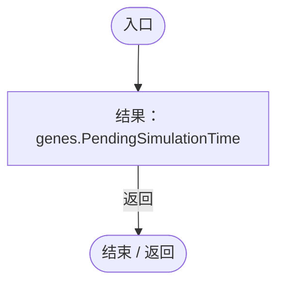
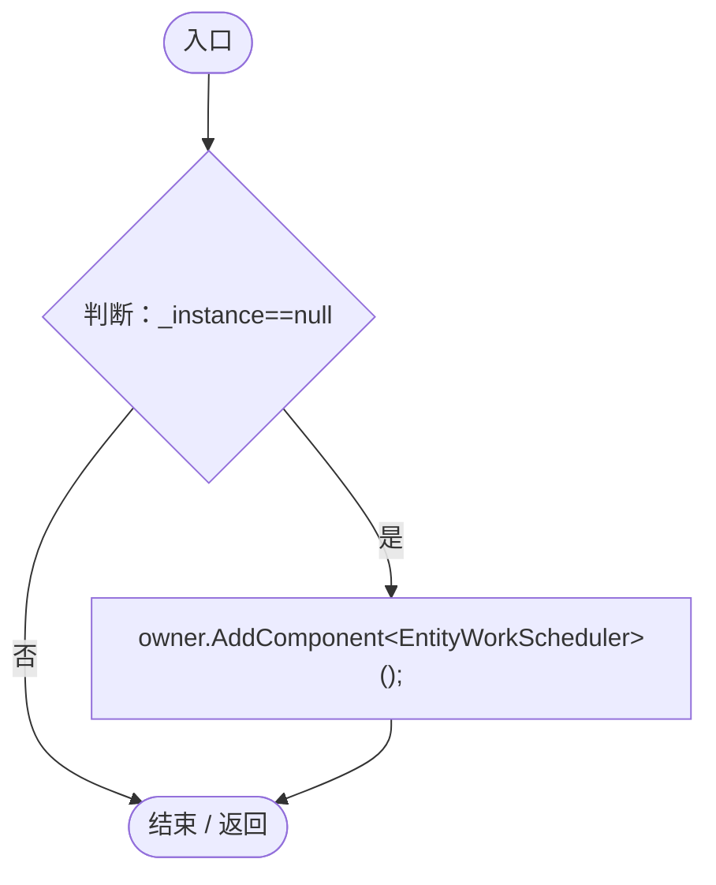
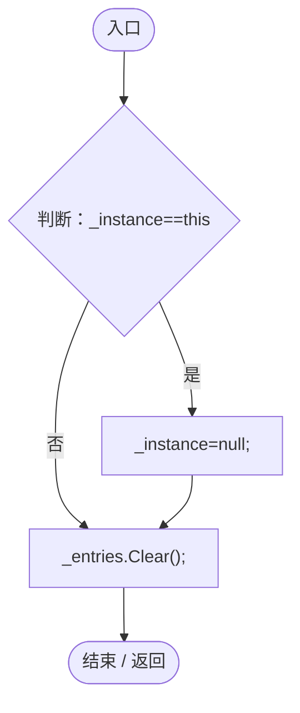
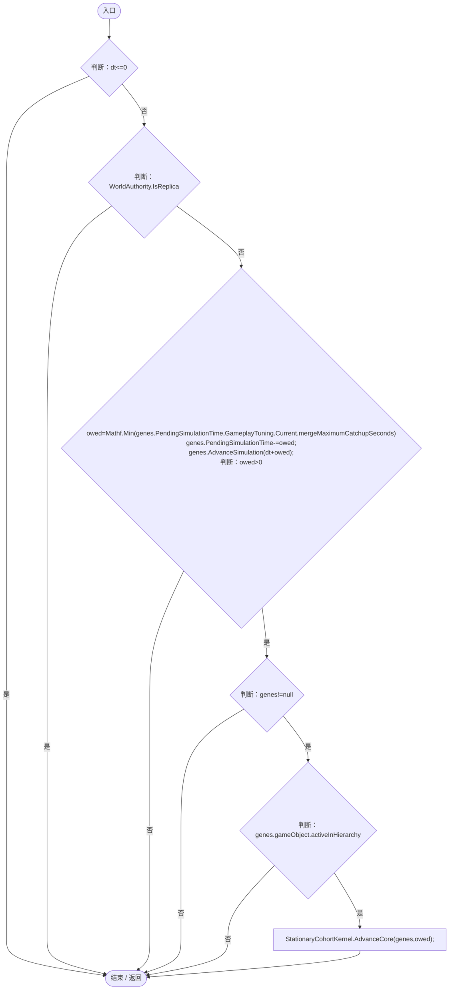
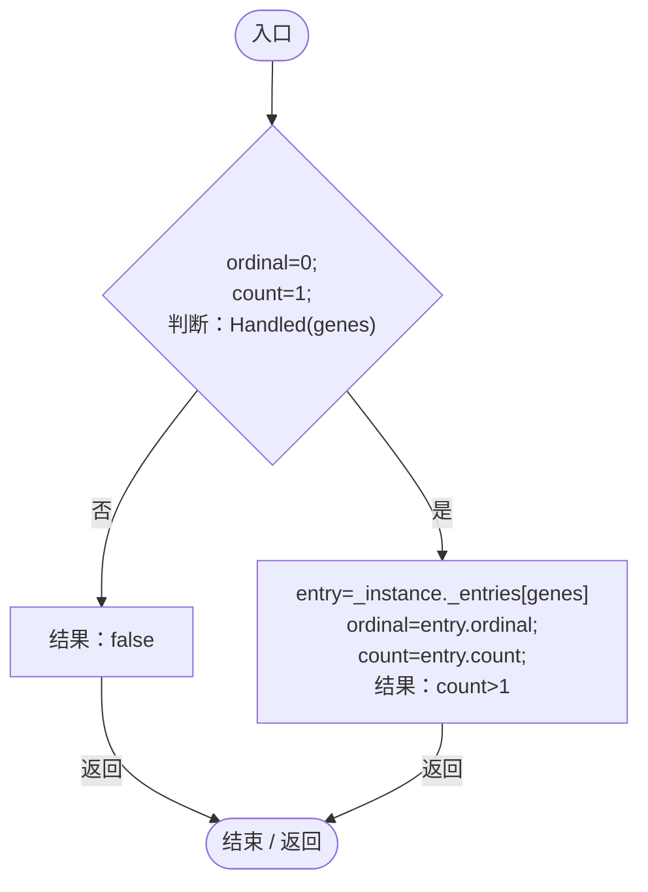
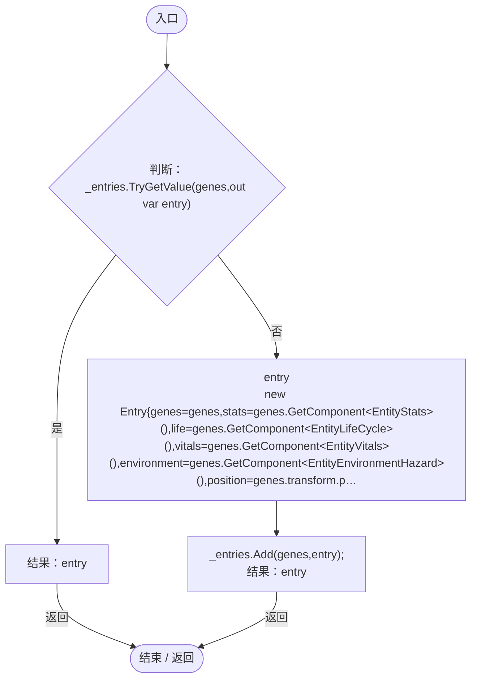
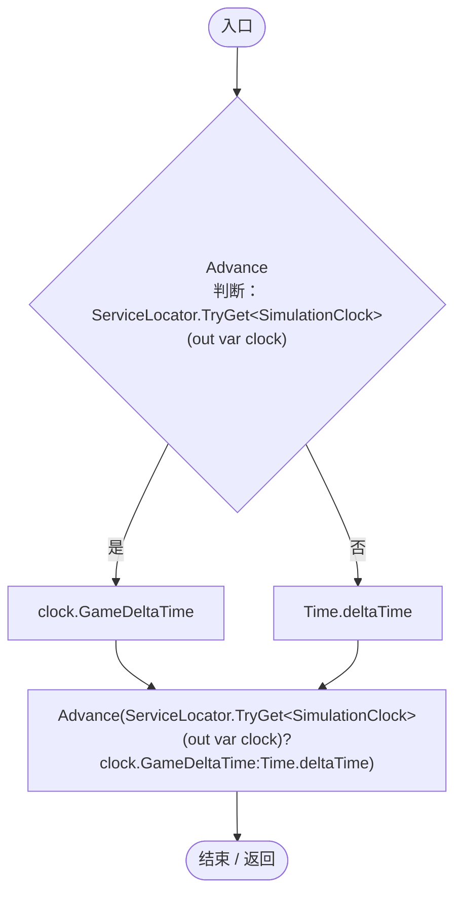
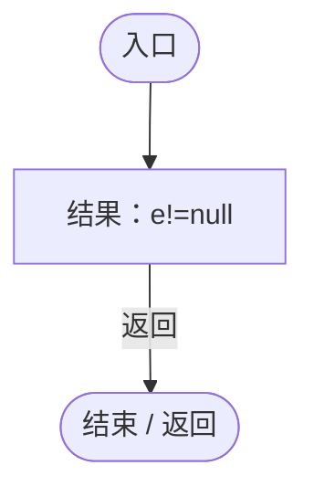

```mermaid
flowchart TD
  b0(["入口"])
  b1{"判断：dt&lt;=0"}
  b2{"判断：WorldAuthority.IsReplica"}
  b3{"判断：_membership!=EntityRegistry.MembershipRevision"}
  b4["present=new HashSet&lt;EntityGeneController&gt;(EntityRegistry.All.Where(e=&gt;e!=null).Select(e=&gt;e.Genes))"]
  b5["_entries.Keys.Where(g=&gt;g==null&#124;&#124;!present.Contains(g)).ToArray()"]
  b6{"判断：_entries.Keys.Where(g=&gt;g==null&#124;&#124;!present.Contains(g)).ToArray()"}
  b7["var<br/>_entries.Remove(key);"]
  b8{"_entries.Keys.Where(g=&gt;g==null&#124;&#124;!present.Contains(g)).ToArray()<br/>判断：_entries.Keys.Where(g=&gt;g==null&#124;&#124;!present.Contains(g)).ToArray()"}
  b9["_entries.Keys.Where(g=&gt;g==null&#124;&#124;!present.Contains(g)).ToArray()"]
  b10["连接 / 离开区域"]
  b11["present"]
  b12{"判断：present"}
  b13{"var<br/>判断：genes!=null"}
  b14["Get(genes);"]
  b15["present"]
  b16["_membership=EntityRegistry.MembershipRevision;"]
  b17["_active.Clear();<br/>_groups.Clear();<br/>_cells.Clear();<br/>DormantMembers=0;<br/>tuning=GameplayTuning.Current"]
  b18["_entries.Values"]
  b19{"判断：_entries.Values"}
  b20["var"]
  b21{"genes=entry.genes<br/>判断：genes==null"}
  b22{"判断：genes.isActiveAndEnabled"}
  b23{"判断：entry.life==null"}
  b24["entry.life=genes.GetComponent&lt;EntityLifeCycle&gt;();"]
  b25{"entry.frame=Time.frameCount;<br/>entry.ordinal=0;<br/>entry.count=1;<br/>stationary=(genes.transform.position-entry.position).sqrMagnitude&lt;=tuning.mergeWakeDistance*tuning.mergeWakeDistance<br/>entry.position=genes.transform.position;<br/>判断：entry.revision!…"}
  b26["entry.revision=genes.LogicRevision;<br/>entry.signature=Signature(genes);<br/>entry.supported=StationaryCohortKernel.Supported(genes);<br/>entry.quiet=0;"]
  b27{"genes.GetComponent&lt;EntityStateController&gt;()<br/>判断：genes.GetComponent&lt;EntityStateController&gt;()"}
  b28[".Current"]
  b29{"判断：.Current"}
  b30[".id"]
  b31["genes.GetComponent&lt;EntityStateController&gt;()?.Current?.id"]
  b32{"判断：genes.GetComponent&lt;EntityStateController&gt;()?.Current?.id"}
  b33["genes.GetComponent&lt;EntityStateController&gt;()?.Current?.id"]
  b34["&quot;&quot;"]
  b35["currentState=genes.GetComponent&lt;EntityStateController&gt;()?.Current?.id??&quot;&quot;"]
  b36{"判断：entry.stateId!=currentState"}
  b37["entry.stateId=currentState;<br/>entry.quiet=0;"]
  b38{"判断：tuning.mergeStationaryEntities"}
  b39{"判断：stationary"}
  b40["Eligible(entry)"]
  b41["tuning.mergeStationaryEntities&amp;&amp;stationary&amp;&amp;Eligible(entry)"]
  b42["eligible=tuning.mergeStationaryEntities&amp;&amp;stationary&amp;&amp;Eligible(entry)"]
  b43{"entry.quiet<br/>判断：eligible"}
  b44["entry.quiet+dt"]
  b45["0"]
  b46["entry.quiet=eligible?entry.quiet+dt:0;"]
  b47{"entry.dormant<br/>判断：eligible"}
  b48["entry.quiet&gt;=tuning.mergeQuietSeconds"]
  b49["eligible"]
  b50["entry.dormant=eligible&amp;&amp;entry.quiet&gt;=tuning.mergeQuietSeconds;"]
  b51{"判断：entry.dormant"}
  b52["_active.Add(entry);"]
  b53{"DormantMembers++;<br/>entry.pending+=dt;<br/>判断：entry.pending+0.00001f&gt;=tuning.mergeInterval"}
  b54["AddGroup(entry,tuning);"]
  b55["_entries.Values"]
  b56["_active.Sort((a,b)=&gt;Priority(b).CompareTo(Priority(a)));"]
  b57["_active"]
  b58{"判断：_active"}
  b59["var"]
  b60{"判断：entry.genes==null"}
  b61{"判断：entry.genes.isActiveAndEnabled"}
  b62{"owed=Mathf.Min(entry.pending,tuning.mergeMaximumCatchupSeconds)<br/>entry.pending-=owed;<br/>entry.genes.AdvanceSimulation(dt+owed);<br/>判断：owed&gt;0"}
  b63{"判断：entry.genes!=null"}
  b64{"判断：entry.genes.gameObject.activeInHierarchy"}
  b65["StationaryCohortKernel.AdvanceCore(entry.genes,owed);"]
  b66["_active"]
  b67["_groups.Sort((a,b)=&gt;b.priority.CompareTo(a.priority));<br/>budget=Mathf.FloorToInt(tuning.mergeGroupsPerFrame)"]
  b68["_groups"]
  b69{"判断：_groups"}
  b70["var"]
  b71{"判断：budget--&lt;=0"}
  b72["first=group.members[0]<br/>elapsed=Mathf.Min(group.time,tuning.mergeMaximumCatchupSeconds)"]
  b73["group.members"]
  b74{"判断：group.members"}
  b75["var<br/>entry.pending=Mathf.Max(0,entry.pending-elapsed);"]
  b76["group.members"]
  b77["steps=Mathf.CeilToInt(elapsed/.1f)"]
  b78["step=0"]
  b79{"判断：step&lt;steps"}
  b80["slice=Mathf.Min(.1f,elapsed-step*.1f)"]
  b81{"判断：group.members.All(e=&gt;e.genes!=null&amp;&amp;e.genes.gameObject.activeInHierarchy&amp;&amp;Eligible(e)&amp;&amp;e.revision==e.genes.LogicRevision)"}
  b82["group.members.All(e=&gt;e.genes.CurrentAge==first.genes.CurrentAge&amp;&amp;e.genes.IsGestating==first.genes.IsGestating)"]
  b83["group.members.All(e=&gt;e.genes!=null&amp;&amp;e.genes.gameObject.activeInHierarchy&amp;&amp;Eligible(e)&amp;&amp;e.revision==e.genes.LogicRevision)"]
  b84["share=group.members.All(e=&gt;e.genes!=null&amp;&amp;e.genes.gameObject.activeInHierarchy&amp;&amp;Eligible(e)&amp;&amp;e.revision==e.genes.LogicRevision)&amp;&amp;group.members.All(e=&gt;e.genes.CurrentAge==first.genes.CurrentAge&amp;&amp;e.genes.IsGestating==first.genes.IsGestating)"]
  b85{"判断：share"}
  b86["speed=StationaryCohortKernel.LifeSpeed(first.genes)<br/>delta=StationaryCohortKernel.Sample(first.genes,slice)<br/>RepresentativeSteps++;"]
  b87["index=0"]
  b88{"判断：index&lt;group.members.Count"}
  b89{"entry=group.members[index]<br/>判断：index&gt;0"}
  b90["StationaryCohortKernel.Apply(first.genes,entry.genes,delta);<br/>SharedMemberSteps++;"]
  b91{"entry.life<br/>判断：entry.life"}
  b92["entry.life?.AdvanceShared(slice,speed);"]
  b93{"判断：entry.genes.gameObject.activeInHierarchy"}
  b94{"entry.life<br/>判断：entry.life"}
  b95[".HasDied"]
  b96["entry.life"]
  b97{"判断：entry.life?.HasDied!=true"}
  b98["StationaryCohortKernel.Reproduce(entry.genes,slice);"]
  b99["index++"]
  b100["group.members"]
  b101{"判断：group.members"}
  b102{"var<br/>判断：entry.genes==null"}
  b103{"判断：entry.genes.gameObject.activeInHierarchy"}
  b104["entry.genes.AdvanceSimulation(slice);<br/>StationaryCohortKernel.AdvanceCore(entry.genes,slice);"]
  b105["group.members"]
  b106["step++"]
  b107["_groups"]
  b108(["结束 / 返回"])
  b0 --> b1
  b1 -->|"否"| b2
  b1 -->|"是"| b108
  b2 -->|"是"| b108
  b2 -->|"否"| b3
  b3 -->|"是"| b4
  b3 -->|"否"| b17
  b4 --> b5
  b5 --> b6
  b6 -->|"是"| b7
  b6 -->|"否 · 经过finally 8"| b11
  b7 --> b6
  b8 -->|"否"| b9
  b8 -->|"是"| b10
  b9 --> b10
  b11 --> b12
  b12 -->|"是"| b13
  b12 -->|"否 · 经过finally 15"| b16
  b13 -->|"是"| b14
  b13 -->|"否"| b12
  b14 --> b12
  b16 --> b17
  b17 --> b18
  b18 --> b19
  b19 -->|"是"| b20
  b19 -->|"否 · 经过finally 55"| b56
  b20 --> b21
  b21 -->|"否"| b22
  b21 -->|"是"| b19
  b22 -->|"否"| b19
  b22 -->|"是"| b23
  b23 -->|"是"| b24
  b23 -->|"否"| b25
  b24 --> b25
  b25 -->|"是"| b26
  b25 -->|"否"| b27
  b26 --> b27
  b27 -->|"否"| b28
  b27 -->|"是"| b31
  b28 --> b29
  b29 -->|"否"| b30
  b29 -->|"是"| b31
  b30 --> b32
  b31 --> b32
  b32 -->|"否"| b33
  b32 -->|"是"| b34
  b33 --> b35
  b34 --> b35
  b35 --> b36
  b36 -->|"是"| b37
  b36 -->|"否"| b38
  b37 --> b38
  b38 -->|"是"| b39
  b38 -->|"否"| b41
  b39 -->|"是"| b40
  b39 -->|"否"| b41
  b40 --> b42
  b41 --> b42
  b42 --> b43
  b43 -->|"是"| b44
  b43 -->|"否"| b45
  b44 --> b46
  b45 --> b46
  b46 --> b47
  b47 -->|"是"| b48
  b47 -->|"否"| b49
  b48 --> b50
  b49 --> b50
  b50 --> b51
  b51 -->|"否"| b52
  b51 -->|"是"| b53
  b52 --> b19
  b53 -->|"是"| b54
  b53 -->|"否"| b19
  b54 --> b19
  b56 --> b57
  b57 --> b58
  b58 -->|"是"| b59
  b58 -->|"否 · 经过finally 66"| b67
  b59 --> b60
  b60 -->|"否"| b61
  b60 -->|"是"| b58
  b61 -->|"否"| b58
  b61 -->|"是"| b62
  b62 -->|"是"| b63
  b62 -->|"否"| b58
  b63 -->|"是"| b64
  b63 -->|"否"| b58
  b64 -->|"是"| b65
  b64 -->|"否"| b58
  b65 --> b58
  b67 --> b68
  b68 --> b69
  b69 -->|"是"| b70
  b69 -->|"否 · 经过finally 107"| b108
  b70 --> b71
  b71 -->|"是 · 经过finally 107"| b108
  b71 -->|"否"| b72
  b72 --> b73
  b73 --> b74
  b74 -->|"是"| b75
  b74 -->|"否 · 经过finally 76"| b77
  b75 --> b74
  b77 --> b78
  b78 --> b79
  b79 -->|"是"| b80
  b79 -->|"否"| b69
  b80 --> b81
  b81 -->|"是"| b82
  b81 -->|"否"| b83
  b82 --> b84
  b83 --> b84
  b84 --> b85
  b85 -->|"是"| b86
  b85 -->|"否"| b100
  b86 --> b87
  b87 --> b88
  b88 -->|"是"| b89
  b88 -->|"否"| b106
  b89 -->|"是"| b90
  b89 -->|"否"| b91
  b90 --> b91
  b91 -->|"否"| b92
  b91 -->|"是"| b93
  b92 --> b93
  b93 -->|"是"| b94
  b93 -->|"否"| b99
  b94 -->|"否"| b95
  b94 -->|"是"| b96
  b95 --> b97
  b96 --> b97
  b97 -->|"是"| b98
  b97 -->|"否"| b99
  b98 --> b99
  b99 --> b88
  b100 --> b101
  b101 -->|"是"| b102
  b101 -->|"否 · 经过finally 105"| b106
  b102 -->|"否"| b103
  b102 -->|"是"| b101
  b103 -->|"否"| b101
  b103 -->|"是"| b104
  b104 --> b101
  b106 --> b79
  b6 -. "退出保护区时 finally（示意）" .-> b8
  b12 -. "退出保护区时 finally（示意）" .-> b15
  b19 -. "退出保护区时 finally（示意）" .-> b55
  b58 -. "退出保护区时 finally（示意）" .-> b66
  b74 -. "退出保护区时 finally（示意）" .-> b76
  b101 -. "退出保护区时 finally（示意）" .-> b105
  b69 -. "退出保护区时 finally（示意）" .-> b107

```

# EntityWorkScheduler.cs

[返回总索引](../README.md) · `Runtime` · `Assets/DarwinPark/Entities/Simulation/EntityWorkScheduler.cs`

[源文件](../../../Assets/DarwinPark/Entities/Simulation/EntityWorkScheduler.cs) · 源码校验：`f3fbd7baebf0035f202fa43e242476e85c334c8e4de8c38cf0997b7bd549af53`

方法按源文件位置排列。事件/回调引用不表示立即执行；分支与异常说明见总索引。完整源码与可点击关系图请打开离线手册。

<a id="m4b2751ad9a55887d"></a>

## pending.get · L21

`get`


### Editor / Player · Roslyn编译器控制流



<a id="me9a0cae0c12eb087"></a>

## pending.set · L21

`set`


### Editor / Player · Roslyn编译器控制流


<a id="m019615a4e3a66f2a"></a>

## RepresentativeSteps.get · L31

`get`


### Editor / Player · 语法控制结构 / 声明（非CFG）


<a id="m2b10634c3ce352fc"></a>

## RepresentativeSteps.set · L31

`private set`


### Editor / Player · 语法控制结构 / 声明（非CFG）


<a id="m643efd7504634838"></a>

## SharedMemberSteps.get · L32

`get`


### Editor / Player · 语法控制结构 / 声明（非CFG）


<a id="m6a584b1380161c15"></a>

## SharedMemberSteps.set · L32

`private set`


### Editor / Player · 语法控制结构 / 声明（非CFG）


<a id="md7d50625816939e1"></a>

## DormantMembers.get · L33

`get`


### Editor / Player · 语法控制结构 / 声明（非CFG）


<a id="m5f86ce246ffaf3d0"></a>

## DormantMembers.set · L33

`private set`


### Editor / Player · 语法控制结构 / 声明（非CFG）


<a id="m7240c6e984d96c2a"></a>

## Ensure · L34

`public static void Ensure(GameObject owner)`


### Editor / Player · Roslyn编译器控制流



<a id="m7ba445d298b29244"></a>

## Awake · L35

`private void Awake()`


### Editor / Player · Roslyn编译器控制流


<a id="m2dadb06fdc75f523"></a>

## OnDestroy · L36

`private void OnDestroy()`


### Editor / Player · Roslyn编译器控制流



<a id="m36b4e1b78524cafa"></a>

## Handled · L37

`public static bool Handled(EntityGeneController genes)`


### Editor / Player · Roslyn编译器控制流


<a id="m24138406501318d9"></a>

## Dormant · L38

`public static bool Dormant(EntityGeneController genes)`


### Editor / Player · Roslyn编译器控制流


项目内调用/回调引用：

- [EntityWorkScheduler.Handled · L37](465ccdbb260bcac2.md#m36b4e1b78524cafa)（方法）

<a id="mb6bd2dc720ad2695"></a>

## Wake · L39

`public static void Wake(EntityGeneController genes)`


### Editor / Player · Roslyn编译器控制流


<a id="m7130b8a5cf03e131"></a>

## AdvanceUnscheduled · L40

`public static void AdvanceUnscheduled(EntityGeneController genes,float dt)`


### Editor / Player · Roslyn编译器控制流



项目内调用/回调引用：

- [GameplayTuning.Current.get · L31](db546e5713b32d53.md#m557c9ecc76cc372d)（访问器）
- [EntityGeneController.AdvanceSimulation · L70](7494d53178552f0e.md#m8d432f097da8bbf7)（方法）
- [StationaryCohortKernel.AdvanceCore · L39](9d3f50e550ab5beb.md#ma124a0ee73387768)（方法）

<a id="m36ac33e732b6538a"></a>

## TryCohortOrdinal · L47

`public static bool TryCohortOrdinal(EntityGeneController genes,out int ordinal,out int count)`


### Editor / Player · Roslyn编译器控制流



项目内调用/回调引用：

- [EntityWorkScheduler.Handled · L37](465ccdbb260bcac2.md#m36b4e1b78524cafa)（方法）

<a id="m440719410a04f5e5"></a>

## Get · L51

`private Entry Get(EntityGeneController genes)`


### Editor / Player · Roslyn编译器控制流



<a id="mc774aa670acac550"></a>

## Update · L57

`private void Update()`


### Editor / Player · Roslyn编译器控制流



项目内调用/回调引用：

- [EntityWorkScheduler.Advance · L58](465ccdbb260bcac2.md#m6c5108b70d3edbe2)（方法）
- [ServiceLocator.TryGet · L26](f2fdbe9f9ccd93cb.md#m143b24e6d58471b0)（方法）
- [SimulationClock.GameDeltaTime.get · L26](a8f444aec9614b0a.md#me7f11abae18a4f2d)（访问器）

<a id="m6c5108b70d3edbe2"></a>

## Advance · L58

`public void Advance(float dt)`


### Editor / Player · Roslyn编译器控制流



项目内调用/回调引用：

- [EntityRegistry.MembershipRevision.get · L15](2093aaf08559c9f2.md#m6afb6f184d119e11)（访问器）
- [EntityWorkScheduler.Get · L51](465ccdbb260bcac2.md#m440719410a04f5e5)（方法）
- [EntityWorkScheduler.DormantMembers.set · L33](465ccdbb260bcac2.md#m5f86ce246ffaf3d0)（访问器）
- [GameplayTuning.Current.get · L31](db546e5713b32d53.md#m557c9ecc76cc372d)（访问器）
- [EntityGeneController.LogicRevision.get · L19](7494d53178552f0e.md#me69facc1c0f1e164)（访问器）
- [EntityWorkScheduler.Signature · L162](465ccdbb260bcac2.md#m3ddf523d791a4956)（方法）
- [StationaryCohortKernel.Supported · L12](9d3f50e550ab5beb.md#mc9ba7d3589415ea3)（方法）
- [EntityWorkScheduler.Eligible · L133](465ccdbb260bcac2.md#mdcef4b2ed1719de6)（方法）
- [EntityWorkScheduler.DormantMembers.get · L33](465ccdbb260bcac2.md#md7d50625816939e1)（访问器）
- [EntityWorkScheduler.Entry.pending.set · L21](465ccdbb260bcac2.md#me9a0cae0c12eb087)（访问器）
- [EntityWorkScheduler.Entry.pending.get · L21](465ccdbb260bcac2.md#m4b2751ad9a55887d)（访问器）
- [EntityWorkScheduler.AddGroup · L140](465ccdbb260bcac2.md#m04187a839c83a2af)（方法）
- [EntityGeneController.AdvanceSimulation · L70](7494d53178552f0e.md#m8d432f097da8bbf7)（方法）
- [StationaryCohortKernel.AdvanceCore · L39](9d3f50e550ab5beb.md#ma124a0ee73387768)（方法）
- [StationaryCohortKernel.LifeSpeed · L25](9d3f50e550ab5beb.md#m46d6deb700637b17)（方法）
- [StationaryCohortKernel.Sample · L30](9d3f50e550ab5beb.md#m4c1c87384128b131)（方法）
- [EntityWorkScheduler.RepresentativeSteps.set · L31](465ccdbb260bcac2.md#m2b10634c3ce352fc)（访问器）
- [EntityWorkScheduler.RepresentativeSteps.get · L31](465ccdbb260bcac2.md#m019615a4e3a66f2a)（访问器）
- [StationaryCohortKernel.Apply · L46](9d3f50e550ab5beb.md#m77d77adc94294369)（方法）
- [EntityWorkScheduler.SharedMemberSteps.set · L32](465ccdbb260bcac2.md#m6a584b1380161c15)（访问器）
- [EntityWorkScheduler.SharedMemberSteps.get · L32](465ccdbb260bcac2.md#m643efd7504634838)（访问器）
- [EntityLifeCycle.AdvanceShared · L27](9f4138bfbae654b7.md#m70423c7e99affa42)（方法）
- [EntityLifeCycle.HasDied.get · L11](9f4138bfbae654b7.md#mf2406e6830e0007e)（访问器）
- [StationaryCohortKernel.Reproduce · L52](9d3f50e550ab5beb.md#mbb47404e70b932f9)（方法）
- [EntityWorkScheduler.回调@63 · L63](465ccdbb260bcac2.md#mf36fbe1d3b5721fa)（回调/委托）
- [EntityWorkScheduler.回调@63 · L63](465ccdbb260bcac2.md#m3036d4f42046fa5b)（回调/委托）
- [EntityWorkScheduler.回调@64 · L64](465ccdbb260bcac2.md#m1431157eb5b6a115)（回调/委托）
- [EntityWorkScheduler.回调@89 · L89](465ccdbb260bcac2.md#mc6545ca86fb0d2c7)（回调/委托）
- [EntityWorkScheduler.回调@100 · L100](465ccdbb260bcac2.md#mc2723c4992a76322)（回调/委托）
- [EntityWorkScheduler.回调@113 · L113](465ccdbb260bcac2.md#mc7bf447bfd2a92f7)（回调/委托）
- [EntityWorkScheduler.回调@113 · L113](465ccdbb260bcac2.md#mfd785b2aa2f219d9)（回调/委托）

<a id="mf36fbe1d3b5721fa"></a>

## 回调@63 · L63

`e … => 回调`


### Editor / Player · Roslyn编译器控制流



<a id="m3036d4f42046fa5b"></a>

## 回调@63 · L63

`e … => 回调`


### Editor / Player · Roslyn编译器控制流

```mermaid
flowchart TD
  b0(["入口"])
  b1["结果：e.Genes"]
  b2(["结束 / 返回"])
  b0 --> b1
  b1 -->|"返回"| b2

```

项目内调用/回调引用：

- [DarwinEntity.Genes.get · L14](70798dde169f2e8b.md#m622eb1adf401d431)（访问器）

<a id="m1431157eb5b6a115"></a>

## 回调@64 · L64

`g … => 回调`


### Editor / Player · Roslyn编译器控制流

```mermaid
flowchart TD
  b0(["入口"])
  b1{"判断：g==null"}
  b2["!present.Contains(g)"]
  b3["g==null"]
  b4["结果：g==null&#124;&#124;!present.Contains(g)"]
  b5(["结束 / 返回"])
  b0 --> b1
  b1 -->|"否"| b2
  b1 -->|"是"| b3
  b2 --> b4
  b3 --> b4
  b4 -->|"返回"| b5

```

<a id="mc6545ca86fb0d2c7"></a>

## 回调@89 · L89

`( … => 回调`


### Editor / Player · Roslyn编译器控制流

```mermaid
flowchart TD
  b0(["入口"])
  b1["结果：Priority(b).CompareTo(Priority(a))"]
  b2(["结束 / 返回"])
  b0 --> b1
  b1 -->|"返回"| b2

```

项目内调用/回调引用：

- [EntityWorkScheduler.Priority · L132](465ccdbb260bcac2.md#mf560dcb6734b2d35)（方法）

<a id="mc2723c4992a76322"></a>

## 回调@100 · L100

`( … => 回调`


### Editor / Player · Roslyn编译器控制流

```mermaid
flowchart TD
  b0(["入口"])
  b1["结果：b.priority.CompareTo(a.priority)"]
  b2(["结束 / 返回"])
  b0 --> b1
  b1 -->|"返回"| b2

```

<a id="mc7bf447bfd2a92f7"></a>

## 回调@113 · L113

`e … => 回调`


### Editor / Player · Roslyn编译器控制流

```mermaid
flowchart TD
  b0(["入口"])
  b1{"判断：e.genes!=null"}
  b2{"判断：e.genes.gameObject.activeInHierarchy"}
  b3{"判断：Eligible(e)"}
  b4["e.revision==e.genes.LogicRevision"]
  b5["e.genes!=null&amp;&amp;e.genes.gameObject.activeInHierarchy&amp;&amp;Eligible(e)&amp;&amp;e.revision==e.genes.LogicRevision"]
  b6["结果：e.genes!=null&amp;&amp;e.genes.gameObject.activeInHierarchy&amp;&amp;Eligible(e)&amp;&amp;e.revision==e.genes.LogicRevision"]
  b7(["结束 / 返回"])
  b0 --> b1
  b1 -->|"是"| b2
  b1 -->|"否"| b5
  b2 -->|"是"| b3
  b2 -->|"否"| b5
  b3 -->|"是"| b4
  b3 -->|"否"| b5
  b4 --> b6
  b5 --> b6
  b6 -->|"返回"| b7

```

项目内调用/回调引用：

- [EntityWorkScheduler.Eligible · L133](465ccdbb260bcac2.md#mdcef4b2ed1719de6)（方法）
- [EntityGeneController.LogicRevision.get · L19](7494d53178552f0e.md#me69facc1c0f1e164)（访问器）

<a id="mfd785b2aa2f219d9"></a>

## 回调@113 · L113

`e … => 回调`


### Editor / Player · Roslyn编译器控制流

```mermaid
flowchart TD
  b0(["入口"])
  b1{"判断：e.genes.CurrentAge==first.genes.CurrentAge"}
  b2["e.genes.IsGestating==first.genes.IsGestating"]
  b3["e.genes.CurrentAge==first.genes.CurrentAge"]
  b4["结果：e.genes.CurrentAge==first.genes.CurrentAge&amp;&amp;e.genes.IsGestating==first.genes.IsGestating"]
  b5(["结束 / 返回"])
  b0 --> b1
  b1 -->|"是"| b2
  b1 -->|"否"| b3
  b2 --> b4
  b3 --> b4
  b4 -->|"返回"| b5

```

项目内调用/回调引用：

- [EntityGeneController.CurrentAge.get · L36](7494d53178552f0e.md#me8997b269f94cf38)（访问器）

<a id="mf560dcb6734b2d35"></a>

## Priority · L132

`private static int Priority(Entry entry)`


### Editor / Player · Roslyn编译器控制流

```mermaid
flowchart TD
  b0(["入口"])
  b1{"entry.genes.GetComponent&lt;EntityManualControl&gt;()<br/>判断：entry.genes.GetComponent&lt;EntityManualControl&gt;()"}
  b2[".IsControlled"]
  b3["entry.genes.GetComponent&lt;EntityManualControl&gt;()"]
  b4{"判断：entry.genes.GetComponent&lt;EntityManualControl&gt;()?.IsControlled==true"}
  b5["3"]
  b6{"判断：entry.stats!=null"}
  b7{"判断：entry.stats.CapacityRemaining(&quot;health&quot;)&gt;0"}
  b8["2"]
  b9["1"]
  b10["结果：entry.genes.GetComponent&lt;EntityManualControl&gt;()?.IsControlled==true?3:entry.stats!=null&amp;&amp;entry.stats.CapacityRemaining(&quot;health&quot;)&gt;0?2:1"]
  b11(["结束 / 返回"])
  b0 --> b1
  b1 -->|"否"| b2
  b1 -->|"是"| b3
  b2 --> b4
  b3 --> b4
  b4 -->|"是"| b5
  b4 -->|"否"| b6
  b5 --> b10
  b6 -->|"是"| b7
  b6 -->|"否"| b9
  b7 -->|"是"| b8
  b7 -->|"否"| b9
  b8 --> b10
  b9 --> b10
  b10 -->|"返回"| b11

```

项目内调用/回调引用：

- [EntityManualControl.IsControlled.get · L12](a6969896da35e1f0.md#m125d8f7da7ab33bf)（访问器）
- [EntityStats.CapacityRemaining · L92](75aa86a368efdf24.md#m574f0a6509120d00)（方法）

<a id="mdcef4b2ed1719de6"></a>

## Eligible · L133

`private static bool Eligible(Entry entry)`


### Editor / Player · Roslyn编译器控制流

```mermaid
flowchart TD
  b0(["入口"])
  b1{"genes=entry.genes<br/>判断：entry.stats==null"}
  b2{"判断：entry.life==null"}
  b3{"判断：entry.life.HasDied"}
  b4{"判断：entry.stats.CapacityRemaining(&quot;health&quot;)&gt;0"}
  b5{"判断：entry.stats.TryGet(&quot;health&quot;,out var hp)"}
  b6{"判断：hp&lt;=0"}
  b7{"判断：entry.stats.TryGet(&quot;nutrient&quot;,out var food)"}
  b8{"判断：food&lt;=0"}
  b9["结果：false"]
  b10{"判断：genes.EnvironmentGeneSuppression&gt;0"}
  b11{"entry.environment<br/>判断：entry.environment"}
  b12[".StressLevel"]
  b13["entry.environment"]
  b14{"判断：entry.environment?.StressLevel&gt;0"}
  b15{"entry.environment<br/>判断：entry.environment"}
  b16[".IsDrowning"]
  b17["entry.environment"]
  b18{"判断：entry.environment?.IsDrowning==true"}
  b19{"判断：genes.GetAttribute(&quot;moveSpeed&quot;)&gt;0"}
  b20{"genes.GetComponent&lt;EntityManualControl&gt;()<br/>判断：genes.GetComponent&lt;EntityManualControl&gt;()"}
  b21[".IsControlled"]
  b22["genes.GetComponent&lt;EntityManualControl&gt;()"]
  b23{"判断：genes.GetComponent&lt;EntityManualControl&gt;()?.IsControlled==true"}
  b24{"判断：EcologyMotion.Immobilized(genes)"}
  b25["结果：false"]
  b26["结果：entry.supported"]
  b27(["结束 / 返回"])
  b0 --> b1
  b1 -->|"否"| b2
  b1 -->|"是"| b9
  b2 -->|"否"| b3
  b2 -->|"是"| b9
  b3 -->|"否"| b4
  b3 -->|"是"| b9
  b4 -->|"否"| b5
  b4 -->|"是"| b9
  b5 -->|"是"| b6
  b5 -->|"否"| b9
  b6 -->|"否"| b7
  b6 -->|"是"| b9
  b7 -->|"是"| b8
  b7 -->|"否"| b9
  b8 -->|"是"| b9
  b8 -->|"否"| b10
  b9 -->|"返回"| b27
  b10 -->|"否"| b11
  b10 -->|"是"| b25
  b11 -->|"否"| b12
  b11 -->|"是"| b13
  b12 --> b14
  b13 --> b14
  b14 -->|"否"| b15
  b14 -->|"是"| b25
  b15 -->|"否"| b16
  b15 -->|"是"| b17
  b16 --> b18
  b17 --> b18
  b18 -->|"否"| b19
  b18 -->|"是"| b25
  b19 -->|"否"| b20
  b19 -->|"是"| b25
  b20 -->|"否"| b21
  b20 -->|"是"| b22
  b21 --> b23
  b22 --> b23
  b23 -->|"否"| b24
  b23 -->|"是"| b25
  b24 -->|"是"| b25
  b24 -->|"否"| b26
  b25 -->|"返回"| b27
  b26 -->|"返回"| b27

```

项目内调用/回调引用：

- [EntityLifeCycle.HasDied.get · L11](9f4138bfbae654b7.md#mf2406e6830e0007e)（访问器）
- [EntityStats.CapacityRemaining · L92](75aa86a368efdf24.md#m574f0a6509120d00)（方法）
- [EntityStats.TryGet · L90](75aa86a368efdf24.md#m24ee1433e4a70d94)（方法）
- [EntityEnvironmentHazard.StressLevel.get · L34](5c434d0ba85333b1.md#m5b49c0526a2393cc)（访问器）
- [EntityEnvironmentHazard.IsDrowning.get · L27](5c434d0ba85333b1.md#md1684c4e763e2899)（访问器）
- [EntityGeneController.GetAttribute · L262](7494d53178552f0e.md#mfead0db2249507df)（方法）
- [EntityManualControl.IsControlled.get · L12](a6969896da35e1f0.md#m125d8f7da7ab33bf)（访问器）
- [EcologyMotion.Immobilized · L9](6ed9d0eedb456d32.md#mff3eeb8fb207a31e)（方法）

<a id="m04187a839c83a2af"></a>

## AddGroup · L140

`private void AddGroup(Entry entry,GameplayTuning tuning)`


### Editor / Player · Roslyn编译器控制流

```mermaid
flowchart TD
  b0(["入口"])
  b1["point=entry.position<br/>radius=tuning.mergeRadius<br/>cell=new Vector3Int(Mathf.FloorToInt(point.x/radius),Mathf.FloorToInt(point.y/radius),Mathf.FloorToInt(point.z/radius))<br/>entry.stats.TryGet(&quot;nutrient&quot;,out var food);<br/>entry.stats.TryGet(&quot;store…"]
  b2{"entry.signature+&quot;&#124;&quot;+Mathf.Floor(entry.pending/tuning.mergeInterval).ToString(&quot;R&quot;,CultureInfo.InvariantCulture)+&quot;&#124;&quot;+entry.stateId+&quot;&#124;&quot;<br/>判断：entry.vitals!=null"}
  b3["entry.vitals.isActiveAndEnabled"]
  b4["entry.vitals!=null"]
  b5["entry.signature+&quot;&#124;&quot;+Mathf.Floor(entry.pending/tuning.mergeInterval).ToString(&quot;R&quot;,CultureInfo.InvariantCulture)+&quot;&#124;&quot;+entry.stateId+&quot;&#124;&quot;+(entry.vitals!=null&amp;&amp;entry.vitals.isActiveAndEnabled)+&quot;&#124;&quot;"]
  b6{"判断：entry.environment!=null"}
  b7["entry.environment.isActiveAndEnabled"]
  b8["entry.environment!=null"]
  b9["sharedKey=entry.signature+&quot;&#124;&quot;+Mathf.Floor(entry.pending/tuning.mergeInterval).ToString(&quot;R&quot;,CultureInfo.InvariantCulture)+&quot;&#124;&quot;+entry.stateId+&quot;&#124;&quot;+(entry.vitals!=null&amp;&amp;entry.vitals.isActiveAndEnabled)+&quot;&#124;&quot;+(entry.environment!=null&amp;&amp;entry.envi…"]
  b10["foodBand=Mathf.FloorToInt(food/tuning.mergeFoodTolerance)<br/>reserveBand=Mathf.FloorToInt(reserve/tuning.mergeReserveTolerance)<br/>foodMax=food+entry.stats.CapacityRemaining(&quot;nutrient&quot;)<br/>reserveMax=reserve+entry.stats.CapacityRemaining(&quot;storedN…"]
  b11["x=-1"]
  b12{"判断：x&lt;=1"}
  b13{"判断：found==null"}
  b14["y=-1"]
  b15{"判断：y&lt;=1"}
  b16{"判断：found==null"}
  b17["z=-1"]
  b18{"判断：z&lt;=1"}
  b19{"判断：found==null"}
  b20{"判断：_cells.TryGetValue((cell+new Vector3Int(x,y,z),sharedKey,entry.genes.CurrentAge,entry.genes.IsGestating,foodBand,reserveBand,size,foodMax,reserveMax),out var options)"}
  b21["options"]
  b22{"判断：options"}
  b23{"var<br/>判断：group.members.Count&lt;tuning.mergeMaximumMembers"}
  b24{"判断：(group.members[0].position-point).sqrMagnitude&lt;=radius*radius"}
  b25["found=group;"]
  b26["options"]
  b27["z++"]
  b28["y++"]
  b29["x++"]
  b30{"判断：found==null"}
  b31["found<br/>new Cohort{time=entry.pending,priority=entry.pending}<br/>time=entry.pending<br/>priority=entry.pending<br/>found=new Cohort{time=entry.pending,priority=entry.pending};"]
  b32{"_groups.Add(found);<br/>key=(cell,sharedKey,entry.genes.CurrentAge,entry.genes.IsGestating,foodBand,reserveBand,size,foodMax,reserveMax)<br/>判断：_cells.TryGetValue(key,out var list)"}
  b33["_cells.Add(key,list=new List&lt;Cohort&gt;());"]
  b34["list.Add(found);"]
  b35["found.time=Mathf.Min(found.time,entry.pending);<br/>found.priority=Mathf.Max(found.priority,entry.pending);<br/>entry.ordinal=found.members.Count;<br/>found.members.Add(entry);"]
  b36["found.members"]
  b37{"判断：found.members"}
  b38["var<br/>member.count=found.members.Count;"]
  b39["found.members"]
  b40(["结束 / 返回"])
  b0 --> b1
  b1 --> b2
  b2 -->|"是"| b3
  b2 -->|"否"| b4
  b3 --> b5
  b4 --> b5
  b5 --> b6
  b6 -->|"是"| b7
  b6 -->|"否"| b8
  b7 --> b9
  b8 --> b9
  b9 --> b10
  b10 --> b11
  b11 --> b12
  b12 -->|"是"| b13
  b12 -->|"否"| b30
  b13 -->|"是"| b14
  b13 -->|"否"| b30
  b14 --> b15
  b15 -->|"是"| b16
  b15 -->|"否"| b29
  b16 -->|"是"| b17
  b16 -->|"否"| b29
  b17 --> b18
  b18 -->|"是"| b19
  b18 -->|"否"| b28
  b19 -->|"是"| b20
  b19 -->|"否"| b28
  b20 -->|"否"| b27
  b20 -->|"是"| b21
  b21 --> b22
  b22 -->|"是"| b23
  b22 -->|"否 · 经过finally 26"| b27
  b23 -->|"是"| b24
  b23 -->|"否"| b22
  b24 -->|"是"| b25
  b24 -->|"否"| b22
  b25 -->|"经过finally 26"| b27
  b27 --> b18
  b28 --> b15
  b29 --> b12
  b30 -->|"是"| b31
  b30 -->|"否"| b35
  b31 --> b32
  b32 -->|"否"| b33
  b32 -->|"是"| b34
  b33 --> b34
  b34 --> b35
  b35 --> b36
  b36 --> b37
  b37 -->|"是"| b38
  b37 -->|"否 · 经过finally 39"| b40
  b38 --> b37
  b22 -. "退出保护区时 finally（示意）" .-> b26
  b37 -. "退出保护区时 finally（示意）" .-> b39

```

项目内调用/回调引用：

- [EntityStats.TryGet · L90](75aa86a368efdf24.md#m24ee1433e4a70d94)（方法）
- [EntityWorkScheduler.Entry.pending.get · L21](465ccdbb260bcac2.md#m4b2751ad9a55887d)（访问器）
- [EntityStats.CapacityRemaining · L92](75aa86a368efdf24.md#m574f0a6509120d00)（方法）
- [EntityGeneController.CurrentAge.get · L36](7494d53178552f0e.md#me8997b269f94cf38)（访问器）

<a id="m3ddf523d791a4956"></a>

## Signature · L162

`private static string Signature(EntityGeneController genes)`


### Editor / Player · Roslyn编译器控制流

```mermaid
flowchart TD
  b0(["入口"])
  b1["text=new StringBuilder()"]
  b2["genes.Genome.Genes"]
  b3{"判断：genes.Genome.Genes"}
  b4["var<br/>text.Append(gene.DefinitionId.Length).Append(':').Append(gene.DefinitionId).Append(':').Append(gene.Value.ToString(&quot;R&quot;,CultureInfo.InvariantCulture)).Append(':').Append(gene.Tier).Append(':').Append(gene.Enabled).Append(':').Append(g…"]
  b5["gene.MissingStateIds"]
  b6{"判断：gene.MissingStateIds"}
  b7["var"]
  b8["text"]
  b9{"state<br/>判断：state"}
  b10[".Length"]
  b11["state"]
  b12{"判断：state?.Length"}
  b13["state?.Length"]
  b14["-1"]
  b15["text.Append(state?.Length??-1).Append(':').Append(state).Append(',');"]
  b16["gene.MissingStateIds"]
  b17["text.Append(';');"]
  b18["genes.Genome.Genes"]
  b19["结果：text.ToString()"]
  b20(["结束 / 返回"])
  b0 --> b1
  b1 --> b2
  b2 --> b3
  b3 -->|"是"| b4
  b3 -->|"否 · 经过finally 18"| b19
  b4 --> b5
  b5 --> b6
  b6 -->|"是"| b7
  b6 -->|"否 · 经过finally 16"| b17
  b7 --> b8
  b8 --> b9
  b9 -->|"否"| b10
  b9 -->|"是"| b11
  b10 --> b12
  b11 --> b12
  b12 -->|"否"| b13
  b12 -->|"是"| b14
  b13 --> b15
  b14 --> b15
  b15 --> b6
  b17 --> b3
  b19 -->|"返回"| b20
  b6 -. "退出保护区时 finally（示意）" .-> b16
  b3 -. "退出保护区时 finally（示意）" .-> b18

```

<a id="mc5315839d3f243a7"></a>

## Reset · L172

`[RuntimeInitializeOnLoadMethod(RuntimeInitializeLoadType.SubsystemRegistration)] private static void Reset()`


### Editor / Player · Roslyn编译器控制流

```mermaid
flowchart TD
  b0(["入口"])
  b1["_instance=null"]
  b2(["结束 / 返回"])
  b0 --> b1
  b1 --> b2

```
