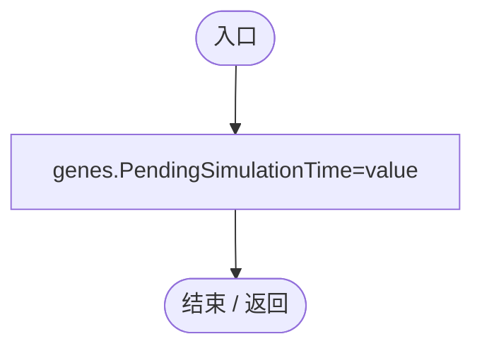
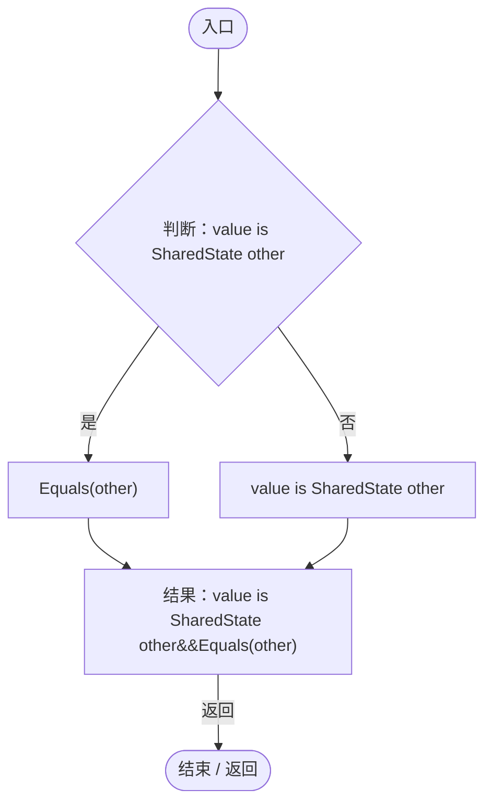
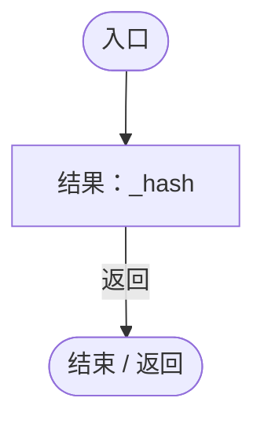
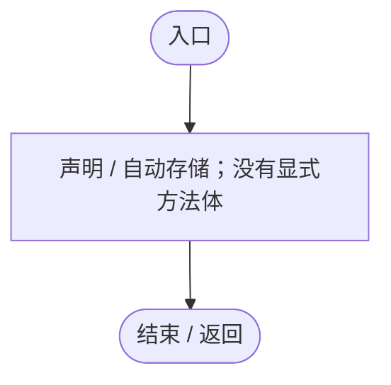
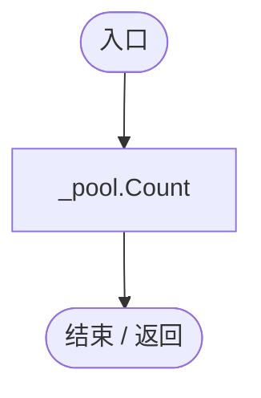
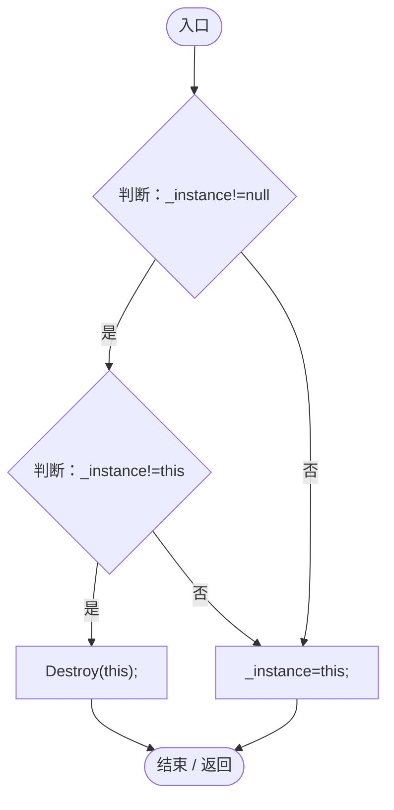
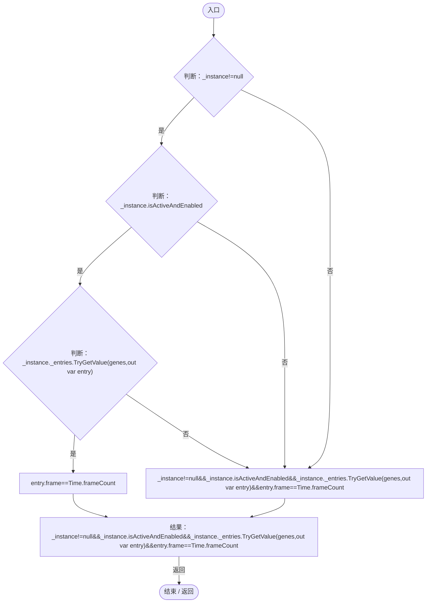
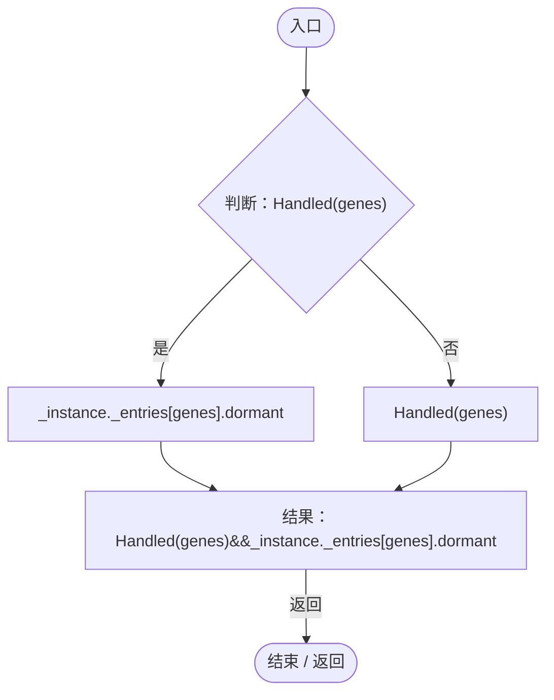
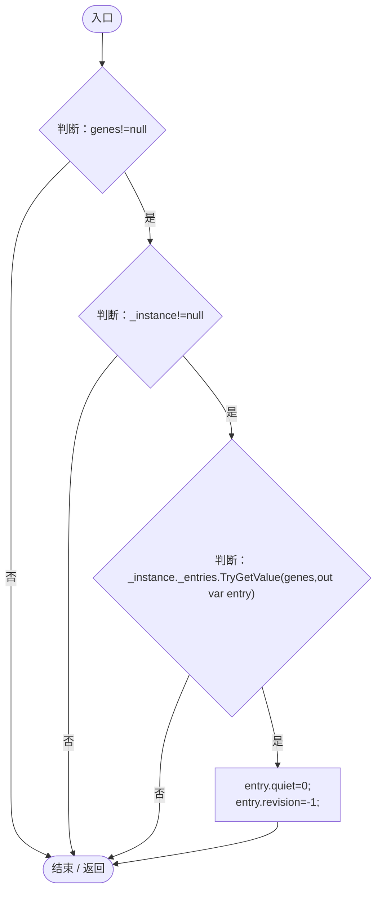

```mermaid
flowchart TD
  b0(["入口"])
  b1["_signature=entry.signature;<br/>_state=entry.stateId;<br/>_age=entry.genes.CurrentAge;"]
  b2["_flags"]
  b3{"判断：entry.genes.IsGestating"}
  b4["1"]
  b5["0"]
  b6{"判断：entry.vitals!=null"}
  b7{"判断：entry.vitals.isActiveAndEnabled"}
  b8["2"]
  b9["0"]
  b10["(entry.genes.IsGestating?1:0)&#124;(entry.vitals!=null&amp;&amp;entry.vitals.isActiveAndEnabled?2:0)"]
  b11{"判断：entry.environment!=null"}
  b12{"判断：entry.environment.isActiveAndEnabled"}
  b13["4"]
  b14["0"]
  b15["_flags=(entry.genes.IsGestating?1:0)&#124;(entry.vitals!=null&amp;&amp;entry.vitals.isActiveAndEnabled?2:0)&#124;(entry.environment!=null&amp;&amp;entry.environment.isActiveAndEnabled?4:0);"]
  b16["_timeBand=Mathf.FloorToInt(entry.pending/tuning.mergeInterval);<br/>entry.stats.TryGet(&quot;nutrient&quot;,out var food);<br/>entry.stats.TryGet(&quot;storedNutrient&quot;,out var reserve);<br/>entry.stats.TryGet(&quot;size&quot;,out _size);<br/>entry.stats.TryGet(&quot;health&quot;,out _hea…"]
  b17(["结束 / 返回"])
  b0 --> b1
  b1 --> b2
  b2 --> b3
  b3 -->|"是"| b4
  b3 -->|"否"| b5
  b4 --> b6
  b5 --> b6
  b6 -->|"是"| b7
  b6 -->|"否"| b9
  b7 -->|"是"| b8
  b7 -->|"否"| b9
  b8 --> b10
  b9 --> b10
  b10 --> b11
  b11 -->|"是"| b12
  b11 -->|"否"| b14
  b12 -->|"是"| b13
  b12 -->|"否"| b14
  b13 --> b15
  b14 --> b15
  b15 --> b16
  b16 --> b17

```

# EntityWorkScheduler.cs

[返回总索引](../README.md) · `Runtime` · `Assets/DarwinPark/Entities/Simulation/EntityWorkScheduler.cs`

[源文件](../../../Assets/DarwinPark/Entities/Simulation/EntityWorkScheduler.cs) · 源码校验：`fe01a5022f733507b0114a437ce19e72068a420c89592c8e3abc27428efa3f9b`

方法按源文件位置排列。事件/回调引用不表示立即执行；分支与异常说明见总索引。完整源码与可点击关系图请打开离线手册。

<a id="m2277186a9d64d8a1"></a>

## pending.get · L22

`get`


### Editor / Player · Roslyn编译器控制流


<a id="m05caefbe3ec968d5"></a>

## pending.set · L22

`set`


### Editor / Player · Roslyn编译器控制流



<a id="m42f9e4d3d4ec77b4"></a>

## SharedState.ctor · L33

`public SharedState(Entry entry,GameplayTuning tuning)`


### Editor / Player · Roslyn编译器控制流



项目内调用/回调引用：

- [EntityGeneController.CurrentAge.get · L37](7494d53178552f0e.md#md08823d8f9a2fa16)（访问器）
- [EntityWorkScheduler.Entry.pending.get · L22](465ccdbb260bcac2.md#m2277186a9d64d8a1)（访问器）
- [EntityStats.TryGet · L90](75aa86a368efdf24.md#m24ee1433e4a70d94)（方法）
- [EntityStats.CapacityRemaining · L92](75aa86a368efdf24.md#m574f0a6509120d00)（方法）

<a id="m16bf5b3fc98c9b71"></a>

## Equals · L44

`public bool Equals(SharedState other)`


### Editor / Player · Roslyn编译器控制流


<a id="m5ff81d773b0079da"></a>

## Equals · L45

`public override bool Equals(object value)`


### Editor / Player · Roslyn编译器控制流



项目内调用/回调引用：

- [EntityWorkScheduler.SharedState.Equals · L44](465ccdbb260bcac2.md#m16bf5b3fc98c9b71)（方法）

<a id="m5c772c781e0963f4"></a>

## GetHashCode · L46

`public override int GetHashCode()`


### Editor / Player · Roslyn编译器控制流



<a id="mc1634e98de0b9148"></a>

## RepresentativeSteps.get · L62

`get`


### Editor / Player · 语法控制结构 / 声明（非CFG）



<a id="mdd3172e7ffeba215"></a>

## RepresentativeSteps.set · L62

`private set`


### Editor / Player · 语法控制结构 / 声明（非CFG）


<a id="ma2ea17be21511192"></a>

## SharedMemberSteps.get · L63

`get`


### Editor / Player · 语法控制结构 / 声明（非CFG）


<a id="mbf38ee84f3a0ece7"></a>

## SharedMemberSteps.set · L63

`private set`


### Editor / Player · 语法控制结构 / 声明（非CFG）


<a id="mf38e594d3d450fdf"></a>

## DormantMembers.get · L64

`get`


### Editor / Player · 语法控制结构 / 声明（非CFG）


<a id="m6a6594139c13a5ea"></a>

## DormantMembers.set · L64

`private set`


### Editor / Player · 语法控制结构 / 声明（非CFG）


<a id="mb0b782033365b73a"></a>

## CohortPoolSize.get · L65

`public int CohortPoolSize`


### Editor / Player · 语法控制结构 / 声明（非CFG）



<a id="m2af69abce504b342"></a>

## SignatureCacheSize.get · L66

`public int SignatureCacheSize`


### Editor / Player · 语法控制结构 / 声明（非CFG）


<a id="mfd37cbe44f4f709e"></a>

## Ensure · L67

`public static void Ensure(GameObject owner)`


### Editor / Player · Roslyn编译器控制流


<a id="m2270045feabf86ad"></a>

## Awake · L68

`private void Awake()`


### Editor / Player · Roslyn编译器控制流



<a id="m763933b0daa89d81"></a>

## OnDestroy · L69

`private void OnDestroy()`


### Editor / Player · Roslyn编译器控制流


<a id="mfb3602c3c5d9b2f7"></a>

## Handled · L70

`public static bool Handled(EntityGeneController genes)`


### Editor / Player · Roslyn编译器控制流



<a id="m4784bd3cb8d8af84"></a>

## Dormant · L71

`public static bool Dormant(EntityGeneController genes)`


### Editor / Player · Roslyn编译器控制流



项目内调用/回调引用：

- [EntityWorkScheduler.Handled · L70](465ccdbb260bcac2.md#mfb3602c3c5d9b2f7)（方法）

<a id="md4572d5c3e13b437"></a>

## Wake · L72

`public static void Wake(EntityGeneController genes)`


### Editor / Player · Roslyn编译器控制流



<a id="md4980b1b489e4fc8"></a>

## AdvanceUnscheduled · L73

`public static void AdvanceUnscheduled(EntityGeneController genes,float dt)`


### Editor / Player · Roslyn编译器控制流

```mermaid
flowchart TD
  b0(["入口"])
  b1{"判断：dt&lt;=0"}
  b2{"判断：WorldAuthority.IsReplica"}
  b3{"owed=Mathf.Min(genes.PendingSimulationTime,GameplayTuning.Current.mergeMaximumCatchupSeconds)<br/>genes.PendingSimulationTime-=owed;<br/>genes.AdvanceSimulation(dt+owed);<br/>判断：owed&gt;0"}
  b4{"判断：genes!=null"}
  b5{"判断：genes.gameObject.activeInHierarchy"}
  b6["StationaryCohortKernel.AdvanceCore(genes,owed);"]
  b7(["结束 / 返回"])
  b0 --> b1
  b1 -->|"否"| b2
  b1 -->|"是"| b7
  b2 -->|"是"| b7
  b2 -->|"否"| b3
  b3 -->|"是"| b4
  b3 -->|"否"| b7
  b4 -->|"是"| b5
  b4 -->|"否"| b7
  b5 -->|"是"| b6
  b5 -->|"否"| b7
  b6 --> b7

```

项目内调用/回调引用：

- [GameplayTuning.Current.get · L44](db546e5713b32d53.md#m5713e7f86902b6fa)（访问器）
- [EntityGeneController.AdvanceSimulation · L73](7494d53178552f0e.md#m0056817ce3208fda)（方法）
- [StationaryCohortKernel.AdvanceCore · L43](9d3f50e550ab5beb.md#mcdd84fc49043442b)（方法）

<a id="mcc852d9054db2d86"></a>

## TryCohortOrdinal · L80

`public static bool TryCohortOrdinal(EntityGeneController genes,out int ordinal,out int count)`


### Editor / Player · Roslyn编译器控制流

```mermaid
flowchart TD
  b0(["入口"])
  b1{"ordinal=0;<br/>count=1;<br/>判断：Handled(genes)"}
  b2["结果：false"]
  b3["entry=_instance._entries[genes]<br/>ordinal=entry.ordinal;<br/>count=entry.count;<br/>结果：count&gt;1"]
  b4(["结束 / 返回"])
  b0 --> b1
  b1 -->|"否"| b2
  b1 -->|"是"| b3
  b2 -->|"返回"| b4
  b3 -->|"返回"| b4

```

项目内调用/回调引用：

- [EntityWorkScheduler.Handled · L70](465ccdbb260bcac2.md#mfb3602c3c5d9b2f7)（方法）

<a id="m044ae5be02b795dc"></a>

## Get · L84

`private Entry Get(EntityGeneController genes)`


### Editor / Player · Roslyn编译器控制流

```mermaid
flowchart TD
  b0(["入口"])
  b1{"判断：_entries.TryGetValue(genes,out var entry)"}
  b2["结果：entry"]
  b3["entry<br/>new Entry{genes=genes,entity=genes.GetComponent&lt;DarwinEntity&gt;(),stats=genes.GetComponent&lt;EntityStats&gt;(),life=genes.GetComponent&lt;EntityLifeCycle&gt;(),vitals=genes.GetComponent&lt;EntityVitals&gt;(),environment=genes.GetComponent&lt;EntityEnvir…"]
  b4["_entries.Add(genes,entry);<br/>结果：entry"]
  b5(["结束 / 返回"])
  b0 --> b1
  b1 -->|"是"| b2
  b1 -->|"否"| b3
  b2 -->|"返回"| b5
  b3 --> b4
  b4 -->|"返回"| b5

```

<a id="m0f3d4ce373d341cb"></a>

## Update · L90

`private void Update()`


### Editor / Player · Roslyn编译器控制流

```mermaid
flowchart TD
  b0(["入口"])
  b1{"Advance<br/>判断：ServiceLocator.TryGet&lt;SimulationClock&gt;(out var clock)"}
  b2["clock.GameDeltaTime"]
  b3["Time.deltaTime"]
  b4["Advance(ServiceLocator.TryGet&lt;SimulationClock&gt;(out var clock)?clock.GameDeltaTime:Time.deltaTime)"]
  b5(["结束 / 返回"])
  b0 --> b1
  b1 -->|"是"| b2
  b1 -->|"否"| b3
  b2 --> b4
  b3 --> b4
  b4 --> b5

```

项目内调用/回调引用：

- [EntityWorkScheduler.Advance · L91](465ccdbb260bcac2.md#m3c6be95c9f3f99a5)（方法）
- [ServiceLocator.TryGet · L26](f2fdbe9f9ccd93cb.md#m143b24e6d58471b0)（方法）
- [SimulationClock.GameDeltaTime.get · L26](a8f444aec9614b0a.md#me7f11abae18a4f2d)（访问器）

<a id="m3c6be95c9f3f99a5"></a>

## Advance · L91

`public void Advance(float dt)`


### Editor / Player · Roslyn编译器控制流

```mermaid
flowchart TD
  b0(["入口"])
  b1["performance=DarwinPark.Core.PerformanceTimings.Measure(DarwinPark.Core.PerformanceTimings.Area.Scheduler)"]
  b2{"判断：dt&lt;=0"}
  b3{"判断：WorldAuthority.IsReplica"}
  b4{"判断：_membership!=EntityRegistry.MembershipRevision"}
  b5["_present.Clear();"]
  b6["EntityRegistry.All"]
  b7{"判断：EntityRegistry.All"}
  b8{"var<br/>判断：entity!=null"}
  b9{"判断：entity.Genes!=null"}
  b10["_present.Add(entity.Genes);"]
  b11{"判断：EntityRegistry.All"}
  b12["EntityRegistry.All"]
  b13["连接 / 离开区域"]
  b14["_removed.Clear();"]
  b15["_entries.Keys"]
  b16{"判断：_entries.Keys"}
  b17{"var<br/>判断：key==null"}
  b18{"判断：_present.Contains(key)"}
  b19["_removed.Add(key);"]
  b20["_entries.Keys"]
  b21["_removed"]
  b22{"判断：_removed"}
  b23["var<br/>_entries.Remove(key);"]
  b24["_removed"]
  b25{"判断：_removed.Count&gt;0"}
  b26["_signaturesDirty=true;"]
  b27{"判断：_entries.Count==0"}
  b28["_signatures.Clear();<br/>_nextSignature=0;<br/>_simulationTime=0;"]
  b29["_present"]
  b30{"判断：_present"}
  b31["var<br/>Get(genes);"]
  b32["_present"]
  b33["_membership=EntityRegistry.MembershipRevision;"]
  b34["_groups"]
  b35{"判断：_groups"}
  b36["var<br/>previous.members.Clear();<br/>previous.next=null;"]
  b37["_groups"]
  b38["_active.Clear();<br/>_controlled.Clear();<br/>_injured.Clear();<br/>_groups.Clear();<br/>_cells.Clear();<br/>_usedGroups=0;<br/>DormantMembers=0;<br/>tuning=GameplayTuning.Current<br/>frameStart=_simulationTime<br/>_simulationTime+=dt;"]
  b39{"判断：_phaseInterval!=tuning.mergeInterval"}
  b40{"判断：_phaseRadius!=tuning.mergeRadius"}
  b41{"判断：_phaseBuckets!=tuning.mergePhaseBuckets"}
  b42["_stagger!=tuning.mergeStaggerBatches"]
  b43["_phaseInterval!=tuning.mergeInterval&#124;&#124;_phaseRadius!=tuning.mergeRadius&#124;&#124;_phaseBuckets!=tuning.mergePhaseBuckets&#124;&#124;_stagger!=tuning.mergeStaggerBatches"]
  b44["phaseChanged=_phaseInterval!=tuning.mergeInterval&#124;&#124;_phaseRadius!=tuning.mergeRadius&#124;&#124;_phaseBuckets!=tuning.mergePhaseBuckets&#124;&#124;_stagger!=tuning.mergeStaggerBatches"]
  b45["_phaseInterval=tuning.mergeInterval;<br/>_phaseRadius=tuning.mergeRadius;<br/>_phaseBuckets=tuning.mergePhaseBuckets;<br/>_stagger=tuning.mergeStaggerBatches;"]
  b46["_entries.Values"]
  b47{"判断：_entries.Values"}
  b48["var"]
  b49{"genes=entry.genes<br/>判断：genes==null"}
  b50{"判断：genes.isActiveAndEnabled"}
  b51{"判断：entry.life==null"}
  b52["entry.life=genes.GetComponent&lt;EntityLifeCycle&gt;();"]
  b53{"判断：entry.manual==null"}
  b54["entry.manual=OptionalComponent.Read&lt;EntityManualControl&gt;(genes);"]
  b55{"entry.frame=Time.frameCount;<br/>entry.ordinal=0;<br/>entry.count=1;<br/>判断：tuning.mergeStationaryEntities"}
  b56["entry.dormant=false;<br/>entry.quiet=0;<br/>entry.nextDue=double.NaN;<br/>QueueActive(entry);"]
  b57{"判断：phaseChanged"}
  b58["entry.nextDue=double.NaN;"]
  b59{"stationary=(genes.transform.position-entry.position).sqrMagnitude&lt;=tuning.mergeWakeDistance*tuning.mergeWakeDistance<br/>entry.position=genes.transform.position;<br/>判断：entry.revision!=genes.LogicRevision"}
  b60{"entry.revision=genes.LogicRevision;<br/>entry.supported=StationaryCohortKernel.Supported(genes);<br/>entry.quiet=0;<br/>entry.nextDue=double.NaN;<br/>entry.state=genes.GetComponent&lt;EntityStateController&gt;();<br/>entry.signature=0;<br/>_signaturesDirty=true;<br/>判断：e…"}
  b61{"signature=Signature(genes)<br/>判断：_signatures.TryGetValue(signature,out entry.signature)"}
  b62["entry.signature=++_nextSignature;<br/>_signatures.Add(signature,entry.signature);"]
  b63{"判断：entry.supported"}
  b64{"entry.state<br/>判断：entry.state"}
  b65[".Current"]
  b66{"判断：.Current"}
  b67[".id"]
  b68["entry.state?.Current?.id"]
  b69{"判断：entry.state?.Current?.id"}
  b70["entry.state?.Current?.id"]
  b71["&quot;&quot;"]
  b72["&quot;&quot;"]
  b73["currentState=entry.supported?entry.state?.Current?.id??&quot;&quot;:&quot;&quot;"]
  b74{"判断：entry.stateId!=currentState"}
  b75["entry.stateId=currentState;<br/>entry.quiet=0;"]
  b76{"判断：entry.supported"}
  b77["entry.nutritionParasite=OptionalComponent.Read&lt;NutritionParasite&gt;(genes);<br/>entry.parasite=OptionalComponent.Read&lt;ParasiteBehavior&gt;(genes);<br/>entry.egg=OptionalComponent.Read&lt;EggIncubation&gt;(genes);"]
  b78{"判断：stationary"}
  b79["Eligible(entry)"]
  b80["stationary"]
  b81["eligible=stationary&amp;&amp;Eligible(entry)"]
  b82{"entry.quiet<br/>判断：eligible"}
  b83["entry.quiet+dt"]
  b84["0"]
  b85["entry.quiet=eligible?entry.quiet+dt:0;"]
  b86{"entry.dormant<br/>判断：eligible"}
  b87["entry.quiet&gt;=tuning.mergeQuietSeconds"]
  b88["eligible"]
  b89["entry.dormant=eligible&amp;&amp;entry.quiet&gt;=tuning.mergeQuietSeconds;"]
  b90{"判断：entry.dormant"}
  b91["entry.nextDue=double.NaN;<br/>QueueActive(entry);"]
  b92{"DormantMembers++;<br/>entry.pending+=dt;<br/>判断：_stagger"}
  b93{"判断：double.IsNaN(entry.nextDue)"}
  b94["entry.nextDue=CohortDeadline.Next(frameStart,entry.position,entry.signature,tuning.mergeRadius,tuning.mergeInterval,tuning.mergePhaseBuckets);"]
  b95{"判断：_simulationTime&gt;=entry.nextDue"}
  b96["AddGroup(entry,tuning);"]
  b97{"判断：entry.pending+0.00001f&gt;=tuning.mergeInterval"}
  b98["AddGroup(entry,tuning);"]
  b99["_entries.Values"]
  b100{"判断：_signaturesDirty"}
  b101["TrimSignatures();"]
  b102["_groups"]
  b103{"判断：_groups"}
  b104["var"]
  b105["group.members"]
  b106{"判断：group.members"}
  b107["var<br/>member.count=group.members.Count;"]
  b108["group.members"]
  b109["_groups"]
  b110["AdvanceActive(_controlled,dt,tuning);<br/>AdvanceActive(_injured,dt,tuning);<br/>AdvanceActive(_active,dt,tuning);<br/>_groups.Sort((a,b)=&gt;b.priority.CompareTo(a.priority));<br/>budget=Mathf.FloorToInt(tuning.mergeGroupsPerFrame)"]
  b111["_groups"]
  b112{"判断：_groups"}
  b113["var"]
  b114{"判断：budget--&lt;=0"}
  b115["first=group.members[0]<br/>elapsed=Mathf.Min(group.time,tuning.mergeMaximumCatchupSeconds)"]
  b116["group.members"]
  b117{"判断：group.members"}
  b118{"var<br/>entry.pending=Mathf.Max(0,entry.pending-elapsed);<br/>判断：_stagger"}
  b119["entry.nextDue=CohortDeadline.Next(_simulationTime,entry.position,entry.signature,tuning.mergeRadius,tuning.mergeInterval,tuning.mergePhaseBuckets);"]
  b120["group.members"]
  b121{"判断：group.members.Count==1"}
  b122{"判断：first.genes!=null"}
  b123{"判断：first.genes.isActiveAndEnabled"}
  b124["SingletonSettlement.Advance(first.genes,elapsed);"]
  b125["steps=SimulationSubsteps.Count(elapsed)"]
  b126["step=0"]
  b127{"判断：step&lt;steps"}
  b128{"slice=SimulationSubsteps.Slice(elapsed,step,steps)<br/>share=CanShare(group,first)<br/>判断：share"}
  b129["speed=StationaryCohortKernel.LifeSpeed(first.genes)<br/>delta=StationaryCohortKernel.Sample(first.genes,first.stats,first.environment,first.vitals,slice)<br/>RepresentativeSteps++;"]
  b130["index=0"]
  b131{"判断：index&lt;group.members.Count"}
  b132{"entry=group.members[index]<br/>判断：index&gt;0"}
  b133["StationaryCohortKernel.Apply(first.environment,entry.genes,entry.stats,entry.environment,entry.entity,delta);<br/>SharedMemberSteps++;"]
  b134{"entry.life<br/>判断：entry.life"}
  b135["entry.life?.AdvanceShared(slice,speed);"]
  b136{"判断：entry.genes.gameObject.activeInHierarchy"}
  b137{"entry.life<br/>判断：entry.life"}
  b138[".HasDied"]
  b139["entry.life"]
  b140{"判断：entry.life?.HasDied!=true"}
  b141{"判断：entry.reproductionRevision!=entry.genes.LogicRevision"}
  b142["entry.reproduction=StationaryCohortKernel.PrimaryReproduction(entry.genes);<br/>entry.reproductionRevision=entry.genes.LogicRevision;"]
  b143{"entry.reproduction<br/>判断：entry.reproduction"}
  b144["entry.reproduction?.OnUpdate(slice);"]
  b145["index++"]
  b146["group.members"]
  b147{"判断：group.members"}
  b148{"var<br/>判断：entry.genes==null"}
  b149{"判断：entry.genes.gameObject.activeInHierarchy"}
  b150["entry.genes.AdvanceSimulation(slice);<br/>StationaryCohortKernel.AdvanceCore(entry.genes,slice);"]
  b151["group.members"]
  b152["step++"]
  b153["_groups"]
  b154["performance=DarwinPark.Core.PerformanceTimings.Measure(DarwinPark.Core.PerformanceTimings.Area.Scheduler)"]
  b155(["结束 / 返回"])
  b0 --> b1
  b1 --> b2
  b2 -->|"否"| b3
  b2 -->|"是 · 经过finally 154"| b155
  b3 -->|"是 · 经过finally 154"| b155
  b3 -->|"否"| b4
  b4 -->|"是"| b5
  b4 -->|"否"| b34
  b5 --> b6
  b6 --> b7
  b7 -->|"是"| b8
  b7 -->|"否 · 经过finally 11"| b14
  b8 -->|"是"| b9
  b8 -->|"否"| b7
  b9 -->|"是"| b10
  b9 -->|"否"| b7
  b10 --> b7
  b11 -->|"否"| b12
  b11 -->|"是"| b13
  b12 --> b13
  b14 --> b15
  b15 --> b16
  b16 -->|"是"| b17
  b16 -->|"否 · 经过finally 20"| b21
  b17 -->|"否"| b18
  b17 -->|"是"| b19
  b18 -->|"否"| b19
  b18 -->|"是"| b16
  b19 --> b16
  b21 --> b22
  b22 -->|"是"| b23
  b22 -->|"否 · 经过finally 24"| b25
  b23 --> b22
  b25 -->|"是"| b26
  b25 -->|"否"| b27
  b26 --> b27
  b27 -->|"是"| b28
  b27 -->|"否"| b29
  b28 --> b29
  b29 --> b30
  b30 -->|"是"| b31
  b30 -->|"否 · 经过finally 32"| b33
  b31 --> b30
  b33 --> b34
  b34 --> b35
  b35 -->|"是"| b36
  b35 -->|"否 · 经过finally 37"| b38
  b36 --> b35
  b38 --> b39
  b39 -->|"否"| b40
  b39 -->|"是"| b43
  b40 -->|"否"| b41
  b40 -->|"是"| b43
  b41 -->|"否"| b42
  b41 -->|"是"| b43
  b42 --> b44
  b43 --> b44
  b44 --> b45
  b45 --> b46
  b46 --> b47
  b47 -->|"是"| b48
  b47 -->|"否 · 经过finally 99"| b100
  b48 --> b49
  b49 -->|"否"| b50
  b49 -->|"是"| b47
  b50 -->|"否"| b47
  b50 -->|"是"| b51
  b51 -->|"是"| b52
  b51 -->|"否"| b53
  b52 --> b53
  b53 -->|"是"| b54
  b53 -->|"否"| b55
  b54 --> b55
  b55 -->|"否"| b56
  b55 -->|"是"| b57
  b56 --> b47
  b57 -->|"是"| b58
  b57 -->|"否"| b59
  b58 --> b59
  b59 -->|"是"| b60
  b59 -->|"否"| b63
  b60 -->|"是"| b61
  b60 -->|"否"| b63
  b61 -->|"否"| b62
  b61 -->|"是"| b63
  b62 --> b63
  b63 -->|"是"| b64
  b63 -->|"否"| b72
  b64 -->|"否"| b65
  b64 -->|"是"| b68
  b65 --> b66
  b66 -->|"否"| b67
  b66 -->|"是"| b68
  b67 --> b69
  b68 --> b69
  b69 -->|"否"| b70
  b69 -->|"是"| b71
  b70 --> b73
  b71 --> b73
  b72 --> b73
  b73 --> b74
  b74 -->|"是"| b75
  b74 -->|"否"| b76
  b75 --> b76
  b76 -->|"是"| b77
  b76 -->|"否"| b78
  b77 --> b78
  b78 -->|"是"| b79
  b78 -->|"否"| b80
  b79 --> b81
  b80 --> b81
  b81 --> b82
  b82 -->|"是"| b83
  b82 -->|"否"| b84
  b83 --> b85
  b84 --> b85
  b85 --> b86
  b86 -->|"是"| b87
  b86 -->|"否"| b88
  b87 --> b89
  b88 --> b89
  b89 --> b90
  b90 -->|"否"| b91
  b90 -->|"是"| b92
  b91 --> b47
  b92 -->|"是"| b93
  b92 -->|"否"| b97
  b93 -->|"是"| b94
  b93 -->|"否"| b95
  b94 --> b95
  b95 -->|"是"| b96
  b95 -->|"否"| b47
  b96 --> b47
  b97 -->|"是"| b98
  b97 -->|"否"| b47
  b98 --> b47
  b100 -->|"是"| b101
  b100 -->|"否"| b102
  b101 --> b102
  b102 --> b103
  b103 -->|"是"| b104
  b103 -->|"否 · 经过finally 109"| b110
  b104 --> b105
  b105 --> b106
  b106 -->|"是"| b107
  b106 -->|"否 · 经过finally 108"| b103
  b107 --> b106
  b110 --> b111
  b111 --> b112
  b112 -->|"是"| b113
  b112 -->|"否 · 经过finally 153,154"| b155
  b113 --> b114
  b114 -->|"是 · 经过finally 153,154"| b155
  b114 -->|"否"| b115
  b115 --> b116
  b116 --> b117
  b117 -->|"是"| b118
  b117 -->|"否 · 经过finally 120"| b121
  b118 -->|"是"| b119
  b118 -->|"否"| b117
  b119 --> b117
  b121 -->|"是"| b122
  b121 -->|"否"| b125
  b122 -->|"是"| b123
  b122 -->|"否"| b112
  b123 -->|"是"| b124
  b123 -->|"否"| b112
  b124 --> b112
  b125 --> b126
  b126 --> b127
  b127 -->|"是"| b128
  b127 -->|"否"| b112
  b128 -->|"是"| b129
  b128 -->|"否"| b146
  b129 --> b130
  b130 --> b131
  b131 -->|"是"| b132
  b131 -->|"否"| b152
  b132 -->|"是"| b133
  b132 -->|"否"| b134
  b133 --> b134
  b134 -->|"否"| b135
  b134 -->|"是"| b136
  b135 --> b136
  b136 -->|"是"| b137
  b136 -->|"否"| b145
  b137 -->|"否"| b138
  b137 -->|"是"| b139
  b138 --> b140
  b139 --> b140
  b140 -->|"是"| b141
  b140 -->|"否"| b145
  b141 -->|"是"| b142
  b141 -->|"否"| b143
  b142 --> b143
  b143 -->|"否"| b144
  b143 -->|"是"| b145
  b144 --> b145
  b145 --> b131
  b146 --> b147
  b147 -->|"是"| b148
  b147 -->|"否 · 经过finally 151"| b152
  b148 -->|"否"| b149
  b148 -->|"是"| b147
  b149 -->|"否"| b147
  b149 -->|"是"| b150
  b150 --> b147
  b152 --> b127
  b7 -. "退出保护区时 finally（示意）" .-> b11
  b16 -. "退出保护区时 finally（示意）" .-> b20
  b22 -. "退出保护区时 finally（示意）" .-> b24
  b30 -. "退出保护区时 finally（示意）" .-> b32
  b35 -. "退出保护区时 finally（示意）" .-> b37
  b47 -. "退出保护区时 finally（示意）" .-> b99
  b106 -. "退出保护区时 finally（示意）" .-> b108
  b103 -. "退出保护区时 finally（示意）" .-> b109
  b117 -. "退出保护区时 finally（示意）" .-> b120
  b147 -. "退出保护区时 finally（示意）" .-> b151
  b112 -. "退出保护区时 finally（示意）" .-> b153
  b2 -. "退出保护区时 finally（示意）" .-> b154

```

项目内调用/回调引用：

- [PerformanceTimings.Measure · L24](a8403a4c7503726d.md#mb452516394f3ebae)（方法）
- [EntityRegistry.MembershipRevision.get · L15](2093aaf08559c9f2.md#m6afb6f184d119e11)（访问器）
- [DarwinEntity.Genes.get · L14](70798dde169f2e8b.md#m622eb1adf401d431)（访问器）
- [EntityWorkScheduler.Get · L84](465ccdbb260bcac2.md#m044ae5be02b795dc)（方法）
- [EntityWorkScheduler.DormantMembers.set · L64](465ccdbb260bcac2.md#m6a6594139c13a5ea)（访问器）
- [GameplayTuning.Current.get · L44](db546e5713b32d53.md#m5713e7f86902b6fa)（访问器）
- [OptionalComponent.Read · L7](806c46b42ced4d36.md#m69622a4dee165c5a)（方法）
- [EntityWorkScheduler.QueueActive · L206](465ccdbb260bcac2.md#m81708dbab6fd4c7a)（方法）
- [EntityGeneController.LogicRevision.get · L19](7494d53178552f0e.md#me69facc1c0f1e164)（访问器）
- [StationaryCohortKernel.Supported · L12](9d3f50e550ab5beb.md#mc9ba7d3589415ea3)（方法）
- [EntityWorkScheduler.Signature · L257](465ccdbb260bcac2.md#m2607707df172e323)（方法）
- [EntityWorkScheduler.Eligible · L229](465ccdbb260bcac2.md#m0e8baae2eeaa4717)（方法）
- [EntityWorkScheduler.DormantMembers.get · L64](465ccdbb260bcac2.md#mf38e594d3d450fdf)（访问器）
- [EntityWorkScheduler.Entry.pending.set · L22](465ccdbb260bcac2.md#m05caefbe3ec968d5)（访问器）
- [EntityWorkScheduler.Entry.pending.get · L22](465ccdbb260bcac2.md#m2277186a9d64d8a1)（访问器）
- [CohortDeadline.Next · L9](7dc9f0a2697792f4.md#m9e1d17c91ceb218b)（方法）
- [EntityWorkScheduler.AddGroup · L238](465ccdbb260bcac2.md#mc69fd9f6dc6d9869)（方法）
- [EntityWorkScheduler.TrimSignatures · L199](465ccdbb260bcac2.md#m670ae50e4da12d78)（方法）
- [EntityWorkScheduler.AdvanceActive · L212](465ccdbb260bcac2.md#m6388d3fd207c0299)（方法）
- [SingletonSettlement.Advance · L22](aa60fc9f4553ae15.md#m354a8ce1a94cb2a0)（方法）
- [SimulationSubsteps.Count · L10](44755274b83df7ba.md#m9b3c9def7f9642d1)（方法）
- [SimulationSubsteps.Slice · L11](44755274b83df7ba.md#ma075f8159da64c99)（方法）
- [EntityWorkScheduler.CanShare · L223](465ccdbb260bcac2.md#m4d55d11465b72a14)（方法）
- [StationaryCohortKernel.LifeSpeed · L25](9d3f50e550ab5beb.md#mdb19e021772f12ab)（方法）
- [StationaryCohortKernel.Sample · L33](9d3f50e550ab5beb.md#mf4245e22058e4dde)（方法）
- [EntityWorkScheduler.RepresentativeSteps.set · L62](465ccdbb260bcac2.md#mdd3172e7ffeba215)（访问器）
- [EntityWorkScheduler.RepresentativeSteps.get · L62](465ccdbb260bcac2.md#mc1634e98de0b9148)（访问器）
- [StationaryCohortKernel.Apply · L52](9d3f50e550ab5beb.md#mff43eda308e9aa23)（方法）
- [EntityWorkScheduler.SharedMemberSteps.set · L63](465ccdbb260bcac2.md#mbf38ee84f3a0ece7)（访问器）
- [EntityWorkScheduler.SharedMemberSteps.get · L63](465ccdbb260bcac2.md#ma2ea17be21511192)（访问器）
- [EntityLifeCycle.AdvanceShared · L29](9f4138bfbae654b7.md#ma29bffd901102e78)（方法）
- [EntityLifeCycle.HasDied.get · L11](9f4138bfbae654b7.md#mf2406e6830e0007e)（访问器）
- [StationaryCohortKernel.PrimaryReproduction · L59](9d3f50e550ab5beb.md#mcf6814b936ea6fab)（方法）
- [ReproductionGeneLogic.OnUpdate · L40](ac319ea70bd8b723.md#m7cb6727410b8cffa)（方法）
- [EntityGeneController.AdvanceSimulation · L73](7494d53178552f0e.md#m0056817ce3208fda)（方法）
- [StationaryCohortKernel.AdvanceCore · L43](9d3f50e550ab5beb.md#mcdd84fc49043442b)（方法）
- [EntityWorkScheduler.回调@152 · L152](465ccdbb260bcac2.md#m241439d28590efc6)（回调/委托）

<a id="m241439d28590efc6"></a>

## 回调@152 · L152

`( … => 回调`


### Editor / Player · Roslyn编译器控制流

```mermaid
flowchart TD
  b0(["入口"])
  b1["结果：b.priority.CompareTo(a.priority)"]
  b2(["结束 / 返回"])
  b0 --> b1
  b1 -->|"返回"| b2

```

<a id="m670ae50e4da12d78"></a>

## TrimSignatures · L199

`private void TrimSignatures()`


### Editor / Player · Roslyn编译器控制流

```mermaid
flowchart TD
  b0(["入口"])
  b1["_liveSignatures.Clear();"]
  b2["_entries.Values"]
  b3{"判断：_entries.Values"}
  b4{"var<br/>判断：entry.signature!=0"}
  b5["_liveSignatures.Add(entry.signature);"]
  b6["_entries.Values"]
  b7["_retiredSignatures.Clear();"]
  b8["_signatures"]
  b9{"判断：_signatures"}
  b10{"var<br/>判断：_liveSignatures.Contains(pair.Value)"}
  b11["_retiredSignatures.Add(pair.Key);"]
  b12["_signatures"]
  b13["_retiredSignatures"]
  b14{"判断：_retiredSignatures"}
  b15["var<br/>_signatures.Remove(signature);"]
  b16["_retiredSignatures"]
  b17["_retiredSignatures.Clear();<br/>_signaturesDirty=false;"]
  b18(["结束 / 返回"])
  b0 --> b1
  b1 --> b2
  b2 --> b3
  b3 -->|"是"| b4
  b3 -->|"否 · 经过finally 6"| b7
  b4 -->|"是"| b5
  b4 -->|"否"| b3
  b5 --> b3
  b7 --> b8
  b8 --> b9
  b9 -->|"是"| b10
  b9 -->|"否 · 经过finally 12"| b13
  b10 -->|"否"| b11
  b10 -->|"是"| b9
  b11 --> b9
  b13 --> b14
  b14 -->|"是"| b15
  b14 -->|"否 · 经过finally 16"| b17
  b15 --> b14
  b17 --> b18
  b3 -. "退出保护区时 finally（示意）" .-> b6
  b9 -. "退出保护区时 finally（示意）" .-> b12
  b14 -. "退出保护区时 finally（示意）" .-> b16

```

<a id="m81708dbab6fd4c7a"></a>

## QueueActive · L206

`private void QueueActive(Entry entry)`


### Editor / Player · Roslyn编译器控制流

```mermaid
flowchart TD
  b0(["入口"])
  b1{"entry.manual<br/>判断：entry.manual"}
  b2[".IsControlled"]
  b3["entry.manual"]
  b4{"判断：entry.manual?.IsControlled==true"}
  b5["_controlled.Add(entry);"]
  b6{"判断：entry.stats!=null"}
  b7{"判断：entry.stats.CapacityRemaining(&quot;health&quot;)&gt;0"}
  b8["_injured.Add(entry);"]
  b9["_active.Add(entry);"]
  b10(["结束 / 返回"])
  b0 --> b1
  b1 -->|"否"| b2
  b1 -->|"是"| b3
  b2 --> b4
  b3 --> b4
  b4 -->|"是"| b5
  b4 -->|"否"| b6
  b5 --> b10
  b6 -->|"是"| b7
  b6 -->|"否"| b9
  b7 -->|"是"| b8
  b7 -->|"否"| b9
  b8 --> b10
  b9 --> b10

```

项目内调用/回调引用：

- [EntityManualControl.IsControlled.get · L12](a6969896da35e1f0.md#m125d8f7da7ab33bf)（访问器）
- [EntityStats.CapacityRemaining · L92](75aa86a368efdf24.md#m574f0a6509120d00)（方法）

<a id="m6388d3fd207c0299"></a>

## AdvanceActive · L212

`private static void AdvanceActive(List<Entry> entries,float dt,GameplayTuning tuning)`


### Editor / Player · Roslyn编译器控制流

```mermaid
flowchart TD
  b0(["入口"])
  b1["entries"]
  b2{"判断：entries"}
  b3["var"]
  b4{"判断：entry.genes==null"}
  b5{"判断：entry.genes.isActiveAndEnabled"}
  b6{"owed=Mathf.Min(entry.pending,tuning.mergeMaximumCatchupSeconds)<br/>entry.pending-=owed;<br/>entry.genes.AdvanceSimulation(dt+owed);<br/>判断：owed&gt;0"}
  b7{"判断：entry.genes!=null"}
  b8{"判断：entry.genes.gameObject.activeInHierarchy"}
  b9["StationaryCohortKernel.AdvanceCore(entry.genes,owed);"]
  b10["entries"]
  b11(["结束 / 返回"])
  b0 --> b1
  b1 --> b2
  b2 -->|"是"| b3
  b2 -->|"否 · 经过finally 10"| b11
  b3 --> b4
  b4 -->|"否"| b5
  b4 -->|"是"| b2
  b5 -->|"否"| b2
  b5 -->|"是"| b6
  b6 -->|"是"| b7
  b6 -->|"否"| b2
  b7 -->|"是"| b8
  b7 -->|"否"| b2
  b8 -->|"是"| b9
  b8 -->|"否"| b2
  b9 --> b2
  b2 -. "退出保护区时 finally（示意）" .-> b10

```

项目内调用/回调引用：

- [EntityWorkScheduler.Entry.pending.get · L22](465ccdbb260bcac2.md#m2277186a9d64d8a1)（访问器）
- [EntityWorkScheduler.Entry.pending.set · L22](465ccdbb260bcac2.md#m05caefbe3ec968d5)（访问器）
- [EntityGeneController.AdvanceSimulation · L73](7494d53178552f0e.md#m0056817ce3208fda)（方法）
- [StationaryCohortKernel.AdvanceCore · L43](9d3f50e550ab5beb.md#mcdd84fc49043442b)（方法）

<a id="m4d55d11465b72a14"></a>

## CanShare · L223

`private static bool CanShare(Cohort group,Entry first)`


### Editor / Player · Roslyn编译器控制流

```mermaid
flowchart TD
  b0(["入口"])
  b1["group.members"]
  b2{"判断：group.members"}
  b3{"var<br/>判断：entry.genes==null"}
  b4{"判断：entry.genes.isActiveAndEnabled"}
  b5{"判断：entry.revision!=entry.genes.LogicRevision"}
  b6{"判断：Eligible(entry)"}
  b7{"判断：entry.genes.CurrentAge!=first.genes.CurrentAge"}
  b8{"判断：entry.genes.IsGestating!=first.genes.IsGestating"}
  b9["结果：false"]
  b10["group.members"]
  b11["结果：true"]
  b12(["结束 / 返回"])
  b0 --> b1
  b1 --> b2
  b2 -->|"是"| b3
  b2 -->|"否 · 经过finally 10"| b11
  b3 -->|"否"| b4
  b3 -->|"是"| b9
  b4 -->|"是"| b5
  b4 -->|"否"| b9
  b5 -->|"否"| b6
  b5 -->|"是"| b9
  b6 -->|"是"| b7
  b6 -->|"否"| b9
  b7 -->|"否"| b8
  b7 -->|"是"| b9
  b8 -->|"是"| b9
  b8 -->|"否"| b2
  b9 -->|"返回 · 经过finally 10"| b12
  b11 -->|"返回"| b12
  b2 -. "退出保护区时 finally（示意）" .-> b10

```

项目内调用/回调引用：

- [EntityGeneController.LogicRevision.get · L19](7494d53178552f0e.md#me69facc1c0f1e164)（访问器）
- [EntityWorkScheduler.Eligible · L229](465ccdbb260bcac2.md#m0e8baae2eeaa4717)（方法）
- [EntityGeneController.CurrentAge.get · L37](7494d53178552f0e.md#md08823d8f9a2fa16)（访问器）

<a id="m0e8baae2eeaa4717"></a>

## Eligible · L229

`private static bool Eligible(Entry entry)`


### Editor / Player · Roslyn编译器控制流

```mermaid
flowchart TD
  b0(["入口"])
  b1{"genes=entry.genes<br/>判断：entry.supported"}
  b2{"判断：entry.stats==null"}
  b3{"判断：entry.life==null"}
  b4{"判断：entry.life.HasDied"}
  b5{"判断：entry.stats.CapacityRemaining(&quot;health&quot;)&gt;0"}
  b6{"判断：entry.stats.TryGet(&quot;health&quot;,out var hp)"}
  b7{"判断：hp&lt;=0"}
  b8{"判断：entry.stats.TryGet(&quot;nutrient&quot;,out var food)"}
  b9{"判断：food&lt;=0"}
  b10["结果：false"]
  b11{"判断：genes.EnvironmentGeneSuppression&gt;0"}
  b12{"entry.environment<br/>判断：entry.environment"}
  b13[".StressLevel"]
  b14["entry.environment"]
  b15{"判断：entry.environment?.StressLevel&gt;0"}
  b16{"entry.environment<br/>判断：entry.environment"}
  b17[".IsDrowning"]
  b18["entry.environment"]
  b19{"判断：entry.environment?.IsDrowning==true"}
  b20{"entry.manual<br/>判断：entry.manual"}
  b21[".IsControlled"]
  b22["entry.manual"]
  b23{"判断：entry.manual?.IsControlled==true"}
  b24{"entry.nutritionParasite<br/>判断：entry.nutritionParasite"}
  b25[".Host"]
  b26["entry.nutritionParasite"]
  b27{"判断：entry.nutritionParasite?.Host!=null"}
  b28{"entry.parasite<br/>判断：entry.parasite"}
  b29[".Active"]
  b30["entry.parasite"]
  b31{"判断：entry.parasite?.Active==true"}
  b32{"entry.egg<br/>判断：entry.egg"}
  b33[".Incubating"]
  b34["entry.egg"]
  b35{"判断：entry.egg?.Incubating==true"}
  b36{"判断：AntColonyWorker.IsCarried(entry.entity)"}
  b37["结果：false"]
  b38{"判断：genes.Evaluation.Attributes.TryGetValue(&quot;moveSpeed&quot;,out var move)"}
  b39{"判断：move&gt;0"}
  b40{"判断：genes.GetAttribute(&quot;moveSpeed&quot;)&gt;0"}
  b41["结果：false"]
  b42["结果：entry.supported"]
  b43(["结束 / 返回"])
  b0 --> b1
  b1 -->|"是"| b2
  b1 -->|"否"| b10
  b2 -->|"否"| b3
  b2 -->|"是"| b10
  b3 -->|"否"| b4
  b3 -->|"是"| b10
  b4 -->|"否"| b5
  b4 -->|"是"| b10
  b5 -->|"否"| b6
  b5 -->|"是"| b10
  b6 -->|"是"| b7
  b6 -->|"否"| b10
  b7 -->|"否"| b8
  b7 -->|"是"| b10
  b8 -->|"是"| b9
  b8 -->|"否"| b10
  b9 -->|"是"| b10
  b9 -->|"否"| b11
  b10 -->|"返回"| b43
  b11 -->|"否"| b12
  b11 -->|"是"| b37
  b12 -->|"否"| b13
  b12 -->|"是"| b14
  b13 --> b15
  b14 --> b15
  b15 -->|"否"| b16
  b15 -->|"是"| b37
  b16 -->|"否"| b17
  b16 -->|"是"| b18
  b17 --> b19
  b18 --> b19
  b19 -->|"否"| b20
  b19 -->|"是"| b37
  b20 -->|"否"| b21
  b20 -->|"是"| b22
  b21 --> b23
  b22 --> b23
  b23 -->|"否"| b24
  b23 -->|"是"| b37
  b24 -->|"否"| b25
  b24 -->|"是"| b26
  b25 --> b27
  b26 --> b27
  b27 -->|"否"| b28
  b27 -->|"是"| b37
  b28 -->|"否"| b29
  b28 -->|"是"| b30
  b29 --> b31
  b30 --> b31
  b31 -->|"否"| b32
  b31 -->|"是"| b37
  b32 -->|"否"| b33
  b32 -->|"是"| b34
  b33 --> b35
  b34 --> b35
  b35 -->|"否"| b36
  b35 -->|"是"| b37
  b36 -->|"是"| b37
  b36 -->|"否"| b38
  b37 -->|"返回"| b43
  b38 -->|"是"| b39
  b38 -->|"否"| b42
  b39 -->|"是"| b40
  b39 -->|"否"| b42
  b40 -->|"是"| b41
  b40 -->|"否"| b42
  b41 -->|"返回"| b43
  b42 -->|"返回"| b43

```

项目内调用/回调引用：

- [EntityLifeCycle.HasDied.get · L11](9f4138bfbae654b7.md#mf2406e6830e0007e)（访问器）
- [EntityStats.CapacityRemaining · L92](75aa86a368efdf24.md#m574f0a6509120d00)（方法）
- [EntityStats.TryGet · L90](75aa86a368efdf24.md#m24ee1433e4a70d94)（方法）
- [EntityEnvironmentHazard.StressLevel.get · L34](5c434d0ba85333b1.md#m5b49c0526a2393cc)（访问器）
- [EntityEnvironmentHazard.IsDrowning.get · L27](5c434d0ba85333b1.md#md1684c4e763e2899)（访问器）
- [EntityManualControl.IsControlled.get · L12](a6969896da35e1f0.md#m125d8f7da7ab33bf)（访问器）
- [NutritionParasite.Host.get · L20](4a18785b7c1e1484.md#m04cde9f68ca91f6a)（访问器）
- [AntColonyWorker.IsCarried · L132](8a0cca2020271b6f.md#m78b7b08c935b36c0)（方法）
- [EntityGeneController.Evaluation.get · L18](7494d53178552f0e.md#mc0039c100a31b455)（访问器）
- [EntityGeneController.GetAttribute · L286](7494d53178552f0e.md#m18bff2b38f95b556)（方法）

<a id="mc69fd9f6dc6d9869"></a>

## AddGroup · L238

`private void AddGroup(Entry entry,GameplayTuning tuning)`


### Editor / Player · Roslyn编译器控制流

```mermaid
flowchart TD
  b0(["入口"])
  b1["point=entry.position<br/>radius=tuning.mergeRadius<br/>cell=new Vector3Int(Mathf.FloorToInt(point.x/radius),Mathf.FloorToInt(point.y/radius),Mathf.FloorToInt(point.z/radius))<br/>shared=new SharedState(entry,tuning)<br/>found=null"]
  b2["x=-1"]
  b3{"判断：x&lt;=1"}
  b4{"判断：found==null"}
  b5["y=-1"]
  b6{"判断：y&lt;=1"}
  b7{"判断：found==null"}
  b8["z=-1"]
  b9{"判断：z&lt;=1"}
  b10{"判断：found==null"}
  b11{"判断：_cells.TryGetValue((cell+new Vector3Int(x,y,z),shared),out var candidate)"}
  b12["group=candidate"]
  b13{"判断：group!=null"}
  b14{"判断：group.members.Count&lt;tuning.mergeMaximumMembers"}
  b15{"判断：(group.members[0].position-point).sqrMagnitude&lt;=radius*radius"}
  b16["found=group;"]
  b17["group=group.next"]
  b18["z++"]
  b19["y++"]
  b20["x++"]
  b21{"判断：found==null"}
  b22{"判断：_usedGroups==_pool.Count"}
  b23["_pool.Add(new Cohort());"]
  b24["found=_pool[_usedGroups++];<br/>found.time=found.priority=entry.pending;<br/>_groups.Add(found);<br/>key=(cell,shared)<br/>_cells.TryGetValue(key,out found.next);<br/>_cells[key]=found;"]
  b25["found.time=Mathf.Min(found.time,entry.pending);<br/>found.priority=Mathf.Max(found.priority,entry.pending);<br/>entry.ordinal=found.members.Count;<br/>found.members.Add(entry);"]
  b26(["结束 / 返回"])
  b0 --> b1
  b1 --> b2
  b2 --> b3
  b3 -->|"是"| b4
  b3 -->|"否"| b21
  b4 -->|"是"| b5
  b4 -->|"否"| b21
  b5 --> b6
  b6 -->|"是"| b7
  b6 -->|"否"| b20
  b7 -->|"是"| b8
  b7 -->|"否"| b20
  b8 --> b9
  b9 -->|"是"| b10
  b9 -->|"否"| b19
  b10 -->|"是"| b11
  b10 -->|"否"| b19
  b11 -->|"否"| b18
  b11 -->|"是"| b12
  b12 --> b13
  b13 -->|"是"| b14
  b13 -->|"否"| b18
  b14 -->|"是"| b15
  b14 -->|"否"| b17
  b15 -->|"是"| b16
  b15 -->|"否"| b17
  b16 --> b18
  b17 --> b13
  b18 --> b9
  b19 --> b6
  b20 --> b3
  b21 -->|"是"| b22
  b21 -->|"否"| b25
  b22 -->|"是"| b23
  b22 -->|"否"| b24
  b23 --> b24
  b24 --> b25
  b25 --> b26

```

项目内调用/回调引用：

- [EntityWorkScheduler.SharedState.SharedState.ctor · L33](465ccdbb260bcac2.md#m42f9e4d3d4ec77b4)（构造函数）
- [EntityWorkScheduler.Entry.pending.get · L22](465ccdbb260bcac2.md#m2277186a9d64d8a1)（访问器）

<a id="m2607707df172e323"></a>

## Signature · L257

`private static string Signature(EntityGeneController genes)`


### Editor / Player · Roslyn编译器控制流

```mermaid
flowchart TD
  b0(["入口"])
  b1["performance=DarwinPark.Core.PerformanceTimings.Measure(DarwinPark.Core.PerformanceTimings.Area.GeneSignature)"]
  b2["text=new StringBuilder()"]
  b3["genes.Genome.Genes"]
  b4{"判断：genes.Genome.Genes"}
  b5["var<br/>text.Append(gene.DefinitionId.Length).Append(':').Append(gene.DefinitionId).Append(':').Append(gene.Value.ToString(&quot;R&quot;,CultureInfo.InvariantCulture)).Append(':').Append(gene.Tier).Append(':').Append(gene.Enabled).Append(':').Append(g…"]
  b6["gene.MissingStateIds"]
  b7{"判断：gene.MissingStateIds"}
  b8["var"]
  b9["text"]
  b10{"state<br/>判断：state"}
  b11[".Length"]
  b12["state"]
  b13{"判断：state?.Length"}
  b14["state?.Length"]
  b15["-1"]
  b16["text.Append(state?.Length??-1).Append(':').Append(state).Append(',');"]
  b17["gene.MissingStateIds"]
  b18["text.Append(';');"]
  b19["genes.Genome.Genes"]
  b20["结果：text.ToString()"]
  b21["performance=DarwinPark.Core.PerformanceTimings.Measure(DarwinPark.Core.PerformanceTimings.Area.GeneSignature)"]
  b22(["结束 / 返回"])
  b0 --> b1
  b1 --> b2
  b2 --> b3
  b3 --> b4
  b4 -->|"是"| b5
  b4 -->|"否 · 经过finally 19"| b20
  b5 --> b6
  b6 --> b7
  b7 -->|"是"| b8
  b7 -->|"否 · 经过finally 17"| b18
  b8 --> b9
  b9 --> b10
  b10 -->|"否"| b11
  b10 -->|"是"| b12
  b11 --> b13
  b12 --> b13
  b13 -->|"否"| b14
  b13 -->|"是"| b15
  b14 --> b16
  b15 --> b16
  b16 --> b7
  b18 --> b4
  b20 -->|"返回 · 经过finally 21"| b22
  b7 -. "退出保护区时 finally（示意）" .-> b17
  b4 -. "退出保护区时 finally（示意）" .-> b19
  b2 -. "退出保护区时 finally（示意）" .-> b21

```

项目内调用/回调引用：

- [PerformanceTimings.Measure · L24](a8403a4c7503726d.md#mb452516394f3ebae)（方法）

<a id="mc143fc56211bbfab"></a>

## Reset · L269

`[RuntimeInitializeOnLoadMethod(RuntimeInitializeLoadType.SubsystemRegistration)] private static void Reset()`


### Editor / Player · Roslyn编译器控制流

```mermaid
flowchart TD
  b0(["入口"])
  b1["_instance=null"]
  b2(["结束 / 返回"])
  b0 --> b1
  b1 --> b2

```
