# NutritionStatusPresentation.cs

[返回总索引](../README.md) · `Runtime` · `Assets/DarwinPark/UI/NutritionStatusPresentation.cs`

[源文件](../../../Assets/DarwinPark/UI/NutritionStatusPresentation.cs) · 源码校验：`e380582977c23a38d17a1ef42e8e059ced7fe80c9b1c32348b4b2a693d21cf81`

方法按源文件位置排列。事件/回调引用不表示立即执行；分支与异常说明见总索引。完整源码与可点击关系图请打开离线手册。

## Append · L8

`public static string Append(DarwinEntity entity,string current)`

### Editor / Player · Roslyn编译器控制流

```mermaid
flowchart TD
  b0(["入口"])
  b1["replica=entity.GetComponent&lt;NutritionReplicaPresentation&gt;()"]
  b2{"判断：replica!=null"}
  b3["replica.attached"]
  b4{"entity.GetComponent&lt;NutritionParasite&gt;()<br/>判断：entity.GetComponent&lt;NutritionParasite&gt;()"}
  b5[".Host"]
  b6["entity.GetComponent&lt;NutritionParasite&gt;()"]
  b7["entity.GetComponent&lt;NutritionParasite&gt;()?.Host!=null"]
  b8["attached=replica!=null?replica.attached:entity.GetComponent&lt;NutritionParasite&gt;()?.Host!=null"]
  b9{"判断：replica!=null"}
  b10["replica.parasites"]
  b11["NutritionParasite.CountOn(entity)"]
  b12["count=replica!=null?replica.parasites:NutritionParasite.CountOn(entity)"]
  b13{"判断：replica!=null"}
  b14["replica.foreignEggs"]
  b15{"entity.GetComponent&lt;EggHostPregnancy&gt;()<br/>判断：entity.GetComponent&lt;EggHostPregnancy&gt;()"}
  b16[".Count"]
  b17["entity.GetComponent&lt;EggHostPregnancy&gt;()"]
  b18{"判断：entity.GetComponent&lt;EggHostPregnancy&gt;()?.Count"}
  b19["entity.GetComponent&lt;EggHostPregnancy&gt;()?.Count"]
  b20["0"]
  b21["eggs=replica!=null?replica.foreignEggs:entity.GetComponent&lt;EggHostPregnancy&gt;()?.Count??0"]
  b22{"判断：attached"}
  b23["current=&quot;寄生中&quot;;"]
  b24{"判断：count&gt;0"}
  b25["current+=&quot;（被寄生）&quot;;"]
  b26{"判断：eggs&gt;0"}
  b27["current+=&quot;（卵寄生孕育 &quot;+eggs+&quot;）&quot;;"]
  b28["结果：current"]
  b29(["结束 / 返回"])
  b0 --> b1
  b1 --> b2
  b2 -->|"是"| b3
  b2 -->|"否"| b4
  b3 --> b8
  b4 -->|"否"| b5
  b4 -->|"是"| b6
  b5 --> b7
  b6 --> b7
  b7 --> b8
  b8 --> b9
  b9 -->|"是"| b10
  b9 -->|"否"| b11
  b10 --> b12
  b11 --> b12
  b12 --> b13
  b13 -->|"是"| b14
  b13 -->|"否"| b15
  b14 --> b21
  b15 -->|"否"| b16
  b15 -->|"是"| b17
  b16 --> b18
  b17 --> b18
  b18 -->|"否"| b19
  b18 -->|"是"| b20
  b19 --> b21
  b20 --> b21
  b21 --> b22
  b22 -->|"是"| b23
  b22 -->|"否"| b24
  b23 --> b24
  b24 -->|"是"| b25
  b24 -->|"否"| b26
  b25 --> b26
  b26 -->|"是"| b27
  b26 -->|"否"| b28
  b27 --> b28
  b28 -->|"返回"| b29

```

项目内调用/回调引用：

- [NutritionParasite.Host.get · L19](4a18785b7c1e1484.md#me3131db9b6e16399)（访问器）
- [NutritionParasite.CountOn · L22](4a18785b7c1e1484.md#m3b1e8683dc9deed4)（方法）
