# NutritionParasite.cs

[返回总索引](../README.md) · `Runtime` · `Assets/DarwinPark/Entities/Ecology/NutritionParasite.cs`

[源文件](../../../Assets/DarwinPark/Entities/Ecology/NutritionParasite.cs) · 源码校验：`ab05fd4f2ba58e502215980acc1a189be1306c131be7f096a5e6859e86cfaeb5`

方法按源文件位置排列。事件/回调引用不表示立即执行；分支与异常说明见总索引。完整源码与可点击关系图请打开离线手册。

## Host.get · L19

`get`

### Editor / Player · 语法控制结构 / 声明（非CFG）

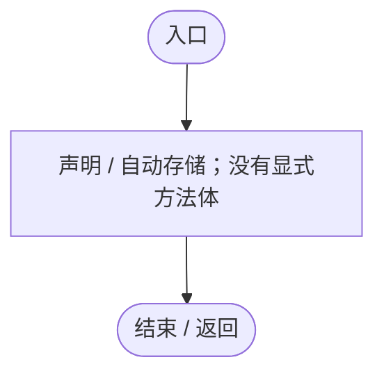

## Host.set · L19

`private set`

### Editor / Player · 语法控制结构 / 声明（非CFG）

## Active.get · L21

`public bool Active`

★ 适配：已孵化的幼体才可营养寄生，食腐出错分支优先接管食性，避免复制基因同时执行两套吸收。

### Editor / Player · 语法控制结构 / 声明（非CFG）

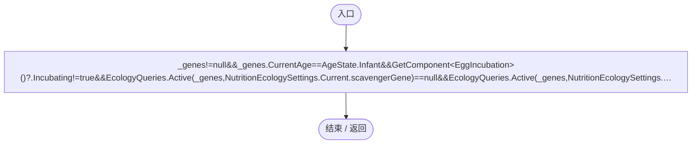

项目内调用/回调引用：

- [EntityGeneController.CurrentAge.get · L34](7494d53178552f0e.md#m83a42c16950b22a4)（访问器）
- [EcologyQueries.Active · L28](bdf7ccc2c9c0452f.md#m4fb10ad424167e3b)（方法）
- [NutritionEcologySettings.Current.get · L19](846a17351dbd6aa4.md#mb3eb930022e314f3)（访问器）

## CountOn · L22

`public static int CountOn(DarwinEntity host)`

### Editor / Player · Roslyn编译器控制流

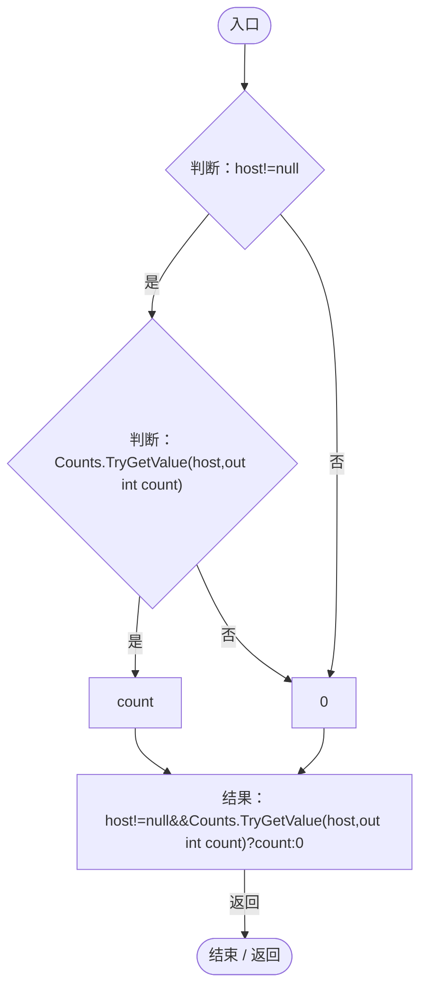

## Reset · L23

`[RuntimeInitializeOnLoadMethod(RuntimeInitializeLoadType.SubsystemRegistration)] private static void Reset()`

### Editor / Player · Roslyn编译器控制流

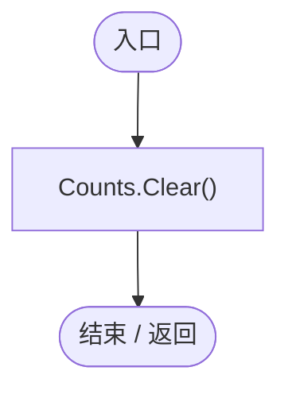

## Awake · L24

`private void Awake()`

### Editor / Player · Roslyn编译器控制流

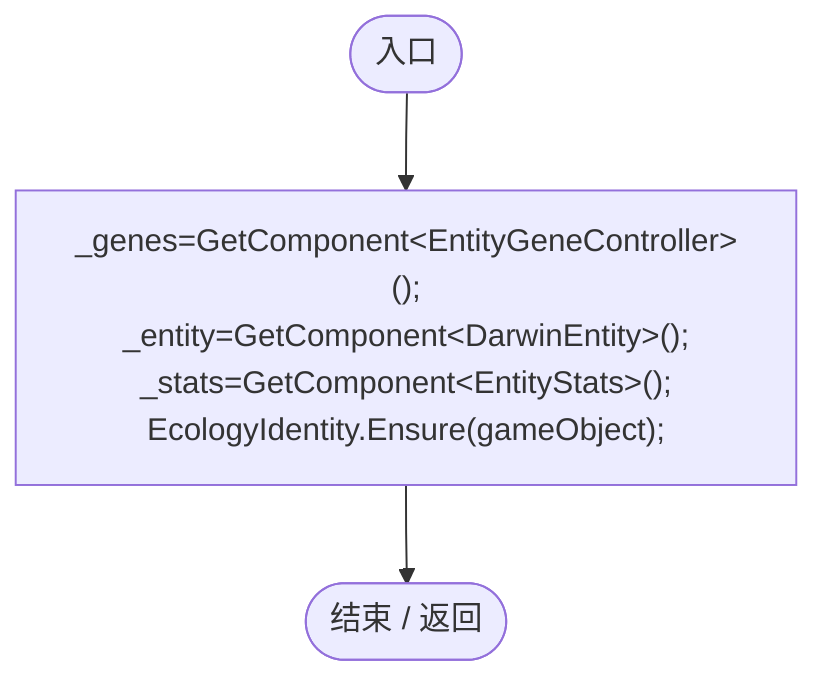

项目内调用/回调引用：

- [EcologyIdentity.Ensure · L22](bdf7ccc2c9c0452f.md#m40609054a6d444d0)（方法）

## Update · L25

`private void Update()`

### Editor / Player · Roslyn编译器控制流

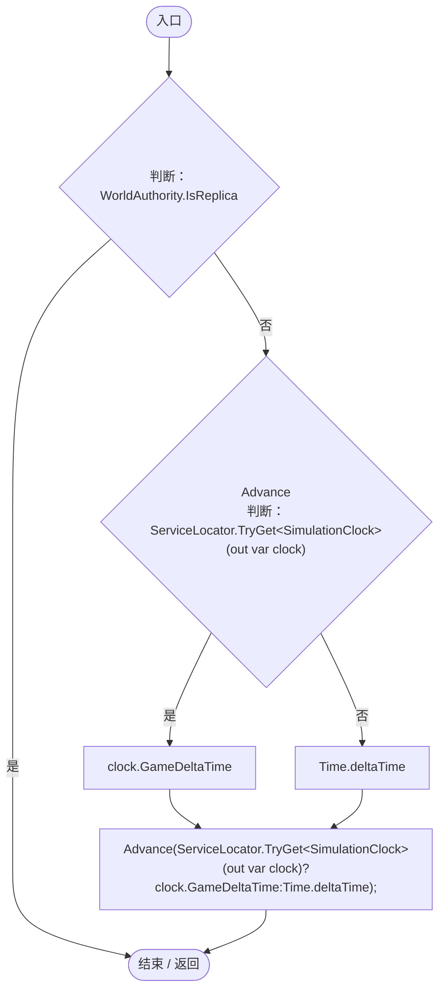

项目内调用/回调引用：

- [NutritionParasite.Advance · L33](4a18785b7c1e1484.md#mf60afdf9561ee9ff)（方法）
- [ServiceLocator.TryGet · L26](f2fdbe9f9ccd93cb.md#m143b24e6d58471b0)（方法）
- [SimulationClock.GameDeltaTime.get · L26](a8f444aec9614b0a.md#me7f11abae18a4f2d)（访问器）

## OnDisable · L26

`private void OnDisable()`

### Editor / Player · Roslyn编译器控制流

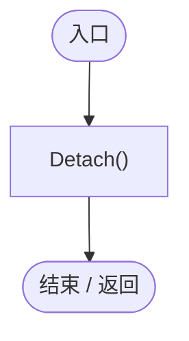

项目内调用/回调引用：

- [NutritionParasite.Detach · L66](4a18785b7c1e1484.md#m58a06ca68acac1ce)（方法）

## CanHost · L27

`private bool CanHost(DarwinEntity host)`

### Editor / Player · Roslyn编译器控制流

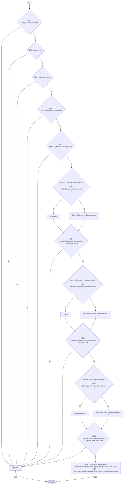

项目内调用/回调引用：

- [EcologyQueries.Alive · L38](bdf7ccc2c9c0452f.md#mb2877c487f449970)（方法）
- [NutritionParasite.CountOn · L22](4a18785b7c1e1484.md#m3b1e8683dc9deed4)（方法）
- [AntColonyWorker.IsCarried · L140](8a0cca2020271b6f.md#mf552b19f9aeffe97)（方法）
- [PopulationBehavior.SameGroup · L123](21e4f62f75a9a80f.md#m7a9d850e1d8967d4)（方法）
- [EntityStats.TryGet · L90](75aa86a368efdf24.md#m24ee1433e4a70d94)（方法）
- [NutritionEcologySettings.Current.get · L19](846a17351dbd6aa4.md#mb3eb930022e314f3)（访问器）

## Advance · L33

`public void Advance(float dt)`

### Editor / Player · Roslyn编译器控制流

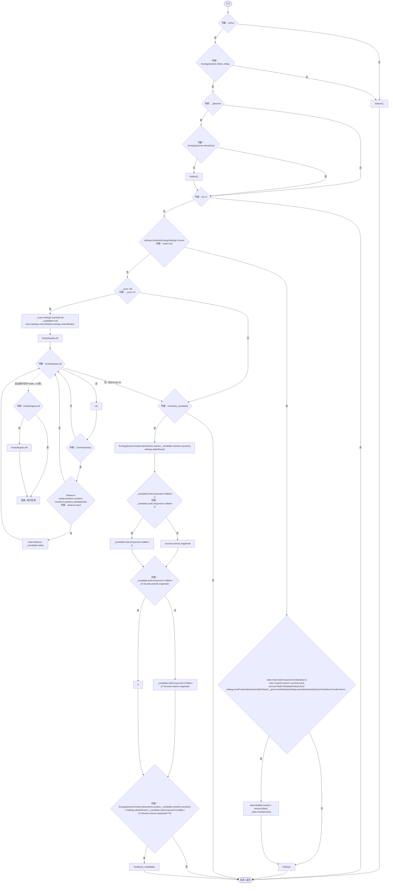

项目内调用/回调引用：

- [EcologyQueries.Alive · L38](bdf7ccc2c9c0452f.md#mb2877c487f449970)（方法）
- [NutritionParasite.Detach · L66](4a18785b7c1e1484.md#m58a06ca68acac1ce)（方法）
- [NutritionParasite.Host.get · L19](4a18785b7c1e1484.md#me3131db9b6e16399)（访问器）
- [NutritionEcologySettings.Current.get · L19](846a17351dbd6aa4.md#mb3eb930022e314f3)（访问器）
- [EntityStats.TryGet · L90](75aa86a368efdf24.md#m24ee1433e4a70d94)（方法）
- [EntityGeneController.GetAttribute · L257](7494d53178552f0e.md#m600509f72d274f0c)（方法）
- [NutritionTransfer.Room · L12](081d3b8ff683e442.md#md8b133015774a4ef)（方法）
- [EntityStats.Modify · L111](75aa86a368efdf24.md#m9c837be197158240)（方法）
- [EntityStats.Feed · L95](75aa86a368efdf24.md#mc025822ff1eb86a0)（方法）
- [NutritionParasite.Follow · L64](4a18785b7c1e1484.md#mfd6fa4c4410c59e0)（方法）
- [NutritionParasite.CanHost · L27](4a18785b7c1e1484.md#m4aa9d9bc53591cf2)（方法）
- [EcologyQueries.Distance · L42](bdf7ccc2c9c0452f.md#mba9c3e3c95d0f2dd)（方法）
- [NutritionParasite.TryAttach · L53](4a18785b7c1e1484.md#mb366b3d9a5de3d82)（方法）

## Destination · L51

`public bool Destination(out Vector3 point)`

### Editor / Player · Roslyn编译器控制流

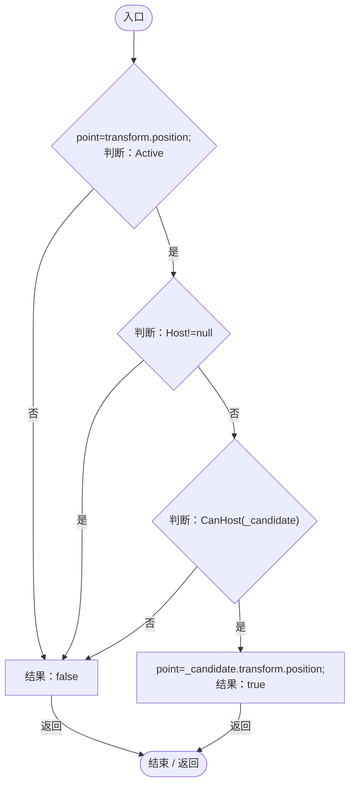

项目内调用/回调引用：

- [NutritionParasite.Host.get · L19](4a18785b7c1e1484.md#me3131db9b6e16399)（访问器）
- [NutritionParasite.CanHost · L27](4a18785b7c1e1484.md#m4aa9d9bc53591cf2)（方法）

## TryAttach · L53

`public bool TryAttach(DarwinEntity host,NutritionParasiteSave restore=null)`

### Editor / Player · Roslyn编译器控制流

```mermaid
flowchart TD
  b0(["入口"])
  b1{"判断：Active"}
  b2{"判断：CanHost(host)"}
  b3["结果：false"]
  b4{"判断：restore==null"}
  b5["EcologyQueries.Distance(transform.position,host.transform.position)<br/>NutritionEcologySettings.Current.attachReach"]
  b6{"host.GetComponent&lt;Collider&gt;()<br/>判断：host.GetComponent&lt;Collider&gt;()"}
  b7[".bounds.extents.magnitude"]
  b8["host.GetComponent&lt;Collider&gt;()"]
  b9{"判断：host.GetComponent&lt;Collider&gt;()?.bounds.extents.magnitude"}
  b10["host.GetComponent&lt;Collider&gt;()?.bounds.extents.magnitude"]
  b11["0"]
  b12{"判断：EcologyQueries.Distance(transform.position,host.transform.position)&gt;NutritionEcologySettings.Current.attachReach+(host.GetComponent&lt;Collider&gt;()?.bounds.extents.magnitude??0)"}
  b13["结果：false"]
  b14{"Detach();<br/>Host=host;<br/>_attached=true;<br/>Counts[host]=CountOn(host)+1;<br/>_body=GetComponent&lt;Rigidbody&gt;();<br/>判断：_body!=null"}
  b15["_kinematic"]
  b16{"restore<br/>判断：restore"}
  b17[".originalKinematic"]
  b18["restore"]
  b19{"判断：restore?.originalKinematic"}
  b20["restore?.originalKinematic"]
  b21["_body.isKinematic"]
  b22["_kinematic=restore?.originalKinematic??_body.isKinematic;"]
  b23["_detect"]
  b24{"restore<br/>判断：restore"}
  b25[".originalDetect"]
  b26["restore"]
  b27{"判断：restore?.originalDetect"}
  b28["restore?.originalDetect"]
  b29["_body.detectCollisions"]
  b30["_detect=restore?.originalDetect??_body.detectCollisions;"]
  b31{"判断：_body.isKinematic"}
  b32["_body.linearVelocity=Vector3.zero;"]
  b33["_body.isKinematic=true;<br/>_body.detectCollisions=false;"]
  b34["GetComponentsInChildren&lt;Renderer&gt;(true)"]
  b35{"判断：GetComponentsInChildren&lt;Renderer&gt;(true)"}
  b36["var<br/>_renderers[renderer]=renderer.enabled;<br/>renderer.enabled=false;"]
  b37{"GetComponentsInChildren&lt;Renderer&gt;(true)<br/>判断：GetComponentsInChildren&lt;Renderer&gt;(true)"}
  b38["GetComponentsInChildren&lt;Renderer&gt;(true)"]
  b39["连接 / 离开区域"]
  b40["GetComponentsInChildren&lt;Collider&gt;(true)"]
  b41{"判断：GetComponentsInChildren&lt;Collider&gt;(true)"}
  b42["var<br/>_colliders[collider]=collider.enabled;<br/>collider.enabled=false;"]
  b43{"GetComponentsInChildren&lt;Collider&gt;(true)<br/>判断：GetComponentsInChildren&lt;Collider&gt;(true)"}
  b44["GetComponentsInChildren&lt;Collider&gt;(true)"]
  b45["连接 / 离开区域"]
  b46["Follow();<br/>结果：true"]
  b47(["结束 / 返回"])
  b0 --> b1
  b1 -->|"是"| b2
  b1 -->|"否"| b3
  b2 -->|"否"| b3
  b2 -->|"是"| b4
  b3 -->|"返回"| b47
  b4 -->|"是"| b5
  b4 -->|"否"| b14
  b5 --> b6
  b6 -->|"否"| b7
  b6 -->|"是"| b8
  b7 --> b9
  b8 --> b9
  b9 -->|"否"| b10
  b9 -->|"是"| b11
  b10 --> b12
  b11 --> b12
  b12 -->|"是"| b13
  b12 -->|"否"| b14
  b13 -->|"返回"| b47
  b14 -->|"是"| b15
  b14 -->|"否"| b34
  b15 --> b16
  b16 -->|"否"| b17
  b16 -->|"是"| b18
  b17 --> b19
  b18 --> b19
  b19 -->|"否"| b20
  b19 -->|"是"| b21
  b20 --> b22
  b21 --> b22
  b22 --> b23
  b23 --> b24
  b24 -->|"否"| b25
  b24 -->|"是"| b26
  b25 --> b27
  b26 --> b27
  b27 -->|"否"| b28
  b27 -->|"是"| b29
  b28 --> b30
  b29 --> b30
  b30 --> b31
  b31 -->|"否"| b32
  b31 -->|"是"| b33
  b32 --> b33
  b33 --> b34
  b34 --> b35
  b35 -->|"是"| b36
  b35 -->|"否 · 经过finally 37"| b40
  b36 --> b35
  b37 -->|"否"| b38
  b37 -->|"是"| b39
  b38 --> b39
  b40 --> b41
  b41 -->|"是"| b42
  b41 -->|"否 · 经过finally 43"| b46
  b42 --> b41
  b43 -->|"否"| b44
  b43 -->|"是"| b45
  b44 --> b45
  b46 -->|"返回"| b47
  b35 -. "退出保护区时 finally（示意）" .-> b37
  b41 -. "退出保护区时 finally（示意）" .-> b43

```

项目内调用/回调引用：

- [NutritionParasite.CanHost · L27](4a18785b7c1e1484.md#m4aa9d9bc53591cf2)（方法）
- [EcologyQueries.Distance · L42](bdf7ccc2c9c0452f.md#mba9c3e3c95d0f2dd)（方法）
- [NutritionEcologySettings.Current.get · L19](846a17351dbd6aa4.md#mb3eb930022e314f3)（访问器）
- [NutritionParasite.Detach · L66](4a18785b7c1e1484.md#m58a06ca68acac1ce)（方法）
- [NutritionParasite.Host.set · L19](4a18785b7c1e1484.md#me0ee571a8b78f370)（访问器）
- [NutritionParasite.CountOn · L22](4a18785b7c1e1484.md#m3b1e8683dc9deed4)（方法）
- [NutritionParasite.Follow · L64](4a18785b7c1e1484.md#mfd6fa4c4410c59e0)（方法）

## LateUpdate · L63

`private void LateUpdate()`

### Editor / Player · Roslyn编译器控制流

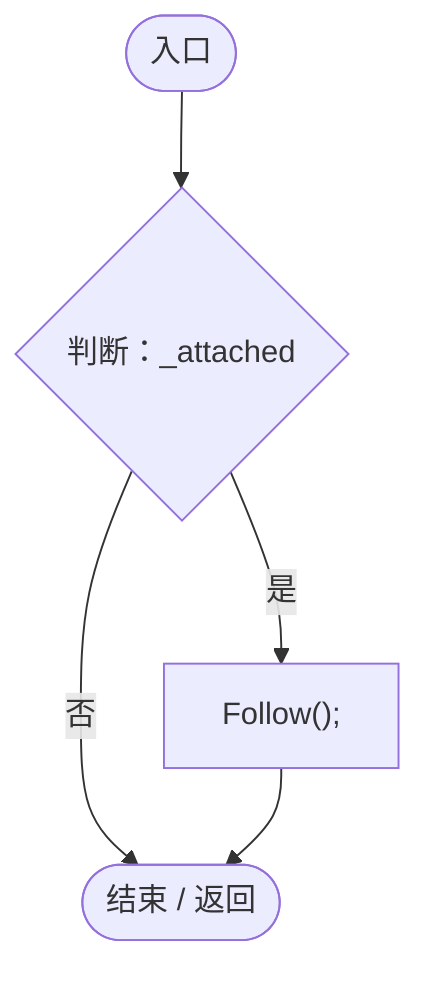

项目内调用/回调引用：

- [NutritionParasite.Follow · L64](4a18785b7c1e1484.md#mfd6fa4c4410c59e0)（方法）

## Follow · L64

`private void Follow()`

### Editor / Player · Roslyn编译器控制流

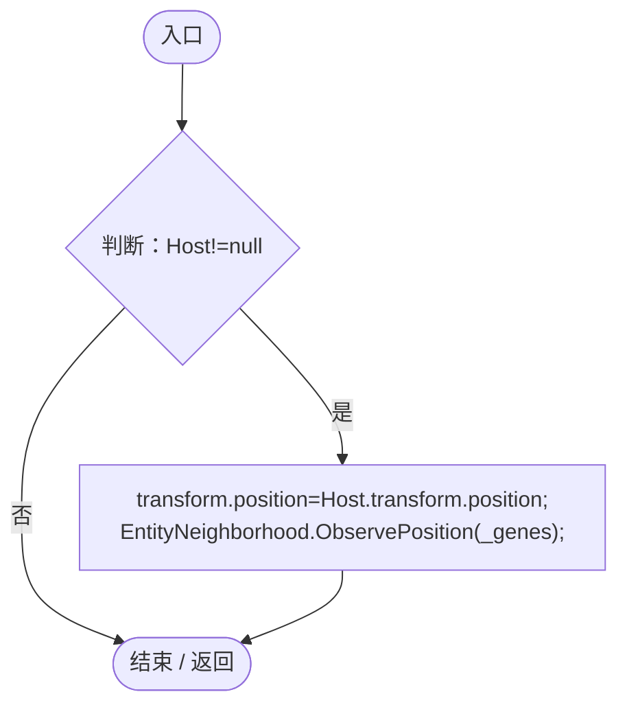

项目内调用/回调引用：

- [NutritionParasite.Host.get · L19](4a18785b7c1e1484.md#me3131db9b6e16399)（访问器）
- [EntityNeighborhood.ObservePosition · L63](e5e24c4aff0395b1.md#m994f4a7ab30bcd1d)（方法）

## Capture · L65

`public NutritionParasiteSave Capture()`

### Editor / Player · Roslyn编译器控制流

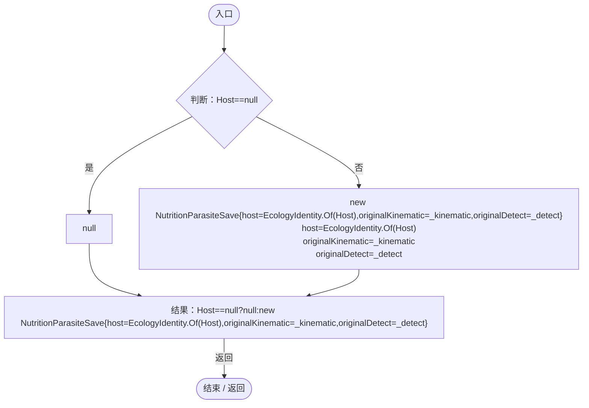

项目内调用/回调引用：

- [NutritionParasite.Host.get · L19](4a18785b7c1e1484.md#me3131db9b6e16399)（访问器）
- [EcologyIdentity.Of · L21](bdf7ccc2c9c0452f.md#m1143cf9570a93b72)（方法）

## Detach · L66

`public void Detach()`

### Editor / Player · Roslyn编译器控制流

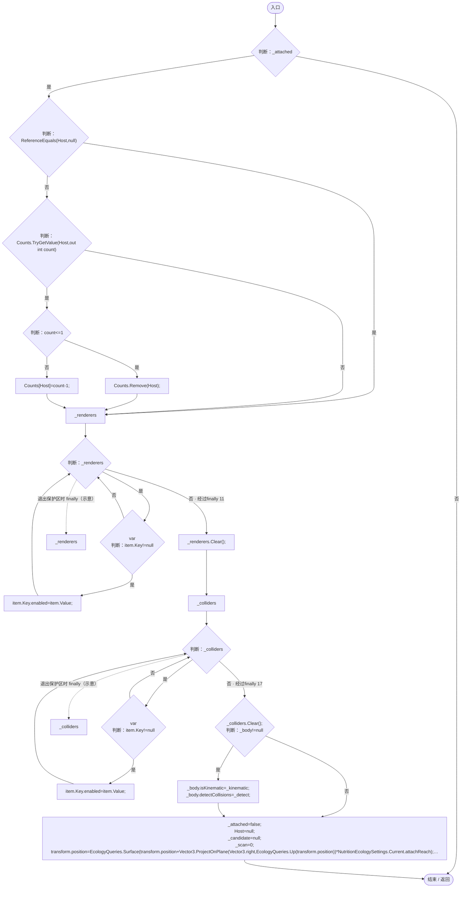

项目内调用/回调引用：

- [NutritionParasite.Host.get · L19](4a18785b7c1e1484.md#me3131db9b6e16399)（访问器）
- [NutritionParasite.Host.set · L19](4a18785b7c1e1484.md#me0ee571a8b78f370)（访问器）
- [EcologyQueries.Surface · L47](bdf7ccc2c9c0452f.md#m2f1f6873ee5fc8df)（方法）
- [EcologyQueries.Up · L41](bdf7ccc2c9c0452f.md#maca7070196f125fd)（方法）
- [NutritionEcologySettings.Current.get · L19](846a17351dbd6aa4.md#mb3eb930022e314f3)（访问器）
- [EntityNeighborhood.ObservePosition · L63](e5e24c4aff0395b1.md#m994f4a7ab30bcd1d)（方法）
