# ObservationMutationRegression.cs

[返回总索引](../README.md) · `Editor` · `Assets/DarwinPark/Editor/ObservationMutationRegression.cs`

[源文件](../../../Assets/DarwinPark/Editor/ObservationMutationRegression.cs) · 源码校验：`b2e9626127e90acb8f8c2b0c0d1a7e4f0360dfffcb37a3b6da76eed88bf3ece8`

方法按源文件位置排列。事件/回调引用不表示立即执行；分支与异常说明见总索引。完整源码与可点击关系图请打开离线手册。

<a id="m9c42f53d5fa6993b"></a>

## Folder.get · L27

`private static string Folder`


### Editor · 语法控制结构 / 声明（非CFG）

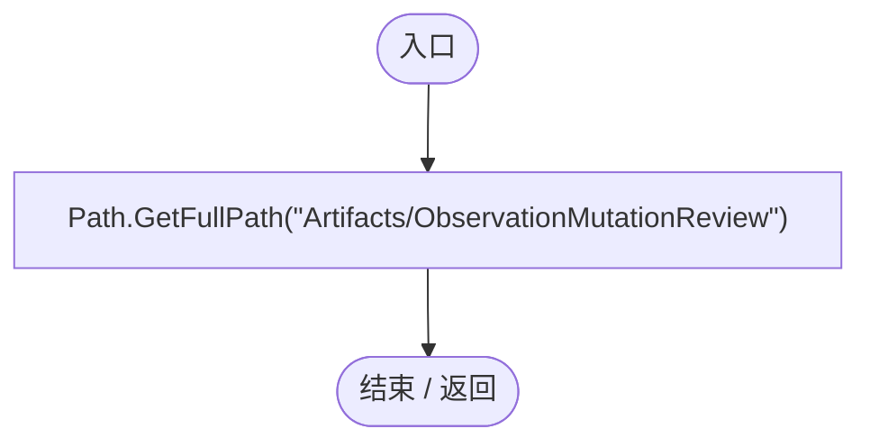

<a id="m73f77faccd7c9970"></a>

## ObservationMutationRegression.ctor · L28

`static ObservationMutationRegression()`


### Editor · Roslyn编译器控制流

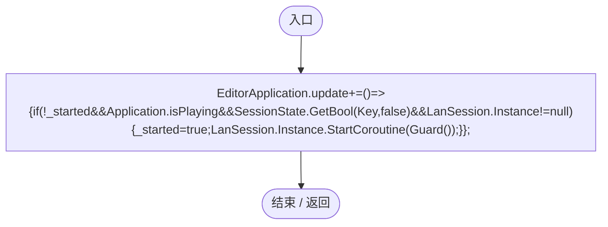

项目内调用/回调引用：

- [ObservationMutationRegression.回调@28 · L28](4acb930dd1eb9363.md#m8e1abafbc208c30b)（回调/委托）

<a id="m8e1abafbc208c30b"></a>

## 回调@28 · L28

`( … => 回调`


### Editor · Roslyn编译器控制流

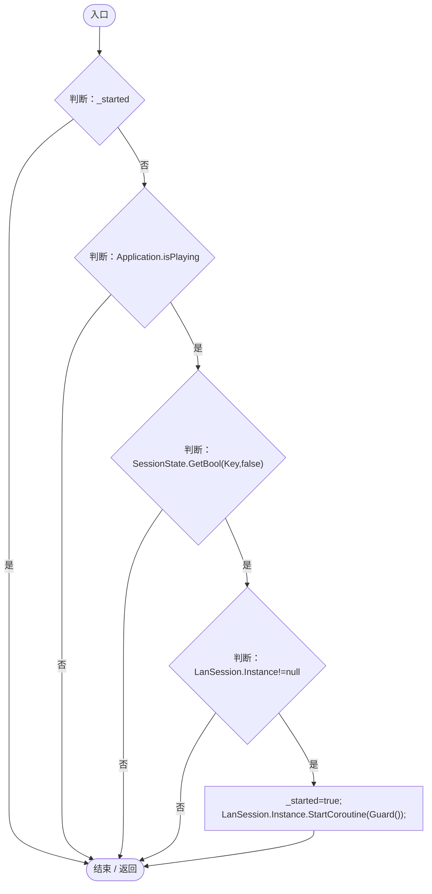

项目内调用/回调引用：

- [LanSession.Instance.get · L23](9fb633eebffe669c.md#mbf83306994878383)（访问器）
- [ObservationMutationRegression.Guard · L31](4acb930dd1eb9363.md#m52d8258fd78e75d6)（方法）

<a id="m61ab1f0ef9133315"></a>

## RunBatch · L29

`public static void RunBatch()`


### Editor · Roslyn编译器控制流

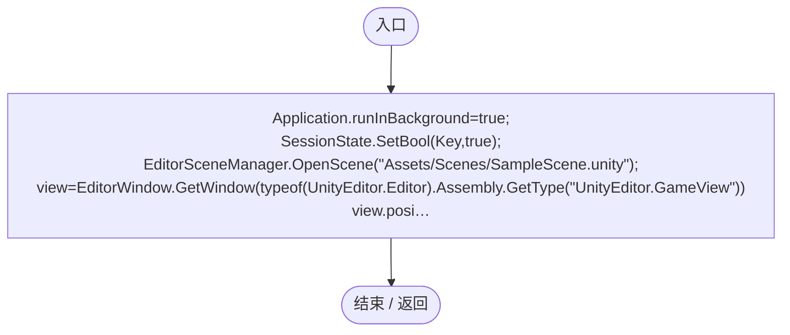

<a id="m4b26bb1cd1216d63"></a>

## Check · L30

`private static void Check(bool value,string message)`


### Editor · Roslyn编译器控制流

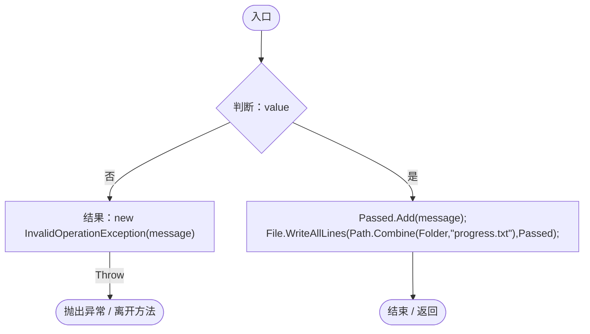

<a id="m52d8258fd78e75d6"></a>

## Guard · L31

`private static IEnumerator Guard()`


### Editor · Roslyn编译器控制流

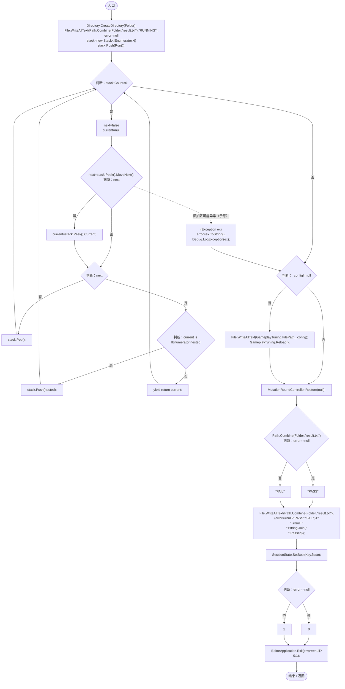

项目内调用/回调引用：

- [ObservationMutationRegression.Run · L48](4acb930dd1eb9363.md#mf942b08857c82d83)（方法）
- [GameplayTuning.Reload · L59](db546e5713b32d53.md#m08a291b1e79e7088)（方法）
- [MutationRoundController.Restore · L56](3a238ee75b15c52c.md#m8fd13208bdd39731)（方法）

<a id="md398aba53a8bf35d"></a>

## Wait · L38

`private static IEnumerator Wait(Func<bool> ready)`


### Editor · Roslyn编译器控制流

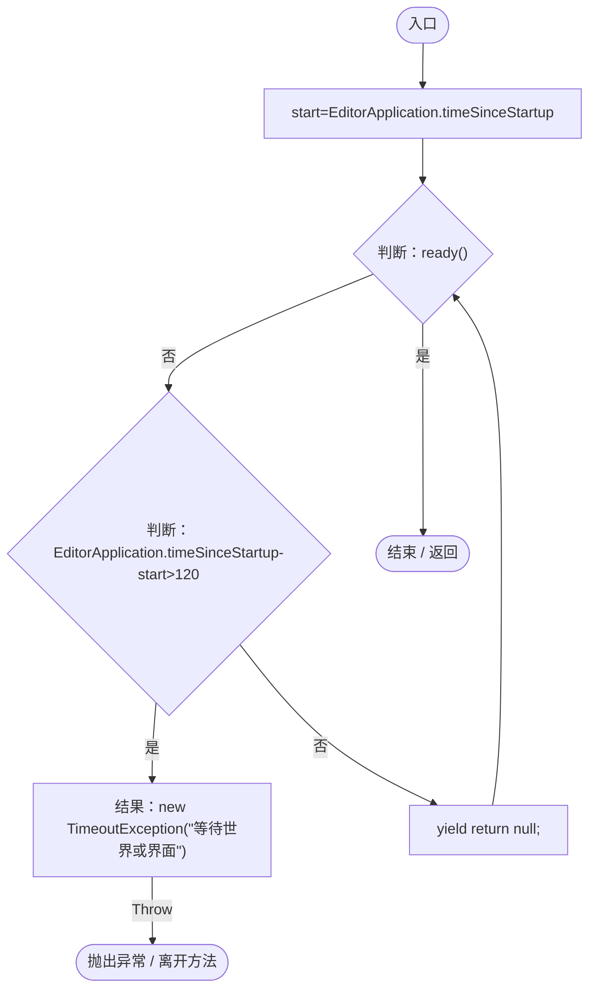

<a id="mddda11ab3b51564c"></a>

## Clear · L39

`private static void Clear()`


### Editor · Roslyn编译器控制流

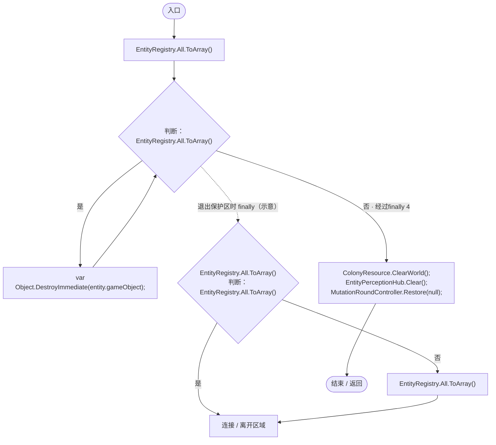

项目内调用/回调引用：

- [ColonyResource.ClearWorld · L109](293dbaecfff4b585.md#m4a3572d1077d33bd)（方法）
- [EntityPerceptionHub.Clear · L79](aeecc36cb2c3cc24.md#m31fc0fb1c51cd043)（方法）
- [MutationRoundController.Restore · L56](3a238ee75b15c52c.md#m8fd13208bdd39731)（方法）

<a id="m60849532af1a3fd0"></a>

## Spawn · L40

`private static DarwinEntity Spawn(Vector3 point,params (string,float)[] genes)`


### Editor · Roslyn编译器控制流

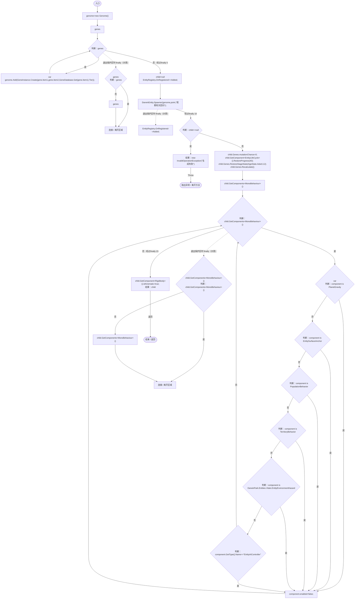

项目内调用/回调引用：

- [Genome.Add · L19](a2ef23f865bc7ee8.md#md9cfdc94b8b8d40f)（方法）
- [GeneInstance.Create · L20](f82e1498d67f5afd.md#m72e94c278de3cf8b)（方法）
- [GeneDatabase.Get · L136](ec0a03483435a863.md#me6a5fefe6c3492f9)（方法）
- [DarwinEntity.Genes.get · L14](70798dde169f2e8b.md#m622eb1adf401d431)（访问器）
- [EntityLifeCycle.RestoreProgress · L52](9f4138bfbae654b7.md#m007c73a0c714c238)（方法）
- [EntityGeneController.RestoreStageState · L56](7494d53178552f0e.md#m37c1dbfa64e7c2ce)（方法）
- [EntityGeneController.Recalculate · L118](7494d53178552f0e.md#m707d9a56b0c7c609)（方法）
- [ObservationMutationRegression.Added · L42](4acb930dd1eb9363.md#m5a3368de638d1f45)（局部函数）

<a id="m5a3368de638d1f45"></a>

## Added · L42

`void Added(DarwinEntity value)`


### Editor · Roslyn编译器控制流

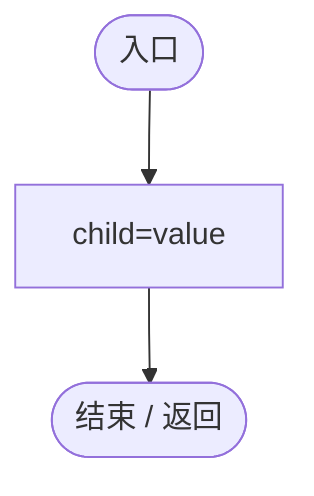

<a id="mf942b08857c82d83"></a>

## Run · L48

`private static IEnumerator Run()`


### Editor · Roslyn编译器控制流

```mermaid
flowchart TD
  b0(["入口"])
  b1["session=Object.FindFirstObjectByType&lt;WorldSessionManager&gt;()<br/>session.autoSaveInterval=36000;<br/>planet=Object.FindFirstObjectByType&lt;PlanetTerrainMeshBuilder&gt;()<br/>planet.subdivisions=16;<br/>typeof(WorldSessionManager).GetField(&quot;_initialTerrain&quot;,Bi…"]
  b2{"GeneDatabase.Get(&quot;gene_observation&quot;)<br/>判断：GeneDatabase.Get(&quot;gene_observation&quot;)"}
  b3[".States.Count"]
  b4["GeneDatabase.Get(&quot;gene_observation&quot;)"]
  b5{"判断：GeneDatabase.Get(&quot;gene_observation&quot;)?.States.Count==2"}
  b6["GeneTreeStorage.Active.nodes.Any(n=&gt;n.id==&quot;gene_observation&quot;)"]
  b7["GeneDatabase.Get(&quot;gene_observation&quot;)?.States.Count==2"]
  b8["Check(GeneDatabase.Get(&quot;gene_observation&quot;)?.States.Count==2&amp;&amp;GeneTreeStorage.Active.nodes.Any(n=&gt;n.id==&quot;gene_observation&quot;),&quot;观察基因两状态与默认树节点可用&quot;);"]
  b9["actors=new List&lt;DarwinEntity&gt;()"]
  b10["i=0"]
  b11{"判断：i&lt;100"}
  b12["actors.Add(Spawn(new Vector3(i*3,350,0),(&quot;gene_storage&quot;,50),(&quot;gene_repair&quot;,50),(&quot;gene_environment&quot;,50)));<br/>i++"]
  b13["tuning.mutationRoundsEnabled=true;<br/>tuning.mutationPopulationFraction=.1f;<br/>tuning.mutationRoundSeconds=2;<br/>tuning.mutationAttemptsPerFrame=1000;<br/>UnityEngine.Random.InitState(8317);<br/>genomes=actors.Select(e=&gt;JsonUtility.ToJson(e.Genes.Genome…"]
  b14{"判断：MutationRoundController.LastPopulation==100"}
  b15{"判断：MutationRoundController.LastSelected==10"}
  b16["MutationRoundController.Attempts==10"]
  b17["MutationRoundController.LastPopulation==100&amp;&amp;MutationRoundController.LastSelected==10&amp;&amp;MutationRoundController.Attempts==10"]
  b18["Check(MutationRoundController.LastPopulation==100&amp;&amp;MutationRoundController.LastSelected==10&amp;&amp;MutationRoundController.Attempts==10,&quot;100活体一轮仅随机选择10个身份&quot;);"]
  b19["Check(actors.Where((e,i)=&gt;JsonUtility.ToJson(e.Genes.Genome)!=genomes[i]).Count()==10,&quot;实际10个不同实体基因改变，旧个体概率0不抵消全局名额&quot;);<br/>Check(actors.Skip(10).Where((e,i)=&gt;JsonUtility.ToJson(e.Genes.Genome)!=genomes[i+10]).Any(),&quot;随机选择不固定落在注册表前10个&quot;);<br/>rounds…"]
  b20{"判断：MutationRoundController.LastSelected==0"}
  b21["MutationRoundController.Attempts==0"]
  b22["MutationRoundController.LastSelected==0"]
  b23["Check(MutationRoundController.LastSelected==0&amp;&amp;MutationRoundController.Attempts==0,&quot;0比例不强行变异一个实体&quot;);"]
  b24["MutationRoundController.Restore(null);<br/>tuning.mutationPopulationFraction=.5f;<br/>tuning.mutationAttemptsPerFrame=3;<br/>GlobalMutationManager.Advance(2);"]
  b25{"判断：MutationRoundController.LastSelected==50"}
  b26{"判断：MutationRoundController.Attempts==3"}
  b27["MutationRoundController.Queued==47"]
  b28["MutationRoundController.LastSelected==50&amp;&amp;MutationRoundController.Attempts==3&amp;&amp;MutationRoundController.Queued==47"]
  b29["Check(MutationRoundController.LastSelected==50&amp;&amp;MutationRoundController.Attempts==3&amp;&amp;MutationRoundController.Queued==47,&quot;每帧预算保留剩余47人而不丢名单&quot;);"]
  b30["state=MutationRoundController.Capture()<br/>Check(state.pending.Distinct().Count()==47,&quot;持久化待执行名单不重复&quot;);<br/>session.SaveNow(false);<br/>disk=WorldSaveStore.Read(WorldSaveStore.FileFor(session.Current.id))<br/>Check(disk.mutationRounds.pending.SequenceEqu…"]
  b31["MutationRoundController.Validate(bad);"]
  b32["rejected=true;"]
  b33["Check(rejected,&quot;重复待变异名单在清场前拒绝&quot;);<br/>session.Open(disk);<br/>yield return Wait(()=&gt;!session.Busy);<br/>clock.Pause();"]
  b34{"判断：MutationRoundController.Queued==47"}
  b35["MutationRoundController.Attempts==3"]
  b36["MutationRoundController.Queued==47"]
  b37["Check(MutationRoundController.Queued==47&amp;&amp;MutationRoundController.Attempts==3,&quot;真正读档恢复剩余名单，不重新抽50人&quot;);"]
  b38["tuning=GameplayTuning.Current;<br/>tuning.mutationRoundsEnabled=true;<br/>tuning.mutationAttemptsPerFrame=3;"]
  b39["i=0"]
  b40{"判断：i&lt;16"}
  b41["GlobalMutationManager.Advance(.01f);<br/>i++"]
  b42{"判断：MutationRoundController.Queued==0"}
  b43["MutationRoundController.Attempts==50"]
  b44["MutationRoundController.Queued==0"]
  b45["Check(MutationRoundController.Queued==0&amp;&amp;MutationRoundController.Attempts==50,&quot;后续帧恰好完成原50个名额&quot;);"]
  b46["locked=Spawn(new Vector3(0,350,5),(&quot;gene_population&quot;,20),(&quot;gene_locomotion&quot;,50))<br/>worker=locked.GetComponent&lt;AntColonyMember&gt;()<br/>worker.Assign(AntRole.Worker,Guid.NewGuid().ToString(&quot;N&quot;));<br/>lockedGenome=JsonUtility.ToJson(locked.Genes.Genom…"]
  b47{"判断：JsonUtility.ToJson(locked.Genes.Genome)==lockedGenome"}
  b48["MutationRoundController.LastSelected&lt;MutationRoundController.LastPopulation"]
  b49["JsonUtility.ToJson(locked.Genes.Genome)==lockedGenome"]
  b50["Check(JsonUtility.ToJson(locked.Genes.Genome)==lockedGenome&amp;&amp;MutationRoundController.LastSelected&lt;MutationRoundController.LastPopulation,&quot;全局100%名额也不绕过工匠基因锁定&quot;);"]
  b51["Clear();<br/>tuning.mutationRoundsEnabled=false;<br/>here=new Vector3(0,350,0)<br/>wide=Spawn(here,(&quot;gene_locomotion&quot;,50),(&quot;gene_observation&quot;,25),(&quot;gene_heterotrophy&quot;,100))<br/>attention=Spawn(here+Vector3.forward,(&quot;gene_locomotion&quot;,50),(&quot;gene_observati…"]
  b52{"判断：EntityPerceptionHub.Read(wide.Genes).Any(s=&gt;s.entity==target)"}
  b53["!EntityPerceptionHub.Read(wide.Genes).Any(s=&gt;s.entity==far)"]
  b54["EntityPerceptionHub.Read(wide.Genes).Any(s=&gt;s.entity==target)"]
  b55["Check(EntityPerceptionHub.Read(wide.Genes).Any(s=&gt;s.entity==target)&amp;&amp;!EntityPerceptionHub.Read(wide.Genes).Any(s=&gt;s.entity==far),&quot;只向观察者投递视野内实体坐标&quot;);"]
  b56["searches=EntityPerceptionHub.Searches"]
  b57["i=0"]
  b58{"判断：i&lt;100"}
  b59["EntityPerceptionHub.Read(wide.Genes);<br/>i++"]
  b60["Check(EntityPerceptionHub.Searches==searches,&quot;同帧100次行动子步复用一次收件箱&quot;);<br/>EntityPerceptionHub.TryLocate(wide.Genes,target,out var sampled);<br/>EntityPerceptionHub.Read(attention.Genes);<br/>target.transform.position+=Vector3.right*3;<br/>EntityNeighborhoo…"]
  b61{"判断：EntityPerceptionHub.TryLocate(wide.Genes,target,out var retained)"}
  b62["retained==sampled"]
  b63["EntityPerceptionHub.TryLocate(wide.Genes,target,out var retained)"]
  b64["Check(EntityPerceptionHub.TryLocate(wide.Genes,target,out var retained)&amp;&amp;retained==sampled,&quot;范围状态保持上次收到的采样坐标&quot;);"]
  b65{"判断：EntityPerceptionHub.TryLocate(attention.Genes,target,out var tracked)"}
  b66["tracked==target.transform.position"]
  b67["EntityPerceptionHub.TryLocate(attention.Genes,target,out var tracked)"]
  b68["Check(EntityPerceptionHub.TryLocate(attention.Genes,target,out var tracked)&amp;&amp;tracked==target.transform.position,&quot;注意力状态实时读取目标新坐标而不全量重搜&quot;);"]
  b69["target.transform.position=here+Vector3.right*100;<br/>EntityNeighborhood.ObservePosition(target.Genes);"]
  b70{"判断：EntityPerceptionHub.TryLocate(wide.Genes,target,out _)"}
  b71["!EntityPerceptionHub.TryLocate(attention.Genes,target,out _)"]
  b72["!EntityPerceptionHub.TryLocate(wide.Genes,target,out _)"]
  b73["Check(!EntityPerceptionHub.TryLocate(wide.Genes,target,out _)&amp;&amp;!EntityPerceptionHub.TryLocate(attention.Genes,target,out _),&quot;目标离开视野后不能继续获得追踪坐标&quot;);"]
  b74["target.transform.position=here+Vector3.right*10;<br/>EntityNeighborhood.ObservePosition(target.Genes);<br/>wide.Genes.Genome.Genes.First(g=&gt;g.DefinitionId==&quot;gene_observation&quot;).Enabled=false;<br/>wide.Genes.Recalculate();"]
  b75{"判断：EntityPerceptionHub.Range(wide.Genes)==0"}
  b76["!EntityPerceptionHub.TryLocate(wide.Genes,target,out _)"]
  b77["EntityPerceptionHub.Range(wide.Genes)==0"]
  b78["Check(EntityPerceptionHub.Range(wide.Genes)==0&amp;&amp;!EntityPerceptionHub.TryLocate(wide.Genes,target,out _),&quot;禁用观察基因立即撤销视野信息&quot;);"]
  b79["wide.Genes.Genome.Genes.First(g=&gt;g.DefinitionId==&quot;gene_observation&quot;).Enabled=true;<br/>wide.Genes.Recalculate();<br/>newborn=Spawn(here+Vector3.right*5,(&quot;gene_storage&quot;,50))<br/>Check(EntityPerceptionHub.Read(wide.Genes).Any(s=&gt;s.entity==newborn),&quot;同帧…"]
  b80["i=0"]
  b81{"判断：i&lt;300"}
  b82["Spawn(here+Vector3.right*(1000+i*3),(&quot;gene_storage&quot;,50));<br/>i++"]
  b83["EntityPerceptionHub.Clear();<br/>visits=EntityPerceptionHub.CandidateVisits<br/>EntityPerceptionHub.Read(wide.Genes);"]
  b84{"判断：EntityPerceptionHub.CandidateVisits-visits&lt;15"}
  b85["EntityCoordinateGrid.CandidateVisits&lt;30"]
  b86["EntityPerceptionHub.CandidateVisits-visits&lt;15"]
  b87["Check(EntityPerceptionHub.CandidateVisits-visits&lt;15&amp;&amp;EntityCoordinateGrid.CandidateVisits&lt;30,&quot;300个远处实体不进入行动候选或粗格距离判断&quot;);"]
  b88["found=PerceivedTargets.Nearest(wide.Genes,false,null,out var received)"]
  b89{"判断：found!=null"}
  b90["received!=default"]
  b91["found!=null"]
  b92["Check(found!=null&amp;&amp;received!=default,&quot;行动选择实际收到的目标和坐标&quot;);"]
  b93["builds=EntityCoordinateGrid.Builds<br/>yield return null;<br/>EntityCoordinateGrid.Query(here,50,new List&lt;EntityCoordinate&gt;());<br/>Check(EntityCoordinateGrid.Builds==builds,&quot;跨帧坐标未变化时复用视野粗格，不因营养快照刷新重建&quot;);<br/>raw=File.ReadAllText(GameplayTuning.FilePath)…"]
  b94{"判断：edited.Contains(&quot;//&quot;)"}
  b95["GameplayTuning.Parse(edited).mutationPopulationFraction==.2f"]
  b96["edited.Contains(&quot;//&quot;)"]
  b97["Check(edited.Contains(&quot;//&quot;)&amp;&amp;GameplayTuning.Parse(edited).mutationPopulationFraction==.2f,&quot;修改规则保留中文注释且数值正确&quot;);"]
  b98["missing=&quot;{\n//保留注释\n\&quot;version\&quot;:1\n}&quot;<br/>Check(GameplayTuning.Parse(MutationRuleEdits.Edit(missing,false,.3f,9)).mutationRoundSeconds==9,&quot;旧外部文件缺字段时可补齐规则且保留注释&quot;);<br/>panel=null<br/>yield return Wait(()=&gt;{panel=Object.FindFirstObjectByType&lt;Simulation…"]
  b99{"判断：panel.transform.parent.name==&quot;Page1&quot;"}
  b100["panel.Card.sizeDelta==new Vector2(260,164)"]
  b101["panel.transform.parent.name==&quot;Page1&quot;"]
  b102["Check(panel.transform.parent.name==&quot;Page1&quot;&amp;&amp;panel.Card.sizeDelta==new Vector2(260,164),&quot;规则控制卡位于第一页且与原卡片同尺寸：&quot;+panel.transform.parent.name+&quot; &quot;+panel.Card.sizeDelta);"]
  b103["panel.Card.Find(&quot;Fraction&quot;).GetComponent&lt;InputField&gt;().text=&quot;20&quot;;<br/>panel.Card.Find(&quot;Seconds&quot;).GetComponent&lt;InputField&gt;().text=&quot;12&quot;;<br/>panel.Card.Find(&quot;ApplyRules&quot;).GetComponent&lt;Button&gt;().onClick.Invoke();"]
  b104{"判断：GameplayTuning.Current.mutationPopulationFraction==.2f"}
  b105["GameplayTuning.Current.mutationRoundSeconds==12"]
  b106["GameplayTuning.Current.mutationPopulationFraction==.2f"]
  b107["Check(GameplayTuning.Current.mutationPopulationFraction==.2f&amp;&amp;GameplayTuning.Current.mutationRoundSeconds==12,&quot;规则卡真实按钮保存并应用比例与周期&quot;);"]
  b108["saved=File.ReadAllText(GameplayTuning.FilePath)<br/>WorldAuthority.CanEdit=false;<br/>panel.Card.Find(&quot;Fraction&quot;).GetComponent&lt;InputField&gt;().text=&quot;99&quot;;<br/>panel.Apply();<br/>Check(File.ReadAllText(GameplayTuning.FilePath)==saved,&quot;只读成员绕过按钮回调也不能写规则&quot;);<br/>Wo…"]
  b109(["结束 / 返回"])
  b0 --> b1
  b1 --> b2
  b2 -->|"否"| b3
  b2 -->|"是"| b4
  b3 --> b5
  b4 --> b5
  b5 -->|"是"| b6
  b5 -->|"否"| b7
  b6 --> b8
  b7 --> b8
  b8 --> b9
  b9 --> b10
  b10 --> b11
  b11 -->|"是"| b12
  b11 -->|"否"| b13
  b12 --> b11
  b13 --> b14
  b14 -->|"是"| b15
  b14 -->|"否"| b17
  b15 -->|"是"| b16
  b15 -->|"否"| b17
  b16 --> b18
  b17 --> b18
  b18 --> b19
  b19 --> b20
  b20 -->|"是"| b21
  b20 -->|"否"| b22
  b21 --> b23
  b22 --> b23
  b23 --> b24
  b24 --> b25
  b25 -->|"是"| b26
  b25 -->|"否"| b28
  b26 -->|"是"| b27
  b26 -->|"否"| b28
  b27 --> b29
  b28 --> b29
  b29 --> b30
  b30 --> b31
  b31 --> b33
  b32 --> b33
  b33 --> b34
  b34 -->|"是"| b35
  b34 -->|"否"| b36
  b35 --> b37
  b36 --> b37
  b37 --> b38
  b38 --> b39
  b39 --> b40
  b40 -->|"是"| b41
  b40 -->|"否"| b42
  b41 --> b40
  b42 -->|"是"| b43
  b42 -->|"否"| b44
  b43 --> b45
  b44 --> b45
  b45 --> b46
  b46 --> b47
  b47 -->|"是"| b48
  b47 -->|"否"| b49
  b48 --> b50
  b49 --> b50
  b50 --> b51
  b51 --> b52
  b52 -->|"是"| b53
  b52 -->|"否"| b54
  b53 --> b55
  b54 --> b55
  b55 --> b56
  b56 --> b57
  b57 --> b58
  b58 -->|"是"| b59
  b58 -->|"否"| b60
  b59 --> b58
  b60 --> b61
  b61 -->|"是"| b62
  b61 -->|"否"| b63
  b62 --> b64
  b63 --> b64
  b64 --> b65
  b65 -->|"是"| b66
  b65 -->|"否"| b67
  b66 --> b68
  b67 --> b68
  b68 --> b69
  b69 --> b70
  b70 -->|"否"| b71
  b70 -->|"是"| b72
  b71 --> b73
  b72 --> b73
  b73 --> b74
  b74 --> b75
  b75 -->|"是"| b76
  b75 -->|"否"| b77
  b76 --> b78
  b77 --> b78
  b78 --> b79
  b79 --> b80
  b80 --> b81
  b81 -->|"是"| b82
  b81 -->|"否"| b83
  b82 --> b81
  b83 --> b84
  b84 -->|"是"| b85
  b84 -->|"否"| b86
  b85 --> b87
  b86 --> b87
  b87 --> b88
  b88 --> b89
  b89 -->|"是"| b90
  b89 -->|"否"| b91
  b90 --> b92
  b91 --> b92
  b92 --> b93
  b93 --> b94
  b94 -->|"是"| b95
  b94 -->|"否"| b96
  b95 --> b97
  b96 --> b97
  b97 --> b98
  b98 --> b99
  b99 -->|"是"| b100
  b99 -->|"否"| b101
  b100 --> b102
  b101 --> b102
  b102 --> b103
  b103 --> b104
  b104 -->|"是"| b105
  b104 -->|"否"| b106
  b105 --> b107
  b106 --> b107
  b107 --> b108
  b108 --> b109
  b31 -. "保护区可能异常（示意）" .-> b32

```

项目内调用/回调引用：

- [PlanetClimateMap.Instance.get · L16](b4e9726c1bcf4c37.md#m3add54a419aeef9f)（访问器）
- [PlanetOreSystem.Instance.get · L8](86b3fbb4d9436121.md#m53f6a6af4b6dc252)（访问器）
- [WorldSessionManager.Create · L41](08741c7b7b9d9344.md#m6aadfeee8b90aacd)（方法）
- [ObservationMutationRegression.Wait · L38](4acb930dd1eb9363.md#md398aba53a8bf35d)（方法）
- [ServiceLocator.Get · L33](f2fdbe9f9ccd93cb.md#m2ae625299520c56d)（方法）
- [SimulationClock.Pause · L79](a8f444aec9614b0a.md#m30929d45a885d0f1)（方法）
- [PopulationMaintenance.Restore · L157](923ccc4e86c4786c.md#m6eadf366fa1602cc)（方法）
- [ObservationMutationRegression.Clear · L39](4acb930dd1eb9363.md#mddda11ab3b51564c)（方法）
- [GameplayTuning.Current.get · L44](db546e5713b32d53.md#m5713e7f86902b6fa)（访问器）
- [ObservationMutationRegression.Check · L30](4acb930dd1eb9363.md#m4b26bb1cd1216d63)（方法）
- [MutationRoundController.Ensure · L23](3a238ee75b15c52c.md#m7fb18fba8421489e)（方法）
- [GeneDatabase.Get · L136](ec0a03483435a863.md#me6a5fefe6c3492f9)（方法）
- [GeneTreeStorage.Active.get · L29](a885bad0d7dedee8.md#m864022905c32d666)（访问器）
- [ObservationMutationRegression.Spawn · L40](4acb930dd1eb9363.md#m60849532af1a3fd0)（方法）
- [EntityGeneController.TryStageMutation · L292](7494d53178552f0e.md#m558528fb545f95d5)（方法）
- [DarwinEntity.Genes.get · L14](70798dde169f2e8b.md#m622eb1adf401d431)（访问器）
- [GlobalMutationManager.Advance · L6](debf58c0eabf33e3.md#m6825a28640333e7b)（方法）
- [MutationRoundController.Restore · L56](3a238ee75b15c52c.md#m8fd13208bdd39731)（方法）
- [MutationRoundController.Capture · L54](3a238ee75b15c52c.md#mce55124f58ec6982)（方法）
- [WorldSessionManager.SaveNow · L169](08741c7b7b9d9344.md#mcf18d8aac368dda6)（方法）
- [WorldSaveStore.Read · L74](d67a35e5e3814c15.md#mde52fadbe0185af1)（方法）
- [WorldSaveStore.FileFor · L50](d67a35e5e3814c15.md#mce4509883be2e47e)（方法）
- [WorldSessionManager.Current.get · L21](08741c7b7b9d9344.md#m5d26a5eb846a8504)（访问器）
- [MutationRoundController.Validate · L61](3a238ee75b15c52c.md#ma902079930c7f779)（方法）
- [WorldSessionManager.Open · L60](08741c7b7b9d9344.md#m7bd56ef45131b4e5)（方法）
- [AntColonyMember.Assign · L62](baebd85c05598377.md#m4841f123cc075e2c)（方法）
- [EntityPerceptionHub.Range · L40](aeecc36cb2c3cc24.md#m82b4d3ee35795aa8)（方法）
- [EntityPerceptionHub.Read · L42](aeecc36cb2c3cc24.md#mbe2216b46b71081b)（方法）
- [EntityPerceptionHub.Searches.get · L23](aeecc36cb2c3cc24.md#m7431de46c6f0053f)（访问器）
- [EntityPerceptionHub.TryLocate · L57](aeecc36cb2c3cc24.md#m2cd96337ffd40bb4)（方法）
- [EntityNeighborhood.ObservePosition · L81](e5e24c4aff0395b1.md#m232339f32a8c5875)（方法）
- [EntityGeneController.Recalculate · L118](7494d53178552f0e.md#m707d9a56b0c7c609)（方法）
- [EntityGeneController.GetAttribute · L286](7494d53178552f0e.md#m18bff2b38f95b556)（方法）
- [EntityPerceptionHub.Clear · L79](aeecc36cb2c3cc24.md#m31fc0fb1c51cd043)（方法）
- [EntityPerceptionHub.CandidateVisits.get · L23](aeecc36cb2c3cc24.md#m55ffe61e92656f55)（访问器）
- [EntityCoordinateGrid.CandidateVisits.get · L16](f6d0404a662a5d5c.md#m06517dd1e7dd190f)（访问器）
- [PerceivedTargets.Nearest · L11](b78759d0d0a172e4.md#mb5f59684e2d33e59)（方法）
- [EntityCoordinateGrid.Builds.get · L16](f6d0404a662a5d5c.md#mf75ff28fb0fffeb0)（访问器）
- [EntityCoordinateGrid.Query · L26](f6d0404a662a5d5c.md#mb223b609771bd310)（方法）
- [MutationRuleEdits.Edit · L12](063e584187dad139.md#m207efabda03701cb)（方法）
- [GameplayTuning.Parse · L45](db546e5713b32d53.md#m1c90d248aa005a56)（方法）
- [SimulationRulesPanel.Apply · L45](dd1021765f4bd253.md#m60499461d27c81f8)（方法）
- [SimulationRulesPanel.Reload · L39](dd1021765f4bd253.md#me8000d5409edac90)（方法）
- [UIRoot.MainCanvas.get · L14](9c1421378791f0e0.md#maa2cc9baf1248477)（访问器）
- [MutationRuleEdits.Save · L25](063e584187dad139.md#me93e1cb551e381e8)（方法）
- [MapEntityStatisticsUI.RefreshNow · L74](da03211264cb6014.md#ma30ab70fe8c10f4f)（方法）
- [MapEntityGeneFilterUI.RefreshNow · L85](c2cd33111de06171.md#mb01da891ea5513fa)（方法）
- [ObservationMutationRegression.回调@51 · L51](4acb930dd1eb9363.md#m4bc4db522757942a)（回调/委托）
- [ObservationMutationRegression.回调@54 · L54](4acb930dd1eb9363.md#m6caf84176843d701)（回调/委托）
- [ObservationMutationRegression.回调@57 · L57](4acb930dd1eb9363.md#m1699bb6d70404507)（回调/委托）
- [ObservationMutationRegression.回调@61 · L61](4acb930dd1eb9363.md#m40855bcd3bde1b6b)（回调/委托）
- [ObservationMutationRegression.回调@62 · L62](4acb930dd1eb9363.md#m8e25f384e12818ab)（回调/委托）
- [ObservationMutationRegression.回调@69 · L69](4acb930dd1eb9363.md#m6757ec974e87dcb8)（回调/委托）
- [ObservationMutationRegression.回调@77 · L77](4acb930dd1eb9363.md#ma477925fb871f87f)（回调/委托）
- [ObservationMutationRegression.回调@77 · L77](4acb930dd1eb9363.md#m3889e75aa74760f5)（回调/委托）
- [ObservationMutationRegression.回调@81 · L81](4acb930dd1eb9363.md#m1f13ec9bb4742f12)（回调/委托）
- [ObservationMutationRegression.回调@82 · L82](4acb930dd1eb9363.md#m2ba443c665273f5b)（回调/委托）
- [ObservationMutationRegression.回调@82 · L82](4acb930dd1eb9363.md#mc3b2f07b46fc1725)（回调/委托）
- [ObservationMutationRegression.回调@89 · L89](4acb930dd1eb9363.md#mf9377570dee8582b)（回调/委托）

<a id="m4bc4db522757942a"></a>

## 回调@51 · L51

`( … => 回调`


### Editor · Roslyn编译器控制流

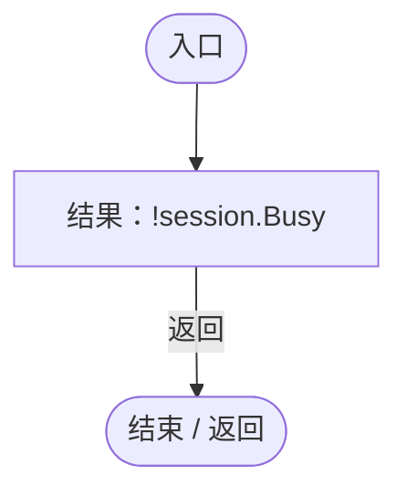

项目内调用/回调引用：

- [WorldSessionManager.Busy.get · L24](08741c7b7b9d9344.md#m4483e2e4f28f7c85)（访问器）

<a id="m6caf84176843d701"></a>

## 回调@54 · L54

`n … => 回调`


### Editor · Roslyn编译器控制流

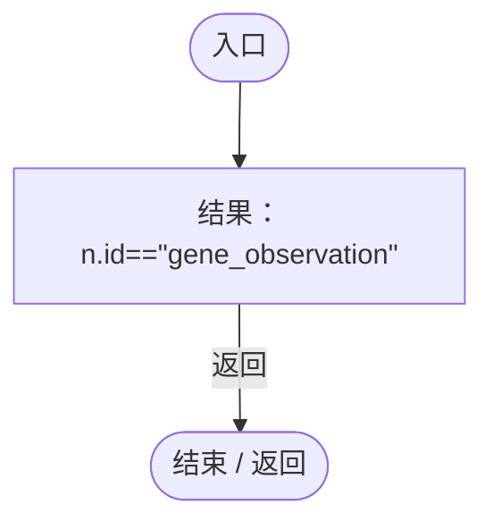

<a id="m1699bb6d70404507"></a>

## 回调@57 · L57

`e … => 回调`


### Editor · Roslyn编译器控制流

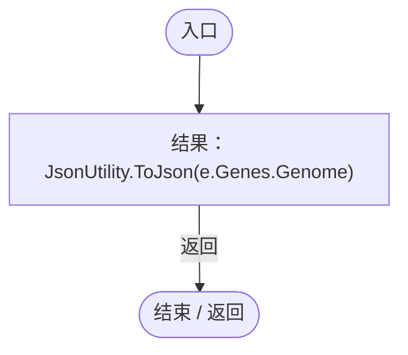

项目内调用/回调引用：

- [DarwinEntity.Genes.get · L14](70798dde169f2e8b.md#m622eb1adf401d431)（访问器）

<a id="m40855bcd3bde1b6b"></a>

## 回调@61 · L61

`( … => 回调`


### Editor · Roslyn编译器控制流

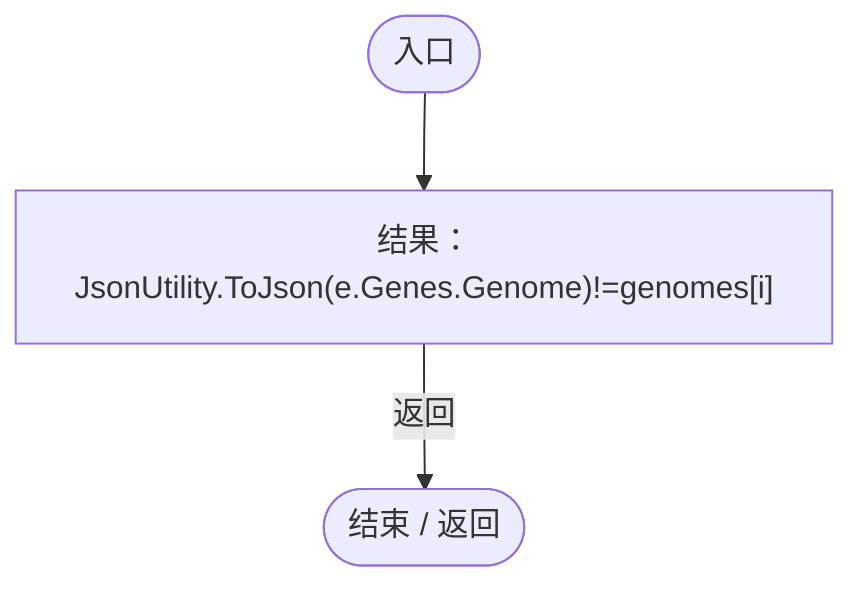

项目内调用/回调引用：

- [DarwinEntity.Genes.get · L14](70798dde169f2e8b.md#m622eb1adf401d431)（访问器）

<a id="m8e25f384e12818ab"></a>

## 回调@62 · L62

`( … => 回调`


### Editor · Roslyn编译器控制流

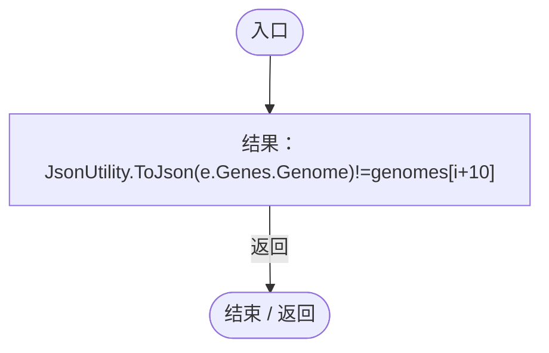

项目内调用/回调引用：

- [DarwinEntity.Genes.get · L14](70798dde169f2e8b.md#m622eb1adf401d431)（访问器）

<a id="m6757ec974e87dcb8"></a>

## 回调@69 · L69

`( … => 回调`


### Editor · Roslyn编译器控制流


项目内调用/回调引用：

- [WorldSessionManager.Busy.get · L24](08741c7b7b9d9344.md#m4483e2e4f28f7c85)（访问器）

<a id="ma477925fb871f87f"></a>

## 回调@77 · L77

`s … => 回调`


### Editor · Roslyn编译器控制流

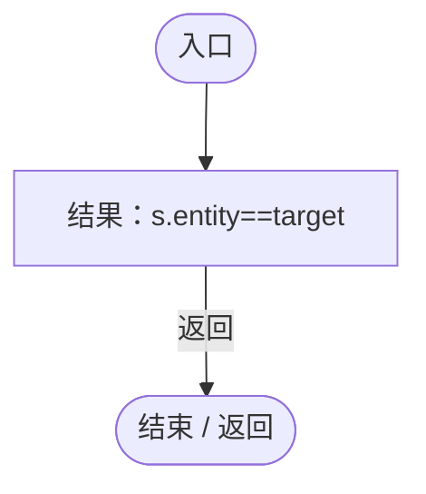

<a id="m3889e75aa74760f5"></a>

## 回调@77 · L77

`s … => 回调`


### Editor · Roslyn编译器控制流

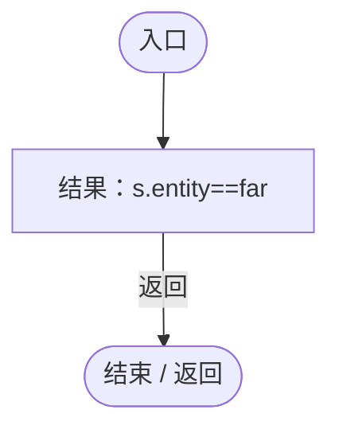

<a id="m1f13ec9bb4742f12"></a>

## 回调@81 · L81

`g … => 回调`


### Editor · Roslyn编译器控制流

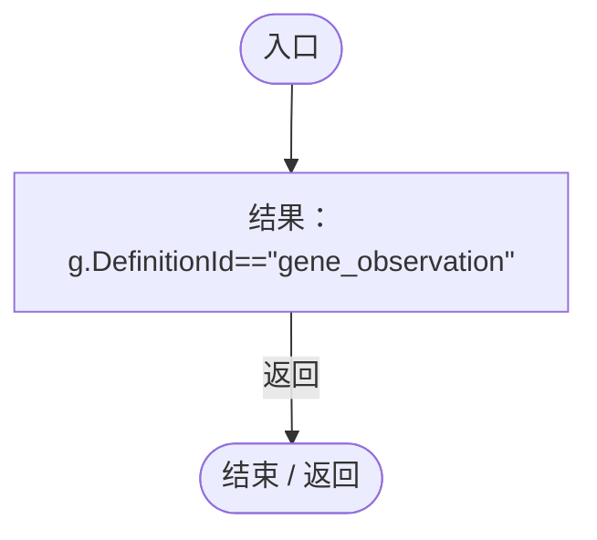

<a id="m2ba443c665273f5b"></a>

## 回调@82 · L82

`g … => 回调`


### Editor · Roslyn编译器控制流

```mermaid
flowchart TD
  b0(["入口"])
  b1["结果：g.DefinitionId==&quot;gene_observation&quot;"]
  b2(["结束 / 返回"])
  b0 --> b1
  b1 -->|"返回"| b2

```

<a id="mc3b2f07b46fc1725"></a>

## 回调@82 · L82

`s … => 回调`


### Editor · Roslyn编译器控制流

```mermaid
flowchart TD
  b0(["入口"])
  b1["结果：s.entity==newborn"]
  b2(["结束 / 返回"])
  b0 --> b1
  b1 -->|"返回"| b2

```

<a id="mf9377570dee8582b"></a>

## 回调@89 · L89

`( … => 回调`


### Editor · Roslyn编译器控制流

```mermaid
flowchart TD
  b0(["入口"])
  b1["panel=Object.FindFirstObjectByType&lt;SimulationRulesPanel&gt;();"]
  b2{"判断：panel!=null"}
  b3["panel.Card!=null"]
  b4["panel!=null"]
  b5["结果：panel!=null&amp;&amp;panel.Card!=null"]
  b6(["结束 / 返回"])
  b0 --> b1
  b1 --> b2
  b2 -->|"是"| b3
  b2 -->|"否"| b4
  b3 --> b5
  b4 --> b5
  b5 -->|"返回"| b6

```
