# EntityPossessionInput.cs

[返回总索引](../README.md) · `Runtime` · `Assets/DarwinPark/UI/EntityPossessionInput.cs`

[源文件](../../../Assets/DarwinPark/UI/EntityPossessionInput.cs) · 源码校验：`6c388185d3d3af2cd9526d980ae11c821b0c8d206c026bdfc63498c21d1332d8`

方法按源文件位置排列。事件/回调引用不表示立即执行；分支与异常说明见总索引。完整源码与可点击关系图请打开离线手册。

## forwardKey.get · L12

`public KeyCode forwardKey`

★ 适配：设置中的绑定直接用于输入，不保留另一套Inspector按键导致界面修改无效。

### Editor / Player · 语法控制结构 / 声明（非CFG）

项目内调用/回调引用：

- [ControlBindings.Get · L45](b6735f8f133ee3f4.md#mb5707e6e63a56689)（方法）

## backKey.get · L13

`public KeyCode backKey`

### Editor / Player · 语法控制结构 / 声明（非CFG）

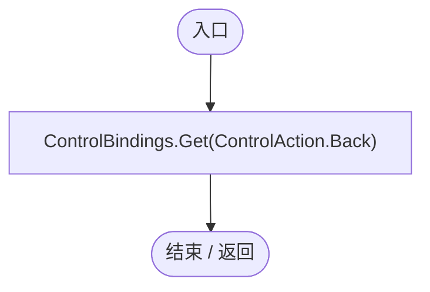

项目内调用/回调引用：

- [ControlBindings.Get · L45](b6735f8f133ee3f4.md#mb5707e6e63a56689)（方法）

## leftKey.get · L14

`public KeyCode leftKey`

### Editor / Player · 语法控制结构 / 声明（非CFG）

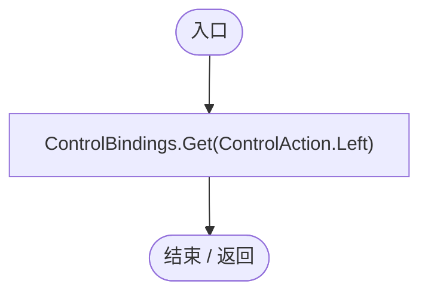

项目内调用/回调引用：

- [ControlBindings.Get · L45](b6735f8f133ee3f4.md#mb5707e6e63a56689)（方法）

## rightKey.get · L15

`public KeyCode rightKey`

### Editor / Player · 语法控制结构 / 声明（非CFG）

项目内调用/回调引用：

- [ControlBindings.Get · L45](b6735f8f133ee3f4.md#mb5707e6e63a56689)（方法）

## jumpKey.get · L16

`public KeyCode jumpKey`

### Editor / Player · 语法控制结构 / 声明（非CFG）

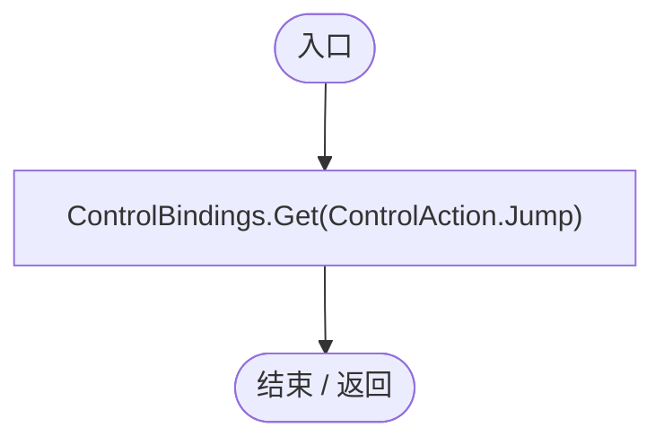

项目内调用/回调引用：

- [ControlBindings.Get · L45](b6735f8f133ee3f4.md#mb5707e6e63a56689)（方法）

## cursorKey.get · L17

`public KeyCode cursorKey`

### Editor / Player · 语法控制结构 / 声明（非CFG）

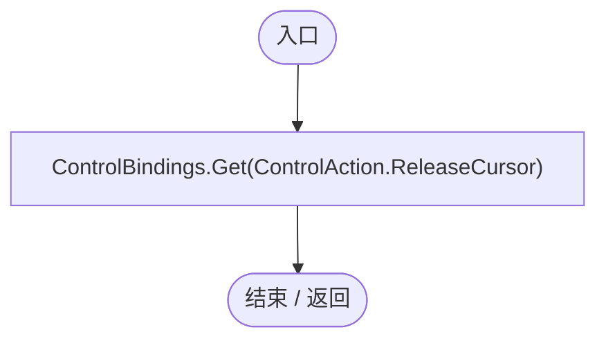

项目内调用/回调引用：

- [ControlBindings.Get · L45](b6735f8f133ee3f4.md#mb5707e6e63a56689)（方法）

## CursorReleased.get · L18

`get`

### Editor / Player · 语法控制结构 / 声明（非CFG）

## CursorReleased.set · L18

`private set`

### Editor / Player · 语法控制结构 / 声明（非CFG）

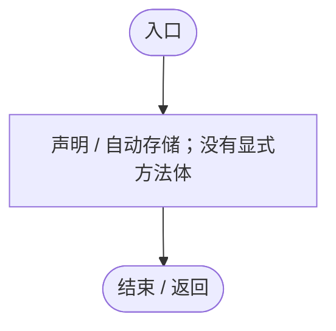

## attackMouseButton.get · L19

`public int attackMouseButton`

### Editor / Player · 语法控制结构 / 声明（非CFG）

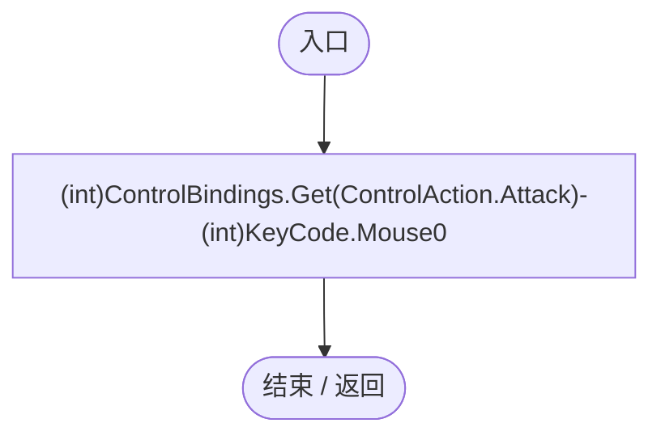

项目内调用/回调引用：

- [ControlBindings.Get · L45](b6735f8f133ee3f4.md#mb5707e6e63a56689)（方法）

## Pitch.get · L28

`public float Pitch`

### Editor / Player · 语法控制结构 / 声明（非CFG）

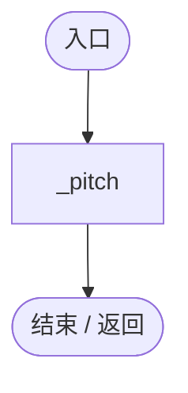

## Begin · L31

`public void Begin(EntityManualControl manual, Transform planet, float height, float distance)`

### Editor / Player · Roslyn编译器控制流

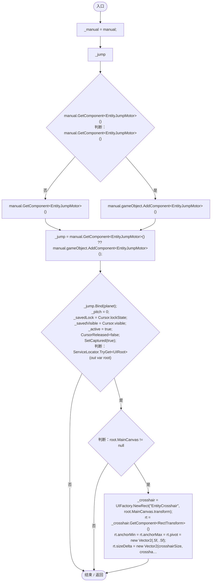

项目内调用/回调引用：

- [EntityJumpMotor.Bind · L20](fa3269c9da0aa692.md#m7322ba5e17678995)（方法）
- [EntityPossessionInput.CursorReleased.set · L18](4c12d3ae76941d37.md#m6c8af4eda9eef4d1)（访问器）
- [EntityPossessionInput.SetCaptured · L90](4c12d3ae76941d37.md#mda37563d5160977d)（方法）
- [ServiceLocator.TryGet · L26](f2fdbe9f9ccd93cb.md#m143b24e6d58471b0)（方法）
- [UIRoot.MainCanvas.get · L14](9c1421378791f0e0.md#maa2cc9baf1248477)（访问器）
- [UIFactory.NewRect · L33](dd1096a6995423db.md#med612116f3152344)（方法）
- [EntityPossessionInput.AddLine · L49](4c12d3ae76941d37.md#mae261290d4800372)（方法）

## AddLine · L49

`private void AddLine(string name, Vector2 size)`

### Editor / Player · Roslyn编译器控制流

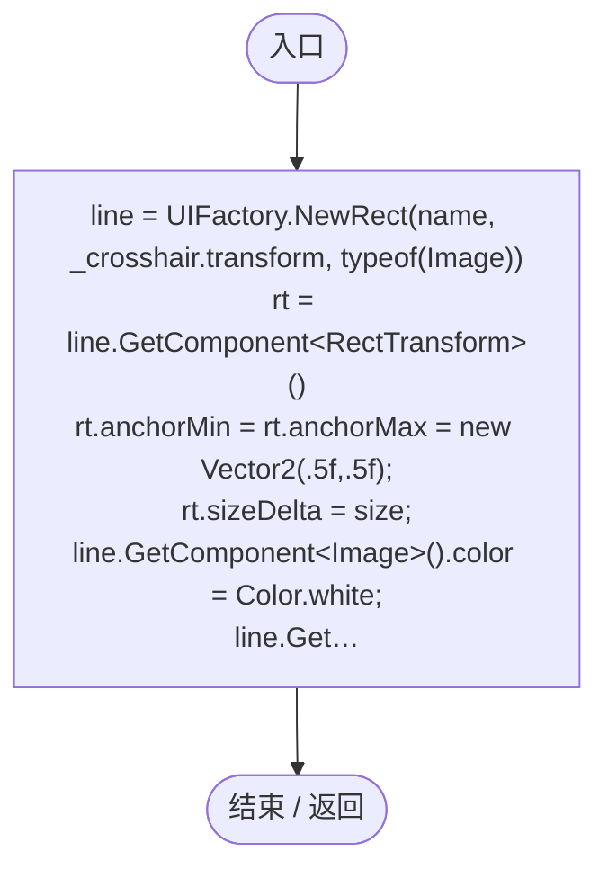

项目内调用/回调引用：

- [UIFactory.NewRect · L33](dd1096a6995423db.md#med612116f3152344)（方法）

## Tick · L55

`public void Tick(bool blocked, Vector3 up, ref Vector3 forward, ref float height, ref float distance, float minDistance, float maxDistance)`

### Editor / Player · Roslyn编译器控制流

```mermaid
flowchart TD
  b0(["入口"])
  b1{"判断：_active"}
  b2["SetCursorReleased(ControlBindings.Held(ControlAction.ReleaseCursor));"]
  b3{"判断：ServiceLocator.TryGet&lt;SimulationClock&gt;(out var clock)"}
  b4["clock.IsRunning"]
  b5["!ServiceLocator.TryGet&lt;SimulationClock&gt;(out var clock)"]
  b6["running=!ServiceLocator.TryGet&lt;SimulationClock&gt;(out var clock)&#124;&#124;clock.IsRunning"]
  b7{"blocked<br/>判断：Application.isFocused"}
  b8{"判断：GameInputGate.Blocked"}
  b9["CursorReleased"]
  b10["!Application.isFocused &#124;&#124; GameInputGate.Blocked &#124;&#124; CursorReleased"]
  b11["blocked &#124;= !Application.isFocused &#124;&#124; GameInputGate.Blocked &#124;&#124; CursorReleased;"]
  b12{"SetCaptured(!blocked);<br/>判断：_crosshair != null"}
  b13{"_crosshair<br/>判断：blocked"}
  b14["running"]
  b15["!blocked"]
  b16["_crosshair.SetActive(!blocked&amp;&amp;running);"]
  b17{"_acceptAttack<br/>判断：blocked"}
  b18{"判断：running"}
  b19["Time.frameCount&gt;_captureFrame+1"]
  b20["!blocked&amp;&amp;running&amp;&amp;Time.frameCount&gt;_captureFrame+1"]
  b21["_acceptAttack=!blocked&amp;&amp;running&amp;&amp;Time.frameCount&gt;_captureFrame+1;"]
  b22{"判断：blocked"}
  b23{"判断：running"}
  b24["_manual.SetInput(Vector3.zero, false);<br/>_manual.ClearAttack();"]
  b25{"判断：Time.frameCount &gt; _captureFrame + 1"}
  b26["forward = Quaternion.AngleAxis(Input.GetAxis(&quot;Mouse X&quot;) * lookSensitivity, up) * forward;<br/>_pitch = Mathf.Clamp(_pitch - Input.GetAxis(&quot;Mouse Y&quot;) * lookSensitivity, minPitch, maxPitch);"]
  b27{"判断：Input.GetKey(forwardKey)"}
  b28["1"]
  b29["0"]
  b30{"判断：Input.GetKey(backKey)"}
  b31["1"]
  b32["0"]
  b33["y = (Input.GetKey(forwardKey) ? 1 : 0) - (Input.GetKey(backKey) ? 1 : 0)"]
  b34{"判断：Input.GetKey(rightKey)"}
  b35["1"]
  b36["0"]
  b37{"判断：Input.GetKey(leftKey)"}
  b38["1"]
  b39["0"]
  b40["x = (Input.GetKey(rightKey) ? 1 : 0) - (Input.GetKey(leftKey) ? 1 : 0)"]
  b41{"判断：_acceptAttack"}
  b42{"判断：ControlBindings.Down(ControlAction.Attack)"}
  b43["_manual.QueueAttack();"]
  b44{"判断：running"}
  b45["_manual.ClearAttack();"]
  b46{"判断：Camera.main!=null"}
  b47["_manual.SetAim(Camera.main.ViewportPointToRay(new Vector3(.5f,.5f,0)));"]
  b48{"_manual<br/>forward * y + Vector3.Cross(up, forward) * x<br/>判断：_acceptAttack"}
  b49["ControlBindings.Held(ControlAction.Attack)"]
  b50["_acceptAttack"]
  b51["_manual.SetInput(forward * y + Vector3.Cross(up, forward) * x, _acceptAttack &amp;&amp; ControlBindings.Held(ControlAction.Attack));"]
  b52{"判断：running"}
  b53{"判断：Input.GetKeyDown(jumpKey)"}
  b54["_jump.TryJump(_manual.CanMove);"]
  b55(["结束 / 返回"])
  b0 --> b1
  b1 -->|"否"| b55
  b1 -->|"是"| b2
  b2 --> b3
  b3 -->|"是"| b4
  b3 -->|"否"| b5
  b4 --> b6
  b5 --> b6
  b6 --> b7
  b7 -->|"是"| b8
  b7 -->|"否"| b10
  b8 -->|"否"| b9
  b8 -->|"是"| b10
  b9 --> b11
  b10 --> b11
  b11 --> b12
  b12 -->|"是"| b13
  b12 -->|"否"| b17
  b13 -->|"否"| b14
  b13 -->|"是"| b15
  b14 --> b16
  b15 --> b16
  b16 --> b17
  b17 -->|"否"| b18
  b17 -->|"是"| b20
  b18 -->|"是"| b19
  b18 -->|"否"| b20
  b19 --> b21
  b20 --> b21
  b21 --> b22
  b22 -->|"否"| b23
  b22 -->|"是"| b24
  b23 -->|"否"| b24
  b23 -->|"是"| b25
  b24 --> b55
  b25 -->|"是"| b26
  b25 -->|"否"| b27
  b26 --> b27
  b27 -->|"是"| b28
  b27 -->|"否"| b29
  b28 --> b30
  b29 --> b30
  b30 -->|"是"| b31
  b30 -->|"否"| b32
  b31 --> b33
  b32 --> b33
  b33 --> b34
  b34 -->|"是"| b35
  b34 -->|"否"| b36
  b35 --> b37
  b36 --> b37
  b37 -->|"是"| b38
  b37 -->|"否"| b39
  b38 --> b40
  b39 --> b40
  b40 --> b41
  b41 -->|"是"| b42
  b41 -->|"否"| b44
  b42 -->|"是"| b43
  b42 -->|"否"| b44
  b43 --> b44
  b44 -->|"否"| b45
  b44 -->|"是"| b46
  b45 --> b46
  b46 -->|"是"| b47
  b46 -->|"否"| b48
  b47 --> b48
  b48 -->|"是"| b49
  b48 -->|"否"| b50
  b49 --> b51
  b50 --> b51
  b51 --> b52
  b52 -->|"是"| b53
  b52 -->|"否"| b55
  b53 -->|"是"| b54
  b53 -->|"否"| b55
  b54 --> b55

```

项目内调用/回调引用：

- [EntityPossessionInput.SetCursorReleased · L82](4c12d3ae76941d37.md#m931bb1228af13972)（方法）
- [ControlBindings.Held · L46](b6735f8f133ee3f4.md#md4244ab88aa8af27)（方法）
- [ServiceLocator.TryGet · L26](f2fdbe9f9ccd93cb.md#m143b24e6d58471b0)（方法）
- [SimulationClock.IsRunning.get · L22](a8f444aec9614b0a.md#m10f4fe307faca0f0)（访问器）
- [GameInputGate.Blocked.get · L8](52955daae7e592ab.md#m765763b665829633)（访问器）
- [EntityPossessionInput.CursorReleased.get · L18](4c12d3ae76941d37.md#m4c0ff7787f8b0aa3)（访问器）
- [EntityPossessionInput.SetCaptured · L90](4c12d3ae76941d37.md#mda37563d5160977d)（方法）
- [EntityManualControl.SetInput · L33](a6969896da35e1f0.md#m7c7f5613b3bebc74)（方法）
- [EntityManualControl.ClearAttack · L26](a6969896da35e1f0.md#m9a16d6f4efae7238)（方法）
- [ControlBindings.Down · L50](b6735f8f133ee3f4.md#mdf834c82033aa362)（方法）
- [EntityManualControl.QueueAttack · L24](a6969896da35e1f0.md#md160ef2315358c16)（方法）
- [EntityManualControl.SetAim · L27](a6969896da35e1f0.md#m70f09d0090a1fa41)（方法）
- [EntityJumpMotor.TryJump · L22](fa3269c9da0aa692.md#m5d4b3420e4d2918e)（方法）

## SetCursorReleased · L82

`public void SetCursorReleased(bool held)`

### Editor / Player · Roslyn编译器控制流

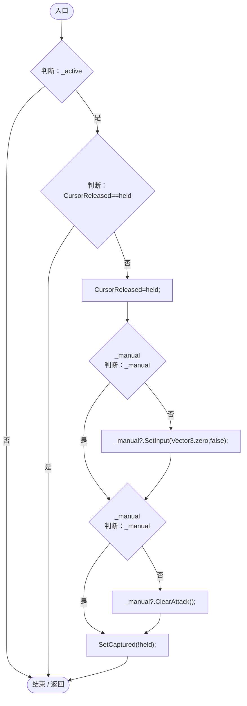

项目内调用/回调引用：

- [EntityPossessionInput.CursorReleased.get · L18](4c12d3ae76941d37.md#m4c0ff7787f8b0aa3)（访问器）
- [EntityPossessionInput.CursorReleased.set · L18](4c12d3ae76941d37.md#m6c8af4eda9eef4d1)（访问器）
- [EntityManualControl.SetInput · L33](a6969896da35e1f0.md#m7c7f5613b3bebc74)（方法）
- [EntityManualControl.ClearAttack · L26](a6969896da35e1f0.md#m9a16d6f4efae7238)（方法）
- [EntityPossessionInput.SetCaptured · L90](4c12d3ae76941d37.md#mda37563d5160977d)（方法）

## OnGUI · L83

`private void OnGUI()`

### Editor / Player · Roslyn编译器控制流

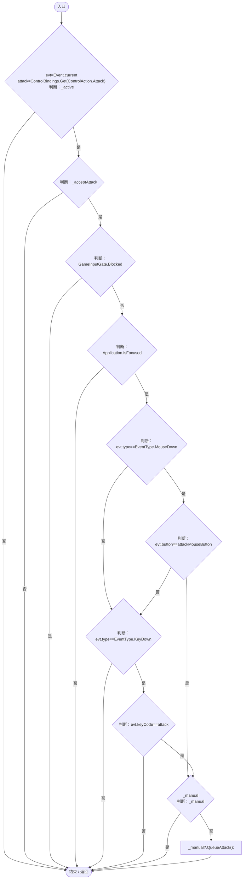

项目内调用/回调引用：

- [ControlBindings.Get · L45](b6735f8f133ee3f4.md#mb5707e6e63a56689)（方法）
- [GameInputGate.Blocked.get · L8](52955daae7e592ab.md#m765763b665829633)（访问器）
- [EntityManualControl.QueueAttack · L24](a6969896da35e1f0.md#md160ef2315358c16)（方法）

## SetCaptured · L90

`private void SetCaptured(bool captured)`

### Editor / Player · Roslyn编译器控制流

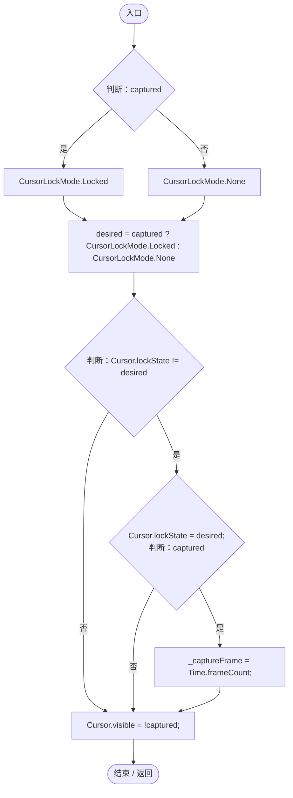

## Suspend · L98

`public void Suspend()`

★ 适配：暂停菜单释放鼠标但保留当前第一人称目标，返回时继续同一视角。

### Editor / Player · Roslyn编译器控制流

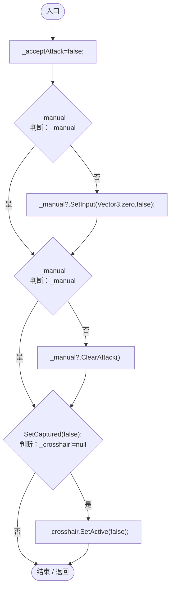

项目内调用/回调引用：

- [EntityManualControl.SetInput · L33](a6969896da35e1f0.md#m7c7f5613b3bebc74)（方法）
- [EntityManualControl.ClearAttack · L26](a6969896da35e1f0.md#m9a16d6f4efae7238)（方法）
- [EntityPossessionInput.SetCaptured · L90](4c12d3ae76941d37.md#mda37563d5160977d)（方法）

## End · L99

`public void End()`

### Editor / Player · Roslyn编译器控制流

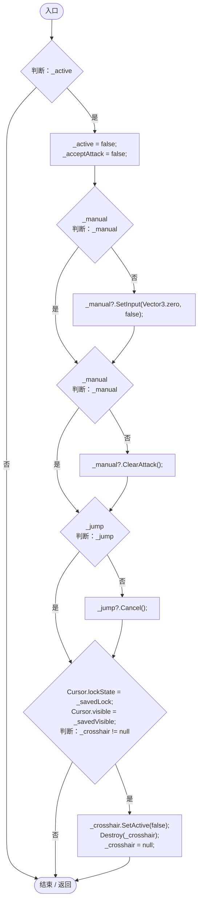

项目内调用/回调引用：

- [EntityManualControl.SetInput · L33](a6969896da35e1f0.md#m7c7f5613b3bebc74)（方法）
- [EntityManualControl.ClearAttack · L26](a6969896da35e1f0.md#m9a16d6f4efae7238)（方法）
- [EntityJumpMotor.Cancel · L49](fa3269c9da0aa692.md#m74e8ff8f50ccc15b)（方法）

## OnApplicationFocus · L107

`private void OnApplicationFocus(bool focused)`

### Editor / Player · Roslyn编译器控制流

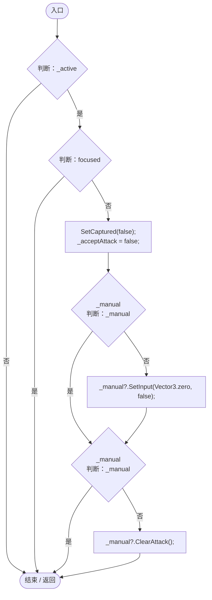

项目内调用/回调引用：

- [EntityPossessionInput.SetCaptured · L90](4c12d3ae76941d37.md#mda37563d5160977d)（方法）
- [EntityManualControl.SetInput · L33](a6969896da35e1f0.md#m7c7f5613b3bebc74)（方法）
- [EntityManualControl.ClearAttack · L26](a6969896da35e1f0.md#m9a16d6f4efae7238)（方法）

## OnDisable · L109

`private void OnDisable()`

### Editor / Player · Roslyn编译器控制流

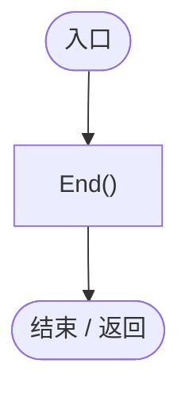

项目内调用/回调引用：

- [EntityPossessionInput.End · L99](4c12d3ae76941d37.md#ma1493f8d0943d794)（方法）
