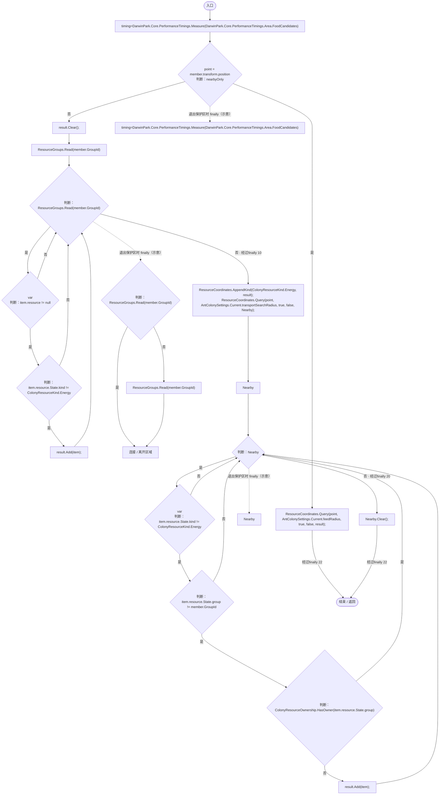

# ColonyFoodCandidates.cs

[返回总索引](../README.md) · `Runtime` · `Assets/DarwinPark/Entities/Ecology/ColonyFoodCandidates.cs`

[源文件](../../../Assets/DarwinPark/Entities/Ecology/ColonyFoodCandidates.cs) · 源码校验：`076981cbe177b7f95430317f62facf83750b1033cbfc4807bcbd07bd7ae8d4b0`

方法按源文件位置排列。事件/回调引用不表示立即执行；分支与异常说明见总索引。完整源码与可点击关系图请打开离线手册。

## Fill · L10

`public static void Fill(AntColonyMember member, bool nearbyOnly, List<ResourceCoordinate> result)`

### Editor / Player · Roslyn编译器控制流

项目内调用/回调引用：

- [PerformanceTimings.Measure · L25](a8403a4c7503726d.md#m36fde3c234084192)（方法）
- [ResourceCoordinates.Query · L69](93d731ac01e3af48.md#mf169cf6ba025c1ca)（方法）
- [AntColonySettings.Current.get · L31](cb0a937e97c8fbb3.md#mcd121159f407ccdf)（访问器）
- [ResourceGroups.Read · L9](97a3c8522367343a.md#m155d5ab724041bf7)（方法）
- [ColonyResource.State.get · L24](293dbaecfff4b585.md#m41824f1a0e160aa5)（访问器）
- [ResourceCoordinates.AppendKind · L88](93d731ac01e3af48.md#m167af02287b0d8c5)（方法）
- [ColonyResourceOwnership.HasOwner · L14](2988679fde59fc87.md#mc9fb9c75e5ef3aa5)（方法）
