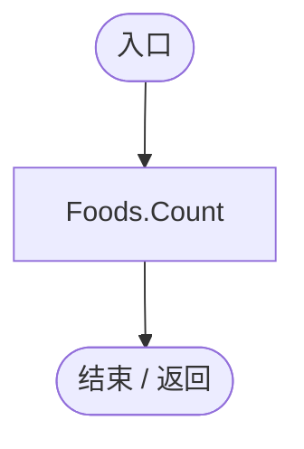
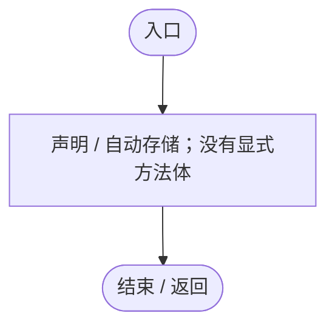
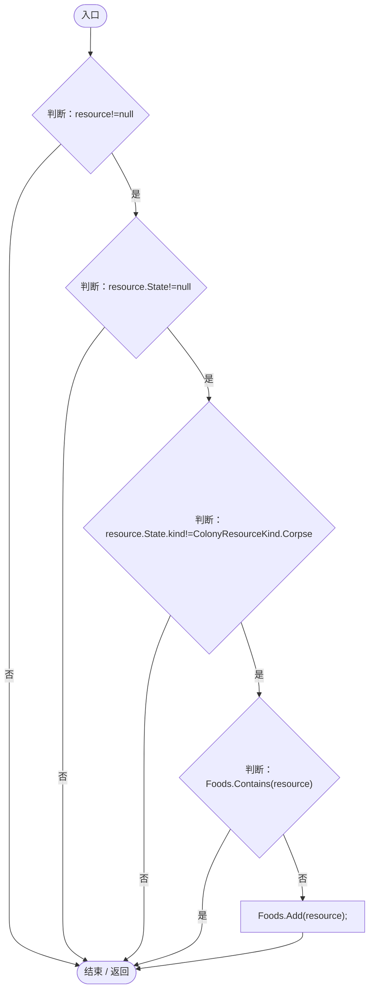
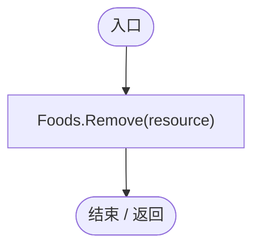
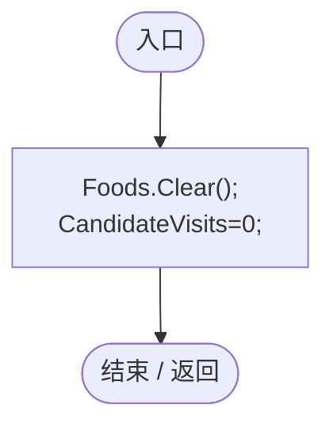
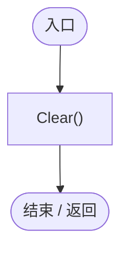
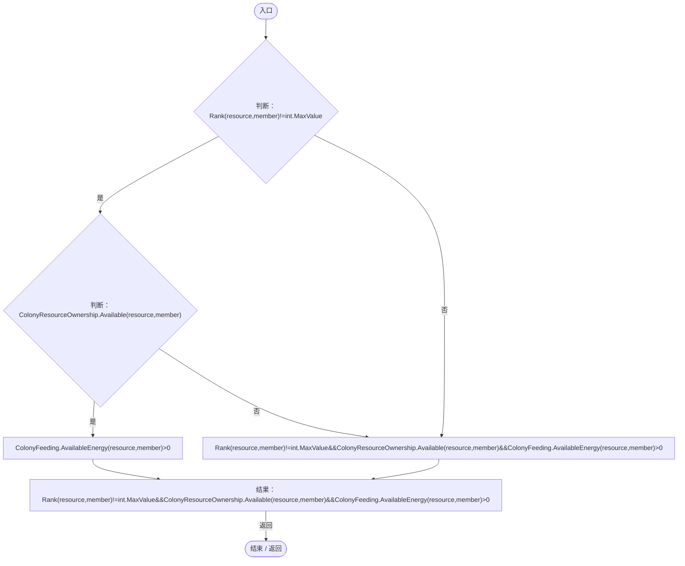
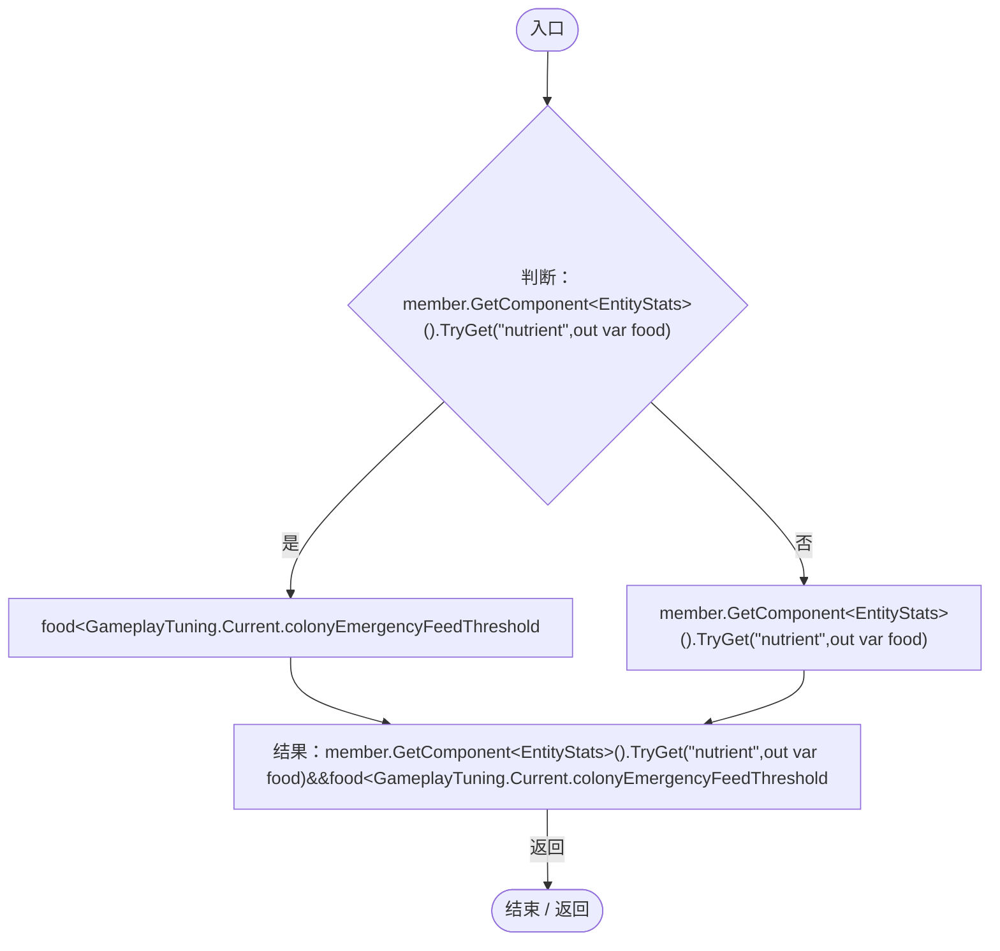
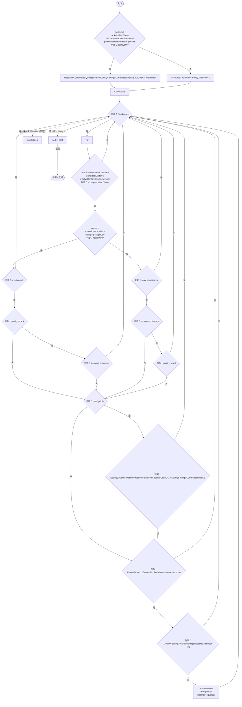

```mermaid
flowchart TD
  b0(["入口"])
  b1{"判断：resource==null"}
  b2{"判断：resource.isActiveAndEnabled"}
  b3{"判断：resource.State.energy&lt;=0"}
  b4{"判断：resource.State.kind==ColonyResourceKind.Corpse"}
  b5["结果：int.MaxValue"]
  b6{"判断：member.Role==AntRole.Queen"}
  b7{"判断：member.Young"}
  b8["ColonyResourceKind.Nursery"]
  b9["ColonyResourceKind.Supply"]
  b10["preferred=member.Role==AntRole.Queen&#124;&#124;member.Young?ColonyResourceKind.Nursery:ColonyResourceKind.Supply"]
  b11{"判断：resource.State.kind==preferred"}
  b12{"判断：resource.State.kind==ColonyResourceKind.Energy"}
  b13["0"]
  b14{"判断：GameplayTuning.Current.colonyShareBackupFood"}
  b15["1"]
  b16["int.MaxValue"]
  b17["结果：resource.State.kind==preferred&#124;&#124;resource.State.kind==ColonyResourceKind.Energy?0:GameplayTuning.Current.colonyShareBackupFood?1:int.MaxValue"]
  b18(["结束 / 返回"])
  b0 --> b1
  b1 -->|"否"| b2
  b1 -->|"是"| b5
  b2 -->|"是"| b3
  b2 -->|"否"| b5
  b3 -->|"否"| b4
  b3 -->|"是"| b5
  b4 -->|"是"| b5
  b4 -->|"否"| b6
  b5 -->|"返回"| b18
  b6 -->|"否"| b7
  b6 -->|"是"| b8
  b7 -->|"是"| b8
  b7 -->|"否"| b9
  b8 --> b10
  b9 --> b10
  b10 --> b11
  b11 -->|"否"| b12
  b11 -->|"是"| b13
  b12 -->|"是"| b13
  b12 -->|"否"| b14
  b13 --> b17
  b14 -->|"是"| b15
  b14 -->|"否"| b16
  b15 --> b17
  b16 --> b17
  b17 -->|"返回"| b18

```

# ColonyFoodSources.cs

[返回总索引](../README.md) · `Runtime` · `Assets/DarwinPark/Entities/Ecology/ColonyFoodSources.cs`

[源文件](../../../Assets/DarwinPark/Entities/Ecology/ColonyFoodSources.cs) · 源码校验：`0c6ec359981d171ef6fac87781cfb475d52b62cc667fd59e62507d84e9c42a82`

方法按源文件位置排列。事件/回调引用不表示立即执行；分支与异常说明见总索引。完整源码与可点击关系图请打开离线手册。

## Count.get · L13

`public static int Count`

### Editor / Player · 语法控制结构 / 声明（非CFG）

## CandidateVisits.get · L14

`get`

### Editor / Player · 语法控制结构 / 声明（非CFG）

## CandidateVisits.set · L14

`private set`

### Editor / Player · 语法控制结构 / 声明（非CFG）

## Register · L15

`public static void Register(ColonyResource resource)`

### Editor / Player · Roslyn编译器控制流

项目内调用/回调引用：

- [ColonyResource.State.get · L24](293dbaecfff4b585.md#m41824f1a0e160aa5)（访问器）

## Remove · L17

`public static void Remove(ColonyResource resource)`

### Editor / Player · Roslyn编译器控制流

## Clear · L18

`public static void Clear()`

### Editor / Player · Roslyn编译器控制流

项目内调用/回调引用：

- [ColonyFoodSources.CandidateVisits.set · L14](4c419a1a067d428c.md#mb736b92c42c88939)（访问器）

## Reset · L19

`[RuntimeInitializeOnLoadMethod(RuntimeInitializeLoadType.SubsystemRegistration)]private static void Reset()`

### Editor / Player · Roslyn编译器控制流

项目内调用/回调引用：

- [ColonyFoodSources.Clear · L18](4c419a1a067d428c.md#m1ded72e671d91ff7)（方法）

## Rank · L20

`private static int Rank(ColonyResource resource,AntColonyMember member)`

### Editor / Player · Roslyn编译器控制流

项目内调用/回调引用：

- [ColonyResource.State.get · L24](293dbaecfff4b585.md#m41824f1a0e160aa5)（访问器）
- [AntColonyMember.Role.get · L38](baebd85c05598377.md#mab30d459d599e4df)（访问器）
- [GameplayTuning.Current.get · L44](db546e5713b32d53.md#m5713e7f86902b6fa)（访问器）

## Usable · L26

`public static bool Usable(ColonyResource resource,AntColonyMember member)`

### Editor / Player · Roslyn编译器控制流

项目内调用/回调引用：

- [ColonyFoodSources.Rank · L20](4c419a1a067d428c.md#m95daaf5446fc7dd6)（方法）
- [ColonyResourceOwnership.Available · L23](2988679fde59fc87.md#ma3b7caf13a1f8423)（方法）
- [ColonyFeeding.AvailableEnergy · L29](2cb56c08d08ff8ec.md#m39bf48fc3c592882)（方法）

## Urgent · L28

`public static bool Urgent(AntColonyMember member)`

### Editor / Player · Roslyn编译器控制流

项目内调用/回调引用：

- [EntityStats.TryGet · L90](75aa86a368efdf24.md#m24ee1433e4a70d94)（方法）
- [GameplayTuning.Current.get · L44](db546e5713b32d53.md#m5713e7f86902b6fa)（访问器）

## Nearest · L29

`public static ColonyResource Nearest(AntColonyMember member,bool nearbyOnly)`

### Editor / Player · Roslyn编译器控制流

项目内调用/回调引用：

- [ResourceCoordinates.Query · L58](93d731ac01e3af48.md#md13e92bc2b759c8f)（方法）
- [AntColonySettings.Current.get · L31](cb0a937e97c8fbb3.md#mcd121159f407ccdf)（访问器）
- [ResourceCoordinates.Food · L72](93d731ac01e3af48.md#m831c8361da1ade54)（方法）
- [ColonyFoodSources.CandidateVisits.set · L14](4c419a1a067d428c.md#mb736b92c42c88939)（访问器）
- [ColonyFoodSources.CandidateVisits.get · L14](4c419a1a067d428c.md#m1ba5574cdb12eab4)（访问器）
- [ColonyFoodSources.Rank · L20](4c419a1a067d428c.md#m95daaf5446fc7dd6)（方法）
- [EcologyQueries.Distance · L42](bdf7ccc2c9c0452f.md#mba9c3e3c95d0f2dd)（方法）
- [ColonyResourceOwnership.Available · L23](2988679fde59fc87.md#ma3b7caf13a1f8423)（方法）
- [ColonyFeeding.AvailableEnergy · L29](2cb56c08d08ff8ec.md#m39bf48fc3c592882)（方法）
