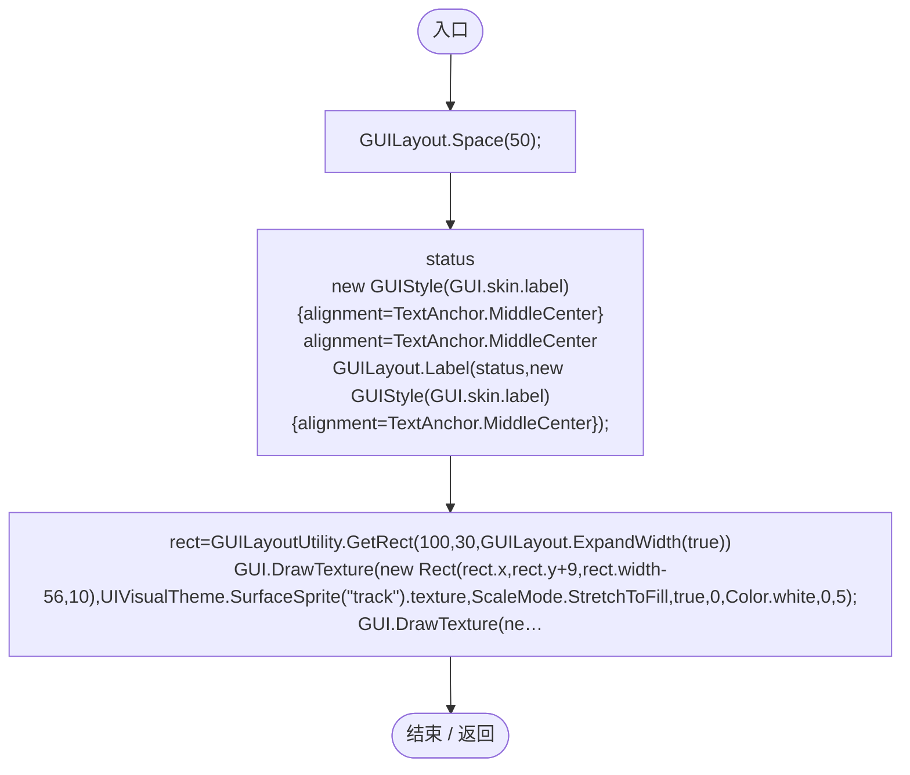

# WorldLoadingView.cs

[返回总索引](../README.md) · `Runtime` · `Assets/DarwinPark/UI/WorldLoadingView.cs`

[源文件](../../../Assets/DarwinPark/UI/WorldLoadingView.cs) · 源码校验：`e69c7adac16cec79bbe647920e9b286aaa42905993afeadf093eb7d78cee236e`

方法按源文件位置排列。事件/回调引用不表示立即执行；分支与异常说明见总索引。完整源码与可点击关系图请打开离线手册。

## Draw · L9

`public static void Draw(string status,float progress,string caption="正在准备世界")`

### Editor / Player · Roslyn编译器控制流

项目内调用/回调引用：

- [UIVisualTheme.SurfaceSprite · L45](ca525a798a08f966.md#md3ae1d7fd207ae2f)（方法）
