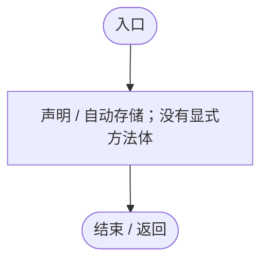
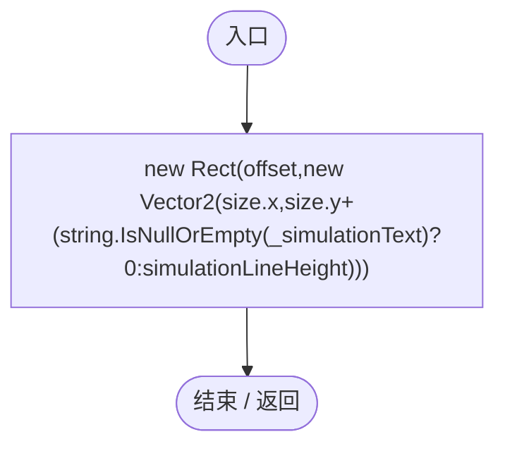
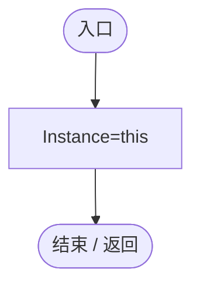
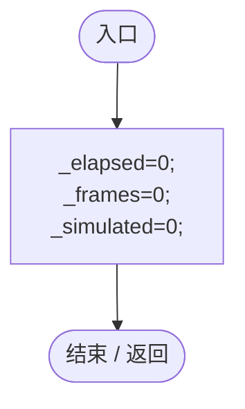
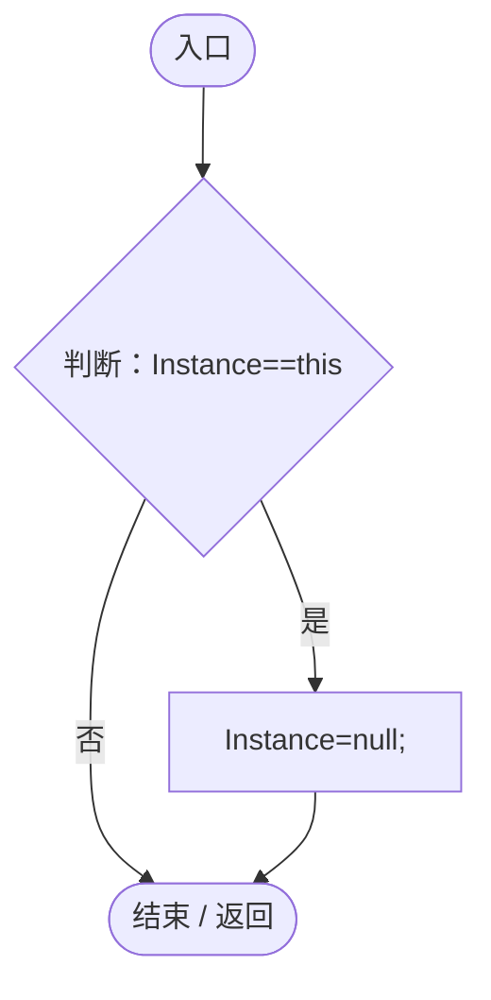
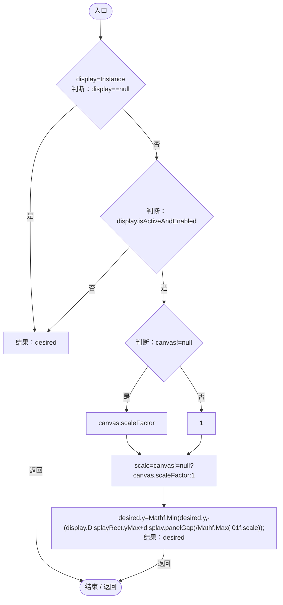
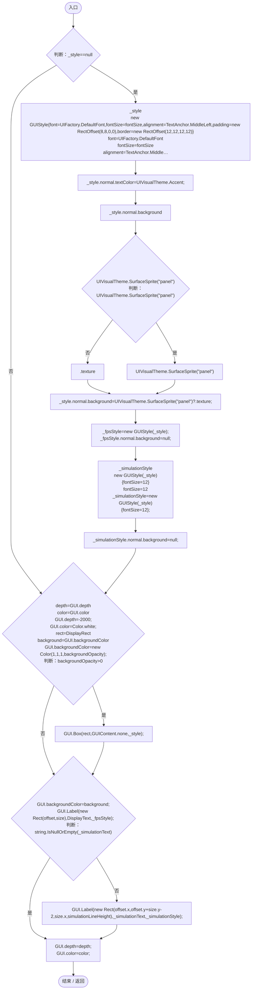

```mermaid
flowchart TD
  b0(["入口"])
  b1["ServiceLocator.TryGet&lt;SimulationClock&gt;(out var clock);"]
  b2{"_simulated<br/>判断：clock!=null"}
  b3["clock.GameDeltaTime"]
  b4["0"]
  b5["_simulated+=clock!=null?clock.GameDeltaTime:0;"]
  b6{"_elapsed+=Time.unscaledDeltaTime;<br/>_frames++;<br/>判断：_elapsed&lt;Mathf.Max(.1f,sampleInterval)"}
  b7["CurrentFps=_frames/_elapsed;"]
  b8{"判断：CurrentFps&lt;1"}
  b9["CurrentFps.ToString(&quot;F2&quot;)"]
  b10["CurrentFps.ToString(&quot;F0&quot;)"]
  b11["fps=CurrentFps&lt;1?CurrentFps.ToString(&quot;F2&quot;):CurrentFps.ToString(&quot;F0&quot;)"]
  b12["DisplayText=$&quot;FPS {fps} &#124; {_elapsed*1000/_frames:F1} ms&quot;;"]
  b13{"_simulationText<br/>判断：clock!=null"}
  b14{"判断：clock.IsRunning"}
  b15{"判断：clock.PendingGameTime&gt;clock.maximumGameDelta"}
  b16["$&quot;模拟 {_simulated/_elapsed:F1}× · 待算 {clock.PendingGameTime:F1}s&quot;"]
  b17["null"]
  b18["_simulationText=clock!=null&amp;&amp;clock.IsRunning&amp;&amp;clock.PendingGameTime&gt;clock.maximumGameDelta?$&quot;模拟 {_simulated/_elapsed:F1}× · 待算 {clock.PendingGameTime:F1}s&quot;:null;"]
  b19["SampleCount++;<br/>_elapsed=0;<br/>_frames=0;<br/>_simulated=0;"]
  b20(["结束 / 返回"])
  b0 --> b1
  b1 --> b2
  b2 -->|"是"| b3
  b2 -->|"否"| b4
  b3 --> b5
  b4 --> b5
  b5 --> b6
  b6 -->|"是"| b20
  b6 -->|"否"| b7
  b7 --> b8
  b8 -->|"是"| b9
  b8 -->|"否"| b10
  b9 --> b11
  b10 --> b11
  b11 --> b12
  b12 --> b13
  b13 -->|"是"| b14
  b13 -->|"否"| b17
  b14 -->|"是"| b15
  b14 -->|"否"| b17
  b15 -->|"是"| b16
  b15 -->|"否"| b17
  b16 --> b18
  b17 --> b18
  b18 --> b19
  b19 --> b20

```

# FrameRateDisplay.cs

[返回总索引](../README.md) · `Runtime` · `Assets/DarwinPark/UI/FrameRateDisplay.cs`

[源文件](../../../Assets/DarwinPark/UI/FrameRateDisplay.cs) · 源码校验：`946412de9168357f71a2b2ca4a708803cef7c498a034a8c0d04b3134e7600e5c`

方法按源文件位置排列。事件/回调引用不表示立即执行；分支与异常说明见总索引。完整源码与可点击关系图请打开离线手册。

## Instance.get · L13

`get`

### Editor / Player · 语法控制结构 / 声明（非CFG）

## Instance.set · L13

`private set`

### Editor / Player · 语法控制结构 / 声明（非CFG）

## CurrentFps.get · L14

`get`

### Editor / Player · 语法控制结构 / 声明（非CFG）

## CurrentFps.set · L14

`private set`

### Editor / Player · 语法控制结构 / 声明（非CFG）

## SampleCount.get · L15

`get`

### Editor / Player · 语法控制结构 / 声明（非CFG）

## SampleCount.set · L15

`private set`

### Editor / Player · 语法控制结构 / 声明（非CFG）

## DisplayText.get · L16

`get`

### Editor / Player · 语法控制结构 / 声明（非CFG）

## DisplayText.set · L16

`private set`

### Editor / Player · 语法控制结构 / 声明（非CFG）

## DisplayRect.get · L18

`public Rect DisplayRect`

### Editor / Player · 语法控制结构 / 声明（非CFG）

## Awake · L19

`private void Awake()`

### Editor / Player · Roslyn编译器控制流

项目内调用/回调引用：

- [FrameRateDisplay.Instance.set · L13](4e898f3c11cb4578.md#m5013f3c804aaaf2b)（访问器）

## Update · L20

`private void Update()`

### Editor / Player · Roslyn编译器控制流

项目内调用/回调引用：

- [ServiceLocator.TryGet · L26](f2fdbe9f9ccd93cb.md#m143b24e6d58471b0)（方法）
- [SimulationClock.GameDeltaTime.get · L26](a8f444aec9614b0a.md#me7f11abae18a4f2d)（访问器）
- [FrameRateDisplay.CurrentFps.set · L14](4e898f3c11cb4578.md#m7e6968b08accf0ec)（访问器）
- [FrameRateDisplay.CurrentFps.get · L14](4e898f3c11cb4578.md#mc5ef3bb75f8cc8f8)（访问器）
- [FrameRateDisplay.DisplayText.set · L16](4e898f3c11cb4578.md#m881d3bd82e5a6b4a)（访问器）
- [SimulationClock.IsRunning.get · L22](a8f444aec9614b0a.md#m10f4fe307faca0f0)（访问器）
- [FrameRateDisplay.SampleCount.set · L15](4e898f3c11cb4578.md#m86a1c3448f7109f4)（访问器）
- [FrameRateDisplay.SampleCount.get · L15](4e898f3c11cb4578.md#m900f6e2616872b85)（访问器）

## OnApplicationFocus · L30

`private void OnApplicationFocus(bool focused)`

### Editor / Player · Roslyn编译器控制流

## OnDestroy · L31

`private void OnDestroy()`

### Editor / Player · Roslyn编译器控制流

项目内调用/回调引用：

- [FrameRateDisplay.Instance.get · L13](4e898f3c11cb4578.md#m7dff03e4b726493b)（访问器）
- [FrameRateDisplay.Instance.set · L13](4e898f3c11cb4578.md#m5013f3c804aaaf2b)（访问器）

## ReserveTop · L32

`public static Vector2 ReserveTop(Vector2 desired,Canvas canvas)`

### Editor / Player · Roslyn编译器控制流

项目内调用/回调引用：

- [FrameRateDisplay.Instance.get · L13](4e898f3c11cb4578.md#m7dff03e4b726493b)（访问器）

## OnGUI · L38

`private void OnGUI()`

### Editor / Player · Roslyn编译器控制流

项目内调用/回调引用：

- [UIFactory.DefaultFont.get · L17](dd1096a6995423db.md#m89af6843ae7629d3)（访问器）
- [UIVisualTheme.SurfaceSprite · L45](ca525a798a08f966.md#md3ae1d7fd207ae2f)（方法）
- [FrameRateDisplay.DisplayText.get · L16](4e898f3c11cb4578.md#m017379c0bfd5bc3e)（访问器）
